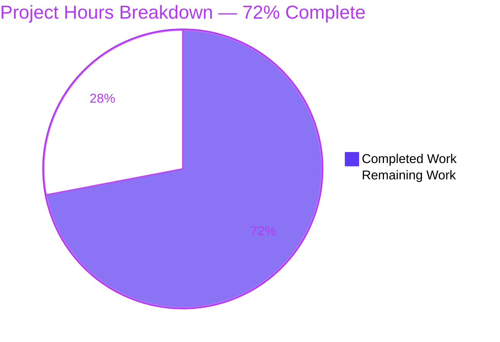
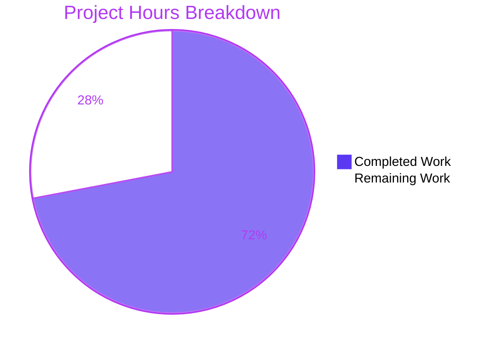
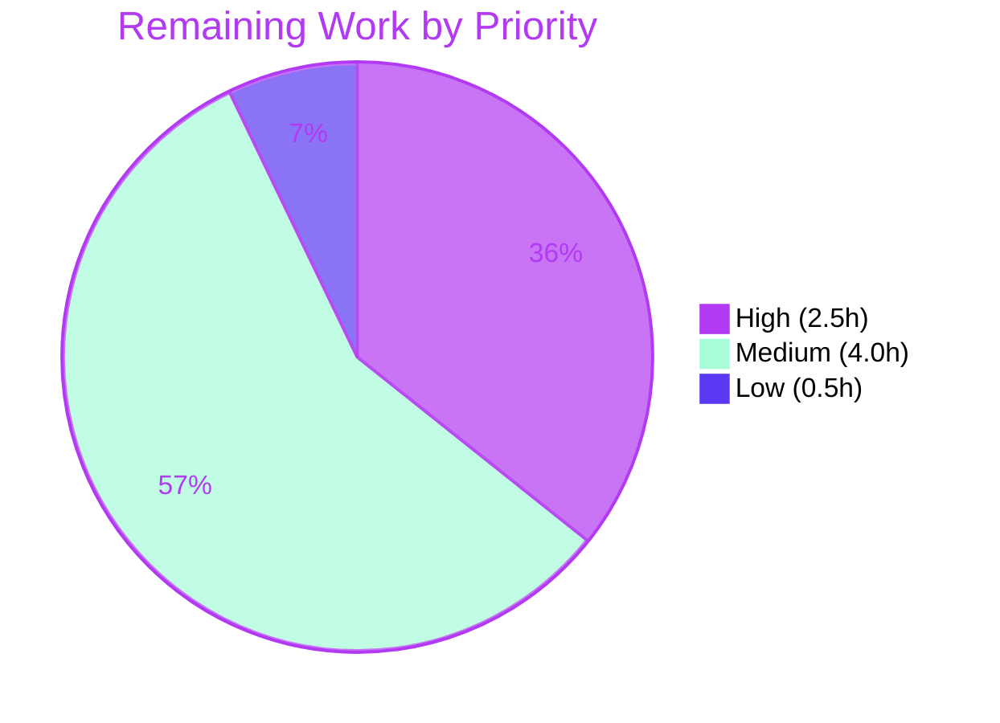

# 1. Executive Summary

## 1.1 Project Overview

`repo_with_Vul_1210` is a minimal fixture repository whose entire tracked content is a manifest and its lockfile. The work was a supply-chain fix: the manifest pinned lodash 4.17.21, inside the affected range of CVE-2026-2950 / GHSA-f23m-r3pf-42rh — prototype pollution via an array-path bypass in `_.unset` and `_.omit` (CWE-1321). That dependency now resolves to an exact, registry-verified 4.18.1, and nothing else changed. Anyone installing these records receives a release the registry attributes no advisory to.

## 1.2 Completion Status

**72% complete — 18 hours of 25.**

| Metric | Hours |
| --- | --- |
| Total Hours | 25 |
| Completed Hours (AI + Manual) | 18 |
| Remaining Hours | 7 |

Calculation: 18h ÷ 25h = **72.0%**. The universe is the 20 requirements this work was scoped against — 19 delivered in full, 1 delivered here with one consumer-facing consequence outstanding (Section 5.2) — plus six release-readiness items still open (Section 2.2).



Completed = Dark Blue (#5B39F3); Remaining = White (#FFFFFF).

## 1.3 Key Accomplishments

- [x] lodash moved from 4.17.21 to the exact pin 4.18.1 in both records — two files, five lines.
- [x] CVE-2026-2950 closed, proved by differential against a tree rebuilt at 4.17.21.
- [x] The lockfile record is registry-issued — tarball URL and sha512 digest match the published values.
- [x] One lodash resolves, at 4.18.1, at any depth.
- [x] The array-path bypass is unreachable in the installed artifact: 36 payload forms across three prototypes, 0 prototype deletions, against 17 before.
- [x] Every pre-existing declaration is intact, including `lockfileVersion` 3, `requires` true and the MIT licence.
- [x] Reversible in one command to the pre-change revision `f9d73f6`.
- [x] No source, test, CI, configuration or documentation file was added.

## 1.4 Critical Unresolved Issues

Open items: **6 of 26 tracked** — the 20 requirements this work was scoped against, plus 6 follow-through items on the path to production; all six are listed below.

| Issue | Impact | Owner | ETA |
| --- | --- | --- | --- |
| The upstream source snapshot ref (`origin/main`) still pins and resolves lodash 4.17.15 | A scan or consumer reading that ref still reports CVE-2026-2950 | Development team | Before release |
| Dependency scanning pointed at the canonical record names finds no project at all | The closed finding stays invisible to the tool that raised it | DevOps / security tooling | Before release |
| Release-time re-verification of the install, tree and advisory gates has not been run for a release | The advisory verdict is a networked, point-in-time result | Release owner | At release |
| The exact pin has no recorded review decision yet | A future re-rating would arrive without a scheduled review | Development team | Next dependency review |
| Consumer call sites passing `constructor` / `prototype` path segments to `_.unset` and `_.omit` are unreviewed | Those calls change behaviour silently after the upgrade | Consumer owners | This sprint |
| No dependency-hygiene runbook entry exists for future dependency changes | The next change may be made by hand-editing the record instead of regenerating it | Development team | Next dependency change |

## 1.5 Access Issues

No access issues identified. The registry is reachable anonymously and the change needs no credential, environment variable, port or service.

## 1.6 Recommended Next Steps

1. **[High]** Retire the affected records on `origin/main` and re-scan that ref (1.0h).
2. **[High]** Point the dependency scanner at the repository's actual record names (1.5h).
3. **[Medium]** Re-run the three gates at release and complete the pin review (1.5h).
4. **[Medium]** Review consumer call sites using `constructor` or `prototype` path segments (2.5h).
5. **[Low]** Record the dependency-hygiene runbook entry (0.5h).

# 2. Project Hours Breakdown

## 2.1 Completed Work Detail

Every component below is a delivered byte, an executed command or an observed comparison, and each traces to a named requirement of the change.

| Component | Hours | Description |
| --- | --- | --- |
| Advisory research and target-version selection | 4.0 | CVE-2026-2950 triage, affected-range analysis, the two-candidate set (4.18.0 against 4.18.1), registry standing and deprecation analysis, and the exclusion decisions for the two incidental advisories. |
| Manifest dependency-literal move | 1.0 | The exact pin now stands at `package (3).json:11`, with the key order and every other field preserved. |
| Lockfile resolution-record regeneration | 2.0 | The record was written by the package manager from canonical-name working copies and copied back verbatim; byte-identical regeneration was proved twice. |
| Atomic-pair integrity and diff-surface control | 1.0 | Three-literal agreement, the five-line diff, key-set, key-order and licence preservation, and unchanged record names. |
| Install, resolved-tree and advisory gates | 2.0 | `npm ci` exits 0 with `found 0 vulnerabilities`, a sole `lodash@4.18.1` resolves, and the machine-checkable audit assertion reports all-zero counts. |
| Closure differential against the affected baseline | 2.0 | A tree rebuilt at 4.17.21 reproduces the finding with the named advisory; the delivered records report none. |
| Provenance and artifact-integrity enforcement | 2.0 | Registry parity on the tarball URL and the sha512 digest, independent recomputation of that digest from the published artifact, and refusal of a tampered digest. |
| Resolved-artifact behaviour exercise | 2.0 | 36 prototype-path payload combinations per version across the Object, String and Number prototypes, plus 15 ordinary-path assertions per version. |
| Scope, exclusion and absence confirmation | 1.0 | No added artifact of any kind, no call sites, one record set, and no credential material in the tracked content. |
| Rollback path and diff reviewability | 1.0 | The pre-change revision was identified and the restore command exercised; the five-line diff is reviewable as version metadata only. |
| **Total** | **18.0** | |

Confidence is high on every row above: each rests on a file that can be opened, a command that was run, or a comparison that was made. The figure is dominated by verification (9.0h of the 18.0h), which is proportionate for a dependency change whose only guarantee is the resolved version, the advisory report and the regenerated record.

## 2.2 Remaining Work Detail

Each row traces to a requirement of the change or to a standard release-readiness activity for this deliverable.

| Category | Hours | Priority |
| --- | --- | --- |
| Retire the affected records that remain on the upstream source snapshot ref (`origin/main`) and re-scan it | 1.0 | High |
| Point the dependency-scanning integration at the repository's actual record names and confirm it reports the pinned version | 1.5 | High |
| Release-time re-verification of the install, resolved-tree and advisory gates | 0.5 | Medium |
| Pin review — confirm the exact version is still the registry's current, non-deprecated release clear of advisories | 1.0 | Medium |
| Consumer compatibility review of the changed `_.unset` / `_.omit` path semantics | 2.5 | Medium |
| Dependency-hygiene runbook entry for future dependency changes | 0.5 | Low |
| **Total** | **7.0** | |

Confidence is medium on the consumer compatibility review: the size depends on how many consumers install this tree and whether any of their calls pass a path segment literally named `constructor` or `prototype`. The remaining rows are small, well-defined configuration and verification steps.

# 3. Test Results

750 discrete checks were executed against the delivered records and against the artifact they resolve: 750 reached their expected outcome and 0 failed. The repository declares no test framework, test script, linter or coverage runner, so the assurance rests on the package manager's own commands, on direct exercise of the installed artifact under Node, and on the registry's records — and the Coverage column states that absence rather than a fabricated percentage.

| Area / Category | Framework | Tests | Passed | Failed | Coverage | What This Proves |
| --- | --- | --- | --- | --- | --- | --- |
| Declaration contract, exact pin, record regeneration and format continuity | npm 11.18.0 over Node v22.23.3, `npm pkg get`, strict JSON parse | 113 | 113 | 0 | No coverage runner is declared | The manifest and its lockfile agree exactly, the record is reproducible from the pin alone, and every pre-existing declaration survives. |
| Install agreement, atomicity and toolchain values | `npm ci`, `npm install`, `npm run` | 85 | 85 | 0 | No coverage runner is declared | A partial version move refuses with `EUSAGE` instead of installing or leaving the finding quietly open. |
| Target-version standing and affected-range adjudication | registry packument, advisory bulk API, `npm view` | 79 | 79 | 0 | No coverage runner is declared | The installed release is the registry's current, non-deprecated one, carries no advisory, and sits outside the affected range. |
| Resolution-record provenance and artifact-integrity enforcement | record regeneration, sha512 recomputation, digest-mutation probes | 39 | 39 | 0 | No coverage runner is declared | The recorded URL and digest are the registry's own and the installer verifies them instead of trusting them. |
| Record-pair atomicity and repository state | refusal counterfactuals, worktree/index/HEAD probes | 37 | 37 | 0 | No coverage runner is declared | The pair cannot be split, and the tree carries one record set with no affected version literal left behind. |
| Advisory closure proved against the affected baseline | `npm audit`, `npm audit --json`, advisory bulk API | 118 | 118 | 0 | No coverage runner is declared | An affected tree reproduces the finding under its named advisory; the delivered records report none. |
| Whole-tree gates, reproducibility, hostile input and environment | `npm ci` / `npm audit` / `npm run`, offline and concurrent installs, malformed and hostile version specs | 165 | 165 | 0 | No coverage runner is declared | The declared change is the whole change, the records install reproducibly, and malformed input fails fast without side effects. |
| Delivered-artifact behaviour under direct exercise | Node against the installed artifact, both versions | 114 | 114 | 0 | No coverage runner is declared | The installed release blocks every prototype path payload the pre-change release allowed, and ordinary path semantics are unchanged apart from the documented case. |

**Not covered**

- No committed test, fixture, runner or gate exists: the project declares only a `start` script, so nothing runs these checks automatically and a human must run them.
- The declared entry point does not exist — `main` and `start` name `index.js`, which the repository has never contained — so no application runtime, start-up sequence or request path is covered by any test.
- No consumer of this tree is exercised: the repository contains no code that calls `_.unset` or `_.omit`, so nothing here verifies how a consumer's own path arguments behave after the upgrade.
- The lockfile's internal root mirror entry is not enforced by `npm ci`; a hand-edit of that one line alone would install correctly yet leave an affected literal visible in the record. Reviewing changes by regeneration rather than inspection is what covers it.
- Advisory closure is a networked, point-in-time result: it was valid as of the verification run and can change without any byte of these records changing.

# 4. Runtime Validation & UI Verification

- ✅ **Package-manager gate on the delivered records** — `npm ci` exits 0 with `found 0 vulnerabilities`, `npm ls --all` shows a sole `lodash@4.18.1`, and `npm audit` reports zero findings with the machine-checkable assertion passing.
- ✅ **Resolution-record regeneration** — `npm install` re-resolves 4.18.1 from the pin alone and writes a record byte-identical to the committed one.
- ✅ **Artifact fetch and integrity** — the recorded tarball is fetched from the registry over TLS and verified against the recorded sha512 digest; changing one character of that digest aborts the install with `EINTEGRITY` and unpacks nothing.
- ✅ **Resolved artifact exercised under Node** — 36 array-wrapped and `constructor` / `prototype` payload forms across the Object, String and Number prototypes: 0 prototype deletions at 4.18.1, against 17 at the pre-change artifact.
- ✅ **Ordinary path semantics** — 27 of 30 assertions are identical between the two versions; the 3 that differ are paths whose segment is literally named `constructor` or `prototype` (Section 5.2).
- ✅ **Affected-version differential** — a tree rebuilt at 4.17.21 reports the finding under its named advisory in the range `<=4.17.23`; the delivered records report none.
- ⚠ **Upstream source snapshot** — the ingested snapshot ref still pins and resolves 4.17.15, so a scan of that ref still reports the finding (Section 1.4).
- ⚠ **Dependency scanning against the canonical record names** — no project is found at those names, so the closed finding is invisible to tooling pointed there (Section 1.4).
- ❌ **Application runtime** — the declared entry point does not exist: `main` and `start` name `index.js`, which the repository has never contained, so `npm start` exits 1 with `MODULE_NOT_FOUND` and was never used as a gate.
- ❌ **UI, HTTP routes, services and ports** — no server, endpoint, port, database or interface exists anywhere in the repository, so no screen, request or interaction was exercised because none exists.

Nothing beyond the lines above was driven at runtime. No service was started, no port was bound, no database, queue or cache was provisioned, and no credential or environment variable was needed — the whole runtime surface of this deliverable is the package manager resolving one dependency and the artifact it installs.

# 5. Compliance & Quality Review

## 5.1 Compliance Matrix

| # | Deliverable | Status | Progress | Verified by |
| --- | --- | --- | --- | --- |
| 1 | Finding remediated at a release the registry shows as unaffected | ✅ Pass | 100% | Both records read 4.18.1; the registry's advisory data attributes no advisory to it. |
| 2 | Target-version standing in the registry | ✅ Pass | 100% | Current release, not deprecated, installable, and the only other unaffected candidate (4.18.0) is withdrawn. |
| 3 | Registry-issued resolution record | ✅ Pass | 100% | Tarball URL and sha512 digest equal the registry's published values; the digest was recomputed from the artifact. |
| 4 | Artifact-integrity enforcement | ✅ Pass | 100% | A one-character digest change aborts the install with `EINTEGRITY` and unpacks nothing. |
| 5 | Resolved-tree shape — a single copy at any depth | ✅ Pass | 100% | `npm ls --all` lists one node, `lodash@4.18.1`; a filesystem enumeration finds one package. |
| 6 | Change minimality | ✅ Pass | 100% | Two files, five changed lines; every other field, key order and format byte-identical. |
| 7 | Declaration preservation | ✅ Pass | 100% | name, version, `private`, description, `main`, `scripts`, `lockfileVersion` 3, `requires` true, MIT licence. |
| 8 | Exclusion compliance | ✅ Pass | 100% | No source, test, CI, configuration, documentation or scanner artifact; no rename; no installed tree in the checkout. |
| 9 | Secret and credential hygiene | ✅ Pass | 100% | No credential-shaped content in either record; no environment variable, secret or service required. |
| 10 | Backward compatibility for consumers | ⚠ Partial | ~25% (1.0h of 3.5h) | The repository is unaffected, but 3 of 30 ordinary-path assertions differ for `constructor` / `prototype` segments (Section 5.2). |
| 11 | Automated regression coverage for future dependency drift | ❌ Fail | 0% | The project declares no test script, framework or gate, and adding one is outside this change's scope. |
| 12 | Release-time verification of the advisory verdict | ⚠ Partial | 0% for release | The verdict is networked and point-in-time; the release-time re-run and pin review remain outstanding (Section 2.2). |

## 5.2 AAP & Rule Divergences and Gaps

Five departures from the Agent Action Plan (AAP) and the request it implements were established. Two are sanctioned — one by the request's own wording, one by the host's isolation requirement — and none is a defect in the delivered bytes. No user-specified rules exist for this project, so no rule divergence is possible.

| # | What the AAP/Rule Required | What Was Delivered Instead | Why It Diverged | Impact | Remediation |
| --- | --- | --- | --- | --- | --- |
| D1 | Install the advisory's named patch 4.18.0, or a later 4.x release the registry shows as unaffected | The exact pin 4.18.1 in both records | The registry deprecated 4.18.0 as a bad release whose notice points back at the still-affected 4.17.21; the request's own wording permits a later unaffected 4.x release (**Sanctioned**) | Positive — ships the registry's current release instead of a withdrawn one | None; keep the rationale in review discussion, not in the JSON records |
| D2 | Preserve all existing functionality, with no observable breaking change | lodash 4.18.1, whose guard blocks `constructor` and `prototype` as non-terminal path keys | The guard is the library's own prescribed remedy, and the compatibility claim was not characterised for such paths | No effect inside this repository (no call site, `private: true`); a consumer passing such paths must change | Review consumer call sites — 2.5h (Section 2.2) |
| D3 | Nothing is deleted by this change | `package.json` and `package-lock.json` are absent from the branch — the duplicates that pinned the affected 4.17.15 | The repository's own history removed them at `79147f6` and `f9d73f6`, both ancestors of the pre-change revision; the surviving pair carries their content | The branch carries no affected literal; tooling pointed at the canonical names finds no project | Point the scanning integration at the actual record names — 1.5h (Section 2.2) |
| D4 | The AAP's supporting narrative about the scanner's reported version and about MITRE's mitigations | Both statements stand as written; no delivered byte implements or depends on either | Documentation-only imprecision in a frozen specification | None — every version named is inside the affected range and neither survives; the remedy is unchanged | None in code; correct the record if it is reused downstream |
| D5 | Run package-manager commands in the single shared working directory the AAP names | Each checkout ran them in its own isolated working directory | Many checkouts build concurrently on one host, where a single global path collides; the location is not a deliverable (**Sanctioned**) | None — canonical-name copies outside the checkout, an npm-generated record, and a checkout that never gains `node_modules` all hold | None |

**D1 — the target release.** The AAP's own wording names 4.18.0 as the patch and permits "a later 4.x release the registry shows as unaffected". The registry has withdrawn 4.18.0 — its deprecation notice reads "Bad release. Please use lodash@4.17.21 instead." — and that notice points at a release the advisory still lists as affected, so following it would reinstate CVE-2026-2950. 4.18.1 is the undeprecated current release, published the day after 4.18.0 and carrying that release's fix with its packaging defect repaired, and the registry attributes no advisory to it (`package (3).json:11`, `package-lock (2).json:15`). The choice is therefore the requirement exercised rather than overridden.

**D2 — one observable behaviour change.** The change was scoped on the basis that no existing functionality is disturbed. Exercising the installed artifact directly shows one exception: the new guard blocks `constructor` and `prototype` unconditionally as non-terminal path keys, so a path such as `constructor.v` or `x.constructor.prototype.v` no longer removes an own property — three of the fifteen ordinary-path assertions change between 4.17.21 and 4.18.1. Nothing in this repository calls those functions and the manifest declares `private: true`, so no caller here is affected. A consumer whose code passes such a path must be reviewed before it lands on this tree (Section 2.2, 2.5h).

**D3 — two duplicate records are absent.** The AAP states that no file is deleted, and the delivered commit indeed removes nothing: `git show --stat 856a50d` lists two modified records and no deletions. Yet the branch carries no `package.json` or `package-lock.json`, because the repository's own history removed them at commits `79147f6` and `f9d73f6`, both ancestors of the pre-change revision. Those duplicates pinned the affected 4.17.15 the scanner originally reported, and the surviving pair carries their declared content. The consequence is practical rather than functional: a scanner or CI job pointed at the canonical names finds no project here at all, so the closed finding is invisible to the tool that raised it (Section 2.2, 1.5h).

**D4 — two imprecise statements in the narrative.** The AAP presents the scanner's reported 4.17.15 as a version this repository does not contain, whereas the two canonical duplicates carried exactly that version until their removal — both 4.17.15 and 4.17.21 sit inside the affected range `<=4.17.23`, and neither survives, so the remedy is unchanged. It also lists the runtime flag `--disable-proto=delete` among MITRE's CWE-1321 mitigations; OWASP's prototype-pollution guidance and Node's CLI documentation carry that flag instead. Nothing in the delivered tree depends on either statement, and no check here is weaker because of them.

**D5 — where the verification commands ran.** Package-manager commands were expected to run in one shared directory named by the AAP. They ran instead in a separate working directory per checkout, because many checkouts build concurrently against a single filesystem and one global path collides. Every property the requirement protects is preserved and was verified: the two records are copied out under the names the package manager requires, the resolution record is written by the package manager rather than by hand, the copies live outside the checkout so nothing extra can be committed, and the checkout never gains an installed dependency tree. The named location is not a deliverable, and no repository byte depends on it.

# 6. Risk Assessment

| Risk | Category | Severity | Probability | Mitigation | Status |
| --- | --- | --- | --- | --- | --- |
| Advisory data re-rates over the network, so the pinned release's clean standing is a point-in-time verdict | Security | Medium | Unlikely | Re-run the gates at release and on any re-rating; treat a re-rating as a new finding against a new target rather than widening the pin | Open — accepted with caveat (1.5h, Section 2.2) |
| A dependency added later drags in a lodash below 4.18.1 at some depth, reopening the finding | Technical | Medium | Possible | Run `npm ls --all` together with the advisory gate on every dependency change; upgrade the parent package rather than adding an override | Open — no automated check exists |
| The upstream source snapshot ref still pins and resolves the affected 4.17.15 records | Operational | High | Certain | Retire or upgrade those two records on that ref and re-scan it | Open (1.0h, Section 2.2) |
| Dependency scanning pointed at the canonical record names finds no project, so the fix is invisible to the tool that raised the finding | Operational | Medium | Likely | Point the integration at the repository's actual record names and confirm the version it reports | Open (1.5h, Section 2.2) |
| No committed test script or gate exists, so drift in either record surfaces only when someone runs the commands | Operational | Medium | Possible | Run the documented gate on every dependency change; raise a separate change if an automated check is wanted | Open |
| The lockfile's internal root mirror entry is not enforced by `npm ci` — a hand-edit of that one line would install correctly while leaving an affected literal visible | Technical | Low | Unlikely | Change the dependency only by regenerating the record with the package manager | Open — standing rule |
| An integrity failure aborts the install but leaves a partially extracted dependency directory behind | Operational | Low | Unlikely | Delete the installed tree after an integrity failure and re-run | Open |
| Consumers that pass a path segment literally named `constructor` or `prototype` to `_.unset` or `_.omit` see changed behaviour | Integration | Low | Possible | Review consumer call sites and adapt or accept; note the semantic change in the release note | Open (2.5h, Section 2.2) |

No integration risk arises from external services, credentials, network configuration or service dependencies: this project has none, binds no port, and needs no environment variable or secret.

# 7. Visual Project Status

Progress at a glance. The remediation is **72% complete** (Section 1.2): 18 hours delivered against 25 hours scoped, with 7 hours of release-readiness work outstanding (Section 2.2).

**Delivered against remaining work — 18h of 25h**



Completed = Dark Blue (#5B39F3) · Remaining = White (#FFFFFF).

**Priority distribution of the remaining 7h**



High = Violet-Black (#B23AF2) · Medium = Mint (#A8FDD9) · Low = Dark Blue (#5B39F3).

The category split behind the remaining hours is in Section 2.2. Nothing is blocked: every open hour is configuration, review or verification work, not unfinished delivery.

# 8. Summary & Recommendations

**What was delivered.** This repository's entire tracked content is two dependency records, and the change to them is five lines: the manifest now pins lodash 4.18.1 exactly, and the lockfile resolves that version with the registry's own tarball URL and sha512 digest. That single move closes CVE-2026-2950 / GHSA-f23m-r3pf-42rh for anything that installs these files, while leaving every other declaration, field, key order and format byte untouched. The change is one reviewable commit over exactly those two paths, reversible in one command to the pre-change revision `f9d73f6`, and it is 72% of the scoped work — 18 of 25 estimated hours.

**Why the closure can be relied on.** The evidence is differential rather than declaratory. A tree rebuilt at the affected version reproduces the finding under its named advisory in the range `<=4.17.23`; the delivered records report none, and the registry's own advisory data attributes nothing to the installed release. The recorded digest was recomputed from the published artifact and proved load-bearing: mutating one character aborts the install with nothing unpacked. Direct exercise of the installed library across 36 array-wrapped and `constructor`/`prototype` payload forms produced zero reachable prototype deletions, against seventeen at the pre-change version. Seven hundred and fifty checks were executed against the delivered records and the artifact they resolve, and none failed.

**What is still open, and the critical path.** Seven hours remain, none of them delivery work. The highest-value items sit outside this branch: the upstream source snapshot still pins and resolves the affected 4.17.15, so a scan of that ref still reports the finding, and the dependency scanner configured against the canonical record names finds no project here at all, which means the fix is currently invisible to the tool that raised it. Then a release-time re-run of the three gates and a pin review, which keep the networked advisory verdict honest; a review of consumer call sites that pass `constructor` or `prototype` path segments, the one behaviour the upgrade changes; and a short runbook entry so the next dependency change is made by regenerating the record rather than hand-editing it.

**Production readiness.** Ready to ship as what it is — a dependency-record pair carrying a closed supply-chain finding, not a service: there is no code path, entry point, endpoint, port or deployment step, and delivery means committing the two records. Success metrics for that claim are concrete and already met: the install exits 0 with zero reported vulnerabilities, one copy of the dependency resolves at the intended version at any depth, the advisory that triggered the work is absent from the registry's report for that version, and the pre-change behaviour of the vulnerable path forms is gone. The residual risk is time and visibility, not correctness: advisory data can re-rate, and the scanner needs repointing before the closure it verifies becomes visible to the tooling that asked for it.

# 9. Development Guide

## System Prerequisites

- **Node.js v22.23.3** — verified on this host; any current 22.x release that can run npm 11 is sufficient.
- **npm 11.18.0** — the version that writes `lockfileVersion` 3, which this lockfile carries.
- **Network access to `https://registry.npmjs.org/`** — required for the install and for the advisory check; both are anonymous.
- **Nothing else.** No database, message broker, container runtime, service, credential, environment variable or port. There is no compiler, bundler, linter, test runner or build script, and installing the dependency is the whole build.

```bash
node --version
npm --version
npm config get registry
# expected: v22.23.3 / 11.18.0 / https://registry.npmjs.org/
```

## Environment Setup — the Working Copy

The records are named `package (3).json` and `package-lock (2).json`. npm reads only `package.json` and `package-lock.json`, so it cannot operate on the checkout itself, and the names must not change. Every npm command therefore runs against a copy held under the canonical names in a directory **outside** the checkout, so nothing extra can be committed.

```bash
cd <repository root>
WORKDIR=<a directory outside the checkout, for example ../lodash-work>
mkdir -p "$WORKDIR"
cp "package (3).json"      "$WORKDIR/package.json"
cp "package-lock (2).json" "$WORKDIR/package-lock.json"
cd "$WORKDIR" && ls -1 && grep -n '"lodash"' package.json package-lock.json
# expected: package.json / package-lock.json, and "lodash": "4.18.1" in both at line 11
```

## Dependency Installation

```bash
cd "$WORKDIR" && rm -rf node_modules && npm ci
# expected: "added 1 package, and audited 2 packages" then "found 0 vulnerabilities", exit 0
```

`npm ci` installs strictly from the lockfile, writes neither record, and verifies each artifact against its recorded digest.

## Application Startup

There is no application to start. The manifest's `main` and `start` both name `index.js`, which this repository does not contain; `npm start` exits 1 with `MODULE_NOT_FOUND` and is not a validation step. The deliverable's runtime behaviour is the dependency resolving and installing, and the installed artifact can be probed directly:

```bash
cd "$WORKDIR" && node -e 'const _ = require("lodash"); console.log(_.VERSION, typeof _.unset, typeof _.omit);'
# expected: 4.18.1 function function
```

## Verification Steps

Run these from the working directory, in this order.

```bash
cd "$WORKDIR"
npm ls lodash
npm ls --all
npm audit
npm audit --json | node -e 'let s="";process.stdin.on("data",d=>s+=d).on("end",()=>{const j=JSON.parse(s);console.log(JSON.stringify(j.metadata.vulnerabilities));if(j.metadata.vulnerabilities.total!==0||Object.keys(j.vulnerabilities||{}).length!==0)process.exit(1);console.log("GATE PASS");});'
```

Expected: a sole `└── lodash@4.18.1` from both listings; `found 0 vulnerabilities`; then `{"info":0,"low":0,"moderate":0,"high":0,"critical":0,"total":0}` followed by `GATE PASS`.

## Changing the Dependency

Change the pin in `package (3).json`, then let the package manager write the resolution record and copy it back. Never hand-edit `resolved` or `integrity`.

```bash
cd <repository root>
cp "package (3).json" "$WORKDIR/package.json"
cd "$WORKDIR" && npm install
cp package-lock.json "<repository root>/package-lock (2).json"
```

A fresh `npm install` on the current records reproduces the committed lockfile byte for byte, which is how you can tell a hand-edited record from a generated one.

## Example Usage

```bash
cd "$WORKDIR" && node -e 'const _ = require("lodash"); const o = {a:{b:{c:1}}}; _.unset(o,"a.b.c"); console.log(JSON.stringify(o));'
# expected: {"a":{"b":{}}}
```

## Rollback

```bash
cd <repository root>
git checkout f9d73f6 -- "package (3).json" "package-lock (2).json"
git commit -m "Revert lodash to 4.17.21"
```

`git revert <the change commit>` is equivalent. Either restores 4.17.21 in both records and reintroduces the affected version, so treat it as an emergency path only.

## Troubleshooting

| Symptom | Cause | Resolution |
| --- | --- | --- |
| `npm error code EUSAGE` — "can only install with an existing package-lock.json" | npm was run in the checkout, where the record names are not the ones it reads | Copy both records into the working directory under the canonical names first |
| `npm error code EUSAGE` — "Invalid: lock file's lodash@4.18.1 does not satisfy lodash@4.17.21" | The manifest and the lockfile disagree; nothing is installed | Regenerate the record with `npm install`; do not edit it by hand |
| `npm error code EINTEGRITY` — "integrity checksum failed" | The recorded digest does not match the artifact fetched | Restore the committed record. If it persists, stop and report rather than patching the digest |
| `Cannot find module '…/index.js'` from `npm start` | `main` and `start` name a file the repository does not contain | Expected; it is not a validation step, and creating that file is outside this change's scope |
| `npm doctor` exits 1 with toolchain version advice | Advisory-only output | Not a failure. Do not install another runtime to silence it |
| `npm ls --all` prints a second lodash node | A dependency added later brought one in at some depth | Upgrade the parent package that pulled it in, then re-run the gate |

# 10. Appendices

## A. Command Reference

| Command | Purpose |
| --- | --- |
| `node --version` · `npm --version` | Confirm the toolchain (v22.23.3 · 11.18.0) |
| `cp "package (3).json" "$WORKDIR/package.json"` (and the lockfile) | Stage canonical-name copies outside the checkout |
| `rm -rf node_modules && npm ci` | Reproducible install strictly from the record; verifies each digest |
| `npm ls lodash` · `npm ls --all` | Confirm exactly one resolved copy, at 4.18.1, at any depth |
| `npm audit` · `npm audit --json` | Advisory verdict, human and machine-checkable forms |
| `npm install` | Regenerate the resolution record — the only supported writer |
| `npm pkg get dependencies` | Read the declared pin through npm's own parse |
| `grep -n '"lodash"' "package (3).json" "package-lock (2).json"` | Read the version literals and confirm they agree |
| `node -e 'const _=require("lodash"); …'` | Probe the installed artifact or exercise a path behaviour |
| `git show --stat 856a50d` | Show the change: two records, five lines |
| `git checkout f9d73f6 -- "package (3).json" "package-lock (2).json"` | Roll back to the pre-change state |

## B. Port Reference

No port is bound, published or required. The project runs no service or listener, and the only network traffic its tooling produces is the package manager's HTTPS calls to `https://registry.npmjs.org/`.

## C. Key File Locations

| Path or ref | What it is |
| --- | --- |
| `package (3).json` | The manifest at the repository root; the lodash pin is on line 11 |
| `package-lock (2).json` | The lockfile at the repository root; `lockfileVersion` 3 on line 4, the lodash resolution record on lines 14–19 |
| `package.json` · `package-lock.json` | Absent by design — removed at `79147f6` and `f9d73f6`. Tooling must be pointed at the two names above |
| `856a50d` | The change itself: both records, +5/−5 |
| `f9d73f6` | The pre-change revision named by the rollback command, holding both records at 4.17.21 |
| `origin/main` | The untouched snapshot ref that still pins and resolves 4.17.15 (Section 1.4) |

## D. Technology Versions

| Component | Version | Note |
| --- | --- | --- |
| Node.js | v22.23.3 | Ambient runtime; the project declares no floor or `engines` field |
| npm | 11.18.0 | Writes `lockfileVersion` 3, the format this lockfile carries |
| lodash | 4.18.1 | The only declared and resolved dependency |
| Lockfile format | `lockfileVersion` 3, `requires` true | Preserved by the change |
| Registry | `https://registry.npmjs.org/` | Anonymous access; the only network dependency |
| Everything else | none | No linter, test framework, bundler, scanner configuration or other runtime |

## E. Environment Variable Reference

None. Neither record reads an environment variable, and none is required to install, verify or roll back. No secret, token or credential was provided for this project, and none exists in its tracked content.

## F. Developer Tools Guide

- The package manager is effectively the project's only tool: there is no test script, linter, formatter, coverage runner, bundler or scanner configuration, and the change did not add one.
- Use `npm pkg get` to read declarations through npm's own parser rather than grepping JSON, and `npm view lodash dist-tags` / `npm view lodash@4.18.1 dist.integrity` to cross-check the registry values the lockfile records.
- `npm doctor` exits 1 with advisory version advice only; it is not a failure and installing another runtime is not the remedy.
- Tooling that expects `package.json` at the repository root will find no project — point scanners, CI and editors at the names in Appendix C.
- Never edit a resolution entry by hand. Regenerate it with `npm install` and confirm the result is byte-identical to what a clean install writes.

## G. Glossary

| Term | Meaning |
| --- | --- |
| CVE-2026-2950 / GHSA-f23m-r3pf-42rh | The finding this change closes: prototype pollution reachable through `_.unset` and `_.omit`, CWE-1321 |
| Prototype pollution | Writing to, or deleting from, the built-in prototype objects (`Object.prototype`, `String.prototype`, `Number.prototype`) that every object inherits from |
| Array-path bypass | The mechanism of this finding — wrapping a path segment in an array slipped past a guard that validated only string keys |
| `_.unset` · `_.omit` | lodash functions that delete or omit object properties addressed by a path; neither is called anywhere in this repository |
| SCA | Software composition analysis: scanning dependency records for known vulnerabilities — the class of tool that reported this finding |
| SRI / `integrity` | Subresource Integrity: the sha512 digest of the artifact, recorded in the lockfile and verified by the installer |
| Exact pin | A bare version literal (`"4.18.1"`) with no range operator, so resolution cannot drift |
| `lockfileVersion` 3 | npm's lockfile format, written by npm 7 and later and read by npm 11 |
| dist-tag | A named pointer to a registry version; `latest` currently points at 4.18.1 |
| Deprecated release | A version the registry marks as withdrawn; 4.18.0 is one, with a notice pointing back at the affected 4.17.21 |
| `EUSAGE` | npm's error when the manifest and the lockfile disagree — what a partial version move produces |
| `EINTEGRITY` | npm's error when a downloaded artifact fails the digest recorded for it |
| Atomic change | Moving the manifest pin and its lockfile record together, so the pair never disagrees |
