# Technical Specification

# 1. Introduction

## 1.1 Executive Summary

`minimal-cve-scanner-fixture` is a deliberately minimal Node.js/npm repository. Its entire content is two files at the repository root — `package.json` and `package-lock.json`, 852 bytes combined — and its own `description` field states its purpose: "Minimal repository for validating dependency vulnerability scanning". There is no application source code: the entry point the manifest declares (`"main": "index.js"`, executed by the sole script `"start": "node index.js"`) is not among the repository's files. The fixture's one substantive technical artifact is a single runtime dependency, `lodash`, exact-pinned to `4.17.15` in both the manifest and the lockfile.

**Core business problem.** Software Composition Analysis (SCA) tooling can only be trusted when its detection of a known-vulnerable dependency is demonstrable on an unambiguous target. Production repositories resist that demonstration: hundreds of direct and transitive dependencies, version ranges rather than pins, and findings that shift as advisory data changes, so a missed or spurious alert is hard to attribute to anything in particular. This repository removes the ambiguity. It declares exactly one dependency — `lodash` at the exact version `4.17.15`, an old release carrying unresolved advisories (enumerated in Section 1.2.3) — and nothing else. The expected detection result is therefore determinate: the advisories affecting that specific version, and no dependency-derived findings beyond them, because no other dependency is declared.

| Attribute | Value |
| --- | --- |
| Package identity | `minimal-cve-scanner-fixture` v1.0.0, `"private": true` |
| Runtime dependency | `lodash` 4.17.15 (exact pin, MIT, zero transitive dependencies) |
| Declared entry point | `index.js` — declared by `main` and `scripts.start`, absent from the repository |
| Runtime and package manager | Node.js / npm (`package-lock.json` at `lockfileVersion` 3) |

**Key stakeholders and users.** The repository has no end users; it is consumed by the people and pipelines that evaluate dependency vulnerability detection.

| Stakeholder | Why this repository concerns them | What it gives them |
| --- | --- | --- |
| SCA / scanner engineering and QA | Build and regression-test detection engines | A known-answer target whose expected finding set is fixed and documented |
| Application security and vulnerability management | Validate scanner coverage, severity mapping and triage workflow | A target with exactly one vulnerable package, so attribution is unambiguous |
| Platform and CI/CD owners | Decide and verify whether a build gate should fail | Two files that clone and scan in seconds, with no build step |
| Dependency and supply-chain reviewers | Confirm that a remediation clears the finding | A pin that can be bumped in both files to observe the result change |

**Expected business impact and value proposition.**

| Value | Mechanism in this repository | Consequence for stakeholders |
| --- | --- | --- |
| Ground truth with zero dependency noise | Exactly one runtime dependency; no dev, peer or optional dependency sections; lodash contributes no entries of its own to the lockfile | Every dependency-derived finding maps to lodash, so comparison against the expected set is unambiguous |
| Stable, repeatable expected output | Exact version `4.17.15` with no range operator in both `package.json` and `package-lock.json`, plus a single resolved lockfile entry | The expected report does not drift between runs, machines or pipelines |
| Negligible cost to adopt | Two files, no build system, no test framework, no transitive graph | A pipeline can clone and scan the fixture without provisioning anything beyond npm |
| Safe to hold anywhere | `"private": true` in the manifest | npm refuses to publish it to a registry, so the fixture cannot leak as a public package |

Two properties qualify that value and are examined in Section 1.2. First, because the fixture contains no source code and declares no test, build or lint script, it exercises dependency-declaration scanning only — there is no surface for runtime, SAST, secret or container scanning. Second, the declared entry point is absent and the integrity hash recorded in `package-lock.json` does not match the published `lodash@4.17.15` tarball, so an integrity-checked `npm install` or `npm ci` of the repository exactly as committed terminates with `EINTEGRITY`; findings must therefore come from static parsing of the two files rather than from an installed tree.


## 1.2 System Overview

The system in this repository is not a running application but a fixed, inspectable artifact: an npm manifest and its lockfile, deliberately reduced to the smallest form that still declares one vulnerable dependency. Its components are two files, its interfaces are npm's manifest and lockfile schemas, and its only behavioural surface is what a dependency scanner can read from those two files. The sub-sections below set out the context the fixture sits in, the components and technical approach that constitute it, and the criteria by which its scanning outcomes can be judged.

### 1.2.1 Project Context

**Business context and market positioning.** The repository expresses no product positioning, customer segment or roadmap of its own: it contains no README, no documentation, no license file and no CI configuration — only `package.json` and `package-lock.json`, verified both by a working-tree listing of the repository root and by `git ls-files`. Its context is internal tooling, and it records that context in its own metadata rather than in prose:

| Metadata field | Value | Significance |
| --- | --- | --- |
| `name` | `minimal-cve-scanner-fixture` | Names the artifact as a test fixture, not an application |
| `description` | "Minimal repository for validating dependency vulnerability scanning" | States the fixture's purpose in the manifest itself |
| `version` | `1.0.0` | A single, unversioned release of the artifact |
| `private` | `true` | Registry publication is disabled by the manifest |

The artifact lives in git as a single commit (`9ea96dc`, "Add files via upload") on two branches whose working trees are identical: `main` and the checked-out `1210_01` (`git diff main 1210_01` is empty). Its position in the enterprise landscape is that of a conformance and acceptance target for dependency scanning tools, not a system that other systems integrate with at runtime.

**Current system limitations.** The repository does not replace or upgrade an existing system; it is a new, self-contained artifact introduced in one commit. Its limitations as an artifact are nonetheless concrete and measurable:

| Limitation | Cause | Observable consequence |
| --- | --- | --- |
| No executable content | `index.js` is declared by both `main` and `scripts.start` but is not present in the repository | `npm run start` cannot complete; instrumentation-based scanners have nothing to observe |
| Install cannot complete | The `integrity` hash in `package-lock.json` does not match the published `lodash@4.17.15` tarball | `npm ci` terminates with `EINTEGRITY`; install-first scanning fails before any finding is produced |
| Single ecosystem, single package | Only an npm manifest and lockfile exist; the lockfile contains one resolved package entry and lodash declares no dependencies of its own there | Nothing exercises monorepo, workspace, multi-ecosystem or transitive-graph resolution |
| No quality gates | `package.json` declares only a `start` script; no CI, test, build or lint configuration exists | Nothing in the repository defines or enforces pass/fail beyond the scan a consumer runs |

**Integration with the existing enterprise landscape.** Every integration point is file-based and npm-native, with no network service, database, queue or API defined by the repository.

| Integration point | Interface used | Direction |
| --- | --- | --- |
| Enterprise CI/CD pipeline | Clones the repository and invokes an SCA scanner against the repository root; the scanner itself is not defined here | Inbound |
| npm CLI — manifest | Reads `package.json` for identity, entry point, scripts and dependency declarations | Consumer of the repository |
| npm CLI — lockfile | Reads `package-lock.json` (`lockfileVersion` 3, `requires` true) for deterministic resolution: exact version, registry tarball URL, sha512 integrity, MIT license | Consumer of the repository |
| Node.js runtime | Would execute `node index.js` under `npm run start` | Blocked — the declared file is absent |
| npm registry | Supplies `https://registry.npmjs.org/lodash/-/lodash-4.17.15.tgz` when an install is attempted | Outbound, install-time only |

Publication to the registry is not an integration path at all: `"private": true` prevents npm from publishing the package, so the fixture can only move between environments by being cloned or copied.

### 1.2.2 High-Level Description

**Primary system capabilities.** The fixture's capabilities are entirely declarative; each is a statement a scanner can read and reason about.

| Capability | Declared in | Declared value |
| --- | --- | --- |
| Package identity and publication guard | `package.json` | `name`, `version` 1.0.0, `private` true, `description` |
| A single, fixed execution path | `package.json` | `main` = `index.js`; `scripts.start` = `node index.js` |
| One exact-pinned runtime dependency | `package.json` | `dependencies.lodash` = `"4.17.15"` (no `^` or `~`) |
| Deterministic install resolution | `package-lock.json` | `lockfileVersion` 3, `requires` true, one resolved `node_modules/lodash` entry |
| Dependency provenance and license record | `package-lock.json` | Registry tarball URL, sha512 `integrity` hash, `license` MIT |

**Major system components.**

| Component | Path | Role | State |
| --- | --- | --- | --- |
| npm manifest | `package.json` | Declares package identity, entry point, the single script and the one dependency | Present, 293 bytes |
| npm lockfile | `package-lock.json` | Records the resolved install tree so installs are deterministic rather than range-resolved | Present, 559 bytes |
| Application entry point | `index.js` | Target of both `main` and the `start` script | Declared but absent |
| Third-party dependency | `node_modules/lodash` (from `lodash-4.17.15.tgz`) | The one external package the fixture resolves | External, not vendored |

No module, namespace, class or function is defined anywhere in the repository: the two files contain dependency declaration and resolution metadata only, with no executable logic, input handling, authentication, session, deserialization, SQL, filesystem-path or network-handling code of their own.

**Core technical approach.**

```json
"dependencies": { "lodash": "4.17.15" }
```

- **Ecosystem and runtime.** Node.js with npm as the package manager and the sole consumer of both files. `package.json` has no `engines` field, so the fixture imposes no Node.js version constraint of its own; the version is whatever the consuming pipeline provides.
- **Exact pinning as the design decision.** The version string is exact in both `package.json` and `package-lock.json`, with no range operators, no `overrides` or `resolutions` remapping, and no dev, peer or optional dependency sections. This is what makes the fixture a fixed target: the resolved version cannot float with a range resolution.
- **Resolution format.** The lockfile is `lockfileVersion` 3 with `requires` true — the format npm 9 and later generate by default, carrying only the modern `packages` map with no legacy `dependencies` tree. It states the resolved version, the registry tarball URL and a sha512 Subresource Integrity hash, so an install is deterministic rather than looked up by range.
- **Toolchain minimalism.** There is no build system, bundler, test framework, linter or type configuration anywhere in the repository. The only npm lifecycle hook declared is `start`.
- **A one-node dependency graph.** The lockfile holds exactly one resolved package entry and no transitive dependencies, so the resolution surface a scanner must traverse is a single node.
- **Two material caveats.** The recorded `integrity` value `sha512-8x0cRHvCjnocdS5cpwXQXVzmmh5e5+saE2QGoeQmbKmRS6J3VQppPOIt0MnmE+4xlZoumy0GPG0D0MVIQbNA1A==` does not match the published tarball's actual hash `sha512-8xOcRHvCjnocdS5cpwXQXVzmmh5e5+saE2QGoeQmbKmRS6J3VQppPOIt0MnmE+4xlZoumy0GPG0D0MVIQbNA1A==`, so `npm ci` fails with `EINTEGRITY`; and the entry point named by both `main` and `start` (`index.js`) does not exist, so the declared start command has no target.

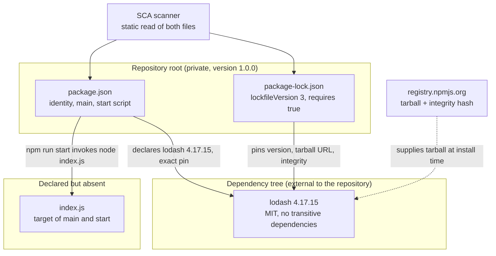

### 1.2.3 Success Criteria

The repository declares no measurable objectives, thresholds, KPIs or service levels of its own. Its two files contain no test script, no CI configuration and no metric of any kind; the only script declared in `package.json` is `start`. Any numeric target — a detection rate, a false-positive budget, a scan-duration limit — is an organizational decision that must be set by the consuming program rather than read from this repository. What the fixture does provide is a determinate expected outcome, because it contains exactly one dependency at exactly one version.

**Measurable objectives derivable from the repository's own content.**

| Objective | How it is measured against this repository | Basis in the repository |
| --- | --- | --- |
| Detect the vulnerable pinned dependency | The report names `lodash` and version `4.17.15`, or the advisories in the table below | The sole dependency in both `package.json` and `package-lock.json` |
| Attribute every dependency finding to one package | Dependency-derived findings attributable to lodash equal all dependency-derived findings | No other dependency and no transitive entries exist |
| Reproduce the same result in any environment | The reported version set is identical run to run and machine to machine | Exact pin in two files, no ranges, one resolved entry |
| Parse the modern lockfile format | The scanner reports no lockfile parse error against `lockfileVersion` 3 | The lockfile carries only the modern `packages` map, no legacy tree |
| Preserve the fixture's private status | No publish step can succeed | `"private": true` |

**Critical success factors.** Detection here depends on five things, each visible in the repository's shape:

- **Lockfile-format coverage.** A scanner that understands only npm's legacy `dependencies` tree must still handle this lockfile, which contains no legacy section at all.
- **Exact-pin awareness.** Detection must not rely on resolving a range; the version is stated verbatim in both files.
- **Advisory data currency and mapping.** The scanner's advisory source must cover the advisories below and map them to version `4.17.15`.
- **The correct expected-finding set.** The ground truth is the advisories affecting this specific version, not the advisory set for the `lodash` package in general — later advisories with higher fixed versions are not the criterion for a pass.
- **Tolerance of a non-installable target.** Because `npm ci` fails with `EINTEGRITY` and `index.js` does not exist, findings must be produced from static parsing of the two files rather than from an installed or executed tree.

**Known-answer ground truth (external advisory data).** The advisories below affect `lodash` 4.17.15; clearing all of them requires version 4.18.0 or later.

| Advisory | Class | Affected functions | Fixed in |
| --- | --- | --- | --- |
| CVE-2020-8203 / GHSA-p6mc-m468-83gw | Prototype pollution (CWE-1321) | `pick`, `set`, `setWith`, `update`, `updateWith`, `zipObjectDeep` | 4.17.19 |
| CVE-2020-28500 / GHSA-29mw-wpgm-hmr9 | ReDoS (CWE-400, CWE-1333) | `toNumber`, `trim`, `trimEnd` | 4.17.21 |
| CVE-2021-23337 / GHSA-35jh-r3h4-6jhm | Command injection (CWE-77, CWE-94) | `_.template` (`variable` option) | 4.17.21 |
| CVE-2025-13465 / GHSA-xxjr-mmjv-4gpg | Prototype pollution (CWE-1321) | `_.unset`, `_.omit` | 4.17.23 |
| CVE-2026-2950 / GHSA-f23m-r3pf-42rh | Prototype pollution via array path bypass | `_.unset`, `_.omit` | 4.18.0 |
| CVE-2026-4800 / GHSA-r5fr-rjxr-66jc | Code injection (`_.template` import keys) | `_.template` | 4.18.0 |

One further entry, CVE-2021-41720 / GHSA-8p5q-j9m2-g8wr, is associated with this version in the GitHub Advisory Database but has been withdrawn and carries no patched version. A scanner's inclusion or omission of a withdrawn advisory is a legitimate difference between tools and should not by itself be treated as a defect. Because advisory databases are revised over time, the row set above is the criterion to re-verify when a scan result is judged, not a permanently frozen expectation.


## 1.3 Scope

The fixture's scope is bounded by its two files. Everything it can validate follows from the manifest and the lockfile; everything else is outside its reach. The sub-sections below separate the two, covering the capabilities, workflows and boundaries the repository actually implements, and then the capabilities, integrations and use cases it deliberately does not.

### 1.3.1 In-Scope

**Core features and functionalities.**

| Feature | Declared in | Status in the repository |
| --- | --- | --- |
| Package identity, description and private flag | `package.json` (`name`, `version`, `description`, `private`) | Present |
| A single fixed execution path | `package.json` (`main`, `scripts.start`) | Declared; its target `index.js` is absent |
| One exact-pinned runtime dependency | `package.json` (`dependencies.lodash` = `"4.17.15"`) | Present |
| Deterministic install resolution record | `package-lock.json` (`lockfileVersion` 3, `requires` true) | Present |
| Dependency provenance and license metadata | `package-lock.json` (resolved tarball URL, sha512 `integrity`, `license` MIT) | Present; the integrity hash does not verify against the published tarball |

These are must-have capabilities in the strict sense: the fixture has no optional parts, because it has no parts beyond these.

**Primary user workflows.**

1. **Obtain the fixture.** Clone the repository — the checked-out branch is `1210_01`, and `main` holds an identical tree (`git diff main 1210_01` is empty), so either branch yields the same target.
2. **Scan statically.** Point an SCA scanner at the repository root. The scanner reads `package.json` and `package-lock.json`; it neither builds nor executes the project, and it needs no network access to produce findings.
3. **Compare against the known answer.** Check the report against the advisory set in Section 1.2.3 and against the expectation that every dependency-derived finding is attributable to `lodash` 4.17.15 and to nothing else.
4. **Confirm remediation clears the finding.** Raise the pinned version in both files to a release above the relevant fixed version and re-scan: the finding set should shrink accordingly. An install-based pipeline additionally needs the recorded `integrity` hash corrected, since the current value fails verification.
5. **Re-run on change.** Repeat steps 2 and 3 whenever the scanner or its advisory data is updated, so detection coverage against this fixed target is regression-tested.

**Essential integrations.**

| Integration | Mechanism | Requirement on the consumer |
| --- | --- | --- |
| Dependency scanning | Static parse of `package.json` and `package-lock.json` | None beyond file access — no install, no network |
| npm CLI | Reads the manifest and lockfile for resolution and install | Only for install- or resolution-based checks; subject to the integrity caveat |
| Source control | Git clone of the repository, branch `1210_01` or `main` | Git access; the two branches are equivalent |
| CI/CD pipeline | Invoked on the cloned repository as a scan job | The pipeline is defined by the consumer; the repository supplies none |

**Key technical requirements.**

| Requirement | Value in the repository | Implication |
| --- | --- | --- |
| Package manager and lockfile schema | npm; `lockfileVersion` 3 with `requires` true | This is the format npm 9 and later generate by default, carrying only the modern `packages` map; npm 5 and 6 cannot consume it, and npm 7/8 read it without the legacy tree |
| Runtime | Node.js (no `engines` constraint declared) | The Node version is chosen by the consuming pipeline, not fixed by the fixture |
| Dependency pinning | Exact `"4.17.15"` in both files; no `overrides`, `resolutions`, dev, peer or optional dependencies | No range resolution occurs, so the scanned version is fixed |
| External network access | `https://registry.npmjs.org/lodash/-/lodash-4.17.15.tgz` | Needed only by install-based checks; static scanning requires none |
| Publication | `"private": true` | Registry publication is disabled by the manifest |

**Implementation boundaries.**

- **System boundary.** The repository root, exactly two files, 852 bytes, the only paths git tracks (`git ls-files` returns `package.json` and `package-lock.json`). There are no subfolders, no dependencies vendored into the tree and no generated artifacts.
- **Interfaces.** npm's manifest and lockfile schemas, plus the `main`/`scripts.start` entry-point convention. The repository defines no API, endpoint, port, CLI, daemon or configuration file.
- **User groups covered.** The engineers who validate dependency scanning: scanner developers and QA, application security and vulnerability-management analysts, and platform or CI/CD owners who gate builds on scan results. The fixture has no end users, no authentication and no user interface.
- **Geographic and market coverage.** None. The repository holds no localization, market, customer or regulatory data of any kind, and its reach is wherever a scanner is pointed at it.
- **Data domains included.** Package identity metadata (`name`, `version`, `private`, `description`); the dependency declaration (`lodash` at `4.17.15`); and resolution metadata (registry tarball URL, sha512 integrity hash, MIT license). It contains no personal data, no runtime or user data, no credentials and no secrets.

### 1.3.2 Out-of-Scope

**Explicitly excluded features and capabilities.**

| Excluded item | Why it is out of scope |
| --- | --- |
| Application logic and business functionality | No source file exists; `index.js` is declared by `main` and `start` but absent |
| Automated tests and test runner | `package.json` declares only a `start` script — no `test` script or framework |
| Build, bundling, transpilation and type checking | No such scripts, no bundler, no type configuration |
| Linting and formatting configuration | No configuration file of any kind exists in the repository |
| CI/CD pipeline definition | No workflow or pipeline file exists; the surrounding pipeline is defined externally |
| Containerization and infrastructure-as-code | No Dockerfile, manifest or IaC artifact is present |
| README, documentation and license file | Only the two files exist; licensing is recorded only as the dependency's MIT `license` field |
| Secrets and secret-scanning surface | Both files hold package metadata only; no secret-bearing content is present |
| Runtime and dynamic-analysis surface | Nothing runs — the entry point is absent |
| Remediation code | Deliberate: the fixture exists to record a vulnerable pin, not to fix it |
| Additional or transitive dependencies | Deliberately excluded; one dependency, one resolved package entry, no transitive graph |
| Alternative package managers | No `yarn.lock` or `pnpm-lock.yaml` exists; only npm's lockfile is present |
| SBOM or report export | No tooling and no output artifacts are declared |

**Future phase considerations.** The repository records no roadmap, backlog, issue list or TODO — nothing in its two files contemplates later phases, so any extension is an organizational decision rather than a documented plan. The candidates visible from the artifact's current shape are, in each case, work that would require new files or edits: restoring an `index.js` so the declared `start` path can actually execute; adding a scan or test script, or a CI workflow, so the check runs automatically rather than by hand; correcting the `integrity` hash so install-based tooling can complete against the fixture; widening the target to more packages, other ecosystems or a transitive dependency graph; and adding documentation. None of these exists today.

**Integration points not covered.** Registry publication is blocked by `"private": true`. There is no SBOM or attestation output, no alerting, ticketing or notification integration, no artifact repository, container registry or secrets-manager interface, no package manager other than npm, no lockfile repair or update automation, and no export path for either file beyond being read in place.

**Unsupported use cases.**

- **Runtime exploitation and reachability analysis.** With no entry point and no code, nothing can be executed to confirm whether a vulnerable function is reachable.
- **SAST, secret, container and IaC scanning.** None of those artifact types exists in the repository, so the fixture cannot demonstrate coverage for them.
- **Load, performance and reliability testing.** The fixture defines no running service or endpoint.
- **Install-then-scan pipelines as committed.** `npm ci` terminates with `EINTEGRITY` because the recorded integrity hash does not match the published tarball, so any workflow that requires a successful install before scanning cannot use the repository exactly as committed.
- **Multi-package, monorepo and workspace resolution.** A single flat dependency is declared; no workspaces, `overrides` or `resolutions` behaviour can be exercised.
- **End-to-end remediation automation.** Only two edits are required to raise the pin (the version in both files, plus the integrity hash for install-based flows), so there is little remediation machinery to validate.
- **Use as a library or published package.** No exports are declared and `"private": true` forbids publication.
- **Advisory coverage outside npm.** The fixture carries no other ecosystem's dependency metadata.


## 1.4 References

- `package.json` — the repository's npm manifest: package identity (`minimal-cve-scanner-fixture` 1.0.0, `"private": true`), the stated purpose in `description`, `"main": "index.js"`, the sole `scripts.start` entry (`node index.js`), and the single exact-pinned runtime dependency `lodash` 4.17.15. It contains no `engines`, dev, peer, optional or override sections.
- `package-lock.json` — the resolution record: `lockfileVersion` 3 with `requires` true, a root `""` package entry mirroring the manifest, and one resolved `node_modules/lodash` entry giving version 4.17.15, the registry tarball URL `https://registry.npmjs.org/lodash/-/lodash-4.17.15.tgz`, a sha512 `integrity` hash that does not verify against the published tarball, and the `MIT` license.
- Repository root folder (`""`) — contains exactly these two files (852 bytes combined) and no subfolders, dotfiles, `node_modules`, documentation or CI configuration; git tracks the same two paths on the identical branches `main` and `1210_01`.
- [web] GitHub Advisory Database, advisories affecting `lodash@4.17.15` — confirmed the six advisories affecting the pinned version, their CVE/GHSA identifiers, weakness classes, affected functions and fixed versions, and the withdrawn entry CVE-2021-41720: <https://github.com/advisories?query=lodash>
- [web] npm docs, `package-lock.json` — confirmed the meaning of `lockfileVersion` 3 (the modern `packages` map without backwards-compatibility fields; generated by npm 9 and later, readable from npm 7) and the role of the `integrity` and `resolved` fields: <https://docs.npmjs.com/cli/v11/configuring-npm/package-lock-json>
- [web] npm docs, `lockfile-version` configuration — confirmed that version 3 is the default when no lockfile exists and that v1 lockfiles are auto-converted to v3: <https://docs.npmjs.com/cli/v9/using-npm/config>
- [web] npm CLI v9.0.0 release notes — confirmed that v3 lockfiles became the default in npm 9: <https://github.com/npm/cli/releases/tag/v9.0.0>
- [web] lodash changelog and releases — confirmed the fix releases that clear the advisories (4.17.19, 4.17.21, 4.17.23, 4.18.0) and the canonical sha512 hash of the published `lodash-4.17.15.tgz`: <https://github.com/lodash/lodash/wiki/Changelog>


# 2. Product Requirements

## 2.1 Feature Catalog

The fixture delivers five features. Every one of them is a property of the two committed files — `package.json` and `package-lock.json` — rather than a behaviour in running code, because the repository contains no source file, no build step and no test harness. Nothing appears below that those files do not declare: there is no feature for application logic, configuration, reporting, scheduling, authentication or interface, since the repository defines none of them.

Two consequences shape the catalog. First, the feature set is small and the requirement set in Section 2.2 is correspondingly small — the artifact is 852 bytes. Second, two features carry measured gaps that the catalog records rather than smooths over: the declared execution path (`F-002`) has no target file, and the provenance feature (`F-005`) records an integrity hash that does not verify, so an integrity-checked install cannot complete. Both gaps are observed behaviour, reproduced during this analysis, not inferences.

### 2.1.1 Feature Catalog Summary, Priorities and Statuses

| ID | Feature name | Category | Priority |
| --- | --- | --- | --- |
| F-001 | Package Identity and Publication Guard | Package metadata and publication control | High |
| F-002 | Declared Execution Path | Execution entry point | Medium |
| F-003 | Exact-Pinned Runtime Dependency Declaration | Dependency declaration | Critical |
| F-004 | Deterministic Install Resolution Record | Dependency resolution and reproducibility | Critical |
| F-005 | Dependency Provenance and License Metadata | Supply-chain provenance and licensing | High |

| ID | Status | Realised by | Verification performed |
| --- | --- | --- | --- |
| F-001 | Completed | `package.json` L2–L5; `package-lock.json` L2, L3, L8, L9 | Fields read directly; identity matches in both files |
| F-002 | Proposed (declaration present, target absent) | `package.json` L6, L7–L9 | `npm start` exits 1 with `MODULE_NOT_FOUND`; no `index.js` in the tree |
| F-003 | Completed | `package.json` L10–L12 | Exact pin read verbatim; no other dependency section exists |
| F-004 | Completed | `package-lock.json` L4–L19 | `lockfileVersion` 3 and a two-key `packages` map read back |
| F-005 | Completed, with one requirement unmet | `package-lock.json` L16–L18 | `npm ci` exits 1 with `EINTEGRITY` |

Priorities are assigned by how directly each feature serves the purpose stated in the manifest itself (`package.json` L5, "Minimal repository for validating dependency vulnerability scanning"):

| Priority | Meaning in this repository | Applied to |
| --- | --- | --- |
| Critical | Detection of the pinned vulnerable dependency depends on it; without it the fixture has no target | F-003, F-004 |
| High | Supplies the identity, safety or provenance facts a scan report and a supply-chain review are judged against | F-001, F-005 |
| Medium | Declared and preserved, but not exercised and not needed for dependency detection | F-002 |
| Low | Not used — no feature of this repository falls below the dependency-detection purpose | none |

Status vocabulary:

| Status | Meaning | Applied to |
| --- | --- | --- |
| Completed | Fully realised by the committed files and verifiable today | F-001, F-003, F-004, F-005 |
| Proposed | Declared or intended but not realised in the working tree | F-002 |
| Approved, In Development | Not used — nothing is declared-but-approved work in flight, and no feature is partially implemented | none |

### 2.1.2 F-001 Package Identity and Publication Guard

| Attribute | Value | Evidence |
| --- | --- | --- |
| Feature ID | F-001 | — |
| Feature name | Package Identity and Publication Guard | — |
| Category | Package metadata and publication control | — |
| Priority | High | Serves the stated purpose by making the scan target identifiable and non-publishable |
| Status | Completed | All four fields present and effective in the committed manifest |

**Overview.** The manifest names and describes the artifact and marks it non-publishable: `"name": "minimal-cve-scanner-fixture"` (L2), `"version": "1.0.0"` (L3), `"private": true` (L4) and a `description` (L5) that states the fixture's purpose in its own words. The same name and version are repeated in the lockfile's top-level fields (L2, L3) and in its root `""` package entry (L8, L9).

**Business Value.** A scan report is only comparable across tools, runs and environments if the artifact it describes is fixed and self-identifying. The identity fields supply that anchor, while `private: true` prevents the artifact — which pins a dependency carrying known advisories — from ever being published to a registry as a public package. Both branches distributed by the remote (`main`, `1210_01`) carry the identical tree, so the identity cannot differ by checkout.

**User Benefits.** Scanner engineers and QA can cite the fixture by name and version in test cases and regression reports; application-security reviewers get a target that cannot leak outward; platform owners can clone either branch and know they hold the same artifact.

**Technical Context.** Identity fields are consumed by the npm CLI when the package is installed, packed or published, and are mirrored into the lockfile so a resolver need not read the manifest. The publication guard is enforced inside npm's publish path (the `EPRIVATE` throw in `libnpmpublish`): a real publish of a package marked private is refused before any registry request. That guard is deliberately *not* exercised by `npm publish --dry-run`, which skips the publish library and was measured completing with exit code 0 and a login warning only, so the guard is verified by inspecting the field or by attempting a real publish, not by a dry run.

| Dependency type | Item | Nature of the dependency |
| --- | --- | --- |
| Prerequisite features | None | The manifest has no prerequisite inside the repository |
| System dependencies | npm CLI (manifest and lockfile consumer); Node.js not required for this feature | Identity fields are read and validated by npm |
| External dependencies | `registry.npmjs.org`, only for an attempted publish | The guard acts at publish time; nothing external is needed to read the fields |
| Integration requirements | None beyond file access | No service, credential, endpoint or configuration is involved |

### 2.1.3 F-002 Declared Execution Path

| Attribute | Value | Evidence |
| --- | --- | --- |
| Feature ID | F-002 | — |
| Feature name | Declared Execution Path | — |
| Category | Execution entry point | — |
| Priority | Medium | Not needed for dependency detection, and not exercised |
| Status | Proposed — declared in the manifest, never realised | `package.json` L6 and L8 name `index.js`, which the working tree does not contain |

**Overview.** The manifest declares one entry point through two conventions: `"main": "index.js"` (L6) names the module the package resolves to, and `scripts.start` (L7–L9) supplies the single runnable command, `node index.js`. No other lifecycle script — no `test`, `build`, `lint`, `prepare` or `postinstall` — is declared, so `npm start` is the repository's only declared execution path.

**Business Value.** The declaration preserves the shape of a runnable Node.js project, which matters for tooling that discovers its target by following an entry-point convention rather than by reading dependency metadata. At the same time, the absent target file keeps the fixture free of executable content: there is no code that could run during a scan, so the fixture cannot contaminate an analysis with runtime side effects.

**User Benefits.** A scanner or pipeline author can see the intended entry point and confirm in one command that nothing executes; a pipeline that happens to invoke `npm start` fails fast and visibly rather than silently succeeding.

**Technical Context.** Measured behaviour in a copy of the two committed files: `npm start` exits 1, with Node.js reporting `MODULE_NOT_FOUND` from the CommonJS loader because `index.js` is absent; `ls index.js` in the working tree likewise reports that the file does not exist. `git ls-files` returns only the two JSON files. The manifest declares no `engines` field, so no Node.js version is required or constrained by the fixture — the runtime is whatever the consuming environment provides.

| Dependency type | Item | Nature of the dependency |
| --- | --- | --- |
| Prerequisite features | None | A declared path stands alone; F-003 declares a dependency but no code consumes it |
| System dependencies | Node.js runtime — invoked only if the declared target existed | `scripts.start` shells out to `node index.js` (L8) |
| External dependencies | None | Execution requires no network, registry or service |
| Integration requirements | `npm run start` / `npm start`; any CI job that invokes the start script | Such a job fails as committed, because the target file is missing |

### 2.1.4 F-003 Exact-Pinned Runtime Dependency Declaration

| Attribute | Value | Evidence |
| --- | --- | --- |
| Feature ID | F-003 | — |
| Feature name | Exact-Pinned Runtime Dependency Declaration | — |
| Category | Dependency declaration | — |
| Priority | Critical | This pin is the fixture's detection target |
| Status | Completed | `package.json` L10–L12 declares exactly one runtime dependency |

**Overview.** The manifest declares one runtime dependency, `lodash`, at the exact version `4.17.15` (L10–L12). The version string carries no `^`, `~`, comparators or wildcard, and no `devDependencies`, `peerDependencies`, `optionalDependencies`, `overrides`, `resolutions` or `workspaces` section exists to add, remap or substitute for it. The same literal appears twice in the lockfile — in the root entry's `dependencies` (L11) and in the resolved entry's `version` (L15) — so the pin is stated in three places across the two files.

**Business Value.** The fixture exists to make dependency-vulnerability detection demonstrable and comparable (purpose stated at `package.json` L5). Exact pinning is what makes the expected result determinate: the scanned version cannot float with a range resolution, no override can remap it, and because there is exactly one dependency, every dependency-derived finding in a report must be attributable to `lodash` 4.17.15 and nothing else. That turns a scan report into an unambiguous comparison against a known-answer advisory set rather than a judgement call.

**User Benefits.** Scanner engineers get a regression target whose expected findings do not drift between runs or machines; application-security analysts get a report with no attribution ambiguity; anyone testing remediation can raise the single pinned version and observe the finding set shrink by exactly the advisories that release fixes.

**Technical Context.** The dependency is declared as a runtime dependency and is legible from the committed manifest alone: JSON parsing yields the name and version pair with no install, no lockfile walk and no registry access. Because `4.17.15` sits inside the affected range of every live advisory for `lodash` (Section 1.2.3), the pin is a genuine detection target rather than a benign package. The repository does not vendor the dependency — the working tree contains no `node_modules` and no generated artifact — so nothing in the tree substitutes for or shadows the declared version.

| Dependency type | Item | Nature of the dependency |
| --- | --- | --- |
| Prerequisite features | F-001 | The declaration lives in the manifest whose identity and purpose F-001 establishes |
| System dependencies | npm CLI as the reader of the declaration; JSON parser only for static detection | No install is required to read the pin |
| External dependencies | `lodash` package at `registry.npmjs.org` — for install-based flows only | Static scanning needs no registry access |
| Integration requirements | A scanner that parses `package.json` `dependencies`; an install-based flow additionally requires F-005's integrity to verify | Static path works today; install path is blocked by the hash mismatch |

### 2.1.5 F-004 Deterministic Install Resolution Record

| Attribute | Value | Evidence |
| --- | --- | --- |
| Feature ID | F-004 | — |
| Feature name | Deterministic Install Resolution Record | — |
| Category | Dependency resolution and reproducibility | — |
| Priority | Critical | Supplies the resolved version and resolution format a scanner reads |
| Status | Completed | `package-lock.json` L4–L19 is a well-formed modern lockfile |

**Overview.** The lockfile records install resolution rather than resolution rules: `"lockfileVersion": 3` with `"requires": true` (L4, L5), a single `packages` map (L6), a root `""` entry that mirrors the manifest (L7–L13), and one resolved entry, `node_modules/lodash` (L14–L19). There is no legacy top-level `dependencies` tree, and the map holds exactly two keys: the root entry and the single package.

**Business Value.** Determinism is the second half of the fixture's value: the manifest states intent, and the lockfile states exactly what a resolver will install. Because the resolved version is exact and the graph is a single node, a scan of the lockfile produces the same version set on every machine and in every pipeline, and a scanner's support for the modern `packages`-only lockfile format is exercised rather than assumed. A scanner that understands only the legacy `dependencies` tree must still cope with a lockfile that contains none of it.

**User Benefits.** Platform and CI owners get identical scan inputs across environments; scanner developers get a compact test of modern-lockfile parsing with no transitive noise; reviewers can read the whole resolution in eleven lines.

**Technical Context.** `lockfileVersion` 3 with `requires` true is the modern npm lockfile format, generated by default from npm 9 onward and readable from npm 7; it carries the keyed `packages` map without the backward-compatibility fields older formats include, so npm 5 and 6 cannot consume it. The root entry repeats the manifest's name, version and dependency declaration, which is why the `4.17.15` literal occurs twice in this file. Determinism holds for every static read, and the resolution map itself is sound; the one qualification is install-time consumption — the resolved entry's `integrity` value fails verification (F-005-RQ-003), so `npm ci` cannot complete even though the lockfile is structurally valid.

| Dependency type | Item | Nature of the dependency |
| --- | --- | --- |
| Prerequisite features | F-003 | The lockfile's root entry and resolved version derive from the manifest's declared dependency |
| System dependencies | npm CLI as consumer of the lockfile; JSON parser for static reads | npm reads version 3; npm 5/6 cannot |
| External dependencies | `registry.npmjs.org` tarball recorded in `resolved` (L16) | Needed only for install, not for resolution reading |
| Integration requirements | Scanners that read lockfiles for exact-version evidence; `npm ci` for reproducibility checks | `npm ci` currently fails; static lockfile reads succeed |

### 2.1.6 F-005 Dependency Provenance and License Metadata

| Attribute | Value | Evidence |
| --- | --- | --- |
| Feature ID | F-005 | — |
| Feature name | Dependency Provenance and License Metadata | — |
| Category | Supply-chain provenance and licensing | — |
| Priority | High | Records where the artifact comes from, under what licence, and with what integrity expectation |
| Status | Completed, with one requirement unmet (F-005-RQ-003) | `package-lock.json` L16–L18 records all three facts; the integrity value does not verify |

**Overview.** The single resolved entry records three provenance facts about the dependency: the registry tarball it resolves to (`resolved`, L16), an sha512 Subresource Integrity hash for that tarball (`integrity`, L17) and the package's declared licence (`license`, `"MIT"`, L18). Together they state where the artifact comes from, what it should hash to, and the terms under which it is used.

**Business Value.** Supply-chain review and install-time trust both rest on these three fields. The licence is the only licence statement anywhere in the repository, since the manifest declares no licence for the fixture itself; the `resolved` URL pins a single origin rather than leaving the artifact's source implicit; and the `integrity` value is the trust anchor npm verifies against a downloaded tarball, which makes this feature the natural place for the fixture to expose a detectable provenance defect.

**User Benefits.** Reviewers can answer "what is it, where from, under what terms" from one lockfile entry; a pipeline that requires successful verification discovers the fixture's integrity defect immediately and deterministically, with the expected and actual hashes printed side by side; static scanners are unaffected, because they read the same fields without downloading anything.

**Technical Context.** The recorded hash is `sha512-8x0cRHvCjnocdS5cpwXQXVzmmh5e5+saE2QG0eQmbKmRS63JVQppP0It0MnmE+4xlZoumy0GPG0D0MV1QbNA1A==` (L17). The published tarball's sha512 is `sha512-8xOcRHvCjnocdS5cpwXQXVzmmh5e5+saE2QGoeQmbKmRS6J3VQppPOIt0MnmE+4xlZoumy0GPG0D0MVIQbNA1A==` — the two differ in three characters (a zero where the published hash has a capital `O`, and two transposed or substituted pairs). An integrity-checked install of the repository exactly as committed was measured failing: `npm ci` exits 1 with `npm error code EINTEGRITY`, reporting that it wanted the value in L17 but got the value above from the 314,170-byte tarball, after two retries. The practical effect is that static analysis of the two files works unchanged, while any pipeline that installs before scanning is blocked.

| Dependency type | Item | Nature of the dependency |
| --- | --- | --- |
| Prerequisite features | F-004 | The provenance fields are attributes of the resolved entry the lockfile feature defines |
| System dependencies | npm CLI (integrity verification during install); JSON parser for static reads | npm performs the hash check that currently fails |
| External dependencies | `registry.npmjs.org` tarball `lodash-4.17.15.tgz` | The authoritative hash exists only on the published artifact |
| Integration requirements | Supply-chain or licence review tooling; install-based scan pipelines | Static tools succeed; install-first pipelines fail as committed |


## 2.2 Functional Requirements Tables

The requirement tables below decompose the five catalogued features into 19 testable requirements, each with a stable identifier of the form `F-00N-RQ-00M`. Every requirement states what must hold, how it is observed, and — where the committed artifact does not satisfy it — that it is currently unmet, in which case the acceptance criterion still stands as the test that will show the gap closed. Acceptance criteria are written to be executed: each names the file and line, the command, or both.

Column conventions: **Priority** uses Must-Have, Should-Have, Could-Have; **Complexity** uses High, Medium, Low and measures the effort to satisfy or verify the requirement in this repository; the technical-specification column **Input → Output** states what is read and what results. Requirements marked `[UNMET]` fail against the repository as committed, and the failure is reproduced by the stated check.

### 2.2.1 F-001 — Package Identity and Publication Guard

| Requirement ID | Description | Acceptance criteria | Priority |
| --- | --- | --- | --- |
| F-001-RQ-001 | The package declares a name and version that agree throughout the artifact. | `package.json` parses and yields `minimal-cve-scanner-fixture` (L2) and `1.0.0` (L3); `package-lock.json` repeats both at L2–L3 and again in `packages[""]` at L8–L9. | Must-Have |
| F-001-RQ-002 | The artifact states its own purpose in its metadata. | `description` (L5) is a non-empty string reading "Minimal repository for validating dependency vulnerability scanning". | Must-Have |
| F-001-RQ-003 | Publication to a public registry is prevented. | `private` is exactly `true` (L4); a real publish is refused with npm error code `EPRIVATE`. Note: `npm publish --dry-run` does not exercise the guard — measured exit 0 — so verification is by field inspection or a real publish. | Must-Have |
| F-001-RQ-004 | Identity is invariant across every distributed copy. | `git diff main 1210_01` is empty and L2–L3 are identical in both branches, so a scan target cannot vary by checkout. | Should-Have |

| Requirement ID | Complexity | Input → Output | Performance criteria |
| --- | --- | --- | --- |
| F-001-RQ-001 | Low | `package.json` → identity string pair, mirrored into `package-lock.json` | One 293-byte document parsed; no network, no install; no latency, throughput or concurrency dimension exists |
| F-001-RQ-002 | Low | `package.json` → purpose string | Same single-document read; no measurable cost beyond JSON parsing |
| F-001-RQ-003 | Low | `package.json` `private` flag → publish refusal | Guard acts before any registry request, so a real publish fails without transferring package content; not exercised by a dry run |
| F-001-RQ-004 | Low | Git refs `main`, `1210_01` → identical trees | Comparison of two refs; no runtime cost |

| Requirement ID | Data requirements | Business and data validation rules | Security and compliance requirements |
| --- | --- | --- | --- |
| F-001-RQ-001 | Package name (string), semantic version (string) | Name non-empty and unique to the fixture; version matches a major.minor.patch pattern; the duplicate values must remain equal in both files | Identity is public metadata; no personal data, credential or regulated data |
| F-001-RQ-002 | Description (string) | Description states the validation purpose and must not be emptied, since it is the repository's only purpose statement | None beyond accuracy of the statement |
| F-001-RQ-003 | Boolean flag | `private` must be `true`, not a truthy string; removing it would expose a dependency-carrying artifact for publication | This is the artifact's only distribution-control property: it is what keeps a vulnerable pin from being published publicly |
| F-001-RQ-004 | Git branch names, tree hashes | Both distributed branches must carry identical content | None |

### 2.2.2 F-002 — Declared Execution Path

| Requirement ID | Description | Acceptance criteria | Priority |
| --- | --- | --- | --- |
| F-002-RQ-001 | Exactly one lifecycle script is declared, and it targets the file the manifest names as its entry point. | `scripts` (L7–L9) holds the single key `start` with value `node index.js` (L8), and `main` (L6) is `index.js`; no `test`, `build`, `lint`, `prepare` or `postinstall` key exists. | Could-Have |
| F-002-RQ-002 | The declared entry point executes successfully. `[UNMET]` | `npm start` exits 0 and runs the file named at L6 and L8. Measured: exit 1, Node.js `MODULE_NOT_FOUND`, because `index.js` is absent from the working tree and from `git ls-files`. | Should-Have |

| Requirement ID | Complexity | Input → Output | Performance criteria |
| --- | --- | --- | --- |
| F-002-RQ-001 | Low | `package.json` `main` and `scripts` → single declared command | Declaration read from 293 bytes; no execution |
| F-002-RQ-002 | Low | `npm start` → process exit status | Currently fails at module resolution in milliseconds; no build, dependency install or network access is involved either way |

| Requirement ID | Data requirements | Business and data validation rules | Security and compliance requirements |
| --- | --- | --- | --- |
| F-002-RQ-001 | Script name, command string, entry-point path | Only one lifecycle script may exist so the fixture's single declared path stays unambiguous; `main` and the script must name the same file | A declared start script executes arbitrary command text: the value is fixed and reviewable, and any change to it is a supply-chain-relevant edit |
| F-002-RQ-002 | Entry-point path, exit status | The path declared by `main` and `start` must resolve to a file in the repository | No executable content exists in the tree, so the fixture has no runtime surface to scan for code-level, secret or dynamic-analysis issues; that property is deliberate and must be preserved if the entry point is ever restored |

### 2.2.3 F-003 — Exact-Pinned Runtime Dependency Declaration

| Requirement ID | Description | Acceptance criteria | Priority |
| --- | --- | --- | --- |
| F-003-RQ-001 | Exactly one runtime dependency is declared, at an exact version with no range operator. | `dependencies` (L10–L12) has one entry, `lodash` = `4.17.15`, containing no `^`, `~`, comparator or wildcard; no `devDependencies`, `peerDependencies`, `optionalDependencies`, `overrides`, `resolutions` or `workspaces` section exists. | Must-Have |
| F-003-RQ-002 | The declared dependency is legible to a static scanner with no install and no network. | Parsing the committed `package.json` yields the name and version pair; the working tree holds no `node_modules`, and no registry access is required to produce a finding. | Must-Have |
| F-003-RQ-003 | The pinned version is a genuine detection target. | A scan with current advisory data reports the advisories affecting `lodash` 4.17.15 (the six live entries of Section 1.2.3) and does not report "no vulnerabilities". The criterion is the advisory set for this version, not the package's full advisory history, and must be re-judged when advisory data is revised. | Must-Have |
| F-003-RQ-004 | Every dependency-derived finding is attributable to one package. | In any report over this repository, all dependency-derived findings name `lodash`; no other package appears. | Must-Have |

| Requirement ID | Complexity | Input → Output | Performance criteria |
| --- | --- | --- | --- |
| F-003-RQ-001 | Low | `package.json` `dependencies` → one name/version pair | Single declaration read; no resolution step, because the version is a literal |
| F-003-RQ-002 | Low | Committed `package.json` → dependency inventory | Static path needs no install and no network; cost is a JSON parse of 293 bytes |
| F-003-RQ-003 | Medium | Declared pair → advisory matches | Governed by the scanner's advisory-source currency and mapping, not by repository size; the fixture contributes no latency of its own |
| F-003-RQ-004 | Low | Declared pair → one attribution per finding | Trivial graph: one declared dependency and no transitive entries |

| Requirement ID | Data requirements | Business and data validation rules | Security and compliance requirements |
| --- | --- | --- | --- |
| F-003-RQ-001 | Package name (string), exact version (string) | The version must remain exact, and no override mechanism may be introduced: any range allows the scanned version to float and destroys the fixture's determinacy | The pin deliberately names a version carrying known advisories; this is the fixture's purpose and must not be "fixed" without re-baselining the expected finding set (§2.5.2) |
| F-003-RQ-002 | Declared dependency inventory | The declaration must stay readable from the committed files alone; vendoring or generating the dependency tree would remove the static-scanning surface | No secrets or credentials are involved; all values are public package metadata |
| F-003-RQ-003 | Advisory identifiers, affected ranges, fixed versions | A finding must be judged against the version-specific advisory set; withdrawal status must be handled (Section 1.2.3 records one withdrawn advisory) | Detection obligation sits with the consuming scanner; the fixture records no compliance framework, so no regulatory scope applies |
| F-003-RQ-004 | Finding-to-package attribution | Only one dependency may be declared | No regulated or personal data is present |

### 2.2.4 F-004 — Deterministic Install Resolution Record

| Requirement ID | Description | Acceptance criteria | Priority |
| --- | --- | --- | --- |
| F-004-RQ-001 | The lockfile is present in the modern format. | `package-lock.json` parses with `lockfileVersion` 3 (L4), `requires` true (L5) and a `packages` map (L6); no top-level legacy `dependencies` tree exists. | Must-Have |
| F-004-RQ-002 | The lockfile's root entry mirrors the manifest's declaration. | `packages[""].name`, `.version` and `.dependencies` (L8–L12) equal the manifest's L2, L3 and L11; the literal `4.17.15` occurs at `package-lock.json` L11 and L15. | Must-Have |
| F-004-RQ-003 | Resolution is a single-node graph with no transitive entries. | `Object.keys(packages)` is exactly `["", "node_modules/lodash"]`, and the `lodash` entry declares no dependencies of its own. | Must-Have |
| F-004-RQ-004 | The resolved version cannot float. | The resolved entry's version is exactly `4.17.15` (L15), no range, override or resolution mechanism exists to change it, and the file is byte-identical in both branches and in a fresh clone. | Must-Have |
| F-004-RQ-005 | The lockfile is consumable as an install plan under integrity checking. `[UNMET]` | `npm ci` in a clone with network access exits 0. Measured: exit 1 with `npm error code EINTEGRITY`, reported against the `integrity` value at L17 (root cause owned by F-005-RQ-003). | Should-Have |

| Requirement ID | Complexity | Input → Output | Performance criteria |
| --- | --- | --- | --- |
| F-004-RQ-001 | Low | `package-lock.json` → resolution format identifier | Parse of 559 bytes; no network, no install |
| F-004-RQ-002 | Low | Manifest declaration → mirrored lockfile entry | Two local file reads; no resolution work is performed |
| F-004-RQ-003 | Low | `packages` map → resolved package list | Two keys, one package: no graph traversal cost |
| F-004-RQ-004 | Low | Lockfile bytes → fixed resolved version | Determinism is a property of the committed bytes; no variability to measure |
| F-004-RQ-005 | Medium | Lockfile + registry → installed tree | Requires a registry round trip for the 314,170-byte tarball (measured) and currently retries the download twice before failing |

| Requirement ID | Data requirements | Business and data validation rules | Security and compliance requirements |
| --- | --- | --- | --- |
| F-004-RQ-001 | Lockfile version integer, `requires` flag, package map | The lockfile must stay in version 3 form; a downgrade to a legacy tree, or an update to a version the consuming npm cannot read, changes the parsing surface being tested | The lockfile is a resolution surface only: it contains no executable logic, credentials or user data |
| F-004-RQ-002 | Name, version, dependency declaration | Mirrored values must equal the manifest's; a divergence between the two files is a defect, not a tolerated state | None beyond integrity of the metadata |
| F-004-RQ-003 | Package keys, dependency lists | The map may hold only the root entry and the single resolved package, so no transitive entry can dilute attribution | No personal, regulated or credential data is present |
| F-004-RQ-004 | Exact version, committed file bytes | The resolved version must remain exact, and `overrides`/`resolutions` must not be introduced | Determinism is what lets a report be reproduced and audited; a floating version would make findings unauditable |
| F-004-RQ-005 | Tarball URL, integrity hash, installed tree | An install plan must be internally consistent: the recorded hash must match the artifact the URL serves | The failure is safe by design — npm aborts rather than installing unverified content |

### 2.2.5 F-005 — Dependency Provenance and License Metadata

| Requirement ID | Description | Acceptance criteria | Priority |
| --- | --- | --- | --- |
| F-005-RQ-001 | The resolved tarball's origin is recorded. | `resolved` (L16) is exactly `https://registry.npmjs.org/lodash/-/lodash-4.17.15.tgz` — the canonical registry URL for the pinned version, not a local path or mirror. | Must-Have |
| F-005-RQ-002 | The dependency's licence is recorded. | `license` (L18) is `MIT`. Note: the manifest declares no licence for the fixture itself, so this field is the repository's only licence statement. | Should-Have |
| F-005-RQ-003 | The recorded integrity verifies against the published artifact. `[UNMET]` | Recomputing sha512 over the published tarball yields the recorded value, and `npm ci` verifies without `EINTEGRITY`. Measured: the recorded value at L17 differs in three characters from the tarball's actual hash (`sha512-8xOcRHvC…QbNA1A==`), and `npm ci` exits 1. | Must-Have |
| F-005-RQ-004 | No credential, token or secret is recorded in the metadata. | Neither file contains a token, key, password or authentication field; the only URL is a public registry path; no `.npmrc` or equivalent credential file exists in the repository. | Should-Have |

| Requirement ID | Complexity | Input → Output | Performance criteria |
| --- | --- | --- | --- |
| F-005-RQ-001 | Low | Resolved entry → tarball origin URL | Read from 559 bytes; no network for static consumers |
| F-005-RQ-002 | Low | Resolved entry → SPDX licence identifier | Single field read |
| F-005-RQ-003 | Low | Recorded hash vs. published artifact hash → verification result | Correction is a one-string edit; verification requires one registry download of 314,170 bytes and currently fails after two retries |
| F-005-RQ-004 | Low | Both files → credential scan | Two documents of 293 and 559 bytes scanned; no external service involved |

| Requirement ID | Data requirements | Business and data validation rules | Security and compliance requirements |
| --- | --- | --- | --- |
| F-005-RQ-001 | URL string | The URL must identify the registry artifact for the exact pinned version, so origin and version cannot disagree | Pinning a single origin keeps the provenance claim auditable |
| F-005-RQ-002 | SPDX licence identifier | The licence must be stated as an SPDX identifier; an absent or unparsable value defeats downstream licence review | MIT places no redistribution restriction; no compliance framework, audit record or attestation is declared by the repository, and the fixture's own licence is unrecorded |
| F-005-RQ-003 | sha512 Subresource Integrity string | The recorded value must be byte-identical to the published artifact's hash, in `sha512-` base64 form; a hash that differs in even one character is a defect, not a tolerable variant | This is the fixture's install-time trust anchor: while it mismatches, no integrity-checked install can complete, and npm refuses rather than installing unverified content — the safe direction of failure |
| F-005-RQ-004 | Both committed documents | Any credential-bearing field would be disqualifying; values must remain public package metadata | No secret is present today, and none may be introduced: the repository is cloned and scanned as plain files |


## 2.3 Feature Relationships

Relationships in this repository are structural, not runtime: two files that no code executes mean the features connect through shared data in those files, through the file-reading tools that consume them, and through the conventions npm applies to both. Every edge documented below is visible in the committed content — nothing here is inferred from a design intent the repository does not exhibit.

### 2.3.1 Feature Dependency Map

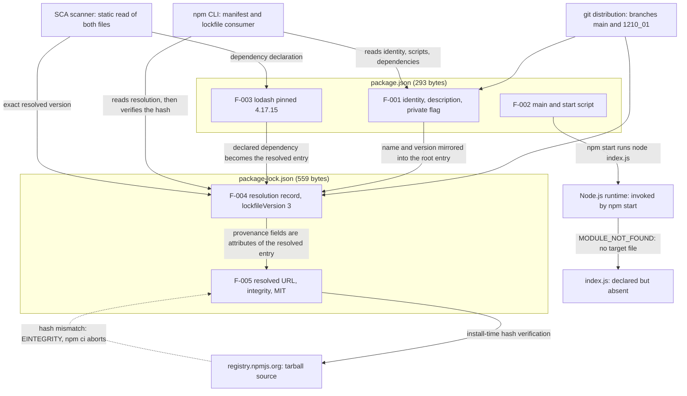

| From | To | Nature of the relationship | Evidence |
| --- | --- | --- | --- |
| F-003 | F-004 | The declared dependency is what the lockfile resolves: the pin appears in the root entry and again as the resolved version | `package-lock.json` L10–L12 and L15 |
| F-001 | F-004 | Identity is duplicated, not referenced: the lockfile states the same name and version | `package-lock.json` L2–L3, L8–L9 |
| F-004 | F-005 | Provenance fields are attributes of the resolved entry; without the entry they have no container | `package-lock.json` L14–L19 |
| F-002 | None | The execution path has no edge to any dependency feature: no code consumes `lodash`, because no code exists | `package.json` L6, L8; `index.js` absent |
| F-003, F-004 | Scan output | Dependency detection reads the declaration for intent and the lockfile for the exact resolved version; both can produce findings for the same package | Static parse of both files, needing neither install nor network |

### 2.3.2 Integration Points

| Integration point | Direction | Interface used | Features affected |
| --- | --- | --- | --- |
| SCA / dependency scanner | Inbound — consumes the repository | Static parse of `package.json` and `package-lock.json`; requires no install, no build and no network | F-001 (target identity), F-003, F-004, F-005 |
| npm CLI — manifest | Consumer of the repository | Reads `package.json` for identity, `main`, `scripts` and `dependencies` | F-001, F-002, F-003 |
| npm CLI — lockfile and install | Consumer of the repository | Reads `package-lock.json`: `lockfileVersion` 3 resolution map, then verifies `integrity` during install | F-004, F-005 |
| npm registry | Outbound, install or publish time only | HTTP fetch of the tarball recorded at L16; publish path where the `EPRIVATE` guard acts | F-005 (verification), F-001 (publish refusal) |
| Node.js runtime | Invoked by the declared script | `npm start` → `node index.js` | F-002 — currently interrupted by `MODULE_NOT_FOUND` |
| Git | Inbound — distribution | Clone of `main` or `1210_01`, which carry identical trees | F-001, F-004 |
| Enterprise CI/CD pipeline | Inbound — invokes the scan | The pipeline is defined entirely by the consumer; the repository declares no workflow, job or test script | All features, as the scan target |

### 2.3.3 Shared Components

| Shared component | Features sharing it | Nature of the sharing |
| --- | --- | --- |
| `package.json` (293 bytes) | F-001, F-002, F-003 | One document carries identity, the single script and the single dependency; any edit to it can affect all three at once |
| `package-lock.json` (559 bytes) | F-004, F-005 | One document carries the resolution map and, inside the resolved entry, the provenance fields |
| The version literal `4.17.15` | F-003, F-004 | Written verbatim three times — `package.json` L11, `package-lock.json` L11 and L15 — so remediation is a coordinated multi-site edit rather than a single change |
| The name/version pair | F-001, F-004 | Declared in the manifest and repeated in the lockfile's top-level fields and root entry: duplication, not indirection |
| The `lodash` dependency name | F-003, F-004, F-005 | Appears as the declared dependency, the `packages` map key and the subject of the provenance entry; it is the artifact's only dependency identifier |
| File digests | F-003, F-004, F-005 | The requirement baseline in §2.5.2 rests on the working-tree hashes of both files, so any edit to either file re-baselines every requirement |

### 2.3.4 Common Services

| Service | Role across these features | Invoked by | Defined in this repository? |
| --- | --- | --- | --- |
| npm CLI | Reads and validates the manifest; reads the lockfile; performs install-time integrity verification; refuses to publish a private package | The consuming pipeline or developer, via `npm ci`, `npm install`, `npm start`, `npm publish` | No — external tooling; the repository supplies only its inputs |
| npm registry | Supplies the tarball recorded at L16 and is the authority for its integrity hash | npm, during install or publish | No |
| Node.js runtime | Would execute the file named by `main` and `scripts.start` | `npm start` (L8) | No — no `engines` constraint is declared, so the version is the consumer's choice |
| Git | Transports the fixed artifact; both branches carry identical content, so the scan target is the same wherever it is cloned | The consuming pipeline | No |
| SCA scanner | Produces the findings the fixture is built to validate | The consuming pipeline; the repository defines neither the scanner nor a scan script | No |

No in-repository service layer exists: there is no API, daemon, queue, shared library or configuration file, so the fixture has no intra-repository service to reuse between features. The two files are the only integration surface, and their duplication of identity and version values — rather than a shared module or generated artifact — is the mechanism by which these features relate. Section 1.2.2 carries the component-level flowchart this map elaborates.


## 2.4 Implementation Considerations

Each feature carries five considerations: technical constraints, performance requirements, scalability, security implications and maintenance. Because the artifact is two declarative files, the honest content of several of these dimensions is "none applicable", and saying so is more useful than manufacturing a load, a throughput figure or a growth path the repository cannot exhibit. Where a consideration is real — the install-time integrity blocker, the duplicated version literal, the runtime boundary of the consumed npm — it is stated with the measurement that shows it.

### 2.4.1 F-001 — Package Identity and Publication Guard

| Consideration | Assessment | Evidence or consequence |
| --- | --- | --- |
| Technical constraints | The manifest must remain valid JSON that npm's schema accepts; the identity fields cannot be renamed without invalidating every external baseline that names the fixture; `private` must stay boolean `true` | `package.json` L2–L5; a rename re-baselines §2.5.2 and every test case citing the name |
| Performance requirements | None: one 293-byte document read per scan, no runtime path and no request served | No latency, throughput or availability dimension exists |
| Scalability considerations | None: the feature describes a single artifact with a single identity | No multiplicity of packages, tenants or requests to scale |
| Security implications | `private: true` is the only property that keeps an artifact pinning a vulnerable dependency out of a public registry, so removing it is a distribution-control regression | A real publish is refused with `EPRIVATE`; `npm publish --dry-run` does not exercise the guard (measured exit 0), so the guard is not regression-testable by a dry run |
| Maintenance requirements | Effectively static; attention is needed only on rename, re-version or a deliberate decision to publish | Identity fields are public metadata carrying no secret and no rotation obligation |

### 2.4.2 F-002 — Declared Execution Path

| Consideration | Assessment | Evidence or consequence |
| --- | --- | --- |
| Technical constraints | The script value is a fixed command string; no `engines` field declares a Node.js version, so behaviour of the declared path depends on the consumer's runtime; restoring the file would add executable content that the repository deliberately lacks | `package.json` L6, L8; no `engines` key exists |
| Performance requirements | `npm start` fails at module resolution in milliseconds, with no install, build or network step attempted | Measured exit 1 with `MODULE_NOT_FOUND` |
| Scalability considerations | None: a single process entry point, with no concurrency, worker or queue surface | Nothing executes, so nothing can be scaled |
| Security implications | A start script executes arbitrary command text under the pipeline's privileges, making the declaration a supply-chain-relevant surface; keeping the target absent means the fixture contributes no runnable code to a scan environment | `scripts.start` value at L8; runtime, dynamic-analysis and exploitation surfaces remain out of scope (Section 1.3.2) |
| Maintenance requirements | The declaration is inert; work is required only if the fixture is made runnable, which would also require re-scoping the dynamic-analysis exclusions and re-baselining the requirement set | Any restoration of `index.js` changes what the artifact can be scanned for |

### 2.4.3 F-003 — Exact-Pinned Runtime Dependency Declaration

| Consideration | Assessment | Evidence or consequence |
| --- | --- | --- |
| Technical constraints | The version must remain an exact literal — no `^`, `~`, comparator, `overrides`, `resolutions` or `workspaces` may be introduced; the dependency must stay a runtime dependency, and the tree must not be vendored or generated | `package.json` L10–L12; any range destroys the fixture's determinacy |
| Performance requirements | Static legibility only: a JSON parse of 293 bytes, no install and no network to produce a finding | Detection latency belongs to the consuming scanner, not to this repository |
| Scalability considerations | None by construction: one dependency, one version, one attribution | Multi-package, monorepo, workspace and transitive-graph behaviour is excluded (Section 1.3.2) |
| Security implications | The pin is intentionally vulnerable, so the fixture's security value is *detection*, not protection; copying this pin into a real project would import all six live advisories | `lodash` 4.17.15 is inside the affected range of CVE-2020-8203, CVE-2020-28500, CVE-2021-23337, CVE-2025-13465, CVE-2026-2950 and CVE-2026-4800 |
| Maintenance requirements | Two triggers: an advisory-data revision (the expected finding set changes; withdrawal is already precedented by CVE-2021-41720) and an intentional pin bump — a coordinated three-site edit that must also correct the integrity hash for install-based flows | Bumping to 4.18.0 clears all six live advisories per the GitHub Advisory Database, but npm deprecates 4.18.0 as a "bad release" and Snyk sets the all-clear at 4.18.1, so the target release is a decision, not a mechanical choice |

### 2.4.4 F-004 — Deterministic Install Resolution Record

| Consideration | Assessment | Evidence or consequence |
| --- | --- | --- |
| Technical constraints | Format version 3 is readable by npm 7 and later and by npm 9 and later by default, but not consumable by npm 5 or 6, so the consuming pipeline's npm decides whether an install path can run; the root entry must stay consistent with the manifest; the graph must stay a single node | `package-lock.json` L4–L6; `Object.keys(packages)` is `["", "node_modules/lodash"]` |
| Performance requirements | Static parse of 559 bytes; the install path costs one registry download of a 314,170-byte tarball plus two retry attempts before the recorded failure | Measured `npm ci` behaviour: two "seems to be corrupted. Trying again." warnings, then `EINTEGRITY` |
| Scalability considerations | None: resolution is a one-node graph with nothing to parallelise, prune or cache | No transitive entries exist to traverse |
| Security implications | Integrity checking is enforced at install and fails closed — npm aborts rather than installing unverified content, which is the safe direction of failure; no credential lives in the lockfile | The abort prevents an unverified artifact from entering a pipeline |
| Maintenance requirements | Regenerate or repair on any dependency change; correct the `integrity` value to restore install-based reproducibility (F-004-RQ-005); if the consumer's npm predates version 7, the lockfile would have to be regenerated in a readable format, which changes the parsing surface the fixture exists to test | `package-lock.json` L15–L17 |

### 2.4.5 F-005 — Dependency Provenance and License Metadata

| Consideration | Assessment | Evidence or consequence |
| --- | --- | --- |
| Technical constraints | The integrity value must be `sha512-` base64 over the published tarball; the URL must remain the canonical registry path so origin and version agree; the licence must stay a parseable SPDX identifier; the fixture itself declares no licence | `package-lock.json` L16–L18; no `license` field exists in `package.json` |
| Performance requirements | Static reads are free; verification costs the single registry download, and the mismatch fails after two retries rather than proceeding | Measured `EINTEGRITY` after two retry warnings |
| Scalability considerations | None: one provenance record for one package | No aggregation, indexing or volume dimension exists |
| Security implications | The recorded hash is the install-time trust anchor, and while it mismatches, every integrity-checked install fails closed — which is safe, but also means the fixture cannot demonstrate a *successful* verified install until the value is corrected | Recorded value L17 differs from the published `sha512-8xOcRHvC…QbNA1A==` in three characters |
| Maintenance requirements | Correcting L17 is a single-string edit; the URL, hash and licence must move together whenever the pin changes; the licence should be re-read at each bump, since nothing else in the repository records it | One edit restores install-based scanning while leaving static scanning unchanged |


## 2.5 Traceability Matrix and Baselines

This sub-section closes the loop between the five catalogued features, the 19 requirements derived from them, the evidence each requirement rests on, and the state of the artifact they were written against. It also records the assumptions the requirement set depends on and the constraints that bound it, so that a later change to the two files can be judged against a stated baseline rather than a remembered one.

### 2.5.1 Requirements Traceability Matrix

| Requirement ID | Feature | Specification source | Evidence |
| --- | --- | --- | --- |
| F-001-RQ-001 | F-001 | §2.2.1; capability table in §1.2.2 | `package.json` L2–L3; `package-lock.json` L2–L3, L8–L9 |
| F-001-RQ-002 | F-001 | §2.2.1; business problem in §1.1 | `package.json` L5 |
| F-001-RQ-003 | F-001 | §2.2.1; publication note in §1.3.1 | `package.json` L4; publish refusal with `EPRIVATE` per npm's publish library |
| F-001-RQ-004 | F-001 | §2.2.1; branch equivalence in §1.2.1 | `git diff main 1210_01` empty; `git ls-tree -r HEAD` shows two blobs |
| F-002-RQ-001 | F-002 | §2.2.2; in-scope table in §1.3.1 | `package.json` L6, L7–L9 |
| F-002-RQ-002 | F-002 (`[UNMET]`) | §2.2.2; limitation table in §1.2.1; out-of-scope §1.3.2 | Measured `npm start` exit 1 with `MODULE_NOT_FOUND`; `index.js` absent from `git ls-files` |
| F-003-RQ-001 | F-003 | §2.2.3; capability table in §1.2.2 | `package.json` L10–L12; no `devDependencies`/`peerDependencies`/`optionalDependencies`/`overrides`/`workspaces` keys |
| F-003-RQ-002 | F-003 | §2.2.3; primary workflow 2 in §1.3.1 | `package.json` parses to one name/version pair; no `node_modules` in the tree |
| F-003-RQ-003 | F-003 | §2.2.3; advisory ground truth in §1.2.3 | Six live advisories affected 4.17.15 at the time of writing; one withdrawn entry |
| F-003-RQ-004 | F-003 | §2.2.3; success criteria in §1.2.3 | One declared dependency and no transitive entries in `package-lock.json` |
| F-004-RQ-001 | F-004 | §2.2.4; technical requirements in §1.3.1 | `package-lock.json` L4, L5, L6; no legacy top-level `dependencies` tree |
| F-004-RQ-002 | F-004 | §2.2.4 | `package-lock.json` L8–L12 against `package.json` L2, L3, L11 |
| F-004-RQ-003 | F-004 | §2.2.4; dependency graph note in §1.2.2 | `Object.keys(packages)` = `["", "node_modules/lodash"]` |
| F-004-RQ-004 | F-004 | §2.2.4; determinism objective in §1.2.3 | `package-lock.json` L15; file byte-identical across branches |
| F-004-RQ-005 | F-004 (`[UNMET]`) | §2.2.4; limitation table in §1.2.1 | Measured `npm ci` exit 1, `EINTEGRITY`, two retries, 314,170-byte tarball |
| F-005-RQ-001 | F-005 | §2.2.5 | `package-lock.json` L16 |
| F-005-RQ-002 | F-005 | §2.2.5; out-of-scope licence note in §1.3.2 | `package-lock.json` L18; no `license` field in `package.json` |
| F-005-RQ-003 | F-005 (`[UNMET]`) | §2.2.5; limitation table in §1.2.1 | `package-lock.json` L17 against the published `sha512-8xOcRHvC…QbNA1A==`; measured `EINTEGRITY` |
| F-005-RQ-004 | F-005 | §2.2.5; data domains in §1.3.1 | Both files hold public package metadata only; no credential file exists |

Related diagrams: the component flowchart in §1.2.2 shows the files, the external dependency and the absent entry point this matrix refers to; the feature dependency map in §2.3.1 shows how F-001 to F-005 connect through them.

### 2.5.2 Requirement Baseline and Version Control

| Baseline element | Value | Source |
| --- | --- | --- |
| Artifact revision | Commit `9ea96dc` ("Add files via upload"); branches `main` and `1210_01` carry identical trees | `git log`, `git diff main 1210_01` |
| `package.json` digest | sha256 `659195d9d3f8d171735e14a7ca2dd11458b4a15625e7c0b22ff6392fe13bfcfd`, 293 bytes | Working-tree hash |
| `package-lock.json` digest | sha256 `edf51fda69aecce48522d764b4f2d77e71eab798cbc909710013ea2b430585cc`, 559 bytes | Working-tree hash |
| Pinned dependency | `lodash` 4.17.15, exact, in three positions across both files | `package.json` L11; `package-lock.json` L11, L15 |
| Advisory snapshot | Six live advisories affecting 4.17.15 plus one withdrawn, as tabulated in §1.2.3; re-verified while this section was written | GitHub Advisory Database |
| Requirement version | 1.0 — F-001…F-005 and F-00N-RQ-00M first issued against the revision above | This section |

Requirements are versioned without renumbering: identifiers stay stable for the life of the artifact, and a change of substance re-issues the set at an incremented version recorded in the table above, with the affected row noted in §2.5.4. Three events invalidate this baseline and require that re-issue: a change to either file's digest, a revision of the advisory data affecting `lodash` 4.17.15, or a change in the npm major version the consuming pipeline uses to read the lockfile. The measured `PASS`/`FAIL` states in §2.2 are therefore statements about the revision above and must be re-measured when any of the three occurs.

### 2.5.3 Assumptions

| ID | Assumption | Basis in the repository | Effect if it does not hold |
| --- | --- | --- | --- |
| A-1 | Consumers scan the two files statically, without requiring a successful install | The artifact as committed cannot install: `npm ci` fails with `EINTEGRITY` | An install-first pipeline must correct `package-lock.json` L17 before it can produce any finding |
| A-2 | The consuming scanner's advisory source covers the advisories affecting `lodash` 4.17.15 | The repository records no advisory data of its own | A missed finding is a scanner-coverage gap, not a fixture defect; §1.2.3 supplies the ground truth to judge against |
| A-3 | Expectation is the version-specific advisory set, not the package's full advisory history | The fixture pins exactly 4.17.15 and nothing else | A scanner that reports only the six live advisories must not be marked incomplete for omitting advisories that do not affect this version |
| A-4 | The consumer supplies Node.js and an npm able to read `lockfileVersion` 3 (npm 7 or later) | No `engines` field exists; the lockfile is version 3 | With npm 5 or 6 the lockfile cannot be parsed and no install or lockfile-based resolution check can run |
| A-5 | The artifact stays private and is never published | `"private": true` at `package.json` L4; one commit, no publish configuration | Publishing would place a package that pins a vulnerable dependency into a registry |
| A-6 | The two committed files are the whole system under test | `git ls-files` returns only `package.json` and `package-lock.json` | Any additional file extends the artifact beyond this requirement set and re-baselines it |

### 2.5.4 Constraints and Unmet Requirements

| ID | Constraint or unmet requirement | Effect on the requirement set |
| --- | --- | --- |
| U-1 | F-002-RQ-002 unmet: the entry point named by `main` and `scripts.start` does not exist (`MODULE_NOT_FOUND`, measured) | F-002 stays at status Proposed; no runtime behaviour can be required or tested until a file is restored, which the current scope excludes |
| U-2 | F-004-RQ-005 and F-005-RQ-003 unmet: the recorded `integrity` value does not verify, so `npm ci` exits 1 with `EINTEGRITY` | Install-based reproducibility cannot be required as satisfied today; the defect is a single-string correction and currently fails closed |
| C-1 | No verification automation: no `test` script, no CI workflow, no lint or build configuration exists | Every requirement in §2.2 is verified manually or by a consumer-defined job; the repository defines no pass/fail gate of its own (§1.3.2) |
| C-2 | Two-file boundary: no source, configuration, container or infrastructure file exists | Requirements that would need such an artifact — runtime scanning, secret scanning, container or IaC coverage — cannot be expressed against this repository |
| C-3 | Lockfile format floor: `lockfileVersion` 3 is not consumable by npm 5 or 6 | An install or resolution path requires npm 7 or later; a downgrade would require regenerating the lockfile and would change the parsing surface under test |
| C-4 | No licence is declared for the fixture itself | Only the dependency's MIT licence is recorded (`package-lock.json` L18); the redistribution terms of the fixture are unstated, and no compliance framework is claimed anywhere |
| C-5 | Expected findings depend on external advisory data that is revised over time | The `PASS` criteria of F-003-RQ-003 and F-003-RQ-004 must be re-judged whenever advisory data changes, including for the already-withdrawn entry recorded in §1.2.3 |


## 2.6 References

- `package.json` — the repository's npm manifest and the sole source for features F-001, F-002 and F-003: identity (`minimal-cve-scanner-fixture` 1.0.0, `private: true`, purpose in `description`) at L2–L5, the single declared execution path (`main` = `index.js` at L6; `scripts.start` = `node index.js` at L7–L9) and the one exact-pinned runtime dependency (`lodash` = `4.17.15` at L10–L12). It declares no `engines`, `license`, `devDependencies`, `peerDependencies`, `optionalDependencies`, `overrides` or `workspaces`. 293 bytes, sha256 `659195d9d3f8d171735e14a7ca2dd11458b4a15625e7c0b22ff6392fe13bfcfd`.
- `package-lock.json` — the resolution record and the source for features F-004 and F-005: `lockfileVersion` 3 with `requires` true (L4, L5), a `packages` map holding exactly the root entry (L7–L13) and the resolved `node_modules/lodash` entry (L14–L19) with version 4.17.15, the registry tarball URL, the sha512 `integrity` value that does not verify, and the MIT licence. 559 bytes, sha256 `edf51fda69aecce48522d764b4f2d77e71eab798cbc909710013ea2b430585cc`.
- Repository root folder (`""`) — established the boundary of the system under test: exactly the two files above (852 bytes combined), no subfolders, no `index.js`, no `node_modules`, no test, build, lint or CI configuration, and no `.blitzyignore`; `git ls-files` and `git ls-tree -r HEAD` return the same two blobs, and branches `main` and `1210_01` carry identical trees.
- Working copy of the two files outside the checkout (used for measurement only; the repository itself was not modified) — established the three measured behaviours this section relies on: `npm ci` exits 1 with `npm error code EINTEGRITY` (wanted the recorded hash, got `sha512-8xOcRHvC…QbNA1A==` from the 314,170-byte tarball, after two retries); `npm start` exits 1 with `MODULE_NOT_FOUND`; `npm publish --dry-run` exits 0 and so does not exercise the private-package guard.
- [web] GitHub Advisory Database, advisories affecting `lodash@4.17.15` — confirmed the six live advisories this section's acceptance criteria reference (CVE-2020-8203/GHSA-p6mc-m468-83gw, CVE-2020-28500/GHSA-29mw-wpgm-hmr9, CVE-2021-23337/GHSA-35jh-r3h4-6jhm, CVE-2025-13465/GHSA-xxjr-mmjv-4gpg, CVE-2026-2950/GHSA-f23m-r3pf-42rh, CVE-2026-4800/GHSA-r5fr-rjxr-66jc), their fixed versions (4.17.19, 4.17.21, 4.17.23, 4.18.0) and the withdrawn entry CVE-2021-41720/GHSA-8p5q-j9m2-g8wr: <https://github.com/advisories?query=lodash>
- [web] npm registry packument, `https://registry.npmjs.org/lodash/4.17.15` — confirmed the canonical `dist.integrity` hash `sha512-8xOcRHvC…QbNA1A==`, the `dist.tarball` URL and the artifact's provenance facts: <https://registry.npmjs.org/lodash/4.17.15>
- [web] npm docs, `package.json` (section "private") — confirmed that npm refuses to publish a package marked private, and the `EPRIVATE` refusal message: <https://docs.npmjs.com/cli/v11/configuring-npm/package-json>
- [web] npm CLI source (`libnpmpublish/lib/publish.js`, `lib/commands/publish.js` and its tests, npm 7 through current 12.x) — confirmed the `EPRIVATE` guard is thrown before any registry request and that the CLI calls the publish library only when not `--dry-run`, which is why the dry run completed with exit 0: <https://unpkg.com/libnpmpublish@latest/lib/publish.js>
- [web] npm docs, `package-lock.json` — confirmed the meaning of `lockfileVersion` 3 (the modern `packages` map, generated by npm 9 and later, readable from npm 7, not consumable by npm 5/6) and the role of the `resolved` and `integrity` fields: <https://docs.npmjs.com/cli/v11/configuring-npm/package-lock-json>
- [web] npm CLI v9.0.0 release notes — confirmed that version 3 lockfiles became the npm default, which is the format the fixture commits: <https://github.com/npm/cli/releases/tag/v9.0.0>
- [web] lodash releases and changelog — confirmed the releases that clear the advisories (4.17.19, 4.17.21, 4.17.23, 4.18.0) and that npm marks 4.18.0 deprecated as a "bad release": <https://github.com/lodash/lodash/releases>
- [web] Snyk package page for `lodash` — recorded the conflict this section reports: Snyk still flags 4.18.0 as vulnerable and puts the all-clear at 4.18.1, against the GitHub Advisory Database's first-patched version of 4.18.0: <https://security.snyk.io/package/npm/lodash>


# 3. Technology Stack

## 3.1 Programming Languages

The repository commits to a language implicitly, through the manifest rather than through any source file. `package.json` names a Node.js entry point (`"main": "index.js"`, `"start": "node index.js"`) and the lockfile resolves exactly one JavaScript package, so the only language the artifact declares is JavaScript executed by a Node.js runtime. The tree contains no source file in any language at all: `index.js` is declared by both `main` and `scripts.start` but is absent from the working tree, and the only other file, `package-lock.json`, is data.

### 3.1.1 Language Inventory by Platform and Component

| Component | Language | Version constraint declared in the repository | Evidence |
| --- | --- | --- | --- |
| Declared execution path | JavaScript, run by Node.js | None — no `engines`, `.nvmrc`, `packageManager` or CI matrix | `package.json` L6 (`main`), L8 (`scripts.start` = `node index.js`) |
| Package identity and dependency declaration | JSON (npm manifest schema) | Schema-validated by npm; carried by whichever npm the consumer runs | `package.json` |
| Install resolution record | JSON (npm lockfile schema) | `lockfileVersion` 3, `requires` true | `package-lock.json` L4–L6 |
| Resolved third-party payload | JavaScript (CommonJS-era build of `lodash`) | `4.17.15`, exact | `package-lock.json` L14–L19 |
| Application logic | None present | — | No `.js`, `.ts`, `.tsx`, `.mjs`, `.cjs`, `.py`, `.go`, `.java`, `.swift`, `.kt`, `.m` or `.rs` file exists anywhere in the tree |

There is exactly one platform target — Node.js — and no second component to contrast it with. No cross-platform, mobile or desktop language is present: no Swift, Kotlin, Objective-C, Java, C# or Python source, manifest or configuration file exists.

### 3.1.2 Justification of the Language Choice

| Selection criterion | How the repository satisfies it | Evidence |
| --- | --- | --- |
| Alignment with the fixture's purpose | The manifest states the purpose in its own `description`: "Minimal repository for validating dependency vulnerability scanning". Dependency vulnerability scanning for the npm ecosystem reads a JavaScript manifest and lockfile, so JavaScript/Node.js is the language that makes the target meaningful | `package.json` L5 |
| No build toolchain, therefore no build-language surface | JavaScript on Node.js is interpreted and needs no compiler, transpiler, bundler or type checker, which is what lets the whole artifact be two files with no build configuration | `package.json` declares no build script, no `devDependencies`, no bundler config |
| Determinism of the scanned artifact | The single dependency is exact-pinned, so the JavaScript that a scanner reasons about cannot float with a range resolution | `package.json` L11; `package-lock.json` L11, L15 |
| Language-agnostic consumption | The consumer is a scanner that parses JSON; nothing in the repository constrains the implementation language of the tooling that reads it | The repository defines no API, endpoint, CLI or plugin surface |

The language was not selected against alternatives: there is no evidence in the tree of a language comparison, an evaluation document or a rejected candidate. What can be stated is the consequence of the choice — a single-ecosystem, no-build target whose entire language surface is declarative.

### 3.1.3 Constraints and Dependencies of the Language Choice

| Constraint | State in the repository | Consequence |
| --- | --- | --- |
| Runtime version | Unpinned: no `engines` field, no `.nvmrc`, no `packageManager`, no CI matrix | The effective Node.js version is whatever the consuming pipeline provides, so behaviour is not fixed by the fixture. Node.js LTS lines at the time of writing are 24.x (Active LTS, EOL 2028-04-30) and 22.x (Maintenance LTS, EOL 2027-04-30); the inspection environment used for this document provides Node v22.23.3 with npm 11.18.0, which is a property of that environment, not a constraint of the repository |
| Module system | No `type` field is declared, so no ES-module mode is configured, and the absent `index.js` means no `require`/`import` style is observable | The module semantics of the declared entry point cannot be verified from the repository, because the file does not exist |
| Syntax level | Unconstrained by any configuration | Nothing in the repository states or checks a target ECMAScript level |
| Package-manager coupling | npm only: no `yarn.lock` or `pnpm-lock.yaml` exists, and the lockfile is `lockfileVersion` 3 | The resolution format is consumable by npm 7 and later (npm 9 and later by default) and is not interoperable with npm 5 or 6, so an older npm in the pipeline breaks the install path rather than the language path |
| Executable trust surface | `scripts.start` runs the command text `node index.js` under the consuming pipeline's privileges | The script string is supply-chain-relevant, even though its target is absent and the command fails immediately with `MODULE_NOT_FOUND` |
| Runtime reachability | The entry point does not exist | No JavaScript in the repository is ever executed, so no syntax, module-resolution or language-level behaviour of this artifact can be observed dynamically; any dynamic analysis of it is blocked by construction |

The declared language therefore carries no version constraint, no build step and no dependency beyond one npm package — and, because the declared entry point is missing, no runnable JavaScript either.


## 3.2 Frameworks & Libraries

The repository contains no application framework, and exactly one library: `lodash`, exact-pinned at `4.17.15`. What the two files declare is a package-manager toolchain (`npm`) plus that single runtime dependency; there is no web framework, no test framework, no build framework, no front-end framework and no AI or orchestration framework anywhere in the tree.

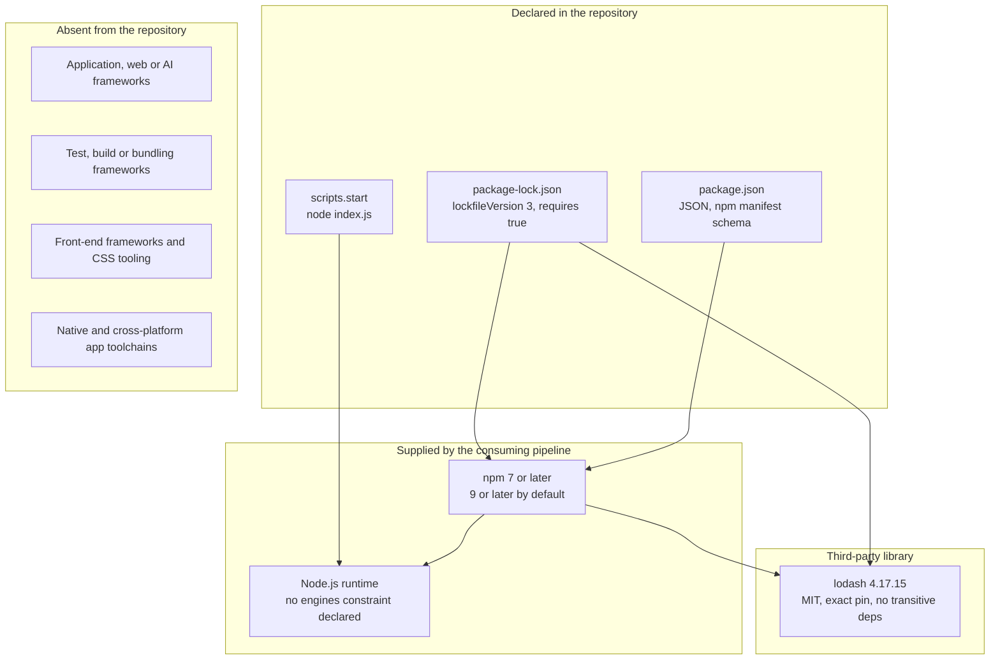

### 3.2.1 Core Frameworks

No framework is declared. Each framework category a reader might expect is evaluated below against what the repository actually contains.

| Framework category | Installed or declared | Evidence of absence in the repository |
| --- | --- | --- |
| Web / HTTP framework (Express, Fastify, Flask, Django, Spring, ASP.NET) | No | `dependencies` holds one entry only; no server file, no route, no port, no start-up configuration exists |
| Application / inversion-of-control framework | No | No source file, no container or dependency-injection configuration |
| Test framework (Jest, Vitest, Mocha, pytest, XCTest) | No | No `test` script — `scripts` contains only `start`; no `jest.config.js` or `vitest.config.ts` exists |
| Build / bundling / transpilation framework (Webpack, Vite, Rollup, Babel, tsc) | No | No build script, no bundler or compiler configuration, no `tsconfig.json` exists |
| Front-end framework (React, Vue, Angular) and CSS framework (TailwindCSS, Bootstrap) | No | No front-end source file exists; no presentation-layer dependency is declared |
| Desktop / mobile / cross-platform framework (Electron, React Native, SwiftUI, Jetpack Compose) | No | No native project file, no mobile manifest, no platform-specific source |
| AI / orchestration framework (LangChain, LlamaIndex) | No | The single dependency is `lodash`; no model, prompt, agent or inference configuration exists |
| Package manager and lifecycle runner | Yes — `npm` | `package.json`'s `scripts.start` and `package-lock.json`'s `lockfileVersion` are both npm's formats |

The only framework-shaped component in the artifact is npm itself, acting as the manifest and lockfile consumer and as the lifecycle runner for the single declared script.

### 3.2.2 Supporting Libraries

| Library | Version | Registry | License | Declared role | Resolved artifact |
| --- | --- | --- | --- | --- | --- |
| `lodash` | `4.17.15` (exact pin, no `^` or `~`) | `https://registry.npmjs.org` | MIT | Runtime dependency, the only one; no `devDependencies`, `peerDependencies` or `optionalDependencies` sections exist | `https://registry.npmjs.org/lodash/-/lodash-4.17.15.tgz` |

Three properties of this library are what make it the fixture's entire technical payload:

- **It is the only external package.** The lockfile's `packages` map contains exactly two keys, the root `""` and `node_modules/lodash`, so the resolution graph is a single node with no transitive dependencies.
- **Its use in code is unobservable.** The lockfile records no `engines`, `os` or `cpu` constraint for the resolved package, and because `index.js` is absent, no call site shows which `lodash` functions the artifact intends to consume. The dependency's consumer-visible role is therefore declared-only: present in the manifest and resolved in the lockfile.
- **Its version is a deliberate detection target, not a current release.** Version `4.17.15` is covered by six live advisories (see §3.3.3), which is precisely the condition the fixture exists to present to a scanner.

### 3.2.3 Compatibility Requirements

| Requirement | Constraint the repository imposes | Source of truth |
| --- | --- | --- |
| Lockfile consumption | The lockfile is `lockfileVersion` 3 with `requires` true; it is consumable by npm 7 and later (npm 9 and later generate it by default) and is not interoperable with npm 5 or 6, which therefore cannot run the install path against this repository | `package-lock.json` L4–L6 |
| Node.js runtime | None declared: no `engines`, no `.nvmrc`, no `packageManager`. The effective runtime is whichever Node.js the consumer provides; Node.js LTS lines at the time of writing are 24.x (Active LTS) and 22.x (Maintenance LTS) | `package.json` (absence of any engine field) |
| Integrity verification | Install-time verification of the resolved artifact must succeed for an install to complete, and it currently does not: the recorded hash does not match the published tarball, so `npm ci` aborts with `EINTEGRITY` after downloading 314,170 bytes | `package-lock.json` L17 compared with the registry's `dist.integrity` |
| Peer and optional dependency compatibility | No compatibility surface exists: no peer, optional or bundled dependency sections are declared, and the resolved library brings no dependencies of its own | `package.json` L10–L12; `package-lock.json` L6–L20 |
| Module interoperation | No `type` field is declared, so no module format is configured for the package; the file that would show the import style is absent | `package.json` |

### 3.2.4 Justification of the Framework and Library Choices

| Choice | Justification visible in the repository | Security implication |
| --- | --- | --- |
| No application framework | The artifact's declared purpose is dependency vulnerability scanning, which reads a manifest and a lockfile rather than running an application. A framework would add source files, start-up configuration and build steps — all of which Section 1.3.2 places out of scope | A framework-free artifact has no runtime attack surface of its own; there is no server to expose, no route to reach and no deserialization path to abuse |
| No test or build framework | With no code, there is nothing to test or compile; adding either would introduce the toolchain configuration the fixture deliberately omits | Fewer tools means fewer transitive dependencies to scan, keeping this repository's own finding set attributable to one package |
| `lodash` as the single library | It is a widely used, MIT-licensed library whose `4.17.15` release sits inside the affected range of six live advisories, giving the scanner an unambiguous known-vulnerable target while the MIT licence leaves redistribution and scanning unrestricted | The pin is intentionally vulnerable. Copying `lodash@4.17.15` into a production project would import CVE-2020-8203, CVE-2020-28500, CVE-2021-23337, CVE-2025-13465, CVE-2026-2950 and CVE-2026-4800; the fixture's security value is detection, never protection |
| Runtime dependency rather than a development one | The dependency is declared under `dependencies`, so a scanner classifies it as shipped rather than build-only | A dependency-derived finding is attributed to a shipped package, which is the case scanners must handle |
| Exact pin rather than a range | A range would let the resolved version float with each install, so the expected finding set would not be reproducible | The scanned version cannot be silently replaced by a range resolution |

The repository declares no licence of its own (`package.json` has no `license` field), and publication is disabled by `"private": true`, so no licensing obligation attaches to the fixture itself; the only licence record in the tree is the MIT declaration carried for `lodash` in the lockfile.


## 3.3 Open Source Dependencies

The artifact has exactly one open-source dependency. Everything a reader needs to know about it — version, registry origin, licence and expected advisory exposure — is fixed in two files, which is the property the fixture exists to provide.

### 3.3.1 Dependency Inventory

| Package | Version (pin) | Registry and resolved artifact | Licence |
| --- | --- | --- | --- |
| `lodash` | `4.17.15`, exact, no range operator | Public npm registry, `https://registry.npmjs.org/lodash/-/lodash-4.17.15.tgz` | MIT, declared in the lockfile |

| Dependency class | Count | Evidence |
| --- | --- | --- |
| Direct runtime dependencies | 1 | `package.json` L10–L12; `package-lock.json` L10–L12 |
| Transitive dependencies | 0 | `package-lock.json`'s `packages` map holds exactly the root `""` and `node_modules/lodash` |
| Development dependencies | 0 | No `devDependencies` section exists |
| Peer, optional or bundled dependencies | 0 | No such sections exist, and the resolved library declares no dependencies of its own in this lockfile |
| Alternate package-manager lockfiles | 0 | No `yarn.lock` or `pnpm-lock.yaml` exists |

The version literal `4.17.15` appears verbatim in three places — `package.json` L11, `package-lock.json` L11 (the root entry) and `package-lock.json` L15 (the resolved entry) — and no `overrides`, `resolutions` or `workspaces` field remaps it.

### 3.3.2 Resolution Record and Install Path

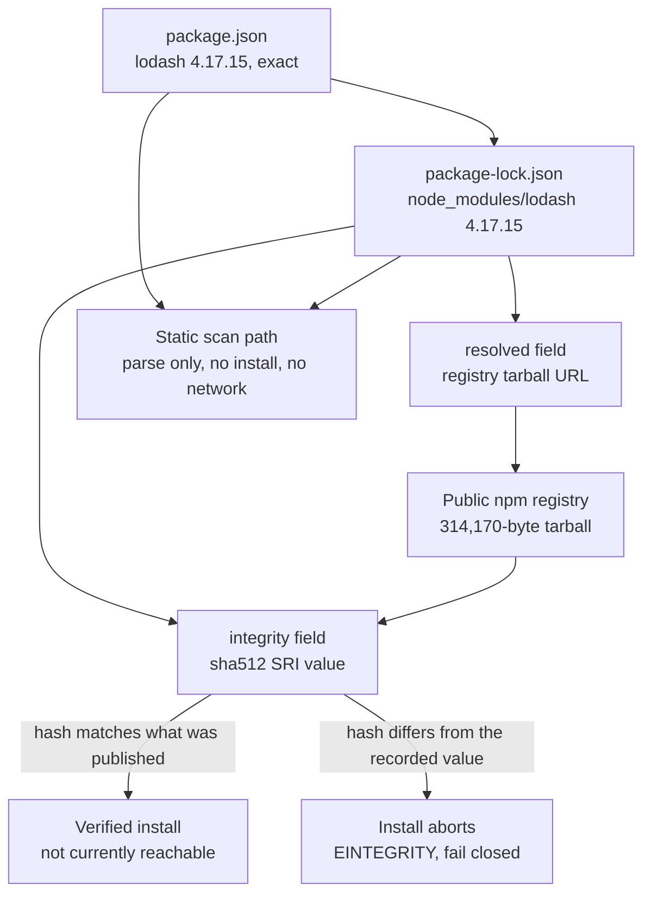

| Element of the resolution record | Value | Purpose |
| --- | --- | --- |
| `lockfileVersion` | `3`, with `requires` true | The format npm 9 and later generate by default; npm's documented formats are 1 (npm 5/6), 2 (npm 7/8) and 3 (npm 9 and later, backwards compatible to npm 7). It is not interoperable with npm 5 or 6, so the consuming pipeline's npm version decides whether any install path can run. The root-level `requires: true` boolean is written unconditionally by npm's resolver and carries no dependency information |
| `resolved` | `https://registry.npmjs.org/lodash/-/lodash-4.17.15.tgz` | Records where the package was actually resolved from, so the install reproduces the same tree without a range lookup. `registry.npmjs.org` is npm's magic value for the configured registry, and no `.npmrc` or registry override exists in the repository, so the default public registry is what this resolves to |
| `integrity` | `sha512-8x0cRHvCjnocdS5cpwXQXVzmmh5e5+saE2QG0eQmbKmRS63JVQppP0It0MnmE+4xlZoumy0GPG0D0MV1QbNA1A==` | A Standard Subresource Integrity string for the unpacked artifact; npm verifies the download against it with the strongest supported algorithm |
| `license` | `MIT` | The only licence record in the repository; `package.json` declares no licence for the fixture itself |

The install path is currently blocked: the recorded integrity value does not match the published tarball, so `npm ci` downloads 314,170 bytes, retries, and aborts with `EINTEGRITY` — fail-closed, refusing to install unverified content. Static scanning is unaffected, because it reads the two JSON files and needs no install and no network.

### 3.3.3 Advisory Exposure of the Pinned Version

The pinned release is inside the affected range of six live advisories. All six clear only at `4.18.0` or later.

| Advisory | Class (CWE) | Affected functions | Fixed in |
| --- | --- | --- | --- |
| CVE-2020-8203 / GHSA-p6mc-m468-83gw | Prototype pollution (CWE-1321; CWE-770) | `pick`, `set`, `setWith`, `update`, `updateWith`, `zipObjectDeep` | 4.17.19 |
| CVE-2020-28500 / GHSA-29mw-wpgm-hmr9 | Regular-expression denial of service (CWE-400; CWE-1333) | `toNumber`, `trim`, `trimEnd` | 4.17.21 |
| CVE-2021-23337 / GHSA-35jh-r3h4-6jhm | Command injection (CWE-77; CWE-94) | `_.template` (`variable` option) | 4.17.21 |
| CVE-2025-13465 / GHSA-xxjr-mmjv-4gpg | Prototype pollution (CWE-1321) | `_.unset`, `_.omit` | 4.17.23 |
| CVE-2026-2950 / GHSA-f23m-r3pf-42rh | Prototype pollution via array-path bypass (CWE-1321) | `_.unset`, `_.omit` | 4.18.0 |
| CVE-2026-4800 / GHSA-r5fr-rjxr-66jc | Code injection via `_.template` `options.imports` key names (CWE-94) | `_.template` | 4.18.0 |

Two qualifications belong with this table. First, the affected-function names come from the advisory text; the advisory records themselves carry no structured function field. Second, one further advisory associated with the `lodash` line — CVE-2021-41720 / GHSA-8p5q-j9m2-g8wr — is withdrawn, covering `<= 4.17.21` with no patched version, so a scanner's inclusion or omission of it is a defensible difference between tools rather than a defect. Advisories fixed at `4.17.5`–`4.17.12` (CVE-2018-3721, CVE-2018-16487, CVE-2019-10744, CVE-2019-1010266) do not cover `4.17.15`.

### 3.3.4 Version Currency and the Remediation Target

`4.17.15` is an old release, and the versions that would clear the advisories are published and reachable: `4.17.19`, `4.17.20`, `4.17.21`, `4.17.23`, `4.18.0` and `4.18.1` are all present on the registry, with `4.18.1` as the current `latest` dist-tag. Sources disagree about the correct target, and the disagreement is material rather than editorial.

| Source | Recommended or required target | Conflict |
| --- | --- | --- |
| GitHub Advisory Database | `4.18.0` — the highest `first_patched_version` across the six advisories; `4.17.23` remains inside the affected range of CVE-2026-2950 and CVE-2026-4800 | Names no advisory that `4.18.1` fixes |
| npm registry metadata | `4.18.0` itself is marked deprecated: "Bad release. Please use lodash@4.17.21 instead." | npm's advice points to `4.17.21`, which the advisory set still marks affected by CVE-2025-13465, CVE-2026-2950 and CVE-2026-4800 |
| Snyk | `4.18.1` — its `4.18.0` page states that release "was intended to fix this vulnerability but it got deprecated due to introducing a breaking functionality issue", and scores `4.18.1` clean | Goes beyond the advisory data, which names no fix in `4.18.1` |
| Debricked (OpenText) | No version-specific fix; its table lists `4.18.0` and `4.18.1` alike and still names CVE-2020-8203, CVE-2020-28500 and CVE-2021-23337 against them | Disagrees with both the Advisory Database and Snyk on whether `4.18.1` is clean |

For this fixture the choice matters only if the pin is deliberately bumped: the expected finding set after remediation depends on which target the organization accepts. Raising the pin is a coordinated four-field edit — the version in `package.json` and in `package-lock.json`'s root and resolved entries, plus the `integrity` value, which must be regenerated from whichever artifact is actually installed.

### 3.3.5 Supply-Chain Observations

| Observation | Detail |
| --- | --- |
| Recorded integrity is wrong | The lockfile records `sha512-8x0cRHvC…QG0eQmbKmRS63JVQppP0It0MnmE+4xlZoumy0GPG0D0MV1QbNA1A==`; the registry's `dist.integrity` for `lodash@4.17.15` is `sha512-8xOcRHvC…QGoeQmbKmRS6J3VQppPOIt0MnmE+4xlZoumy0GPG0D0MVIQbNA1A==`. The two differ in three character positions, and the mismatch fails verification rather than proceeding |
| No provenance attestation | The lockfile records `resolved`, `integrity` and `license` only; no npm provenance, signature or attestation field is present |
| No SBOM or inventory export | Nothing in the repository generates a bill of materials; the inventory is the two files themselves |
| No registry or audit configuration | No `.npmrc` exists, so no registry override, no scoped-registry mapping, no `audit` or `ignore-scripts` policy is set. Advisory consultation is entirely the consuming pipeline's responsibility, and no `audit` script is declared |
| No installed tree | No `node_modules` directory is present or tracked, so every dependency fact is declarative and none is vendored |
| No credential material | The manifest and lockfile hold package metadata only — no tokens, `.npmrc` auth lines or secrets |
| Publication disabled | `"private": true` prevents this artifact, which pins a vulnerable release, from being published to any registry |


## 3.4 Third-Party Services

No third-party service is integrated by this repository. There is no API client, no SDK dependency, no service endpoint, no credential, no configuration file and no environment variable anywhere in the tree; the single external endpoint the artifact references is the public npm registry, and it is referenced only as the origin of one install-time download.

### 3.4.1 External APIs and Integrations

| Service or integration | Interaction | Direction | Evidence |
| --- | --- | --- | --- |
| Public npm registry (`registry.npmjs.org`) | Download of `lodash-4.17.15.tgz` (314,170 bytes) at install time, verified against the lockfile's integrity value | Outbound, install-time only | `package-lock.json` L16–L17 |
| Consuming SCA scanner and its advisory feed | Reads the two JSON files and matches the pinned version against its own advisory data; the feed itself is not named or configured here | Inbound | No scanner dependency, configuration or output artifact exists in the repository |
| Consumer's CI/CD pipeline | Clones the repository and invokes the scan job; the pipeline is defined entirely outside this repository | Inbound | No workflow, pipeline or automation file exists (Section 1.3.2) |
| Git remote | Distribution channel for the two committed files; `origin` carries `main` and the checked-out `1210_01`, whose trees are identical | Inbound | `git` metadata only — no file in the tree configures it |

There is no HTTP client library, no vendor SDK, no webhook, no message broker, no queue, no RPC stub and no callback URL. The only network interaction the fixture can produce is npm's fetch of one registry tarball, which is reachable solely through an install attempt and currently terminates in `EINTEGRITY` rather than a completed download-and-verify.

### 3.4.2 Authentication Services

None. The repository contains no identity provider, no OAuth or OIDC configuration, no token, no API key, no session store and no secrets material; `package.json` and `package-lock.json` hold package metadata only. The artifact has no user-facing authentication surface because it has no application and no users.

Two registry-authentication facts belong to the picture even though neither is configured here: npm's `publish` command requires an authenticated session against the configured registry (a dry run warns that a login is required), and for this package a real publish is refused with `EPRIVATE` before any registry request is made, because the manifest sets `"private": true`. Authentication to the registry is therefore neither needed nor usable by this artifact. The declared `start` script, by contrast, executes command text under the privileges of whatever pipeline runs it — a trust surface on the consumer's side, not an authentication integration.

### 3.4.3 Monitoring, Observability and Security Tooling

| Capability | Present in the repository | Note |
| --- | --- | --- |
| APM or runtime monitoring agent | No | No agent dependency, no initialization code |
| Logging or telemetry SDK | No | No logging library, no log configuration, no telemetry endpoint |
| Error reporting or alerting service | No | No reporter dependency and no notification configuration |
| Dependency scanning as a repository feature | No | No `audit` script is declared and no `.npmrc` sets an audit policy, so advisory consultation happens only in the consuming pipeline |
| SAST, secret scanning, container or IaC scanning | No | None of the artifact types those tools consume exists here |
| Dashboards, SLOs or uptime checks | No | The artifact serves no endpoint and runs nothing |

The only monitoring signal the artifact produces is the report generated by the consumer's scanner. When npm itself fails against the repository — as `npm ci` does with `EINTEGRITY` and `npm run start` does with `MODULE_NOT_FOUND` — it writes a debug log under the invoking user's npm log directory; that is npm's own behaviour, not a monitoring integration configured in this repository.

### 3.4.4 Cloud Services and Infrastructure

No cloud service is referenced. There is no provider SDK in `dependencies`, no infrastructure-as-code file, no container registry, no serverless or platform configuration, no managed service endpoint and no credential of any kind; the tree contains exactly two JSON files, and an explicit probe for cloud- and platform-related artifacts (Terraform files, Docker artifacts, a `.github` pipeline directory) found none. Statements that this artifact uses AWS, Docker, Terraform or GitHub Actions would not be supportable from the repository.

### 3.4.5 Integration Requirements Placed on the Consuming Environment

| Requirement | Needed for | Constraint |
| --- | --- | --- |
| Node.js runtime | The declared `start` path and any resolution-based tooling | Unpinned by the repository; Node.js LTS lines at the time of writing are 24.x and 22.x |
| npm 7 or later (9 or later by default) | Consuming the `lockfileVersion` 3 lockfile | npm 5 and 6 cannot interoperate with this format, and an install path against the repository additionally requires the integrity value to be corrected |
| Network access to `registry.npmjs.org` | Install-based or resolution-based scanning | Not required by static scanning, which needs only file access |
| An advisory data source | Producing findings | Neither named nor configured in the repository |
| Git access | Obtaining the artifact | Branch `main` or `1210_01`; both carry identical trees |

Because every integration is file- or registry-based, the artifact imposes no service dependency on the consumer beyond a workspace that can read JSON and, optionally, reach the public npm registry.


## 3.5 Databases & Storage

Not applicable: this artifact has no database, no data store, no cache and no storage service. It persists two declarative JSON files in git and nothing else — 852 bytes in total, with no runtime, so nothing can write, read, query or expire data. The sub-sections below record that absence explicitly, because a technology-stack section that simply omits the topic would leave a reader unable to tell whether the information was missing or deliberately nil.

### 3.5.1 Databases

| Database category | Present | Evidence |
| --- | --- | --- |
| Relational / SQL (PostgreSQL, MySQL, SQL Server, Oracle) | No | No driver, ORM or SQL file; the only dependency is `lodash` |
| Document / NoSQL (MongoDB, CouchDB, DynamoDB) | No | No document client or ODM dependency, no connection string, no schema |
| Key-value store (Redis, Memcached, etcd) | No | No client library and no cache configuration |
| Embedded / file-based (SQLite, LevelDB, DuckDB) | No | No database file, no embedded engine dependency |
| Search, time-series, graph, columnar or warehouse | No | No client, no index definition, no query |
| Migrations / schema management | No | No migration directory, no migration script, no schema artefact |

Three consequences follow from this absence rather than from any configuration. There is no connection string anywhere — and no place one could be supplied, since the repository defines no configuration file and no environment-variable convention. There is no persistence code path, because no source file exists. And no schema, index or migration can drift, because none is declared.

### 3.5.2 Data Persistence Strategy

What the artifact does persist is its own declaration state, versioned in git rather than in a database.

| Storage role | Mechanism | Evidence | Lifetime |
| --- | --- | --- | --- |
| Package identity and dependency declaration | `package.json`, committed | `package.json` L2–L12 | As long as the file remains in the repository |
| Install resolution state | `package-lock.json`, committed | `package-lock.json` L4–L19 | As long as the file remains in the repository |
| Version history of both files | Git objects — a single commit `9ea96dc` on `main` and `1210_01`, whose trees are identical | Git metadata; the two branches carry the same two blobs | Indefinite, in the repository's history |
| Dependency bytes at rest | None: no `node_modules` directory exists and nothing is vendored | `ls -d node_modules` returns no such directory; `git ls-files` lists only the two JSON files | Not persisted in the repository at all |
| Dependency bytes during an install attempt | npm's own content-addressable cache on the installing machine after a download that passes integrity verification | npm behaviour, not a repository configuration; no verified download currently completes | Consumer-environment scope, outside this repository |

The persistence strategy is therefore whole-file, commit-versioned configuration: state changes only by editing a JSON file and committing it, and the repository holds no mutable runtime state, no generated artefact and no vendored dependency.

### 3.5.3 Caching

No caching layer is configured in the repository: no in-memory or distributed cache client, no HTTP cache-control configuration, no CDN, no build cache and no artefact repository. There is no application process in which a cache could operate. The only cache in the picture is npm's local package cache on the machine performing an install, and it is invisible to and unconfigured by this repository — the same is true of the registry's own edge caching of `lodash-4.17.15.tgz`.

### 3.5.4 Storage Services

No storage service is used: no object storage (S3, GCS, Azure Blob), no managed file system, no block volume, no backup or disaster-recovery configuration, no retention policy, no lifecycle rule and no encryption-at-rest setting. Nothing in the tree references a bucket, container, share or mount point, and no such reference could be resolved because the repository declares no infrastructure at all. Stated plainly: the fixture's storage surface is the file system of whatever machine has it checked out, plus the git history that carries it.

### 3.5.5 Data Governance Considerations

| Consideration | Assessment |
| --- | --- |
| Personal or sensitive data | None. The files contain package metadata: a name, a version, a description, a private flag, one dependency pin, a registry URL, an integrity hash and a licence identifier |
| Credentials or secrets | None present in either file, and no credential store is referenced |
| Runtime or user data | None — nothing executes, so no data is produced, logged or retained |
| Data-integrity risk | Real and present, though not a disclosure risk: the recorded `integrity` value does not match the published tarball, so the persisted resolution record cannot be verified and any integrity-checked install fails closed |
| Retention and distribution obligations | The fixture declares no licence of its own and `"private": true` blocks registry publication, so it can move only by being cloned or copied; git history retains both files indefinitely |
| Regulatory scope | None identifiable — no jurisdiction, residency, classification or compliance control is declared anywhere in the repository |


## 3.6 Development & Deployment

The repository's development and deployment tooling is npm and nothing else. There is no build system, no test or lint tooling, no containerisation and no pipeline definition; the tree holds exactly two files, so the absence is exhaustive rather than a matter of a missing configuration path. What automation exists around the artifact is supplied by the consuming pipeline, and this section states both what the repository provides and what that consumer must add.

### 3.6.1 Development Tools

| Tooling category | Present | Evidence |
| --- | --- | --- |
| Package manager and lifecycle runner | Yes — npm | `scripts.start` in `package.json`; `lockfileVersion` 3 in `package-lock.json` |
| Runtime | Node.js (version unpinned) | `"start": "node index.js"`; no `engines`, `.nvmrc` or `packageManager` field |
| Linter / formatter | No | No ESLint, Prettier or equivalent configuration exists |
| Type checker | No | No `tsconfig.json`, no type packages, no `typecheck` script |
| Test runner | No | `scripts` contains only `start`; no Jest, Vitest or other test configuration exists |
| Task runner or build orchestrator | No | No Makefile, no npm workspaces, no monorepo configuration |
| Version manager or toolchain pin | No | No `.nvmrc`, no `.tool-versions`, no Volta configuration |
| npm configuration | No | No `.npmrc`, so no registry override, scope mapping or install policy is set |
| Repository scaffolding | No | No `.gitignore`, `README` or licence file; the tree is two JSON files only |

The only declared command in the repository is `start`: `npm run start` shells out to `node index.js`, and it fails immediately with `MODULE_NOT_FOUND` because `index.js` is not in the tree. There is consequently no development loop to describe — no watch mode, no dev server, no hot reload, no local run that completes.

### 3.6.2 Build System

No build system exists, and none is needed by design: the artifact is two JSON documents plus a declared entry point. Specifically, there is no build, bundle, transpile or compile script; no `prepare`, `prepublish`, `prepack` or `postinstall` lifecycle hook that would run tooling on install; no output directory, artefact manifest or packaging step; and no bundler or transpiler configuration. Because `main` names a source file that does not exist, there is not even an artefact available to package.

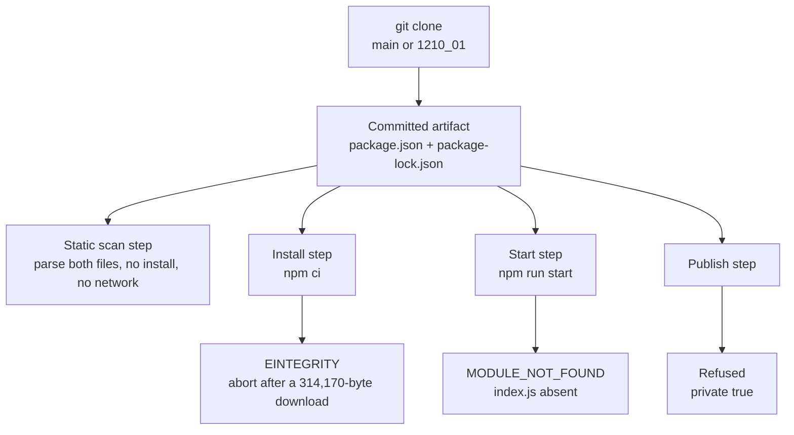

The nearest thing to a build step in this stack is npm's own resolution at install time: reading `package.json`, applying `package-lock.json`, fetching the pinned tarball and verifying its integrity. That step is measurable and currently fails — one registry download of 314,170 bytes, two retry attempts, then `EINTEGRITY`, exit status 1. Only the static scan path completes, because it parses the two files without building, installing or executing anything.

### 3.6.3 Containerisation

| Artefact | Present | Evidence |
| --- | --- | --- |
| `Dockerfile` | No | Probe for the file returns absent |
| `.dockerignore` | No | Probe returns absent |
| Compose file (`docker-compose.yml` / `.yaml`) | No | Probe returns absent |
| Image manifest, base-image pin or registry configuration | No | Nothing in the tree references an image, tag or registry |
| Kubernetes, Helm or other orchestrator descriptor | No | The tree contains exactly two files, both JSON |

Containerisation is therefore not part of this artifact in any form. A pipeline that wraps the repository in a container supplies and maintains that image definition entirely outside this repository, and the fixture itself remains a pair of files that any environment with a file system can read.

### 3.6.4 Continuous Integration and Continuous Delivery

No CI/CD definition exists: the repository contains no `.github` directory and no workflow, pipeline, job or build file of any kind — an exhaustive statement, since `git ls-files` and a working-tree search both return exactly two files. There is likewise no infrastructure-as-code artefact, so provisioning is not expressed here either. The pipeline that clones the fixture and scans it is defined by its consumer (Section 1.3.1); the repository supplies no job, no trigger and no gate.

| Deployment aspect | State |
| --- | --- |
| Distribution mechanism | `git clone` or a copy of the two files; branches `main` and `1210_01` carry identical trees |
| Publication to a registry | Blocked: `"private": true` makes npm refuse a real publish with `EPRIVATE` |
| Versioning and release automation | None; the version is the static literal `1.0.0` and history is a single commit |
| Environments and configuration | None defined — no environment variables, no config file, no per-stage settings |
| Rollback and promotion | Not applicable; there is no deployed runtime artefact to promote or roll back |
| Quality gate available to a pipeline | A pass/fail judgement is produced by the consumer's scanner, not by the repository; the install path fails closed and the start path fails outright |

One release-pipeline caveat is worth recording: `npm publish --dry-run` exits 0 against this package and does not exercise the private-package guard, so a dry run cannot be used as evidence that publication is actually blocked. The guard is enforced only when a publish is really attempted.

### 3.6.5 Integration Requirements on the Build and Deployment Environment

| Requirement | Needed for | Constraint |
| --- | --- | --- |
| Node.js runtime | Executing the declared `start` path; resolving the lockfile | Unpinned by the repository; Node.js LTS lines at the time of writing are 24.x (Active LTS, EOL 2028-04-30) and 22.x (Maintenance LTS, EOL 2027-04-30), and the environment used to verify this document runs Node v22.23.3 with npm 11.18.0 |
| npm 7 or later (9 or later by default) | Consuming the `lockfileVersion` 3 lockfile | npm 5 and 6 cannot interoperate with this format; npm 8 maintains an existing higher lockfile version rather than downgrading it |
| Network access to `registry.npmjs.org` | Any install- or resolution-based step | Not required for static file parsing |
| A corrected `integrity` value | Completing an install-based build or scan step against the repository as committed | Without it, `npm ci` aborts with `EINTEGRITY` |
| Its own CI/CD definition, container image and advisory data source | Automated scanning and gating | None of these is declared in this repository |


## 3.7 Default Stack Reconciliation and Adoption Guidance

The section prompt supplies a default technology stack — AWS, Docker, Terraform, GitHub Actions, Python, Flask, Auth0, MongoDB, LangChain, React with TypeScript, TailwindCSS, React Native, Swift, Kotlin, Objective-C and ElectronJS. That list is guidance for a project that declares such components; this repository declares none of them. The two tables below separate what the artifact actually adopts from what the default list proposes, so the divergence is explicit rather than silent.

### 3.7.1 Stack Adopted by the Repository

| Component | Version, as recorded in the repository | Where it is declared | Verdict |
| --- | --- | --- | --- |
| Node.js (JavaScript runtime) | Unpinned — no `engines`, `.nvmrc` or `packageManager` field | `package.json` L6, L8 | Adopted implicitly: the manifest declares a Node.js entry point |
| npm (package manager and lifecycle runner) | Not versioned in the repository; the lockfile format constrains consumers to npm 7 or later, npm 9 or later by default | `scripts.start`; `package-lock.json` L4–L6 | Adopted |
| JSON (npm manifest and lockfile schemas) | Manifest per npm's `package.json` schema; lockfile at `lockfileVersion` 3 | `package.json`; `package-lock.json` L4 | Adopted |
| `lodash` | `4.17.15`, exact pin, MIT | `package.json` L11; `package-lock.json` L11, L15, L18 | Adopted — the single third-party library |
| Public npm registry | Endpoint recorded as `https://registry.npmjs.org/lodash/-/lodash-4.17.15.tgz` | `package-lock.json` L16 | Adopted as the install-time origin of the pinned artifact |

These five entries are the entire technology stack that is supportable from the repository. No other component can be given a version, because no other component is named in any file.

### 3.7.2 Default Stack Items Assessed Against Evidence

| Default stack item | Category in the default list | Evidence in this repository | Verdict |
| --- | --- | --- | --- |
| AWS | Cloud platform | Nothing in the tree references a cloud provider; the only dependency is `lodash` | Not present |
| Docker | Containerisation | `Dockerfile`, `.dockerignore` and compose files all absent | Not present |
| Terraform | Infrastructure as code | No `terraform.tf`, `main.tf` or any IaC file exists | Not present |
| GitHub Actions | CI/CD | No `.github` directory and no pipeline file exists | Not present |
| Python | Backend language | No `.py` file, no `requirements.txt`, no `pyproject.toml` | Not present |
| Flask | Backend framework | Not a declared dependency; no application source exists | Not present |
| Auth0 | Authentication | No identity-provider dependency, configuration or credential exists | Not present |
| MongoDB | Database | No document-store driver, ODM or connection string exists | Not present |
| LangChain | AI framework | Not a declared dependency; no model, prompt or agent configuration exists | Not present |
| React with TypeScript | Front-end web | No front-end source file and no `tsconfig.json` or React dependency exists | Not present |
| TailwindCSS | CSS framework | No stylesheet, build configuration or styling dependency exists | Not present |
| React Native with TypeScript | Mobile / cross-platform | No mobile manifest or platform project file exists | Not present |
| Swift | iOS | No Swift source or Xcode project exists | Not present |
| Kotlin | Android | No Kotlin source or Gradle build exists | Not present |
| Objective-C | macOS | No Objective-C source or Xcode project exists | Not present |
| ElectronJS | Desktop | No desktop-shell dependency or main-process source exists | Not present |

The verdict is "not present", not "rejected": the repository records no decision about these technologies, because it contains no planning, architecture or evaluation document at all. A reader should treat the default list as a proposal belonging to the consuming organization rather than as a description of this artifact.

### 3.7.3 Adoption Guidance

| Consideration | Guidance grounded in the repository |
| --- | --- |
| Effect on the fixture's purpose | The manifest's own `description` states the purpose — "Minimal repository for validating dependency vulnerability scanning". Adding frameworks, runtimes or services would introduce further dependencies and therefore further possible findings, so the single-package attribution that makes the expected result determinate would be lost |
| Scope consequences | Section 1.3.2 places application logic, build and test tooling, CI/CD definitions, containerisation, IaC, front-end and native implementations explicitly out of scope. Adopting any default-stack item would require revising that scope, not merely adding a file |
| Where the default stack should be documented | In the repositories that actually declare those components. Nothing in this tree can date, version or justify them, so listing them here would create an unverifiable claim |
| Versioning discipline if anything is adopted | Any component added must carry an explicit version recorded in the repository. The fixture's own lesson is that a pin is only meaningful when stated exactly in both the manifest and the lockfile, and that an unversioned runtime leaves behaviour to whichever environment reads it |
| Verification before adoption | An install-based pipeline cannot currently complete against this repository at all, because the lockfile's `integrity` value does not match the published `lodash@4.17.15` tarball. Any tooling added to this repository for scanning purposes must therefore be able to work from static file parsing, or the integrity value must be corrected first |
| Security posture of an addition | Because the artifact is deliberately vulnerable and `"private": true` keeps it unpublished, the safe pattern is to keep it isolated as a scanning target: tools and services used against it belong in the consumer's pipeline and credentials, not inside a repository whose only committed content is a known-vulnerable pin |


## 3.8 References

- `package.json` — the artifact's only manifest: package identity (`name`, `version` 1.0.0, `private` true, `description`), the declared entry point (`main` = `index.js`), the single lifecycle script (`start` = `node index.js`) and the single exact-pinned runtime dependency (`lodash` `4.17.15`); established the language surface, the npm toolchain, and the absence of `engines`, `devDependencies`, `overrides`, `resolutions`, `workspaces`, `license` and any build, test, lint or type-check configuration.
- `package-lock.json` — the install resolution record: `lockfileVersion` 3 with `requires` true, the root entry mirroring the manifest, and the single resolved `node_modules/lodash` entry with version `4.17.15`, `resolved` registry URL, sha512 `integrity` value and `license` MIT; established the one-node dependency graph, the registry origin, the recorded integrity mismatch, and the absence of `engines`, `os` or `cpu` constraints for the resolved package.
- Repository root (folder `""`) — the artifact's complete contents: exactly two files, no subfolders, `.git` excluded; established that no source file, configuration file, container artefact, pipeline definition or IaC artefact exists anywhere in the tree.
- [web] npm Docs — `package-lock.json` (`https://docs.npmjs.com/cli/v11/configuring-npm/package-lock-json`) — confirmed the meaning of `resolved` and `integrity`, the documented `lockfileVersion` values 1 (npm 5/6), 2 (npm 7/8) and 3 (npm 9 and later, backwards compatible to npm 7), and that a lockfile reproduces an identical tree regardless of intermediate dependency updates.
- [web] npm Docs — `config`, `lockfile-version` (`https://docs.npmjs.com/cli/v11/using-npm/config`, `https://docs.npmjs.com/cli/v8/using-npm/config`) — confirmed that `lockfileVersion` 3 is not interoperable with older npm versions and that npm 8 maintains an existing higher lockfile version.
- [web] npm CLI release `v9.0.0` (`https://github.com/npm/cli/releases/tag/v9.0.0`) — confirmed that npm 9 made the version 3 lockfile the default, which dates the resolution format this repository carries.
- [web] `@npmcli/arborist` `shrinkwrap.js` (`https://raw.githubusercontent.com/npm/cli/latest/workspaces/arborist/lib/shrinkwrap.js`) — established that the root-level `requires: true` boolean is written unconditionally by npm's resolver and carries no dependency information.
- [web] `pacote` and `cacache` READMEs (`https://raw.githubusercontent.com/npm/pacote/main/README.md`, `https://github.com/npm/cacache`) — confirmed that an integrity mismatch raises `EINTEGRITY` and that npm refuses to install unverified content, i.e. the failure observed against this repository is fail-closed.
- [web] npm registry — package metadata docs and the `lodash` packuments (`https://registry.npmjs.org/lodash`, `https://registry.npmjs.org/lodash/4.18.0`, `https://www.npmjs.com/package/lodash`) — confirmed the published `dist.integrity` for `lodash@4.17.15` (`sha512-8xOcRHvC…QbNA1A==`) that the lockfile's recorded value fails to match, the MIT licence, the available versions, the `latest` dist-tag `4.18.1`, and the deprecation of `4.18.0` as a "Bad release".
- [web] GitHub Advisory Database — per-advisory records GHSA-p6mc-m468-83gw, GHSA-29mw-wpgm-hmr9, GHSA-35jh-r3h4-6jhm, GHSA-xxjr-mmjv-4gpg, GHSA-f23m-r3pf-42rh and GHSA-r5fr-rjxr-66jc (`https://github.com/advisories?query=affects%3Alodash`) — established the six live advisories covering `lodash` 4.17.15, their classes, affected functions and fixed versions, and that the highest `first_patched_version` is `4.18.0`.
- [web] GitHub Advisory Database — GHSA-8p5q-j9m2-g8wr, withdrawn (`https://github.com/advisories/GHSA-8p5q-j9m2-g8wr`) — established that CVE-2021-41720 is withdrawn, affects `<= 4.17.21` and has no patched version, so its inclusion or omission is a defensible difference between scanners.
- [web] Snyk package pages for `lodash` (`https://security.snyk.io/package/npm/lodash`, `https://security.snyk.io/package/npm/lodash/4.18.0`) — reported the conflicting remediation target: Snyk treats `4.18.1` as clean and attributes `4.18.0`'s replacement to a breaking issue introduced by that release.
- [web] Debricked / OpenText Fortify Open Source Select, `lodash` (`https://debricked.com/select/package/npm-lodash`) — reported a third remediation position: no version-specific fix, with advisories still listed against `4.18.0` and `4.18.1` alike.
- [web] Node.js Release Working Group (`https://github.com/nodejs/Release`, `https://nodejs.org/en/about/previous-releases`) — supplied the LTS status cited for the unpinned runtime in §3.1.3, §3.2.3 and §3.6.5: 24.x as Active LTS (EOL 2028-04-30), 22.x as Maintenance LTS (EOL 2027-04-30) and 26.x as Current.

# 4. Process Flowchart

## 4.1 System Workflows

Section 4 documents every process this repository takes part in. That scope is narrow, and stating why keeps the rest of the section honest: the artifact is not a running system. The repository root holds exactly two files, `package.json` (293 bytes) and `package-lock.json` (559 bytes) — 852 bytes in total, the only paths `git ls-files` reports — and it defines no service, no scheduler, no request handler and no source file. `index.js` is named by both `main` and `scripts.start` but does not exist. Consequently the processes below are either a consumer-side journey that passes over the artifact or an npm/filesystem pipeline a consumer runs against it. Three of the seven processes named here complete, three fail by construction of the committed state, and one is refused by the manifest's own `private` flag.

### 4.1.1 Core Business Processes

The repository declares its business purpose in the manifest itself: `"description": "Minimal repository for validating dependency vulnerability scanning"` (`package.json` L5). Its core process is therefore dependency-vulnerability detection performed by a tool outside the repository against data declared inside it; every other process below exists to serve that one or to record what the fixture deliberately blocks. All step-level facts come from the two files and from behaviour reproduced in this environment with Node.js v22.23.3 and npm 11.18.0.

| ID | Process | Trigger | Actor | Steps (with evidence) | Terminal state |
| --- | --- | --- | --- | --- | --- |
| P-1 | Obtain the fixture | A consumer decides to use the target | Pipeline job or engineer | `git clone` of `main` or the checked-out `1210_01`; both refs sit at commit `9ea96dc` and their trees are identical | Clone present at the repository root; completes |
| P-2 | Static dependency scan | Scan job starts | External SCA scanner | Parse `package.json` L10–L12 → parse `package-lock.json` L6–L20 → match advisory data → emit report | Report naming one direct dependency, `lodash` 4.17.15, with every dependency-derived finding attributable to it; completes |
| P-3 | Install-based resolution | `npm ci` | npm CLI | Read manifest and lockfile → clear `node_modules` → GET the recorded tarball URL → compute sha512 → compare with L17 → mismatch → two retries → abort | `EINTEGRITY`, exit status 1, partial `node_modules/lodash` possible; fails |
| P-4 | Native advisory audit | `npm audit` | npm CLI | Build the tree from the lockfile (no install needed) → advisory lookup over the network → report | Exit status 1, one high-severity direct finding carrying six advisories, fix available at `lodash` 4.18.1; completes with findings |
| P-5 | Declared execution | `npm start` | npm CLI spawning Node.js | Read `scripts.start` (`node index.js`) → spawn Node.js with the repository root as cwd → CommonJS loader resolves the path | `MODULE_NOT_FOUND`, exit status 1; fails |
| P-6 | Remediation | An owner decides the finding must be cleared | Engineer | Edit the version literal in `package.json` L11 and in `package-lock.json` L11 and L15, regenerate the `integrity` value in L17, then re-run P-2 or P-4 | Completes only as a coordinated four-field edit: `npm audit fix` alone refuses, reporting the fix is "outside the stated dependency range" |
| P-7 | Publication | `npm publish` | npm CLI | The publish path consults the manifest's `private` field | Refused (`EPRIVATE`); `npm publish --dry-run` exits 0 and does not exercise the guard |

**End-to-end journeys.** Two journeys carry a consumer through the fixture end to end; one completes today and one is blocked by the committed state.

*J-1 — Static validation journey (the fixture's purpose, and the only journey that reaches a result without editing the repository).*

1. **Obtain.** Clone `main` or `1210_01`; the trees are identical, so the checkout cannot change the target.
2. **Hand over the root.** The scanner is pointed at the repository root. No build, no install and no execution is involved, so no network access is needed for this journey (Section 1.3.1).
3. **Read intent (F-003).** `package.json` L10–L12 yields one dependency, `lodash`, at the exact literal `4.17.15` — no `^`, `~`, comparator or wildcard — which is what fixes the expected result.
4. **Read resolution (F-004).** `package-lock.json` L4–L5 establishes `lockfileVersion` 3 with `requires` true, and L6–L20 holds exactly two `packages` keys: the root `""` entry mirroring the manifest, and one resolved entry `node_modules/lodash`.
5. **Read provenance (F-005).** That resolved entry supplies the version literal (`4.17.15`), the registry tarball URL, the sha512 `integrity` value and `license: MIT`.
6. **Match advisories.** Findings are expected to be exactly the advisories affecting version `4.17.15`; the measured `npm audit` run for this artifact reports six, whose printed affected ranges are listed below.
7. **Compare against the known answer.** A pass requires every dependency-derived finding to be attributable to `lodash` 4.17.15 and to nothing else — there is no other dependency and no transitive entry to absorb or dilute a finding.
8. **Re-run on change.** Repeat whenever the scanner or its advisory data is updated, since the target is fixed and the expected finding set is therefore stable.

Decision points on this journey are DP-2 (lockfile format support), DP-3 (advisory coverage of the exact version) and DP-4 (attribution completeness); all are enumerated in the decision table below.

| Advisory reference printed by `npm audit` | Affected range printed |
| --- | --- |
| GHSA-35jh-r3h4-6jhm — Command Injection in lodash | `<4.17.21` |
| GHSA-p6mc-m468-83gw — Prototype Pollution in lodash | `>=3.7.0 <4.17.19` |
| GHSA-29mw-wpgm-hmr9 — Regular Expression Denial of Service (ReDoS) | `>=4.0.0 <4.17.21` |
| GHSA-r5fr-rjxr-66jc — Code Injection via `_.template` imports key names | `>=4.0.0 <=4.17.23` |
| GHSA-f23m-r3pf-42rh — Prototype Pollution via array path bypass in `_.unset` and `_.omit` | `<=4.17.23` |
| GHSA-xxjr-mmjv-4gpg — Prototype Pollution in `_.unset` and `_.omit` | `>=4.0.0 <=4.17.22` |

The npm CLI's aggregate verdict for the package was `severity: high`, `isDirect: true`, range `<=4.17.23`, with `fixAvailable` naming `lodash` 4.18.1 and `isSemVerMajor: false`. The advisory set, its CVEs and the disagreement between sources about the correct remediation target are documented in Section 3.3.3 and Section 3.3.4; npm's `fixAvailable` value is one more data point in that disagreement, and the fixture itself records no target.

*J-2 — Install-then-scan journey (blocked, and the reason the fixture is scanned statically).*

1. **Obtain.** As J-1.
2. **Install.** `npm ci` reads the manifest and lockfile, clears `node_modules`, fetches `https://registry.npmjs.org/lodash/-/lodash-4.17.15.tgz` (314,170 bytes), hashes the payload and finds the digest different from the recorded value. npm logs `tarball data ... seems to be corrupted. Trying again.` twice, then throws `EINTEGRITY` and exits 1 (DP-5).
3. **Observe residual state.** The abort is not clean: a partial extraction survives at `node_modules/lodash` (files such as `slice.js`, `snakeCase.js` and the `fp/` directory were present) because npm's own cleanup step fails with `ENOTEMPTY`.
4. **Consequence for the consumer.** Any step that requires an installed tree is unreachable against the repository exactly as committed. Observed concretely: with nothing installed, `npm ls lodash` prints `└── (empty)` rather than resolving from the lockfile, so tree-inspection-based tooling sees no dependency at all (DP-6).
5. **Fallback that does complete.** `npm audit --json` produced its report with no `node_modules` present at all, because it resolves from the lockfile and consults advisory data over the network rather than downloading the tarball (Section 4.3.2).
6. **Recovery, in order of least disruption:** switch the pipeline to a lockfile-only scan (unchanged repository), or remove the partial `node_modules` and correct the `integrity` value in `package-lock.json` L17 so the install can verify. Section 4.3.2 states both procedures step by step.

**System interactions.** Every interaction in these journeys is file-, process- or HTTP-based; nothing in the repository initiates a connection, because nothing in it executes.

| Interaction | Interface | Direction | What crosses the boundary | Evidence |
| --- | --- | --- | --- | --- |
| Source control → consumer | Git clone over HTTPS | Inbound to the consumer | Two JSON files at one commit, 852 bytes | `git ls-files`; commit `9ea96dc` |
| Filesystem → scanner | JSON parse of the two files | Read-only, no network | Package identity, one dependency declaration, one resolution record | `package.json` L2–L12; `package-lock.json` L2–L19 |
| npm CLI → registry (install) | HTTPS GET of the `resolved` URL | Outbound, install time only | `lodash-4.17.15.tgz`, 314,170 bytes | `npm ci` output |
| npm CLI → registry (audit) | HTTPS advisory lookup | Outbound, audit time only | Advisory records for the resolved version | `npm audit --json`, exit 1, six advisories |
| npm CLI → filesystem | Extraction and linking into `node_modules` | Write, in the consumer's working tree | Partial `node_modules/lodash` on the failure path | Post-abort inspection; `ENOTEMPTY` cleanup warning |
| npm CLI → Node.js | Process spawn | Internal to the consumer | `node index.js` with cwd at the repository root | `npm start` output |
| Node.js → filesystem | CommonJS module resolution | Read, fails | A path lookup for `index.js` that finds nothing | `MODULE_NOT_FOUND`, exit 1 |

**Decision points.** Every decision diamond in Section 4.4, with the branch that applies to the artifact as committed marked.

| ID | Decision | Condition | Branch taken as committed | Other branch | Diagram |
| --- | --- | --- | --- | --- | --- |
| DP-1 | Is a dependency declared? | `dependencies` non-empty in `package.json` | Yes — one key, `lodash` | No detection target exists | Figure 4.4.2 |
| DP-2 | Does the scanner understand `lockfileVersion` 3? | Format support of the `packages` map | Consumer-dependent; the fixture offers no legacy `dependencies` tree | Parse error path, no finding produced | Figures 4.4.2, 4.4.3 |
| DP-3 | Does advisory data cover version `4.17.15`? | Currency and mapping of the advisory source | Consumer-dependent; npm's own data covers it (six advisories) | False negative | Figure 4.4.2 |
| DP-4 | Is every dependency finding attributable to `lodash`? | One declared dependency, no transitive entries | Yes | Attribution defect | Figure 4.4.2 |
| DP-5 | Does the downloaded payload match the recorded digest? | sha512 comparison during install | No — mismatch, two retries, `EINTEGRITY` | Install completes | Figures 4.4.3, 4.4.5 |
| DP-6 | Is an installed tree required by the consumer? | Whether the scanner resolves from `node_modules` | Consumer-dependent; `npm ls lodash` returned an empty tree, `npm audit` did not need one | Tree-based flow blocked | Figures 4.4.2, 4.4.3 |
| DP-7 | Does `index.js` exist? | File present in the tree | No — `MODULE_NOT_FOUND` | Application logic would run | Figures 4.4.2, 4.4.4 |
| DP-8 | Is the manifest `private`? | `private: true` at `package.json` L4 | Yes — publish refused | Publish would proceed | Figure 4.1.3 |
| DP-9 | Can npm remediate within the declared range? | Exact pin `4.17.15` versus fix at 4.18.1 | No — `npm audit fix` refuses, `--force` installs outside the stated range | Automatic remediation | Figure 4.3.2 |

**Error handling paths, in summary.** Three error states are reachable and one is refused by policy: `MODULE_NOT_FOUND` on the declared execution path (exit 1, no retry, no fallback target declared), `EINTEGRITY` on the install path (two retries then exit 1, with residual partial extraction), and `EPRIVATE` on the publish path (refused before any registry request). A fourth, a manifest or lockfile parse failure, is the consumer's error rather than the repository's, and its correct handling is to treat the scan as failed rather than clean. Section 4.3.2 gives detection, notification and recovery for each; Figure 4.4.3 traces them as decisions.

### 4.1.2 Integration Workflows

The repository has no integration of its own to operate: it declares no endpoint, port, CLI, daemon, queue, webhook or configuration file (Section 1.3.2), and `private: true` removes the one outbound path npm would otherwise offer by publish. What follows is therefore the integration surface of the *consumer*, and the flows that pass across the repository's boundary.

**Data flow between systems.** Data moves in one direction only — from the two committed files outward into tooling — and the only data the repository ever receives is written by a human or by npm itself.

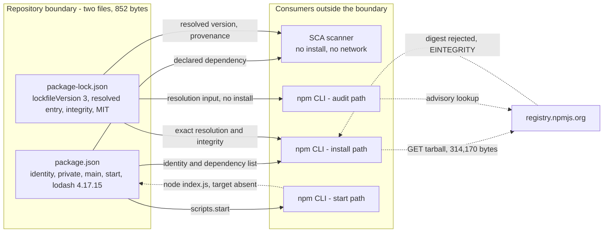

**API interactions.** The artifact exposes no API of its own; the interfaces a consumer programs against are npm's manifest and lockfile schemas, the `main`/`scripts.start` entry-point convention, and the npm CLI's own exit statuses. On the wire, two registry interactions are involved in the flows above and both are initiated by npm, never by the repository:

| Interaction | Request | Response | Failure mode observed |
| --- | --- | --- | --- |
| Tarball fetch (install path) | `GET https://registry.npmjs.org/lodash/-/lodash-4.17.15.tgz` | 314,170-byte tarball | Payload digest differs from `package-lock.json` L17 → two retries → `EINTEGRITY`, exit 1 |
| Advisory lookup (audit path) | Advisory query for the resolved version, issued by `npm audit` | Six advisories for the `lodash` line | None; the call completed and the command exited 1 because findings exist |

Two measured details qualify how the audit path's output should be read. First, `npm audit` exits 1 as its way of signalling findings, so a pipeline must distinguish that code from a transport failure rather than treating every non-zero exit as breakage. Second, the command's own counters reported `high: 1, total: 1` under `vulnerabilities` alongside `prod: 2, dev: 0, optional: 0, peer: 0, total: 1` under `dependencies` for an artifact that declares a single dependency — npm's tally is its own accounting, not an inventory of this repository, and should not be read as evidence of a second package.

**Event processing flows.** There are none. The manifest declares one lifecycle hook, `start` (`package.json` L7–L9), and no event, callback, message, subscription or timer exists anywhere in the tree; `npm run` confirms `start` is the only script. Nothing in the repository reacts to anything, because nothing in it executes. The events a consumer might attach — a scan triggered on push, a nightly advisory refresh, a gate failure notification — are defined in the consumer's CI/CD system, which the repository neither supplies nor configures (Section 3.6.4).

**Batch processing sequences.** The repository defines no scheduled or batched work, no job, no queue and no data set to iterate over. The nearest analogue in practice is the consumer's scan job, which is a single-shot batch over two files: clone, parse, compare, report, gate. Because the process reads immutable committed files and performs no writes, running it repeatedly is idempotent — the only variation across runs comes from the scanner's own version and its advisory data, not from the artifact. The measured install path is likewise deterministic in shape (one resolved URL, 314,170 bytes, two retries, abort) but produces the side effect noted in J-2: a partial `node_modules` that survives the failure and must be cleaned before a retry.

**Timing and integration constraints on the consumer.** The repository states no timing requirement, but it does impose four integration constraints that shape any workflow built around it: the consuming npm must be npm 7 or later to read `lockfileVersion` 3 (npm 5 and 6 cannot interoperate with this format, Section 3.3.2); Node.js is unpinned, since no `engines` field exists, so the runtime is whatever the consumer supplies — the version used to verify this document was Node.js v22.23.3 with npm 11.18.0; and any install-based flow needs the network while static and audit flows do not. The only timing figure this analysis produced is illustrative rather than contractual: `npm audit fix --dry-run` reported auditing 2 packages in 317 ms in this environment, a figure that measures local work, not a service level.


## 4.2 Flowchart Requirements

This sub-section states the elements every diagram in Section 4 is built from, and the boundary those elements live inside, so a reader can trace any workflow from its start point to its exit status without inferring anything the repository does not show. Because the artifact is two files rather than a running system, the elements are unusually concrete: a start point is a command or a clone, a decision is a comparison of file contents or a tool's capability, and an end point is an exit status or a written report.

### 4.2.1 Workflow Elements, Boundaries and Touchpoints

**Start and end points.** Each process from Section 4.1.1 has one declared trigger and one observable terminal state; nothing in this repository terminates by time or by volume.

| Process | Start point | End point | Exit status / artefact |
| --- | --- | --- | --- |
| P-1 Obtain the fixture | Consumer's clone decision | Working tree at the repository root | Clone of commit `9ea96dc`, two files |
| P-2 Static dependency scan | Scan job start | Report over one dependency and six advisories (observed via `npm audit`) | Report produced or a gate verdict |
| P-3 Install-based resolution | `npm ci` | Verification failure after two retries | `EINTEGRITY`, exit 1, partial `node_modules/lodash` possible |
| P-4 Native advisory audit | `npm audit` | Report from the lockfile, no install performed | Exit 1 with findings (npm signals findings by exit status) |
| P-5 Declared execution | `npm start` | CommonJS loader throws before any user code could run | `MODULE_NOT_FOUND`, exit 1 |
| P-6 Remediation | Owner accepts the finding | Edited manifest and lockfile, re-scan | Exit 0 from the scan once no advisory covers the new version |
| P-7 Publication | `npm publish` | Guard evaluated inside npm's publish path | Refused (`EPRIVATE`); a dry run exits 0 |

**Process steps.** Steps are the two files' fields, the tools that read them, and the shell commands that drive those tools; Section 4.4 labels every step with the evidence it rests on, and Figure 4.4.2 traces the seven steps of the detection process in order. No step depends on input assembled at run time, on a value supplied by a user, or on a previous run's state — every input is a committed literal.

**Decision diamonds.** Every decision in Section 4 compares something observable: a field's value, a file's presence, a digest, or whether a tool supports a format. None depends on elapsed time, on concurrency, or on an approval step, which is why the same diamond resolves the same way on every run.

| Decision class | Condition read from | Examples | Resolved by |
| --- | --- | --- | --- |
| Presence | Whether a declared path exists | DP-7 (`index.js`) | The filesystem |
| Declared value | A field's literal content | DP-1 (dependency declared), DP-8 (`private`), DP-9 (exact pin) | JSON parse |
| Cryptographic comparison | Recomputed digest versus the recorded value | DP-5 (`integrity`) | npm's install-time verification |
| Capability of the consumer | Format support, advisory currency, whether an installed tree is required | DP-2, DP-3, DP-6 | The consuming scanner or pipeline |

**System boundaries.** The boundary is the repository root: two files, 852 bytes, the only paths git tracks. Everything else in these flows — npm, Node.js, the registry, the scanner, the pipeline — sits outside it. Boundary crossings are exhaustive and few:

| Crossing | Direction | Payload | Writes into the boundary? |
| --- | --- | --- | --- |
| File read by a scanner | Inbound to the consumer | Both JSON documents | No |
| File read by npm | Inbound to the consumer | Both JSON documents | No, until a mutating command is run |
| Registry fetch | Outbound from npm | `lodash-4.17.15.tgz`, 314,170 bytes | No — extraction targets `node_modules`, not the committed files |
| Advisory lookup | Outbound from npm | Advisory records for the resolved version | No |
| Process spawn | Internal to the consumer | `node index.js`, cwd at the repository root | No |
| Publish attempt | Outbound from npm | Package tarball would be sent | No — refused while `private` is true |

No path from outside can alter the committed files: only a human edit or an npm command that rewrites `package.json`/`package-lock.json` (remediation, P-6) changes them, and no code inside the repository is capable of it because no code runs.

**User touchpoints.** The fixture has no end users, no interfaces, no session and no authentication surface (Section 1.3.2). The touchpoints that exist are professional and file-level:

| Touchpoint | Who | What they do | What they observe |
| --- | --- | --- | --- |
| Clone | Pipeline job, platform or CI owner, scanner engineer | Clone `main` or `1210_01` | Identical trees; no configuration to apply |
| Scan invocation | Scanners engineer/QA, application-security analyst | Point an SCA scanner at the repository root | One dependency, exact version, report attributable to `lodash` 4.17.15 |
| Install invocation | Pipeline owner | Run `npm ci` when a flow needs an installed tree | Two retries then `EINTEGRITY`, exit 1 |
| Audit invocation | Application-security analyst | Run `npm audit` for the ecosystem's own verdict | Exit 1, one high direct finding, six advisories, fix at 4.18.1 |
| Start invocation | Engineer or a pipeline step that assumes a runnable project | Run `npm start` | `MODULE_NOT_FOUND`, exit 1 |
| Remediation edit | Engineer or platform owner | Raise the version literal in three places and regenerate `integrity` | A re-scan whose finding set has shrunk |
| Publication attempt | Release engineer, if any | Run `npm publish` | Refusal, because the manifest is private |

**Error states and recovery paths.** Four error states are reachable across these processes; each is traced as a decision in Figure 4.4.3 and specified with procedures in Section 4.3.2.

| Error state | Detection signal | Residual state | Recovery |
| --- | --- | --- | --- |
| `MODULE_NOT_FOUND` (P-5) | Node's loader throws on stderr; exit 1 | None — nothing was executed | Add `index.js`, or stop invoking the declared start path |
| `EINTEGRITY` (P-3) | npm error naming the wanted and actual digests; exit 1 | Partial `node_modules/lodash` can survive the abort | Remove `node_modules`; correct the `integrity` value in `package-lock.json` L17; re-run |
| `EPRIVATE` (P-7) | npm refuses before any registry request | None | None needed; the refusal is the designed behaviour |
| Manifest or lockfile unparsable (consumer-side) | Scanner reports a parse failure | None in the repository | Treat the scan as failed, never as clean; then widen format support (DP-2) |

**Timing and SLA considerations.** The repository declares no service level, no timeout, no KPI and no measurable objective of any kind — its only script is `start`, and its two files contain no metric (Sections 1.2.3, 3.6.4). Three timing-relevant facts are nevertheless determinate and useful to a pipeline designer, and they are structural rather than contractual:

- The declared start path fails immediately and deterministically: the loader throws because no target file exists, so no timeout is needed to bound it, and a job that invokes `npm start` fails fast rather than hanging.
- The install path is bounded by npm's own retry policy rather than by anything in the repository. In the observed run, the payload was verified, rejected, and retried twice — the log carried two `tarball data ... seems to be corrupted. Trying again.` warnings — before `EINTEGRITY` ended the attempt, so up to three transfers of the same 314,170-byte payload occur, and the whole sequence terminates rather than retrying indefinitely. No `.npmrc` exists to change that policy, so it is a property of the consuming npm version (observed: 11.18.0).
- The static and audit paths have no timing requirement at all from the repository's side; the single wall-clock figure measured here (`npm audit fix --dry-run` reporting 2 audited packages in 317 ms) is descriptive of one environment and must not be read as a service level.

The only SLA-like statement a consumer can rely on is therefore about the target rather than the clock: because the pin is exact and the resolution record is fixed, a scan of this artifact yields the same version set every time, so run-to-run variance comes from the scanner and its advisory data, not from the repository.

### 4.2.2 Validation Rules and Checkpoints

Every rule below is enforced by a tool outside the repository, because the repository contains no logic of its own. Stating which tool enforces each rule is the practical content of this sub-section: it tells a pipeline owner where a violation will surface and where it will not.

**Business rules at each step.**

| ID | Rule | Where it is declared or enforced | What happens when it holds | What happens when it does not |
| --- | --- | --- | --- | --- |
| R-1 | The artifact must be identifiable and non-publishable | `name`, `version`, `private`, `description` (`package.json` L2–L5) | Reports can cite one fixed target; publication is refused | A publish could send a package pinning a vulnerable dependency outward |
| R-2 | Exactly one runtime dependency is declared | `dependencies` (`package.json` L10–L12) | Every dependency-derived finding is attributable to `lodash` 4.17.15 | Attribution becomes ambiguous; the known-answer comparison weakens (DP-4) |
| R-3 | The version is pinned exactly, with no range operator | The literal `"4.17.15"` in `package.json` L11 | The scanned version cannot float; the expected result is fixed | Detection would depend on resolution rather than declaration (DP-9) |
| R-4 | The lockfile resolution must agree with the manifest | `package-lock.json` L11 (root entry) and L15 (resolved entry) repeat the same literal | Manifest intent and resolved version are provably the same | A report could show one version declared and another resolved |
| R-5 | The recorded digest must match the fetched payload | npm's install-time verification against `package-lock.json` L17 | Install completes (would hold only after the value is corrected) | Two retries, then `EINTEGRITY`, exit 1 (DP-5) |
| R-6 | The declared entry point must exist | `main` (`package.json` L6) and `scripts.start` (L7–L9) | The declared path would execute | `MODULE_NOT_FOUND`, exit 1 (DP-7) |
| R-7 | Lockfile consumers must support `lockfileVersion` 3 | `package-lock.json` L4–L5 | Modern npm reads the `packages` map | npm 5 and 6 cannot interoperate with this format at all |
| R-8 | No range remapping may substitute the dependency | Absence of `overrides`, `resolutions`, `workspaces`, dev, peer and optional sections | The pin cannot be silently replaced | A scan could resolve a version the manifest does not state |

Two of these rules are deliberately unmet by the committed artifact — R-5 (the recorded digest does not verify) and R-6 (the target file is absent) — and a third is met only in the sense that the tool reads it, R-3, whose exactness is precisely what blocks npm's own automated remediation (DP-9). That combination is the fixture's design: a fixed, detectable defect alongside a fixed, detectable finding.

**Data validation requirements.** Validation is syntactic and comparative, never semantic or domain-specific:

| Validation | Requirement | Enforced by | Evidence of compliance |
| --- | --- | --- | --- |
| Manifest well-formedness | Valid JSON with the fields npm requires | npm CLI and any JSON parser | `package.json` parses; `npm run` lists `start` |
| Lockfile well-formedness | Valid JSON at `lockfileVersion` 3 | npm 7 or later | `package-lock.json` parses; `packages` holds exactly the root `""` entry and `node_modules/lodash` |
| Version identity across files | The same literal in the manifest, the lockfile root entry and the resolved entry | Comparison, or npm's own resolution | `4.17.15` at `package.json` L11, `package-lock.json` L11 and L15 |
| Integrity well-formedness | A `sha512-<base64>` Subresource Integrity string | npm, at verification time | Format is valid; value does not match the published tarball |
| Resolution target present | `resolved` names the artifact's origin | npm | Registry tarball URL recorded at L16 |
| Licence recorded | A `license` value on the resolved entry | Review tooling, not npm | `MIT` at L18; the manifest declares no licence for the fixture itself |

**Authorization checkpoints.** The artifact contains no authentication, no session, no role and no permission model, and it therefore has no authorization checkpoint a workflow could fail. Two authorization-adjacent guards do exist at the process level:

- **Publication guard.** `private: true` (`package.json` L4) is the only access control the repository states. npm enforces it inside the publish path and refuses the operation, so a workflow can never publish this artifact to a registry. It is worth noting in a flowchart that `npm publish --dry-run` exits 0 without exercising the guard, so a dry run is not evidence that publication is blocked (Sections 2.1.2, 3.6.4).
- **Source-control access.** Changing the repository requires push credentials, which the repository itself does not hold: no `.npmrc`, no credential file and no secret appears in the tree. In the environment used for this analysis the `origin` remote carries a short-lived access credential in its URL, which is why that URL is deliberately not reproduced anywhere in this specification; a workflow that clones, edits and pushes inherits whatever credential its own environment provides.

**Regulatory and compliance checks.** None are implemented, and none can be inferred from the artifact. The repository holds no personal data, no runtime data, no credentials, no secrets, no retention rule and no audit log (Section 1.3.2), and it generates no SBOM, no attestation and no signed provenance record (Section 3.3.5). The single compliance-relevant fact it carries is the resolved dependency's `license: MIT` at `package-lock.json` L18, which is the only licence statement in the repository. Licence review, export control, vulnerability-management policy and any gating threshold are therefore obligations a consumer must add; the fixture supplies the input data for such a check but performs no part of it. Where a workflow needs a compliance checkpoint, the only sound place to put it is the consumer's gate over the scan report — the process this artifact exists to exercise.


## 4.3 Technical Implementation

State in this system lives in files, not in a process: nothing holds a session, a conversation, a queue position or an in-memory cache, because nothing in the repository executes. What does have state is the artifact's lifecycle, the working tree a consumer mutates when it installs, and the two JSON documents themselves. This sub-section names those states, their transitions, where each is persisted, and where the boundaries of a write lie.

### 4.3.1 State Management

**The state model.** Three state spaces appear in the workflows of Section 4.1, and only the second is mutable by tooling:

| State space | States | Where it lives | Who transitions it |
| --- | --- | --- | --- |
| Artifact lifecycle | Committed → Cloned → Statically scanned, install attempted, execution attempted → installed, blocked, or remediated | Git commit `9ea96dc` and the clone's filesystem | The consumer alone; the repository moves no state itself |
| Install verification | Resolved → fetching → verifying → verified, or mismatch → aborted → partial tree → cleaned up | The consumer's `node_modules` and npm's cache outside the repository | The npm CLI, on the consumer's command |
| Declaration and resolution record | A pair of committed JSON documents whose fields must agree | `package.json` and `package-lock.json` | A human edit, or an npm command that rewrites them (remediation only) |

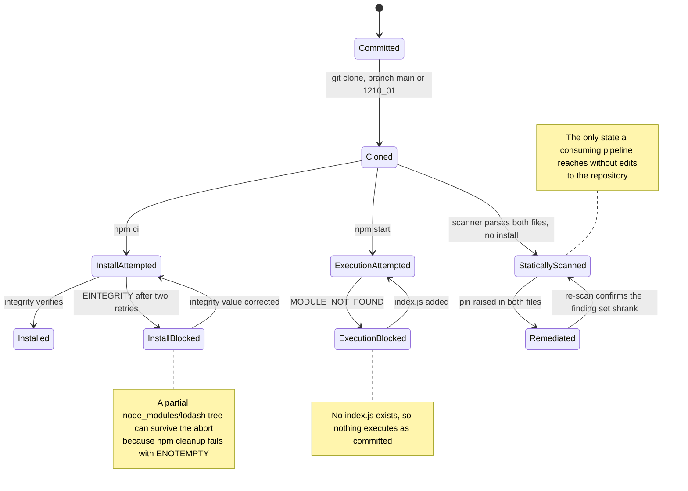

**State transitions of the committed artifact.** Because the artifact's states are reached by a consumer's commands rather than by internal logic, each transition is triggered from outside and none can occur spontaneously:

| From | To | Trigger | Observable evidence |
| --- | --- | --- | --- |
| Committed | Cloned | `git clone` of `main` or `1210_01` | Two refs at the same commit, identical trees |
| Cloned | Statically scanned | Scanner pointed at the repository root | Report over one dependency; no install, no network needed |
| Cloned | Install attempted | `npm ci` | Tarball fetch of 314,170 bytes begins |
| Install attempted | Install blocked | Digest mismatch, twice retried | `EINTEGRITY`, exit 1 |
| Install blocked | Install attempted | `integrity` value corrected at L17 | A later `npm ci` can verify (not observed; the committed value fails) |
| Cloned | Execution attempted | `npm start` | `node index.js` is spawned |
| Execution attempted | Execution blocked | Loader finds no file at the declared path | `MODULE_NOT_FOUND`, exit 1 |
| Statically scanned | Remediated | Version literal raised in three places | The re-scan's finding set shrinks (Section 4.3.2, Figure 4.3.2) |

**Data persistence points.** Every byte this system persists, and where:

| Persisted item | Location | Written by | Durable? |
| --- | --- | --- | --- |
| Package identity, one script, one dependency declaration | `package.json` L2–L12 | The original commit; a human edit on remediation | Yes — committed |
| Resolution record, provenance and licence | `package-lock.json` L2–L19 | The same | Yes — committed |
| Version history of the target | Git object store, one commit `9ea96dc` | The original upload | Yes — and it is the reason the target cannot drift |
| Extracted dependency files | `node_modules/lodash` in the consumer's working tree | npm, during install | No — and on this artifact the write is incomplete |
| npm's download cache and its debug log | Outside the repository, under the user's npm directory (the observed abort wrote `/root/.npm/_logs/2026-10-12T09_18_49_595Z-debug-0.log`) | npm | No — incidental to the consumer's environment |
| Scan report and gate verdict | The consumer's CI system | The consumer's scanner | Not in the repository at all |

Nothing else persists: the repository contains no data store, no file written by its own code, and no state carried between runs. Running any process against it twice from a clean clone produces the same bytes at the end as at the start, except for the `node_modules` residue noted above.

**Caching requirements.** The repository declares none — there is no cache configuration, no `.npmrc` and no build cache, so every caching decision belongs to the consuming tooling. Two caches nevertheless influence the flows and should be understood by anyone drawing them:

- **npm's package cache.** npm stores fetched tarballs in a content-addressed cache outside the repository. It cannot rescue this artifact, because the failing check is the comparison between the recorded `integrity` value and the artifact's digest rather than the availability of a download; the check is deterministic and fails on every attempt regardless of cache state.
- **Advisory data.** `npm audit` consults advisory data over the network rather than a local copy in the repository, so its verdict is a function of the data's currency, not of anything cached in the fixture. A consumer that caches advisory responses shifts its own detection latency and freshness, not the artifact's content.

**Transaction boundaries.** Three write boundaries exist, and only one is genuinely transactional:

| Boundary | Operation | Atomicity observed | Rollback |
| --- | --- | --- | --- |
| Source of truth | A commit to `package.json` and/or `package-lock.json` | Atomic by git's design: the repository holds a single commit `9ea96dc`, so any clone sees one consistent pair | `git checkout` of the two files |
| Install into the working tree | `npm ci` extraction and linking | Not atomic on the failure path: `npm ci` begins by clearing `node_modules` for a clean-slate install, then aborts mid-extraction and leaves partial content | `rm -rf node_modules` |
| Remediation edit | Raising the pin across the manifest and the lockfile's two version fields, plus the `integrity` value | Not atomic in the repository's own terms: the edits are separate strings, and a partial edit leaves the three version literals inconsistent with the regenerated hash | Re-edit, or `git checkout` to discard |

The third boundary is the one a flowchart should mark explicitly, since it spans four fields in two files and no tool enforces the consistency of the edit: an operator who changes `package.json` without changing the lockfile, or who regenerates the hash without changing the version, produces an artifact that validates inconsistently across the flows of Section 4.1.

### 4.3.2 Error Handling

Error handling in this system is a property of the npm CLI, Node.js and the consumer's pipeline; the repository contributes no handler, no retry policy, no fallback and no notifier, because it contributes no code. What it does contribute is a set of error conditions that are deterministic — the same inputs fail the same way every time — which is why they are usable as a test fixture and why a pipeline must treat them as conditions to classify rather than as transient faults to retry.

**Error taxonomy.**

| Error | Code | Layer | Exit status | Detection signal | Retry behaviour | Fallback available | Recovery |
| --- | --- | --- | --- | --- | --- | --- | --- |
| Declared target absent | `MODULE_NOT_FOUND` | Node.js CommonJS loader, reached via `npm start` | 1 | Throw with a stack trace on stderr naming the missing path | None — npm does not retry a script that throws | None; no alternative entry point is declared | Add `index.js`, or stop invoking the start path (procedure A) |
| Integrity mismatch | `EINTEGRITY` | npm install-time verification | 1 | npm error printing the wanted and actual sha512 digests for a 314,170-byte payload | Two retries of the download before the throw, then no further retry | Yes — static parse and `npm audit` both work without an install | Correct the digest or change the flow (procedure B) |
| Partial extraction after the abort | `ENOTEMPTY` (cleanup warning) | npm's own cleanup after the failed install | — (warning during the same run) | Warning block about failing to remove `node_modules` | — | — | Remove `node_modules` before any retry |
| Publication refused | `EPRIVATE` | npm publish path | 1 | Refusal before any registry request | Not applicable | Not applicable | None needed; the artifact is deliberately non-publishable |
| Manifest or lockfile unparsable | Tool-specific | The consumer's scanner | Tool-specific | Parse error reported by the scanner | None defined here | A different scanner, or format support in the same one | Treat the scan as failed, never as clean (procedure C) |

**Retry mechanisms.** Exactly one retry mechanism is engaged by this artifact, and it belongs to npm: on the install path, the payload is fetched, hashed, found wanting, and fetched again twice — the observed run logged two `tarball data ... seems to be corrupted. Trying again.` warnings — after which `EINTEGRITY` ends the attempt. Two consequences follow for anyone drawing the flow:

- **Retrying the install is not a recovery strategy here.** The mismatch is a property of the recorded value, not of the network, so a retry loop repeats a deterministic failure, downloads the same payload again (up to three transfers of 314,170 bytes in the observed run) and never converges. The only change that makes an install succeed is editing `package-lock.json` L17.
- **Retries of the start path do not exist.** Node throws immediately because the module is absent, so a pipeline that assumes a retry-until-healthy pattern fails on its first attempt and gains nothing by repeating it.

The repository itself configures neither retry count nor timing — there is no `.npmrc` — so the retry cadence is a property of the consuming npm version, observed here as npm 11.18.0 with Node.js v22.23.3. A consumer that wants different behaviour must set it in its own environment.

**Fallback processes.** Four fallbacks exist, in decreasing order of how much they change the consumer's setup:

| Fallback | What it does | When it applies | Cost |
| --- | --- | --- | --- |
| Lockfile-only static scan | Reads both files and produces findings without an install or network access | Always — this is the fixture's intended path, and the only journey that completes unedited | Requires a scanner that reads `lockfileVersion` 3 and does not insist on an installed tree |
| Install-free advisory audit | `npm audit` resolves from the lockfile and consults advisory data over the network; measured working with no `node_modules` present, exit 1 with findings | When the ecosystem's own verdict is acceptable as the detection mechanism | Needs network access; its advisory data and its `fixAvailable` target are npm's own (Section 3.3.4) |
| Correcting the recorded digest | Regenerates L17 from the artifact actually installed, unblocking every install-first flow | When a pipeline cannot avoid installing | An edit to a committed file, and it changes the fixture's supply-chain defect |
| Dependency-tree inspection | `npm ls lodash` — measured printing `└── (empty)` with nothing installed | Only after a successful install; it does not substitute for one | None, but it provides nothing until the install path is fixed |

The declared execution path has no fallback at all: `main` and `scripts.start` both point at the same absent file, and the manifest declares no alternative.

**Error notification flows.** Notification is entirely the caller's, because the artifact has no logging, no alerting, no webhook, no ticketing integration and no status surface (Section 1.3.2). What the consumer can observe and must classify:

| Signal | Source | Correct interpretation |
| --- | --- | --- |
| Exit status 1 with `MODULE_NOT_FOUND` on stderr | `npm start` | The declared target is absent; the job's premise is wrong, not its configuration |
| Exit status 1 with `npm error code EINTEGRITY` | `npm ci` | A supply-chain verification failure; the environment is fine and the recorded digest is not |
| Exit status 1 with a findings report on stdout | `npm audit` | Findings exist — the code signals detection, not breakage, and must not be collapsed into a generic failure |
| Exit status 0 from a static scan | The consumer's scanner | The scan ran to completion; a pass verdict is still the consumer's comparison against the known-answer set (Section 1.2.3) |
| Parse or format error text | The consumer's scanner | A coverage gap in the tool; the scan result is unusable rather than clean |

npm additionally writes a debug log outside the repository on failure — the observed abort produced `/root/.npm/_logs/2026-10-12T09_18_49_595Z-debug-0.log` — which is the only diagnostic record the process leaves behind and is worth collecting in a pipeline that must explain an install failure after the fact.

**Recovery procedures.**

*A — the declared execution path fails.* Confirm the file is absent (`list index.js`, and `git ls-files` returns only the two JSON files), then either add the module so the declared path has a target, or remove `npm start` from the pipeline that runs against this fixture, because the failure is by design and repeats identically.

*B — an install-based flow fails.* Remove the residue first, then fix the value:
1. `rm -rf node_modules` — the aborted run can leave a partial `node_modules/lodash`.
2. Regenerate the `integrity` value from the artifact actually installed, replacing the literal at `package-lock.json` L17.
3. Re-run `npm ci`; if the flow also needs the fix for the finding rather than merely the install, continue with procedure D.

*C — a scan produces nothing usable.* Establish whether the cause is the lockfile format (`lockfileVersion` 3 with a `packages` map and no legacy `dependencies` tree) or advisory coverage, then widen the scanner's support for one or the other. Do not treat the absence of findings as a clean result: this artifact is known to carry six advisories for its pinned version, so a scan that reports none has a coverage gap, not a pass.

*D — the finding itself must be cleared.* npm cannot remediate within the declared range, so the choice is between a coordinated edit that preserves the exact pin's determinism and an unattended bump outside the stated range.

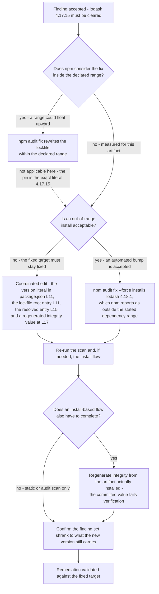

Figure 4.3.2 — Remediation decision flow for the pinned dependency.

The measured behaviour behind this flow is worth stating plainly: `npm audit fix` refused to act, reporting `fix available via npm audit fix --force` and that it `will install lodash@4.18.1, which is outside the stated dependency range`, and the dry run left both committed files byte-identical. Only `--force` performs the bump unattended, at the cost of the determinism that makes the fixture reproducible. Where the bump is made deliberately, it is a four-field edit — the version literal in `package.json` L11, the same literal in the lockfile's root entry at L11 and resolved entry at L15, and a regenerated `integrity` value at L17 — and the correct target version is itself contested between advisory sources (Section 3.3.4). A remediation is not complete until a re-scan shows the finding set shrink to exactly the advisories that the newly pinned version still carries, and, if an install-based flow is used, until the regenerated digest verifies.


## 4.4 Required Diagrams

The diagrams below are the normative flows for this artifact: the high-level workflow with actor lanes, the detailed flows of the processes in Section 4.1, the error-handling tree, the cross-system sequence, and the state machines. Each is drawn from the two committed files and from behaviour reproduced in Node.js v22.23.3 with npm 11.18.0; no branch is drawn that was not observed or declared. Figures are numbered after the sub-section that contains them, and Figure 4.4.6 cross-indexes them against the workflows, features and evidence they rest on.

### 4.4.1 High-Level System Workflow

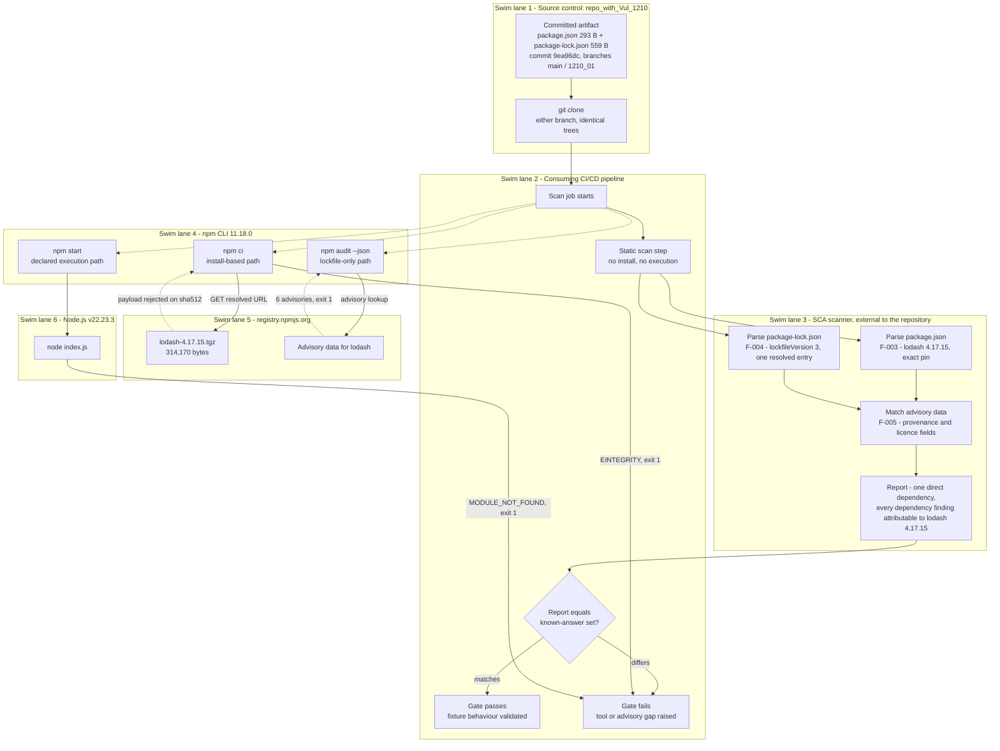

Figure 4.4.1 — High-level system workflow, laid out as six actor lanes.

**How to read it.** The lanes are Mermaid subgraphs, one per actor, with edges crossing lanes wherever the process crosses a trust or process boundary — the idiom used because Mermaid has no dedicated swim-lane construct. Three properties of the flow are worth naming. First, the leftmost lane holds the entire artifact: everything downstream is consumer-side. Second, exactly one path reaches `GatePass` without editing the repository — the static scan lane — while the three npm paths leave the boundary (to the registry) or fail locally. Third, the two dashed returns are the only inbound responses the consumer ever receives from outside the artifact: a rejected payload on the install path and advisory data on the audit path.

| Lane | Actor | Enters the flow at | Leaves it at | External dependency |
| --- | --- | --- | --- | --- |
| 1 | Source control (`repo_with_Vul_1210`) | Committed artifact | Clone handed to the pipeline | None |
| 2 | Consuming CI/CD pipeline | Scan job start | Gate verdict or gate failure | Its own definition; the repository supplies none |
| 3 | SCA scanner (external) | Repository root | Report | Advisory data source of its own |
| 4 | npm CLI 11.18.0 | Any of three commands | Exit status | The registry, for install and audit |
| 5 | `registry.npmjs.org` | Fetch or advisory lookup | Payload or advisory records | Public network access |
| 6 | Node.js v22.23.3 | `node index.js` spawn | Loader exception | None |

### 4.4.2 Detailed Process Flows for the Core Feature Chain

The three flows below expand the processes of Section 4.1.1: the static detection process that carries the fixture's purpose (feature chain F-003 → F-004 → F-005 of Section 2.1), the declared execution path (F-002), and the install-based verification path.

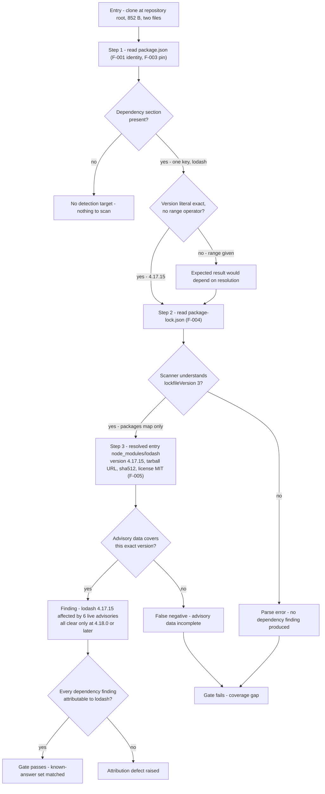

Figure 4.4.2(a) — Dependency detection process over the committed declaration and resolution record.

| Element | Value in this flow |
| --- | --- |
| Start point | A clone at the repository root; 852 bytes across two files |
| End points | Gate pass (known-answer set matched) or gate failure (coverage gap, attribution defect, or no target) |
| Decision points | DP-1 dependency present, DP-2 lockfile format supported, DP-3 advisory coverage, DP-4 attribution completeness |
| Error state | Parse failure at DP-2, which yields no finding rather than a negative result |
| Timing | None from the repository; the flow involves no install, no network and no execution |
| Business rule touched | R-2, R-3 and R-4 (Section 4.2.2) — one dependency, exact literal, three consistent version literals |

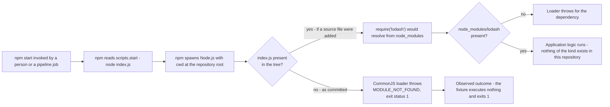

Figure 4.4.2(b) — Declared execution path (F-002) and the decision that stops it.

| Element | Value in this flow |
| --- | --- |
| Start point | `npm start`, or `npm run start` |
| End point | `MODULE_NOT_FOUND` with exit status 1 (the branch taken), or application execution in the branch that cannot occur as committed |
| Decision points | DP-7 does the declared file exist; the dependency check on the right exists only in the branch where a source file is added |
| Error state | The loader throw is the only observable outcome; no retry and no fallback target are declared |
| Timing | Immediate and deterministic — the throw happens before any user code could run |
| Business rule touched | R-6, the entry point declared by `main` and `scripts.start` that has no target |

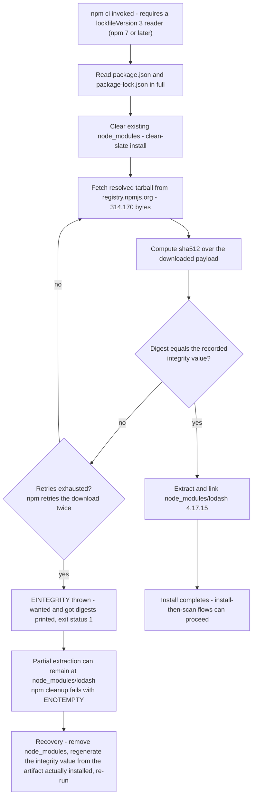

Figure 4.4.2(c) — Install-based resolution and its verification decision (P-3).

| Element | Value in this flow |
| --- | --- |
| Start point | `npm ci` |
| End points | `EINTEGRITY` with exit status 1 and possible residue; or a completed install into `node_modules` |
| Decision points | DP-5 digest comparison; the retry-exhaustion decision that ends the loop |
| Error state | `EINTEGRITY` after two retries, followed by a cleanup warning (`ENOTEMPTY`) |
| Recovery | Clean the residue, regenerate the digest from the installed artifact, re-run — see Section 4.3.2, procedure B |
| Timing | Bounded by npm's retry policy, not by the repository: up to three transfers of the same 314,170-byte payload in the observed run |
| Business rule touched | R-5, the digest that must match the fetched payload |

### 4.4.3 Error Handling Flowchart

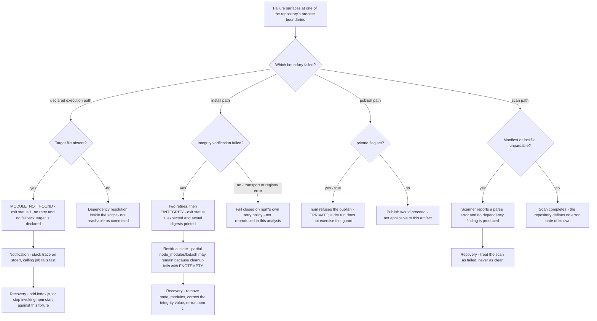

Figure 4.4.3 — Error handling across the four boundaries, including the publication guard.

| Boundary | Diamond | Failure branch | Recovery branch |
| --- | --- | --- | --- |
| Declared execution path | Target file absent? (DP-7) | `MODULE_NOT_FOUND`, exit 1 | Add `index.js`, or stop invoking the start path |
| Install path | Integrity verification failed? (DP-5) | Two retries then `EINTEGRITY`, exit 1, residue possible | Remove `node_modules`, correct the digest, re-run |
| Publish path | `private` flag set? (DP-8) | `EPRIVATE` — refusal before any registry request | None required; the refusal is the design |
| Scan path | Manifest or lockfile unparsable? (DP-2) | No finding produced | Treat the scan as failed, then widen format support |

The one branch that carries no observation is the transport or registry error under the install path: it was not reproduced, and npm's own retry policy governs it. It is drawn because a reader comparing failure modes needs to know that the repository neither configures nor overrides that policy — no `.npmrc` exists.

### 4.4.4 Integration Sequence Diagram

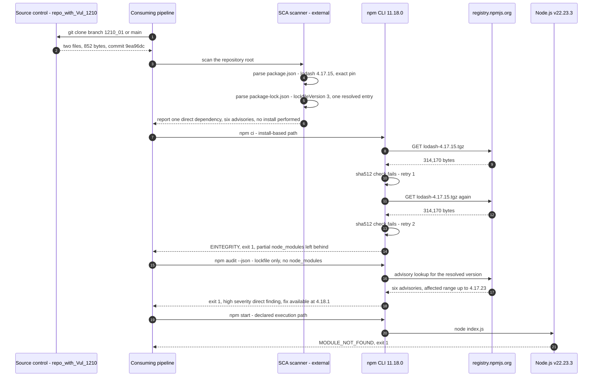

Figure 4.4.4 — Integration sequence across the six participants, in the order a scan job exercises them.

| Step group | Participants | Message semantics | Failure or timing note |
| --- | --- | --- | --- |
| 1–2 | Pipeline ↔ source control | Clone and hand over the tree | Both branches carry identical trees, so this step cannot change the outcome |
| 3–7 | Pipeline ↔ scanner | Parsing is internal to the scanner; both files are inputs | No install and no network involved; the report is the flow's only artefact |
| 8–15 | Pipeline ↔ npm ↔ registry | Three fetches of the same payload, each verified and rejected | Ends in `EINTEGRITY`; the retry pair is npm's, and the attempt is bounded |
| 16–19 | Pipeline ↔ npm ↔ registry | Audit resolves from the lockfile without downloading the tarball | Exit 1 signals findings, not breakage; fix target reported as 4.18.1 |
| 20–22 | Pipeline ↔ npm ↔ Node.js | Process spawn followed by an immediate loader failure | The target file is absent, so no application code runs |

### 4.4.5 State Transition Diagrams

The lifecycle states of the artifact are drawn in Figure 4.3.1; the machine below is the finer-grained state space of the install-verification step, which is where the artifact spends most of its failure behaviour.

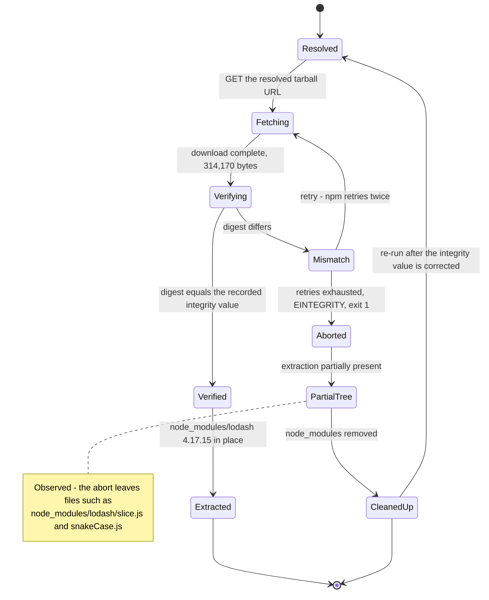

Figure 4.4.5 — Install-verification state machine, from resolution to extraction or abort.

| State | Meaning | Reachable as committed? | Exits |
| --- | --- | --- | --- |
| Resolved | The lockfile entry has been read and its `resolved` URL chosen | Yes | Fetch |
| Fetching | The payload is being transferred from the registry | Yes | Verifying, or a transport failure governed by npm's own policy |
| Verifying | The digest is computed and compared with `package-lock.json` L17 | Yes | Verified, or Mismatch |
| Mismatch | The digest does not equal the recorded value | Yes | Fetch again (retry), then Aborted |
| Aborted | `EINTEGRITY` raised, exit status 1 | Yes — the observed terminal state | Partial tree |
| PartialTree | Extracted files remain because npm's cleanup failed | Observed | CleanedUp |
| Verified / Extracted | The recorded digest matched and the package is in place | No — unreachable until L17 is corrected | Terminal |
| CleanedUp | The consumer removed the residue | Manual | Resolved, or terminal |

Read together with Figure 4.3.1, the two machines show the whole state surface of this repository: an artifact whose committed state is fixed reachable in exactly one consumer-visible configuration (statically scanned), with every other state either blocked by a declared defect or reachable only after an edit to a committed file.

### 4.4.6 Diagram Conventions, Swim Lanes and Traceability

**Conventions.** All diagrams use Mermaid.js syntax and follow one set of rules so a reader can compare them:

| Convention | Application in this section |
| --- | --- |
| Swim lanes | Actors are Mermaid subgraphs, ordered left to right (Figure 4.4.1) or from caller to callee (Figure 4.4.4); no subgraph doubles as a node |
| Decision diamonds | Curly-braced nodes, each labelled with the condition from Section 4.2.1 and its DP identifier where a table lists it |
| Process steps | Rectangular nodes carrying the step and the file or field it reads |
| Terminal nodes | Start and end points stated explicitly; failure terminals carry the error code and exit status |
| Dashed edges | Return paths or inbound responses from outside the artifact's boundary |
| Evidence in the diagram | Node labels name the file, line range or measured value the step rests on, so no branch depends on an unstated assumption |
| Figure numbering | A figure is numbered after the sub-section that contains it; a sub-section with several flows letters them, as in Figure 4.4.2(a)–(c) |

One cross-reference resolves through the numbering rather than naming a figure of its own: the publication-guard row of the decision table in Section 4.1.1 cites Figure 4.1.3, and that guard is drawn as the publish branch of Figure 4.4.3.

Every diagram parses and renders under Mermaid 12 and has been checked against a second renderer, because the swim-lane subgraphs in Figure 4.4.1 and the state machines in Figures 4.3.1 and 4.4.5 use syntax that varies between Mermaid versions.

**Traceability.** Each required element of the prompt's diagram set maps to a figure, and each figure to the processes, features and evidence it rests on.

| Diagram | Figure | Workflows covered (Section 4.1.1) | Features referenced (Section 2.1) | Primary evidence |
| --- | --- | --- | --- | --- |
| High-level system workflow | 4.4.1 | P-1, P-2, P-3, P-4, P-5 | F-001, F-002, F-003, F-004, F-005 | `package.json` L2–L12; `package-lock.json` L2–L19; observed command outputs |
| Dependency detection flow | 4.4.2(a) | P-2 | F-003, F-004, F-005 | `package.json` L10–L12; `package-lock.json` L4–L19; `npm audit` report |
| Declared execution flow | 4.4.2(b) | P-5 | F-002 | `package.json` L6–L9; `npm start`, exit 1 |
| Install verification flow | 4.4.2(c) | P-3 | F-003, F-005 | `package-lock.json` L14–L19; `npm ci` output |
| Error handling flowchart | 4.4.3 | P-3, P-5, P-7, P-2 | F-002, F-005, F-001 | Observed codes `MODULE_NOT_FOUND`, `EINTEGRITY`, `ENOTEMPTY`; `private` at L4 |
| Integration sequence diagram | 4.4.4 | P-1, P-2, P-3, P-4, P-5 | F-003, F-004, F-005 | Clone state; parse paths; tarball fetch; audit lookup |
| State transitions — artifact lifecycle | 4.3.1 | P-1, P-2, P-3, P-5, P-6 | F-002, F-005 | `git ls-files`; clone of `main`/`1210_01`; install and start attempts |
| State transitions — install verification | 4.4.5 | P-3 | F-004, F-005 | Two retry warnings, then `EINTEGRITY`; residue inspection |
| Remediation decision flow | 4.3.2 | P-6 | F-003, F-005 | `npm audit fix` refusal text; `--force` target 4.18.1 |
| Data flow across the boundary | 4.1.2 | P-1, P-2, P-4 | F-001, F-003, F-004 | No outbound call exists except npm's own |

**Coverage boundaries.** Two diagram classes the prompt requests are absent because the repository has nothing for them to represent, and their absence is stated rather than filled with a speculative drawing: there is no event-processing flow (the manifest declares one script, `start`, and no hook, subscription or timer — Section 4.1.2), and there is no batch-processing sequence of the repository's own (the nearest analogue is the consumer's single-shot scan job over two immutable files). Likewise there is no authentication flow to draw: the only access-control expression in the artifact is `private: true` in the publish guard, shown in Figure 4.4.3.


## 4.5 References

**Repository files cited as evidence.**

- `package.json` — the artifact's identity and control surface: `name` (L2), `version` (L3), `private: true` (L4), the description stating the fixture's purpose (L5), `main: "index.js"` (L6), the single `start` script (L7–L9) and the one exact-pinned runtime dependency `lodash 4.17.15` (L10–L12); also the source of the absences this section relies on — no `engines`, no `devDependencies`, no other lifecycle script.
- `package-lock.json` — the resolution record: `lockfileVersion` 3 with `requires` true (L4–L5), the root `""` entry mirroring the manifest (L7–L13), and the single resolved entry `node_modules/lodash` carrying version 4.17.15 (L15), the registry tarball URL (L16), the sha512 `integrity` value that fails verification (L17) and `license: MIT` (L18).
- `` (repository root) — the system boundary as a whole: exactly two children, both files, 293 and 559 bytes; no subfolder, no `index.js`, no `node_modules`, no `.npmrc` and no CI configuration.
- `.git/` (repository metadata) — the durable state behind the artifact: a single commit `9ea96dc` ("Add files via upload"), branches `main` and `1210_01` at the same commit with identical trees, and an `origin` remote whose embedded access credential is deliberately not reproduced in this specification.

**Working material cited as evidence.**

- A copy of `package.json` and `package-lock.json` held outside the checkout — used to reproduce install, audit and remediation behaviour (including the residual `node_modules` state) without writing into the repository, whose working tree remained the two committed files throughout.

**External sources cited as evidence.**

- [web] npm registry metadata for `lodash@4.17.15`, read with `npm view lodash@4.17.15 dist.integrity dist.tarball version` — established that the published sha512 (`sha512-8xOcRHvC…QG0eQmbKmRS6J3VQppPOIt0MnmE+4xlZoumy0GPG0D0MVIQbNA1A==`) differs from the value recorded at `package-lock.json` L17, and that the tarball URL matches L16.
- [web] npm advisory data returned by `npm audit --json` — supplied the six advisory identifiers and their affected ranges, the aggregate verdict (`high`, direct, `<=4.17.23`), the counters (`high: 1, total: 1`; `prod: 2, total: 1`) and `fixAvailable: lodash 4.18.1`.
- [web] Mermaid rendering services (local `@mermaid-js/mermaid-cli` 12.0.0 and the Kroki Mermaid endpoint) — confirmed that every diagram in Section 4.4 and Figure 4.3.2 parses and renders, including the swim-lane subgraphs and the state machines.

**Cross-referenced sections of this specification.**

- Section 1.2 — System Overview: the fixture's context, components and the success criteria this section's flows are judged against.
- Section 1.3 — Scope: the in-scope user workflows that Section 4.1.1 expands into process form, and the out-of-scope capabilities whose absence is stated rather than diagrammed.
- Section 2.1 — Feature Catalog: feature identifiers F-001 through F-005, referenced by the diagrams and the traceability table in Section 4.4.6.
- Section 3.3 — Open Source Dependencies: the advisory set, the integrity defect and the disagreement between sources about the correct remediation target.
- Section 3.6 — Development & Deployment: the same install, start and publish outcomes as seen from the tooling and pipeline perspective.


# 5. System Architecture

## 5.1 High-Level Architecture

This section describes the architecture of the repository at its root (`""`), which is an npm project named `minimal-cve-scanner-fixture`. The artifact is deliberately reduced to two JSON documents — `package.json` (293 bytes) and `package-lock.json` (559 bytes) — tracked in git as a single commit. There is no source file, no service, no listening socket, no datastore and no process defined anywhere in the tree, and `git ls-files` returns exactly those two paths. The architecture below is therefore stated in terms of what the artifact declares, what a consumer reads from it, and how its two declared lifecycle operations (install and start) actually behave.

### 5.1.1 System Overview

**Architecture style.** The repository is a *declarative, non-executing artifact*: a manifest and its committed resolution record, whose only behaviour is produced when a consumer (npm, Node.js, or a scanner) reads them. It is not a layered application, a service-oriented or microservice topology, an event-driven system, or a plugin host. The style is best characterised as **manifest-centric, single-package, zero-execution**, and its rationale is recorded in the artifact itself: `package.json` L5 states the purpose as "Minimal repository for validating dependency vulnerability scanning". Dependency vulnerability scanning for the npm ecosystem consumes a JavaScript manifest and lockfile, so the shape that makes this repository a valid and useful scan target is precisely the shape it has — declarations only, no logic to distract a scanner and no build step to run before the scan.

**Key architectural principles and patterns.** Each principle below is a property of the two files, not an aspiration recorded in prose (there is no README, no licence file, no `.gitignore` and no CI configuration in the tree).

| Principle | How it is realized | Evidence |
| --- | --- | --- |
| Minimality | Two files, both data; no code, test, build, lint or container configuration exists | Repository root listing; `git ls-files` returns `package-lock.json` and `package.json` only |
| Determinism | The dependency is exact-pinned, with no `^`/`~` range, no `overrides`, no `resolutions`, and the resolution is committed | `package.json` L11; `package-lock.json` L11, L15 |
| Declared, not vendored | The dependency is a declaration plus a lockfile record; no `node_modules` directory exists in the checkout | Root listing shows no `node_modules`; no install tree is committed |
| Fail-closed verification | The resolution record carries a sha512 Subresource Integrity value that npm verifies before accepting a download | `package-lock.json` L17 |
| No implicit toolchain | One lifecycle script (`start`) and no `devDependencies`, `engines`, `.npmrc` or build pipeline, so consuming the artifact requires nothing but npm and Node.js | `package.json` L7–L9, L13; no other configuration file exists |
| Publication guard | The manifest is marked private, so the package cannot be published to a registry as-is | `package.json` L4 (`"private": true`) |

Two consequences of this style are architectural rather than incidental. First, because verification is fail-closed and the recorded hash does not match the published artifact, the install path (and therefore any install-based scan) terminates with `EINTEGRITY` — a first-hand probe on a copy of the two files under Node v22.23.3 / npm 11.18.0 showed two `seems to be corrupted. Trying again.` warnings, then `wanted sha512-8x0cRHvC… != got sha512-8xOcRHvC… (314170 bytes)` and exit status 1, leaving a partial `node_modules/lodash` tree behind. Second, because `index.js` — named by both `main` (L6) and `scripts.start` (L8) — is absent, the start path ends in `MODULE_NOT_FOUND` and no JavaScript in this repository is ever executed. Static parsing of the two JSON files is the only path through the artifact that completes.

**System boundaries and major interfaces.** The system boundary is the repository root: two JSON files plus the git history that distributes them. Everything the artifact interacts with lies outside that boundary and is reachable only as a consumer reading the files or as an install attempt reaching the network.

| Interface | Type and direction | Consumer / counterpart | Contract |
| --- | --- | --- | --- |
| `package.json` | Inbound read of a JSON document (npm manifest schema) | npm CLI ≥ 7; any JSON reader | Supplies identity, entry point, the `start` script and the dependency declaration |
| `package-lock.json` | Inbound read of a JSON document (`lockfileVersion` 3) | npm CLI ≥ 7 (default-written by npm 9+) | Supplies the resolved version, registry tarball URL and sha512 integrity for the one package |
| Process execution contract | Outbound process spawn (`node index.js`) | Node.js runtime | Declared but non-functional: the target file is absent, so the spawn fails immediately |
| Registry fetch | Outbound HTTPS GET, install-time only | `registry.npmjs.org` | Fetches `https://registry.npmjs.org/lodash/-/lodash-4.17.15.tgz` (L16); aborted at the integrity gate |
| Distribution | Repository transfer (clone or copy) | Consuming pipeline or engineer | `main` and `1210_01` carry identical trees from the single commit `9ea96dc` |
| Scan surface | Inbound read of both JSON documents | SCA / CVE scanner, as defined by the consumer | Requires no install, no network and no execution |

The artifact exposes no inbound network interface of any kind: no HTTP endpoint, no CLI of its own, no RPC, message queue, database or user interface is defined in the repository. It likewise holds no runtime state, no sessions and no secrets. An architecture review of this repository is consequently a review of declaration, resolution, integrity and supply chain — not of runtime topology.

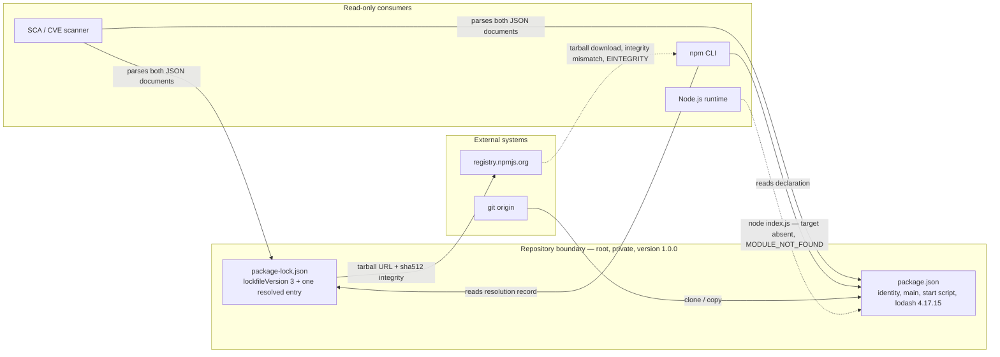

### 5.1.2 Core Components Table

The artifact has four components inside or named by the repository, plus the external consumer that gives it its purpose. Each is a declaration or a resolved record rather than an executing unit.

| Component Name | Primary Responsibility | Key Dependencies | Critical Considerations |
| --- | --- | --- | --- |
| npm manifest (`package.json`) | Declares package identity, the entry point, the single lifecycle script and the one runtime dependency | npm manifest schema; npm CLI ≥ 7 to consume | Holds both the fixture's purpose statement and the exact vulnerable pin; omits `engines`, `devDependencies` and `overrides`, so nothing constrains the runtime or remaps the version |
| npm lockfile (`package-lock.json`) | Records the resolved install tree so an install reproduces version, source and integrity instead of range-resolving | `lockfileVersion` 3 schema; npm 7+ (default-written by npm 9+); registry metadata at generation time | Its `integrity` value differs from the published tarball's real hash, so every install path aborts; it carries only the modern `packages` map, with no legacy `dependencies` tree |
| Declared execution path (`main` + `scripts.start`) | Names the intended runtime entry chain for the fixture: `npm run start` → `node index.js` | Node.js runtime; npm script runner; `index.js`, which is absent | Cannot run — `MODULE_NOT_FOUND` at exit; no JavaScript in the repository is ever executed, and no dynamic behaviour can be observed |
| Resolved third-party payload (`lodash` 4.17.15) | Supplies the single external dependency and therefore the entire vulnerability surface | Public npm registry; outbound HTTPS; sha512 verification | Inside the affected range of six published advisories that clear only at 4.18.0 or later; not vendored, so in this checkout it exists only as a declaration and a lockfile record |
| Scanning consumer (external validation harness) | Reads the two documents and produces the advisory finding set that is the fixture's reason to exist | The two JSON files; an advisory database; a `lockfileVersion` 3 parser | Not defined in this repository; must tolerate a target that cannot be installed or executed, which makes static parsing the only viable path |

The same five components in terms of their integration points:

| Component Name | Integration Points | Direction | Interface / Transport |
| --- | --- | --- | --- |
| npm manifest (`package.json`) | npm CLI; Node.js runtime (`main`); any scanner | Read by others | JSON document on the local filesystem |
| npm lockfile (`package-lock.json`) | npm CLI; scanner | Read by others | JSON document; `lockfileVersion` 3 schema |
| Declared execution path | npm script runner; Node.js runtime | Outbound, non-functional | Process spawn with the command text `node index.js` |
| Resolved third-party payload | npm registry at install time; node_modules install tree | Outbound then inbound | HTTPS GET of the `resolved` tarball URL, then integrity verification |
| Scanning consumer | Both JSON documents | Inbound only | Direct file reads and JSON parsing; no npm invocation required |

### 5.1.3 Data Flow Description

Four flows are definable in this artifact. One reaches the network, one fails before producing data, one is read-only, and one is refused by policy.

**Install-time resolution flow (the only outbound network flow).** `npm install` or `npm ci` reads `package.json` L10–L12 for the declared dependency and `package-lock.json` L6–L20 for its resolution. Because the declaration is exact, npm performs no range resolution: the lockfile entry supplies the pinned version (L15), the tarball URL (L16) and the sha512 integrity string (L17). npm then issues an HTTPS GET to `https://registry.npmjs.org/lodash/-/lodash-4.17.15.tgz` and streams the tarball. Observed on a copy of the two files: two `tarball data ... seems to be corrupted. Trying again.` warnings, a 314,170-byte download, then `npm error code EINTEGRITY` reporting `wanted sha512-8x0cRHvC… but got sha512-8xOcRHvC…`, exit status 1, and a partial `node_modules/lodash` tree whose cleanup failed with `ENOTEMPTY`. Nothing further reaches the install tree, and no successful resolution is ever produced.

**Start-time execution flow.** `npm run start` reads the `start` script string at `package.json` L8 and spawns `node index.js`. Node.js resolves `index.js` relative to the package root, finds no such file, and terminates with `code: 'MODULE_NOT_FOUND'` before any application code — and therefore any application data flow — exists. Because the entry point is missing, `lodash` is never required, no module graph is built and no runtime interaction between the two files occurs.

**Scan-time read flow (the flow the fixture exists for).** A scanner reads the dependency declaration at `package.json` L10–L12 and the resolved entry at `package-lock.json` L14–L19, builds a single-package inventory (`lodash` 4.17.15, MIT, registry-sourced), matches that version against its advisory source, and emits findings. This flow requires no install, no network access and no execution, and is the only path through the artifact that completes end to end.

**Publication flow.** `npm publish` reads `"private": true` (`package.json` L4) and refuses with `EPRIVATE`. `npm publish --dry-run` instead exits 0 and does not exercise that guard, so a dry run produces no flow-relevant output for this artifact.

**Integration patterns and protocols.** All interaction is pull-based and file-based. npm CLI and the scanner read JSON documents from the filesystem; Node.js is invoked as a child process through the `start` script and communicates only through stdio and exit status; the sole network protocol is HTTPS to the public registry, used at install time only. There is no push, no webhook, no callback, no polling loop, no message broker, no shared database and no service discovery, and the artifact defines no retry, batching or idempotency policy of its own — the two `Trying again.` warnings observed during install come from npm's own download logic, not from anything declared here.

**Data transformation points.** Three transformations are observable; the third lies outside the repository.

| Transformation | Input | Output | Status |
| --- | --- | --- | --- |
| Declaration → resolution record | `"lodash": "4.17.15"` at `package.json` L11 | Install-path-keyed entry `node_modules/lodash` at `package-lock.json` L14–L19 | Committed as data; reproduced by npm at install time |
| Registry artifact → install tree | Gzip tarball from the `resolved` URL | Unpacked `node_modules/lodash` file tree | Blocked by the integrity mismatch after a partial unpack |
| Manifest and lockfile → finding set | The two JSON documents | Scanner inventory, advisory matches, report | Performed by the consumer; not defined in this repository |

**Key data stores and caches.**

| Store | Location | Content | Role |
| --- | --- | --- | --- |
| Committed lockfile | `package-lock.json` in the repository | Version, tarball URL, sha512 integrity, MIT licence for the one resolved package | The authoritative resolution record; a file store, not a service, and the only persisted state the artifact owns |
| Git repository store | `.git` in the checkout | The single commit `9ea96dc` on `main` and `1210_01` | Sole distribution and durable-record mechanism |
| npm's local cache | Outside the repository, managed by npm on the machine running the install | Downloaded tarballs keyed by their integrity value | Populated only on success; irrelevant to the static scan path, and no cache directory exists inside the checkout |
| Install tree | `node_modules` (absent in the checkout) | Unpacked third-party files | Would be created by a successful install; currently produced only as a partial, unusable tree |
| Application datastore | None | — | No database, schema, migration, ORM or embedded store is declared or referenced anywhere in the tree |

### 5.1.4 External Integration Points

Every integration is file-based or npm-native. No integration in this table is defined by the repository itself: the artifact supplies declarations, and the counterpart systems supply the behaviour.

| System Name | Integration Type | Data Exchange Pattern | Protocol / Format |
| --- | --- | --- | --- |
| npm CLI (any npm ≥ 7) | Tool consumption of the manifest and lockfile | Reads both documents, then resolves and installs; pull, one-shot, no callbacks | Local filesystem JSON per npm's manifest and `lockfileVersion` 3 schemas |
| Public npm registry (`registry.npmjs.org`) | Outbound registry fetch, install-time only | Request/response of a single tarball addressed by package and exact version | HTTPS over TLS; gzip tarball, verified against a sha512 SRI string |
| Node.js runtime | Process execution of the declared entry point | Spawn `node index.js` under the `start` script; stdio and exit status only | OS process invocation; CommonJS entry resolution by file path |
| SCA / CVE scanner or CI pipeline | Static consumption of both documents | Pull of two small files, then advisory matching and report generation; no install required | JSON parsing; advisory data supplied by the scanner, not by this repository |
| Git remote (`origin`) | Source distribution | Clone or copy of the repository; no build artefact is exchanged | Git transport; trees identical on `main` and `1210_01` |

The second view of the same integrations records the service-level position and the failure mode actually observed.

| System Name | SLA Requirements | Observed Failure Mode | Basis |
| --- | --- | --- | --- |
| npm CLI | None declared by this repository; the consumer's pipeline chooses the npm version and timeouts | npm 5/6 cannot interoperate with `lockfileVersion` 3, so the install path breaks before any scan | `package-lock.json` L4–L6; npm format documentation |
| Public npm registry | None declared; availability, throughput and retry budget are npm's and the network's | Two corruption warnings, 314,170 bytes retrieved, then `EINTEGRITY` and exit status 1 | First-hand install probe; `package-lock.json` L16–L17 |
| Node.js runtime | None declared: no `engines` field, no `.nvmrc`, no `packageManager` | `MODULE_NOT_FOUND` for `/…/index.js`; exit non-zero, nothing executed | `package.json` L6, L8; first-hand start probe |
| SCA / CVE scanner | None declared; any scan-duration, coverage or false-positive target is an organizational decision | None applicable on the static path: parsing two documents has no declared target to fail | Sections 1.2 and 3.6 of this specification record no CI, no gate and no metric in the repository |
| Git remote | None declared | None applicable: both branches carry the same two files, and no tag or release is used | `git ls-files`; commit `9ea96dc` |

No availability target, timeout, retry budget, throughput figure or error budget is stated anywhere in the two files, and the repository declares no `audit` script, no monitoring hook and no health check. Any SLA applied to this artifact is imposed entirely by the consuming pipeline.

## 5.2 Component Details

The artifact contains four repository-resident or repository-declared components and one external consumer. Because none of them executes, each is specified below in terms of what it declares, what it exposes to a reader, and what it would persist if the declared operations succeeded.

### 5.2.1 npm Manifest Component (`package.json`)

**Purpose and responsibilities.** The manifest is the single source of the artifact's identity and intent. It names the package and its version, blocks publication, states the fixture's purpose in prose, declares the entry point, declares the one lifecycle script, and declares the one runtime dependency. It contains no logic of any kind — no function, class, module or configuration block beyond these seven fields (`package.json` L1–L13).

| Field | Value | Architectural role |
| --- | --- | --- |
| `name`, `version` | `minimal-cve-scanner-fixture`, `1.0.0` | Identifies the artifact; the version is a static literal and is not derived from any tag or automation |
| `private` | `true` | Publication guard; makes npm refuse a real publish of a package that pins a vulnerable release |
| `description` | "Minimal repository for validating dependency vulnerability scanning" | The only statement of purpose in the repository, and the rationale for the artifact's shape |
| `main` | `index.js` | Declares the module entry point for consumers of the package |
| `scripts.start` | `node index.js` | The only executable instruction in the repository; a process contract with the Node.js runtime |
| `dependencies.lodash` | `4.17.15` | The exact pin that defines the entire dependency surface and the expected finding |

**Technologies and frameworks.** JSON conforming to npm's manifest schema. No framework, transpiler, type system or build tool is involved, and the manifest declares no `devDependencies`, `engines`, `type`, `packageManager`, `overrides` or `resolutions` field. Because `type` is absent, the declared entry point would resolve as CommonJS — a detail that cannot be verified, since the file does not exist.

**Key interfaces and APIs.** The manifest exposes no API. Its interface is its field set, read by npm's resolver and installer, by the Node.js runtime through `main`, and by any scanner that parses JSON. The one instruction it carries is the command text `node index.js` at L8, which npm executes under the privileges of whatever pipeline runs `npm run start`.

**Data persistence requirements.** `package.json` is static data under version control: it is written only by an explicit human or tooling edit, and nothing in the repository writes to it at runtime. Its persistence requirement is therefore simply that it remains byte-identical across clones, which the single-commit history (`9ea96dc`) and the identical `main` and `1210_01` trees satisfy.

**Scaling considerations.** The document is 293 bytes with a fixed field count, so it imposes no scaling cost: read time, parse time and memory are constant, and any number of consumers can read it concurrently without coordination. The only scaling-relevant property is the absence of an `engines` constraint — because the manifest does not pin a Node.js version, behaviour of anything derived from it (in practice, only the failing start path) varies with whatever runtime the consumer supplies.

### 5.2.2 Dependency Resolution Component (`package-lock.json`)

**Purpose and responsibilities.** The lockfile is the artifact's determinism mechanism: it records the outcome of dependency resolution so that an install reproduces a specific version, source and integrity rather than re-resolving a version range. It holds three blocks — top-level metadata (`package-lock.json` L2–L5), a root `""` entry mirroring the manifest and repeating the dependency declaration (L7–L13), and one resolved entry keyed by install path at `node_modules/lodash` (L14–L19). It declares `lockfileVersion` 3 with `requires` true.

| Element | Value | Purpose and consequence |
| --- | --- | --- |
| `lockfileVersion`, `requires` | `3`, `true` | The format npm 9 and later write by default and that dates from npm 7; backwards compatible to npm 7 and not interoperable with npm 5 or 6 |
| `node_modules/lodash` → `version` | `4.17.15` | The resolved version, stated verbatim and matching the manifest pin |
| `node_modules/lodash` → `resolved` | `https://registry.npmjs.org/lodash/-/lodash-4.17.15.tgz` | The exact artefact location, so no range lookup is needed at install time |
| `node_modules/lodash` → `integrity` | `sha512-8x0cRHvC…MV1QbNA1A==` | The verification anchor; it differs from the published tarball's real hash, which is why installs fail closed |
| `node_modules/lodash` → `license` | `MIT` | The only licence record in the repository; the artifact declares no licence for itself |

**Technologies and frameworks.** JSON per npm's lockfile schema; the document carries only the modern `packages` map, with no legacy `dependencies` tree, which follows from the v3 format rather than from any choice in the file.

**Key interfaces and APIs.** The lockfile is a read-only interface for two consumers: npm's installer, which uses it to place and verify the package, and a scanner, which reads version, `resolved`, `integrity` and `license` to build an inventory without installing anything. It exposes no mutation API; npm rewrites the whole document when resolution changes rather than patching entries.

**Data persistence requirements.** The lockfile must be committed alongside the manifest — it is the authoritative record, and its `integrity` value is the only verification data the repository carries. Its single resolved entry means it contains exactly one verifiable claim about third-party content, and that claim is presently wrong: the recorded value differs from the registry's `dist.integrity` for `lodash@4.17.15`, so the persisted state is internally consistent with the manifest but unusable for an install.

**Scaling considerations.** The resolution graph has one node and no transitive entries, so traversal cost is constant and there is nothing to shard, cache or prune. Scaling shows up instead as a limitation: the document exercises no monorepo, workspace, multi-ecosystem or transitive-graph path, so it cannot exercise a scanner's handling of those cases.

### 5.2.3 Declared Execution Path Component

**Purpose and responsibilities.** `main` (`package.json` L6) and `scripts.start` (L8) together declare the artifact's intended runtime entry: `npm run start` invokes `node index.js` from the package root. The component's responsibility is to name that entry chain; it holds no implementation, and `index.js` is not present in the working tree or in `git ls-files`.

**Technologies and frameworks.** npm's script runner, the `node` CLI, and Node.js's entry-point resolution. The manifest declares no `type` field, so the intended module system is CommonJS by default, and no `engines` field or toolchain pin constrains which Node.js release performs the resolution.

**Key interfaces and APIs.** The interface is a process contract: a command string, a working directory, stdio, and an exit status. Nothing else is exposed — there is no exported function, no CLI argument handling, no environment-variable contract and no module export list, because the file that would define them is absent.

**Data persistence requirements.** None. The component declares no state, writes no file and reads no data source; it would be the point at which the artifact first touched `lodash`, and it never reaches that point.

**Scaling considerations.** There is no process to scale and no request to serve. The architectural consequence is a hard limit on verification: because the entry point is missing, no dynamic analysis of this artifact is possible — no profiling, no coverage, no instrumentation and no execution-trace evidence — so every finding about it must come from parsing the two documents.

### 5.2.4 Resolved Third-Party Dependency Component (`lodash` 4.17.15)

**Purpose and responsibilities.** This is the artifact's entire vulnerability surface and the payload the fixture exists to expose. It is declared once (`package.json` L11) and resolved once (`package-lock.json` L14–L19). The library itself carries no repository-specific adaptation: it is used as published, contributes no transitive dependencies, and is licensed MIT.

**Technologies and frameworks.** A JavaScript library distributed as a gzip tarball from the public npm registry, built for Node.js consumption in the CommonJS era. The repository pins it with no range operator, no `overrides` or `resolutions` remap, and no vendored copy.

**Key interfaces and APIs.** The declared consumer interface is `require('lodash')` from application code, which is never reached because the entry point is absent. The interface that is actually exercised is its advisory identity: the exact version string is what a scanner matches against published advisories, and that matching is the component's only live interface in this artifact. Its distribution interface is the `resolved` HTTPS URL plus the sha512 integrity value the download must satisfy.

**Data persistence requirements.** The package is not vendored and no install tree is committed, so within this repository the component persists only as two text facts (a declaration and a resolved entry). On a machine, it materialises in `node_modules/lodash` only after a successful verification; the observed install leaves a partial tree whose cleanup fails with `ENOTEMPTY`, which is not a usable installation.

**Scaling considerations.** The tarball is 314,170 bytes and resolves with no transitive dependencies, so distribution and verification cost is constant, and the package imposes no runtime footprint in this artifact because it never loads. Its scaling relevance is entirely about exposure: the pinned release sits inside the affected range of six published advisories that clear only at 4.18.0 or later — prototype pollution (CVE-2020-8203, CVE-2025-13465, CVE-2026-2950), regular-expression denial of service (CVE-2020-28500), and code injection through `_.template` (CVE-2021-23337, CVE-2026-4800). Bumping the pin is not a one-line change: the version appears in three places across two files, and the integrity value must be regenerated from whichever artefact is actually installed.

### 5.2.5 Scanning Consumer Component (External)

**Purpose and responsibilities.** The consumer is the component for which the artifact exists: it reads `package.json` and `package-lock.json`, derives the dependency inventory, matches versions against an advisory source, and reports findings. It is not defined, configured or constrained by this repository — no CI definition, no scanner configuration, no `.npmrc` and no `audit` script exists in the tree — so its design is entirely the integrating organization's responsibility.

**Technologies and frameworks.** Unspecified by the repository, which constrains only the input format: a reader must parse npm's manifest schema and a `lockfileVersion` 3 lockfile that contains no legacy `dependencies` section. Its advisory data source is likewise external.

**Key interfaces and APIs.** The consumer's input interface is the two documents read from the repository root; its output interface (report format, severity scheme, exit-code gate) is defined outside this repository and is therefore not documented here.

**Data persistence requirements.** None in the repository. Any cached advisory data, scan history or report artefact is persisted on the consumer's side, and the artifact supplies no state for the consumer to reconcile.

**Scaling considerations.** Cost is constant per scan: two small JSON documents (293 and 559 bytes) with one dependency node, no install and no network access required. The scaling risk runs the other way — the fixture cannot exercise the scales a scanner must handle. It has no monorepo or workspace layout, no transitive graph, no second ecosystem and no dev, peer or optional dependency section, and it cannot exercise an install-based analysis path at all, because the install aborts.

### 5.2.6 Component Interaction Diagram

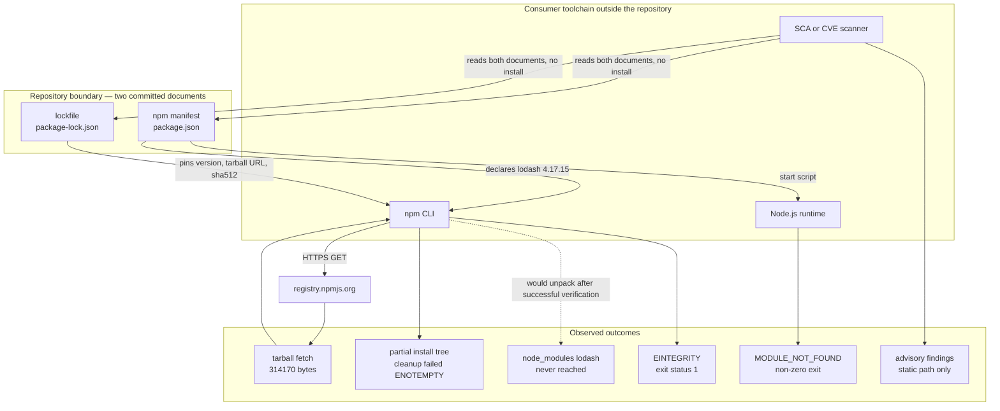

### 5.2.7 State Transitions — Dependency Resolution Lifecycle

The states below describe what npm does with the two documents. `Verified` and `Installed` are reachable in principle but not for this artefact, because the recorded integrity value differs from the published tarball's hash.

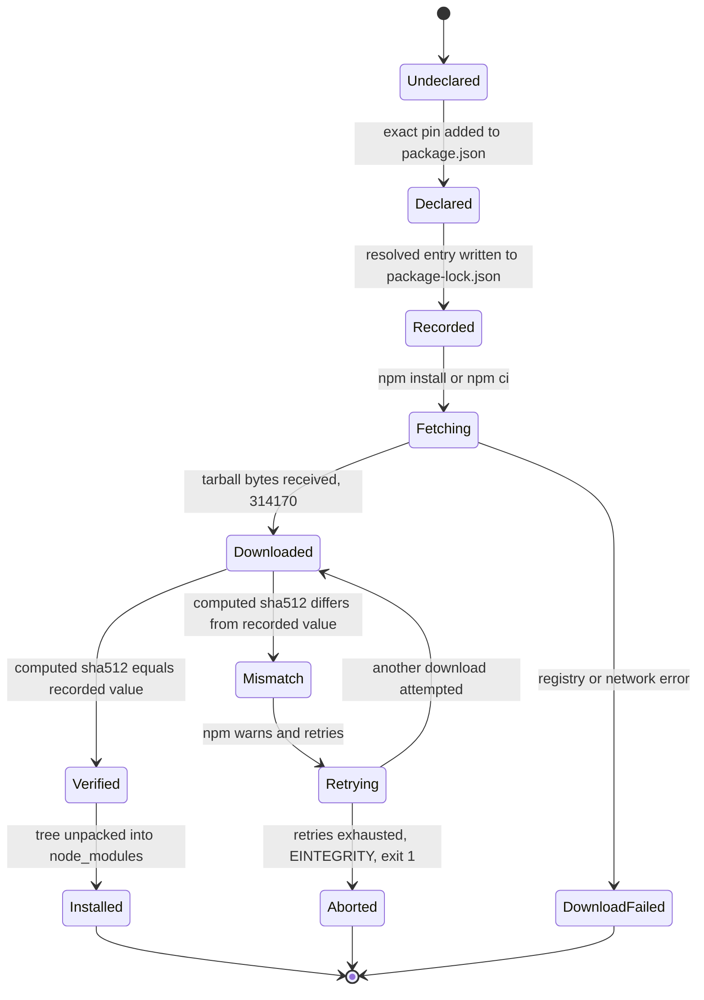

### 5.2.8 State Transitions — Declared Execution Path

The start-path lifecycle is short and terminated: the only reachable transitions end at `Failed`, because the file Node.js resolves is absent.

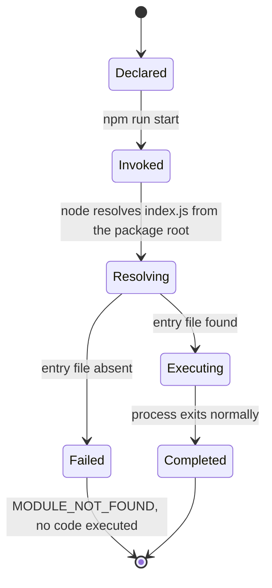

### 5.2.9 Sequence Diagram — Install-Time Resolution and Integrity Verification

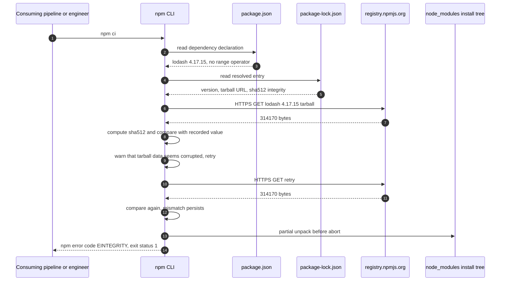

### 5.2.10 Sequence Diagram — Scan-Time Read and Start-Time Invocation

```mermaid
sequenceDiagram
    autonumber
    participant Scanner as SCA or CVE scanner
    participant Manifest as package.json
    participant Lock as package-lock.json
    participant Npm as npm CLI
    participant Node as Node.js runtime
    Scanner->>Manifest: parse dependency declaration
    Manifest-->>Scanner: lodash 4.17.15, exact
    Scanner->>Lock: parse resolved entry
    Lock-->>Scanner: version 4.17.15, tarball URL, sha512 integrity, MIT
    Scanner->>Scanner: match version against advisory source
    Scanner-->>Scanner: emit finding set for the pinned release
    Npm->>Node: spawn node index.js
    Node->>Node: resolve index.js relative to the package root
    Node-->>Npm: cannot find module index.js, MODULE_NOT_FOUND
    Npm-->>Npm: exit status non-zero, nothing executed
```

## 5.3 Technical Decisions

The repository records no design documentation: there is no README, no architecture note, no changelog and no comment in either file. The decisions below are therefore reported as they are observable in the artifact, with the evidence that fixes each one and the tradeoff each carries. Where the repository states no motivation, that is recorded as such rather than supplied.

### 5.3.1 Architecture Style Decision

**Decision.** Ship a declarative artifact — one npm manifest and one committed lockfile, with no source file, no build step and no runtime component — rather than a runnable application or a publishable library.

| Option | Present in the artifact | What the chosen shape gains | What it costs |
| --- | --- | --- | --- |
| Declarative fixture (chosen) | Yes — two JSON documents, no code | The scanned input is the whole artifact: fixed, small, exhaustively inspectable, and impossible for scan logic to be confused by application code | Nothing can be observed dynamically; the declared `start` path and any install-based analysis both fail |
| Runnable application | No — `index.js` is declared but absent | — | Would add an execution path, a toolchain and behaviour that the fixture does not need |
| Publishable library | No — `package.json` L4 sets `"private": true` | Prevents a package that pins a vulnerable release from reaching a registry | The artifact can only be distributed by clone or copy, not by install from a registry |
| Monorepo or workspace layout | No — a single root package, no `workspaces` field | Keeps the resolution graph at one node, so the expected finding is unambiguous | Exercises none of a scanner's multi-package, workspace-dedup or multi-ecosystem logic |

The style's own rationale is the one motivation the artifact does write down: `package.json` L5 declares the purpose as "Minimal repository for validating dependency vulnerability scanning". The observable architecture follows from taking that sentence literally — reduce the repository until only the declaration and its resolution remain, then keep both fixed.

**Tradeoff summary.** The style buys determinism and exhaustiveness, and gives up executability and breadth. Determinism comes from exact pinning plus a committed resolution record; exhaustiveness comes from the artifact being 852 bytes in total, so no part of it is unreachable to a reader. The cost is that this artifact cannot demonstrate an install-based or instrumentation-based scan, cannot show a transitive dependency graph, cannot exercise multi-ecosystem detection, and gives no evidence about runtime behaviour of any kind.

### 5.3.2 Communication Pattern Choices

**Decision.** Use pull-based, file-level interfaces, and allow exactly one network interaction — the registry fetch that npm's installer performs — with no service-to-service communication of any kind.

| Pattern | Present | Where realized | Alternative excluded |
| --- | --- | --- | --- |
| File-based pull (JSON documents read from the filesystem) | Yes | Both documents, read by npm and by a scanner | No socket, no query interface, no API the reader must call |
| Process invocation with stdio and exit status | Declared | `scripts.start` = `node index.js` (L8); observed as `MODULE_NOT_FOUND` | No in-process library import path, no RPC surface |
| HTTPS request/response (single tarball, install time only) | Yes, at npm's initiative | `resolved` URL at `package-lock.json` L16 | No long-lived connection, no subscription, no streaming protocol |
| Message queue, event bus, webhook or callback | No | Nothing in the two files references a broker, topic or endpoint | No asynchronous or push integration exists to configure or secure |
| Batch, retry or idempotency policy of the artifact's own | No | npm's two `Trying again.` warnings during install come from npm, not from this repository | The artifact states no retry budget or timeout |

**Rationale and consequence.** Because every interface is a read, the artifact needs no protocol negotiation, no versioning scheme, no backward-compatibility contract and no availability guarantee of its own; a consumer that can read JSON on a filesystem can consume it fully. The same choice means the artifact cannot be integrated as a runtime dependency of another system: nothing here can be called, subscribed to or scheduled. The only process boundary is npm spawning `node`, and it fails at entry resolution before any inter-process exchange occurs.

### 5.3.3 Data Storage Solution Rationale

**Decision.** Persist nothing at runtime and store the artifact's only state — the dependency resolution record — as a version-controlled text file committed beside the manifest.

| Storage need | Solution chosen | Implementation state | Reasoning visible in the artifact |
| --- | --- | --- | --- |
| Resolution record for the one dependency | `package-lock.json`, committed at `lockfileVersion` 3 | Present, 559 bytes, one resolved entry | A file store needs no service, diff review is possible on every change, and the record travels with the code through git |
| Verification data for the downloaded artefact | `integrity` field inside that record | Present but incorrect for the pinned release | Keeps the verification anchor in the same document as the version and URL it belongs to |
| Application state, cache, session, queue or audit store | None | No database, schema, migration, ORM or embedded store exists anywhere in the tree | There is no runtime to own state, and the declared start path never runs |
| Durable distribution and history | The git repository itself, one commit `9ea96dc` | `main` and `1210_01` carry identical trees | Version control doubles as the artifact's durable record; no release, tag or registry entry is involved |

**Rationale and consequence.** A committed lockfile is the pattern that makes dependency resolution reproducible, and here it also makes the fixture's expected finding deterministic: version, source and licence are all fixed in one reviewable file. The cost of this choice is that the store can be wrong in a way that blocks all install activity, which is exactly the state it is in — the recorded integrity value does not match the published tarball, so the persisted record is self-consistent with the manifest but unusable for installation. Regenerating it is a coordinated edit across both documents: the version literal appears at `package.json` L11, `package-lock.json` L11 and `package-lock.json` L15, and the `integrity` value at L17 must be recomputed from whichever artefact is actually installed.

### 5.3.4 Caching Strategy Justification

**Decision.** Define no cache of the artifact's own, and rely entirely on npm's cache for any repeat download.

| Cache layer | Where it lives | What it holds | Status in this artifact |
| --- | --- | --- | --- |
| npm's local package cache | Outside the repository, on the machine running the install, managed by npm | Downloaded package data keyed by its integrity value | Populated only by a successful download; cannot be populated from this artifact, because verification fails on every attempt |
| Install tree (`node_modules`) | Package root, git-ignored by convention though no `.gitignore` exists | Unpacked package files | Not present in the checkout; the failed install leaves a partial tree whose cleanup fails with `ENOTEMPTY` |
| HTTP or CDN caching for a served interface | Not applicable | — | The artifact serves nothing |
| Application-level memoisation or result cache | Not applicable | — | No code exists to cache results in |

**Rationale and consequence.** Caching here is deliberately outside the artifact's boundary: the deterministic inputs (two small JSON documents) make the artifact cheap to re-read, while the expensive step — fetching and verifying a tarball — is npm's cache to manage and npm's policy to configure. The repository sets no cache policy at all: there is no `.npmrc`, no `cache` or `prefer-offline` configuration and no CI cache definition. The practical consequence is that correctness is prioritised unconditionally over speed: because the recorded hash never matches the downloaded bytes, the cache yields no usable entry, and every install attempt re-downloads 314,170 bytes before failing closed. Reads on the static scan path are unaffected, since they never consult a cache.

### 5.3.5 Security Mechanism Selection

**Decision.** Rely on four npm-native mechanisms — Subresource Integrity verification, exact version pinning, the private-package publication guard, and the absence of any lifecycle hook that would execute code during install — and define no mechanism of the artifact's own.

| Mechanism | Where it is realized | What it protects | Observed status |
| --- | --- | --- | --- |
| sha512 Subresource Integrity verification | `package-lock.json` L17, verified by npm against the downloaded tarball | Content integrity of the third-party payload: substituted or corrupted bytes are rejected rather than installed | Working as designed and failing closed — `EINTEGRITY`, exit status 1, nothing usable installed |
| Exact version pinning (no range operator) | `package.json` L11 and `package-lock.json` L11, L15 | Removes range-resolution drift: no newer, unreviewed release can be selected silently | In force; also the reason the artifact's advisory exposure is fixed and predictable |
| Private-package publication guard | `package.json` L4 (`"private": true`) | Prevents a package that pins a vulnerable release from being published to any registry | In force for a real publish; `npm publish --dry-run` exits 0 and does not exercise the guard |
| No install-time lifecycle hook | `package.json` L7–L9 declares only `start`; no `preinstall`, `install`, `postinstall`, `prepare` or `prepack` exists | Removes the arbitrary-code-execution path that install-time scripts open | In force: installing this artifact runs no repository-supplied code, in contrast to the start script, which is never run to completion because its target is absent |
| Credentials and registry configuration | No `.npmrc`, no auth token, no environment-file content exists in the tree | Holds no secret that a clone of the artifact would expose | In force; the registry fetch is an anonymous public-package download |
| Vulnerability consultation and policy (`audit`, `overrides`, `resolutions`) | None declared | — | Absent: advisory checking, remediation policy and any gate are entirely the consuming pipeline's responsibility |

**Rationale and consequence.** The mechanisms selected are the ones that operate on dependency declaration and resolution, which is the only layer this artifact controls; identity, authorisation and session management are not applicable because there is no runtime to protect, no user, no endpoint and no stored data. The single deliberate inversion of a security posture is the pinned vulnerable release itself: `lodash` 4.17.15 is inside the affected range of six published advisories, and keeping it there is what makes the artifact a known-answer target. Three consequences follow. First, any remediation requires editing the same fields as a version bump, so the lockfile's `integrity` must be regenerated with the new version. Second, the private flag prevents the vulnerable pin from being redistributed through a registry, so distribution is a git clone or file copy. Third, the incorrect integrity value, whatever its origin, behaves as a strict deny-by-default control rather than a weakness in the install path — the failure mode is refusal, not acceptance of unverified content.

### 5.3.6 Architecture Decision Records

Each record states a decision observable in the artifact, its status, and its consequence. Where the repository records no motivation, the record says so instead of inventing one.

| ID | Decision | Status | Consequence |
| --- | --- | --- | --- |
| ADR-001 | Pin the single dependency to an exact version (`4.17.15`) with no range operator | In force — `package.json` L11, `package-lock.json` L11, L15 | The resolved version cannot float; the advisory exposure is fixed and the expected finding is unambiguous |
| ADR-002 | Commit the resolution record, written at `lockfileVersion` 3 with `requires` true | In force — `package-lock.json` L4–L5 | Installs are deterministic but require npm 7 or later (npm 9 and later write it by default); npm 5 or 6 cannot interoperate with it |
| ADR-003 | Declare one runtime dependency and no dev, peer or optional dependency | In force — `package.json` L10–L12 is the only dependency section | One dependency node, no transitive graph; the fixture exercises none of a scanner's graph or dedup logic |
| ADR-004 | Declare an entry point and a `start` script whose target file is not part of the artifact | In force — `package.json` L6, L8; `index.js` is absent from the working tree and from `git ls-files` | `npm run start` fails with `MODULE_NOT_FOUND`; no JavaScript in the repository executes, so static analysis is the only viable path |
| ADR-005 | Include no build, test, lint, type-check, container or CI configuration | In force — the tree holds exactly two files, both JSON | No lifecycle work precedes a scan and no quality gate exists inside the repository; every gate is the consumer's |
| ADR-006 | Mark the package private | In force — `package.json` L4 | A real publish is refused; the artifact moves only by clone or copy |
| ADR-007 | Constrain no runtime or package-manager version | In force — no `engines`, `.nvmrc` or `packageManager` field exists | The effective Node.js and npm versions are whatever the consumer supplies, so consumption behaviour is not fixed by the artifact |
| ADR-008 | Commit the resolution record with the integrity value as it stands, which does not match the published tarball | In force — `package-lock.json` L17; registry `dist.integrity` for the same release differs in three character positions | Every install path aborts with `EINTEGRITY` after a 314,170-byte download and two retries; rationale not recorded anywhere in the repository |
| ADR-009 | Consult no registry override, audit policy or advisory configuration | In force — no `.npmrc` exists and no `audit` script is declared | Resolution uses the default public registry; advisory consultation and any remediation gate are the consumer's to define |

**Rationale notes on the consequential records.** ADR-001 and ADR-002 together produce the fixture's whole value: because the version is stated rather than resolved, a scanner's answer cannot depend on when it ran or which range it preferred, which is what makes the artifact usable as a known-answer target — one dependency, one version, one expected advisory set. ADR-004 and ADR-008 are the two decisions with operational teeth, and both are constraints a consumer must design around rather than defects to be fixed silently: the missing entry point removes every dynamic verification path, and the integrity mismatch removes every install-based path, so a consumer's only complete path is to parse the two documents and match versions against advisory data. ADR-008's motivation is not recorded in the artifact, and it cannot be deduced from the repository; what is observable is its effect, which is that the install path fails closed rather than installing content whose bytes do not match the recorded hash.

### 5.3.7 Decision Tree — Choosing an Analysis Path

The tree below records the decision a consuming pipeline must make against this artifact as committed. It is drawn from the observed behaviour of both declared operations.

```mermaid
flowchart TD
    Entry{"Does the validation need an installed or executed tree?"}
    RunInstall["Run npm ci"]
    NpmVersion{"Is the npm major version 7 or later?"}
    FormatBlocked["Lockfile format unsupported<br/>install cannot proceed"]
    Fetch["Fetch tarball from registry.npmjs.org"]
    HashOk{"Does the computed sha512 equal the recorded integrity?"}
    Regenerate{"May the version and integrity fields be regenerated?"}
    Rewrite["Rewrite version and integrity in both documents<br/>install then proceeds"]
    StaticPath["Parse package.json and package-lock.json statically"]
    Installed["Installed tree available<br/>install-based analysis possible"]
    Findings["Findings for lodash 4.17.15<br/>static path completes"]
    NoPath["No findings produced"]

    Entry -->|yes| RunInstall
    Entry -->|no| StaticPath
    RunInstall --> NpmVersion
    NpmVersion -->|no| FormatBlocked
    NpmVersion -->|yes| Fetch
    Fetch --> HashOk
    HashOk -->|yes| Installed
    HashOk -->|no, as committed| Regenerate
    Regenerate -->|yes| Rewrite
    Regenerate -->|no| StaticPath
    Rewrite --> Installed
    StaticPath --> Findings
    FormatBlocked --> NoPath
```

## 5.4 Cross-Cutting Concerns

Cross-cutting concerns are largely vacuous for this artifact, and that is a property worth stating precisely rather than dressing up: with no runtime, no service, no user and no stored state, the concerns that normally occupy this section have almost no surface to attach to. What remains — process exit status, npm's own diagnostics, fail-closed verification and the recovery of a corrupted resolution record — is documented below, with the non-applicable concerns marked as such and the evidence for each statement.

### 5.4.1 Monitoring and Observability

There is no monitoring inside this artifact: no metrics endpoint, no health check, no heartbeat, no log sink, no `audit` script and no telemetry dependency. The only dependency is `lodash` (`package.json` L10–L12), and the only script is `start` (L7–L9).

| Signal | Produced by | What it indicates | Available here |
| --- | --- | --- | --- |
| Process exit status | npm CLI, Node.js | Whether the invoked operation completed | Yes — the install path exits 1 with `EINTEGRITY`; the start path exits non-zero with `MODULE_NOT_FOUND` |
| Diagnostic lines on stderr | npm CLI, Node.js | Cause of the failure and the artefacts involved | Yes — `tarball data ... seems to be corrupted. Trying again.`, the wanted/got hash pair and the 314,170-byte figure |
| Scanner report | The consuming pipeline | The artifact's actual observable output: which advisories affect the pinned release | Yes, but externally produced — the repository defines neither its format nor its gate |
| Service health, uptime, latency, saturation metrics | — | — | Not applicable: nothing runs, listens or serves |
| Audit trail of dependency or permission changes | — | — | Not applicable: no runtime principal, no permission model, and history is a single commit |

Observability of this artifact is therefore a single question asked by a consumer — "does the scan report identify the pinned release and its advisories?" — answered from a static read. Any dashboard, alert threshold or availability monitor applied to it would be monitoring the consuming pipeline, not this repository; the artifact declares no metric of its own and no SLO against which an alert could fire.

### 5.4.2 Logging and Tracing Strategy

No logging framework is declared, no log level, format, destination or rotation policy is configured, and no trace instrumentation, correlation identifier or span concept exists anywhere in the tree — there is no code in which any of them could be established. The only two log-like records this artifact can produce are npm's and Node's:

| Diagnostic output | Origin | Content observed | Persistence |
| --- | --- | --- | --- |
| npm install diagnostics | npm CLI, during `npm ci` | Two corruption warnings naming the tarball and the recorded integrity value, then the wanted/got sha512 pair with a byte count of 314,170, then `npm error code EINTEGRITY` | Printed to stderr; npm additionally writes its own debug log file to a path outside the repository, e.g. `/root/.npm/_logs/<timestamp>-debug-0.log` in the environment used for this document |
| Node.js module-resolution error | Node.js runtime, during `npm run start` | `Error: Cannot find module '<path>/index.js'` with `code: 'MODULE_NOT_FOUND'` and an empty `requireStack` | Printed to stderr; nothing is written to the repository |

Both records are produced by tooling the artifact invokes, not by the artifact, and neither is defined, shaped or configured by the two documents. There is no log retention requirement, no log transport, no redaction policy and no trace propagation, because there is no application that would emit, forward or read them. For a consumer, the practical consequence is that any durable record of a scan must be captured by the consumer's CI system from the process output — the artifact supplies no store to receive it.

### 5.4.3 Error Handling Patterns

The artifact contains no error-handling code, so its error behaviour is entirely that of npm and Node.js acting on the data it declares. Three patterns are observable, and they are consistent rather than accidental: verification fails closed, execution fails hard, and publication is refused.

| Failure | Originating layer | Artifact-level effect | Recoverable by the consumer |
| --- | --- | --- | --- |
| Recorded integrity ≠ downloaded bytes | npm's verification, using `package-lock.json` L17 | `EINTEGRITY`, exit status 1 after two retries and a 314,170-byte download; no verified install | Only by regenerating the resolution record; the artifact itself refuses unverified content |
| Lockfile format unsupported by an old npm | npm 5 or 6 reading `lockfileVersion` 3 | The install path cannot start | Only by supplying npm 7 or later |
| Entry file absent | Node.js entry resolution from `package.json` L6, L8 | `MODULE_NOT_FOUND`, non-zero exit, no code executed | No — the file is not part of the artifact |
| Publication attempted | npm enforcing `"private": true` (`package.json` L4) | Refusal with `EPRIVATE`; a `--dry-run` publish instead exits 0 and exercises nothing | No, and that is the intent |
| Partial install tree left behind after the abort | npm's cleanup, observed in a probe | `node_modules/lodash` (including `fp`) remains, and cleanup reports `ENOTEMPTY` | By removing the directory; the artifact neither prevents nor cleans it |

The distinguishing property of this error profile is its bias: every verification failure stops work rather than degrading, and nothing in the artifact retries, falls back, swallows or reports a partially successful result. The one non-atomic side effect observed is the leftover partial install tree, which matters because a later scan that naïvely inspects `node_modules` could read a truncated package tree rather than the declared one; the artifact offers no guard against that, so the guard belongs in the consumer.

### 5.4.4 Authentication and Authorization Framework

Neither is applicable, and no framework, token, key, session or permission model exists in the tree — the two documents hold package metadata only, with no `.npmrc` auth lines, no tokens and no secrets.

| Concern | Applicability | Basis |
| --- | --- | --- |
| User authentication | Not applicable | No runtime, no endpoint, no interactive surface; the declared entry point does not exist |
| Service-to-service authentication | Not applicable | The single network interaction is an anonymous fetch of a public npm package |
| Authorization model or roles | Not applicable | No protected operation and no principal exist; the artifact defines no permission check |
| Publication control | Present, as policy rather than authorization | `"private": true` (`package.json` L4) makes npm refuse a publish; it is a manifest-level guard with no identity behind it |
| Artefact authenticity | Partially addressed | `integrity` (L17) verifies content integrity but is not a signature — the lockfile records no provenance or attestation field |
| Secret handling | Not applicable | Nothing to redact; the repository contains no credential material to rotate or leak |

Because the artifact grants no access to anything it owns, the security question a reviewer asks of it is not "who may call this?" but "what is trusted, and how is that trust verified?" The answer observed in the files is: a single third-party artefact is trusted to the extent that its bytes hash to the recorded sha512 value, and that verification currently fails.

### 5.4.5 Performance Requirements and SLAs

The repository declares none — no `engines` constraint, no timeout, no retry budget, no throughput figure and no performance test. What it does provide is a set of behavioural costs that are constant rather than variable, so a consumer can budget against them exactly.

| Operation | Measured or declared cost | Determinism | Source |
| --- | --- | --- | --- |
| Static read of the artifact | Two documents totalling 852 bytes | Constant; no install, no network, no execution | `package.json` 293 bytes, `package-lock.json` 559 bytes |
| Install attempt | One 314,170-byte tarball download, two `Trying again.` retries, then abort with exit status 1 | Constant failure independent of environment, provided npm 7 or later and network access | First-hand probe under Node v22.23.3 / npm 11.18.0 |
| Start attempt | Fails at entry resolution, before any code runs; no measurable service time | Constant failure | `package.json` L6, L8 and the absent `index.js` |
| Publish attempt | Refused at manifest validation | Constant refusal | `package.json` L4 |
| Resolution lookup | None: version, URL and integrity are read from the committed record rather than looked up | Deterministic by construction | `package-lock.json` L14–L19 |

Every SLA that matters here is imposed from outside: the scan-duration budget, the advisory-data freshness window, the severity threshold that gates a build and the acceptable false-positive rate are all organizational decisions (as Sections 1.2 and 3.6 of this specification record) and none of them can be read from this repository. The one performance-like guarantee the artifact does make is reproducibility: identical inputs, a single resolved version and no range resolution mean that a scan's dependency finding set does not vary with time, machine or network conditions — provided the scan takes the static path.

### 5.4.6 Disaster Recovery

There is no deployed runtime, so there is no RTO, no RPO, no failover site and no backup schedule to define; loss of the artifact is loss of two files that git reproduces exactly. Recovery is therefore a clone, and the only operationally meaningful recovery scenario is a corrupted resolution record.

| Scenario | Impact | Recovery action |
| --- | --- | --- |
| Loss of the working copy or the machine | None on state: no runtime state, session or datastore exists | Clone or copy the repository; `main` and `1210_01` carry identical trees from commit `9ea96dc`, so no branch selection affects content |
| Resolution record unusable because `integrity` does not match the published artefact (ADR-008) | Every install-based step aborts; only static scanning proceeds | Regenerate the record from a trusted environment by installing the intended release and letting npm rewrite `package-lock.json`, then verify the new `integrity` value against the registry's published value for that exact version before committing it |
| Dependency becomes unavailable or is renamed on the registry | The `resolved` URL at L16 can no longer be fetched | Re-resolve from a mirror or a private registry and regenerate the record; any such change is a change to the scanned artefact and must be re-baselined with the consumer |
| Pin needs to move to a remediated version | The expected finding set changes | Edit the version at `package.json` L11, `package-lock.json` L11 and L15 and regenerate `integrity` at L17; then re-baseline the expected findings, noting that published sources disagree on the correct target |
| Accidental publication of the vulnerable pin | Not possible through npm | No action; `"private": true` refuses a real publish |

Two recovery properties follow from the repository's own shape. First, because there is no runtime state and no external datastore, recovery cannot lose data — the worst case is a clone that behaves exactly as the original. Second, because history is a single commit, there is no earlier revision to roll back to; recovery of a corrupted resolution record is forward-only, by regenerating the record and reviewing the resulting diff rather than by reverting to a known-good earlier state.

### 5.4.7 Error Handling Flow

```mermaid
flowchart TD
    Start["Consumer reads the two documents"]
    NeedInstall{"Requires an install or execution?"}
    StaticOk["Parse both JSON documents"]
    InvokeInstall["npm ci"]
    FormatCheck{"Lockfile format consumable?"}
    FormatFail["Format unsupported<br/>no install path"]
    Download["Download tarball, 314170 bytes"]
    Verify{"sha512 equals recorded integrity?"}
    Retry["npm warns and retries once more"]
    FailClosed["EINTEGRITY<br/>abort, exit status 1"]
    Partial["Partial node_modules tree left<br/>cleanup reports ENOTEMPTY"]
    InstallOk["Verified install tree"]
    InvokeStart["npm run start"]
    ResolveEntry{"index.js present?"}
    StartFail["MODULE_NOT_FOUND<br/>no code executed"]
    Findings["Report findings for lodash 4.17.15"]

    Start --> NeedInstall
    NeedInstall -->|no| StaticOk
    NeedInstall -->|yes| InvokeInstall
    InvokeInstall --> FormatCheck
    FormatCheck -->|no| FormatFail
    FormatCheck -->|yes| Download
    Download --> Verify
    Verify -->|yes| InstallOk
    Verify -->|no| Retry
    Retry --> Verify
    Verify -->|retries exhausted| FailClosed
    FailClosed --> Partial
    Start --> InvokeStart
    InvokeStart --> ResolveEntry
    ResolveEntry -->|no| StartFail
    ResolveEntry -->|yes| StaticOk
    StaticOk --> Findings
```

## 5.5 References

- `package.json` — the artifact's entire declarative surface: package identity, version `1.0.0`, `"private": true`, the purpose statement at L5, `main` at L6, the single `start` script at L8, and the exact dependency pin `"lodash": "4.17.15"` at L11. It establishes the manifest component, the declared execution path, the publication guard, the exact-pinning decision (ADR-001), the absence of install lifecycle hooks and the absence of `engines`, `devDependencies`, `overrides` and `type`.
- `package-lock.json` — the committed resolution record: `lockfileVersion` 3 with `requires` true at L4–L5, the root `""` entry repeating the pin at L7–L13, and the single resolved entry `node_modules/lodash` at L14–L19 with version L15, tarball URL L16, sha512 integrity L17 and MIT licence L18. It establishes the lockfile component, the npm 7+ consumption constraint, the integrity verification anchor and the install failure path (ADR-002, ADR-008).
- Repository root folder (`""`) — contained exactly `package.json`, `package-lock.json` and the `.git` metadata directory; established that no source file, test, linter, build, container or CI configuration exists, and that no `node_modules` install tree is present in the checkout.
- `.git` (git metadata directory, observed in the checkout listing) — established repository provenance: a single commit `9ea96dc` ("Add files via upload"), branches `main` and `1210_01` with identical trees, and `git ls-files` returning only the two JSON documents, which fixes the artifact's boundaries and its forward-only recovery position.
- Verification probe on a copy of the two files at `/tmp/arch_probe` (outside the checkout; the repository was left unmodified) under Node v22.23.3 and npm 11.18.0 — established first-hand that `npm ci` downloads 314,170 bytes, warns twice that the tarball "seems to be corrupted. Trying again.", then aborts with `EINTEGRITY` (wanted `sha512-8x0cRHvC…`, got `sha512-8xOcRHvC…`) and exit status 1 while leaving a partial `node_modules/lodash` tree whose cleanup reports `ENOTEMPTY`; and that `npm run start` fails with `code: 'MODULE_NOT_FOUND'` for `index.js`.
- [web] npm Docs, `package-lock.json` — `lockfileVersion` semantics: `3` is the format npm 9 and later write by default and is backwards compatible to npm 7, while npm 5/6 use v1 and npm 7/8 default to v2. https://docs.npmjs.com/cli/v11/configuring-npm/package-lock-json
- [web] npm Docs, `config` — the `lockfile-version` option, confirming that v3's fields date from npm 7 and are not interoperable with older npm versions. https://docs.npmjs.com/cli/v11/using-npm/config
- [web] npm CLI v9 changelog — "use v3 lockfiles by default" from npm 9.0.0. https://docs.npmjs.com/cli/v9/using-npm/changelog
- [web] npm registry packument for `lodash` — confirms `dist.integrity` for `4.17.15` as `sha512-8xOcRHvC…MIQbNA1A==` with `dist.shasum` `b447f6670a0455bbfeedd11392eff330ea097548`, and the single `latest` dist-tag `4.18.1`. https://registry.npmjs.org/lodash
- [web] npm package page for `lodash` — current tags and version history, confirming `4.18.1` as latest and the absence of a `4.17.22` release. https://www.npmjs.com/package/lodash?activeTab=versions
- [web] npm registry packument for `lodash@4.18.0` and its version page — confirm the deprecation notice "Bad release. Please use lodash@4.17.21 instead.", which bears on the remediation-target disagreement recorded in Section 3.3. https://registry.npmjs.org/lodash/4.18.0 ; https://www.npmjs.com/package/lodash/v/4.18.0
- [web] npm registry packument for `lodash@4.17.21` — no `deprecated` field, establishing that the version npm's own deprecation notice recommends is not itself deprecated. https://registry.npmjs.org/lodash/4.17.21
- Cross-referenced specification sections (this document): 1.2 System Overview, 3.1 Programming Languages, 3.3 Open Source Dependencies and 3.6 Development & Deployment — used to keep terminology and facts consistent, notably the advisory set affecting `lodash` 4.17.15, the `EINTEGRITY` and `MODULE_NOT_FOUND` behaviours, the `lockfileVersion` 3 compatibility range, and the caveat that `npm publish --dry-run` does not exercise the private-package guard.

# 6. SYSTEM COMPONENTS DESIGN

## 6.1 Core Services Architecture

### 6.1.1 Applicability Determination

**Core Services Architecture is not applicable for this system.**

The repository root (`""`) is an npm project named `minimal-cve-scanner-fixture` whose complete tracked content is two JSON documents — `package.json` (293 bytes) and `package-lock.json` (559 bytes) — recorded by `git ls-files` in a single commit `9ea96dc`. Nothing in the artifact defines, deploys, or runs a service: there is no source file, no HTTP server, no listening socket, no RPC surface, no message consumer, no scheduled job, no datastore, and no deployment descriptor. A recursive scan of the tree for service indicators (`express`, `fastify`, `koa`, `listen(`, `http.createServer`, `grpc`, `redis`, `kafka`, `postgres`, `mysql`, `mongo`, `docker`, `kubernetes`) returned no match, and the working tree contains exactly one directory — the repository root itself.

A service architecture presumes independently deployable units that own state, expose addresses, and talk to one another. None of those preconditions holds here, and the artifact states its own reason: `package.json` L5 describes the project as a "Minimal repository for validating dependency vulnerability scanning". Its value comes from being read statically by a scanner, so every piece of surface a service would add — a process, a port, a schema, a deployment — would dilute the fixture rather than serve it. Section 5.1 reaches the same conclusion from the architecture standpoint, classifying the artifact as manifest-centric and zero-execution, and Section 1.3.2 places runtime and dynamic-analysis surface, containerization, and CI/CD definition explicitly out of scope.

| Service-architecture precondition | Present | Evidence in this artifact |
| --- | --- | --- |
| Independently deployable process units | No | No source file exists; `main` and `scripts.start` name `index.js` (`package.json` L6, L8), which is absent from both the working tree and `git ls-files` |
| Network endpoints or transports owned by the system | No | No server module, port, or protocol constant appears in either file; the only network call is an outbound tarball fetch performed by npm, not by this artifact |
| Inter-service communication | No | Both documents are pulled as files; nothing here calls or is called at runtime |
| Service registry or discovery layer | No | No registry client, service name, or health endpoint; resolution is precomputed in the committed lockfile, and no `.npmrc` override exists (ADR-009) |
| Per-service data stores | No | No database, schema, migration, ORM, or embedded store; the only persisted state is the committed lockfile itself |
| Container or orchestrator descriptors | No | No `Dockerfile`, compose file, Kubernetes/Helm descriptor, or infrastructure-as-code artefact (Section 3.6.3) |
| Scaling, load-balancing, or circuit-breaking configuration | No | No orchestrator, proxy, or resilience configuration of any kind exists in the tree |

#### 6.1.1.1 The Only Two Process-Level Interactions, and Why Neither Is a Service Interaction

| Interaction | Declared or observed | Observed result |
| --- | --- | --- |
| npm spawns the declared entry point | `scripts.start` = `node index.js` (`package.json` L8) | Node.js terminates with `code: 'MODULE_NOT_FOUND'` and an empty `requireStack`, exit status 1; `lodash` is never required, no module graph is built, and no inter-process exchange beyond stdio and exit status occurs |
| npm fetches the pinned package | `resolved` URL `https://registry.npmjs.org/lodash/-/lodash-4.17.15.tgz` (`package-lock.json` L16), verified against the sha512 value at L17 | Two `tarball data … seems to be corrupted. Trying again.` warnings, then `npm error code EINTEGRITY` after a 314,170-byte download, exit status 1, leaving a partial `node_modules/lodash` tree whose cleanup fails with `ENOTEMPTY` |

The first is a single process spawn that dies during entry resolution; the second is a package-manager download. Neither establishes a topology, a contract between two deployed components, or runtime state. Both are documented in Section 5.4.7 and Section 5.3.7 of this specification.

#### 6.1.1.2 Disposition of the Requested Areas

Because the artifact has no service tier, the areas required of this section are recorded as non-applicable, each with the evidence that establishes the absence, the nearest observable analogue in the artifact, and where a consumer would have to supply the capability if it needs it.

| Requested area | Disposition | Where the capability actually lives |
| --- | --- | --- |
| Service components (§6.1.2) | Not applicable — the nearest analogues are two read-only JSON documents, not components that execute | The consuming scanner, the npm CLI, and the Node.js runtime, all outside the repository boundary |
| Scalability design (§6.1.3) | Not applicable — there is no process to replicate and no resource to allocate; cost per scan is constant | The consumer's CI capacity; the artifact itself scales by being copied |
| Resilience patterns (§6.1.4) | Not applicable as a service concern; the observable behaviour is fail-closed verification and fail-fast execution | npm's integrity gate, and git as the sole distribution and recovery mechanism |
| Required diagrams (§6.1.5) | Supplied, labeled, and annotated to show the absent service tier alongside the real interactions that do exist | — |

Where a requested topic has no observable analogue in the artifact, the sub-section that follows says so rather than inventing one. The absence is itself the reportable finding: it is what makes this repository a valid, deterministic scan target, and a reader who expects a service topology here should read Section 5.1 (architecture), Section 5.3 (decisions ADR-001 … ADR-009), and Section 3.6 (development and deployment) instead.


### 6.1.2 Service Components

The repository defines no service components. The nearest analogues are the four declarative elements catalogued in Section 5.1.2 — the npm manifest, the npm lockfile, the declared execution path, and the resolved third-party payload — plus the external scanning consumer. This sub-section evaluates those elements against the attributes a service component must have, then records each requested service concern as absent with its evidence.

| Attribute a service component must have | Required for a service | State of the two documents |
| --- | --- | --- |
| Independent deployability | Yes | No — both are committed in one git commit `9ea96dc` and distributed together |
| Its own process and lifecycle | Yes | No — nothing in the artifact executes; the one declared spawn fails at entry resolution |
| A network address or endpoint | Yes | No — no port, route, or transport is declared anywhere in the tree |
| Ownership of runtime state | Yes | No — the only persisted state is the static lockfile (Section 5.3.3) |
| Independent scalability | Yes | No — the artifact is 852 bytes of data with no capacity to vary |
| Failure isolation from other components | Yes | Not applicable — a failure is a process exit, observed as `EINTEGRITY` or `MODULE_NOT_FOUND` |
| A versioned interface contract | Yes | Partial — the manifest and lockfile schemas are the interface, and `lockfileVersion` 3 (`package-lock.json` L4) versions the lockfile schema; this is a document format, not a service API |

#### 6.1.2.1 Service Boundaries and Responsibilities

The system boundary is the repository root: two files totalling 852 bytes, plus the git history that distributes them. There is no decomposition into service units, and there is not even a module graph to decompose — the dependency declaration at `package.json` L10–L12 contains a single entry, so the resolution graph is one node (ADR-003) and nothing imports anything.

| Element | Declared responsibility | Service-role equivalent | Boundary evidence |
| --- | --- | --- | --- |
| `package.json` | Package identity, entry point, one lifecycle script, one exact-pinned dependency | None — a read-only declaration, not a deployable unit | Root-level file, 293 bytes, read by npm and by scanners |
| `package-lock.json` | Resolution record: version, tarball URL, sha512 integrity, MIT licence for the one package | None — a read-only record, not a deployable unit | Root-level file, 559 bytes, `lockfileVersion` 3 with `requires` true |
| Declared execution path (`main` L6, `scripts.start` L8) | Names the intended runtime entry chain `npm run start` → `node index.js` | Would be the process entry point of a service | Cannot fulfil the role: `index.js` is absent, so the path ends in `MODULE_NOT_FOUND` (ADR-004) |
| `lodash` 4.17.15 | Supplies the single third-party dependency and therefore the whole vulnerability surface | None — it is a library, not a service: nothing binds, listens, or resolves against it | Present only as a declaration (`package.json` L11) and a locked record (`package-lock.json` L14–L19) |
| Scanning consumer (external) | Reads both documents and emits advisory findings | The only actor in the system that exhibits behaviour | Not defined in this repository; supplied by the consuming pipeline |

A service boundary normally answers two questions — which state does a component own, and who may change it. Here the answer is that the git repository owns two JSON documents and no runtime principal exists at all (Section 5.1.1). Responsibility for producing any behaviour therefore falls entirely outside the boundary: npm performs resolution and install, Node.js performs entry resolution, and the scanner performs advisory matching.

#### 6.1.2.2 Inter-Service Communication Patterns

There is no inter-service communication, because there is only one party inside the boundary and it does not run. The interaction patterns that do exist are file-level pulls, plus the single network fetch that npm performs on its own initiative; Section 5.3.2 records that decision and its consequences.

| Candidate pattern | Present | Evidence |
| --- | --- | --- |
| Synchronous request/response over a network | No | No endpoint, listener, or route exists; nothing in either file names a host or port it serves |
| RPC or gRPC | No | No protocol definition, stub, or client dependency; `lodash` is the only dependency declared |
| Message queue, event bus, or publish/subscribe | No | Nothing references a broker, topic, or subscription |
| Webhook, callback, or server push | No | No callable address and no outbound notification exists |
| Shared database between components | No | No datastore of any kind is declared (Section 5.3.3) |
| File-based pull (the only interaction inside the boundary) | Yes | npm and any scanner read `package.json` and `package-lock.json` from the filesystem; the reader needs only file access |
| Process spawn with stdio and exit status (declared, non-functional) | Yes, declared | `scripts.start` = `node index.js` (`package.json` L8), observed as exit status 1 with `MODULE_NOT_FOUND` |
| HTTPS request/response, install time only | Yes, npm-initiated | `package-lock.json` L16 → `EINTEGRITY` at the integrity gate |

Because every interface is a read, the artifact needs no protocol negotiation, no interface versioning beyond the lockfile schema, no backward-compatibility contract, and no availability guarantee of its own — a consumer that can read JSON from a filesystem consumes it fully. The converse also holds: nothing in this artifact can be called, subscribed to, scheduled, or imported as a runtime dependency of another system, so any service-style integration a consumer wants must be built around the files.

#### 6.1.2.3 Service Discovery Mechanisms

No service discovery mechanism exists, because there is no set of instances to discover and no address to register. The mechanism that replaces discovery here is **pinning**: the address of the single third-party artefact and its integrity value are committed rather than looked up at runtime.

| Discovery mechanism | Present | Evidence |
| --- | --- | --- |
| Registry- or key-value-based discovery (Consul, etcd, Zookeeper) | No | No such client, agent, or configuration appears in the tree |
| DNS-based or client-side service list | No | No service name, host list, or resolver configuration is declared |
| Platform-native discovery (for example a Kubernetes Service) | No | No orchestrator descriptor exists (Section 3.6.3) |
| Health-check-driven discovery | No | No health endpoint, probe, or heartbeat is defined (Section 5.4.1) |
| Static resolution from a committed record | Yes | `package-lock.json` L6–L20 pins version `4.17.15` (L15), the tarball URL (L16), and the sha512 integrity value (L17); no range lookup occurs, and no `.npmrc` redirects the registry (ADR-009) |

The trade this makes is explicit in the artifact: resolution is deterministic and reproducible (ADR-001, ADR-002), but nothing can adapt if the pinned artefact becomes unfetchable or moves on the registry. Section 5.4.6 records re-resolution from a mirror or private registry as the recovery action, and notes that any such change alters the scanned artefact and must be re-baselined with the consumer — the discovery mechanism has no fallback of its own.

#### 6.1.2.4 Load Balancing Strategy

There is no load balancing, and nothing for it to act on: no entry point receives requests, no replica set exists, and no health check could drive routing (Section 5.4.1). What would be balanced — inbound traffic — does not exist, because the artifact exposes no network interface.

| Load-balancing concept | State in this artifact |
| --- | --- |
| Entry points to distribute traffic across | None — the artifact serves nothing |
| Multiple instances to spread requests over | None — one artifact, one pinned version, one resolution record |
| Health checks driving routing decisions | None defined; no probe or liveness signal exists |
| Session affinity or stickiness | Not applicable — there are no sessions and no client identity |
| Mechanism that replaces balancing | Independence of readers: each consumer reads its own checkout of identical bytes, with no shared mutable resource to contend for, so concurrent scans require no coordination |

Distribution in this system therefore happens by **replication of a static file**, not by balancing traffic: `main` and `1210_01` carry identical trees from the single commit `9ea96dc`, and any number of pipelines may clone either. The only place concurrency has a cost is the install path, where every attempt independently downloads 314,170 bytes and fails verification; npm's own cache is the only artefact that accumulates from those attempts (Section 5.3.4).

#### 6.1.2.5 Circuit Breaker Patterns

No circuit breaker is implemented, configured, or referenced — there is no breaker library, threshold, state machine, or half-open probe anywhere in the tree. The behaviour a breaker is designed to produce is nonetheless observable, reached by two different means:

| Breaker responsibility | How this artifact behaves |
| --- | --- |
| Stop using a dependency that is failing | npm's sha512 verification fails closed: content whose bytes do not match the recorded value is refused, `npm error code EINTEGRITY`, exit status 1 |
| Avoid exhausting the caller on a failing dependency | The install path aborts after two retry attempts rather than continuing to fetch; the download is bounded at 314,170 bytes and the run ends |
| Retain failure state so later calls short-circuit | Absent — the failure is deterministic rather than transient, so no state is kept; a subsequent `npm ci` performs the same download and fails again, with no memory of the earlier failure |
| Fail fast when a component is unusable | The declared entry path fails immediately at entry resolution (`MODULE_NOT_FOUND`), before any code runs |

The distinction matters for a reader designing around this artifact: a breaker exists to insulate a caller from intermittent failure without paying the timeout cost repeatedly, whereas here the dependency fails **deterministically**. The gate that stops the work is npm's integrity verification, not a breaker, and adding one would change nothing observable — the artifact already refuses unverified content on every attempt.

#### 6.1.2.6 Retry and Fallback Mechanisms

The artifact declares no retry, timeout, or fallback policy of its own; neither file states a retry budget, an alternate registry, or an alternate entry path.

| Mechanism | Declared by the artifact | Observed behaviour |
| --- | --- | --- |
| Retry on a corrupted download | No | npm's own download logic retries: two `tarball data … seems to be corrupted. Trying again.` warnings precede the `EINTEGRITY` abort in a single `npm ci` run (Section 5.3.2 attributes the retry to npm, not to this repository) |
| Retry budget or timeout constant | No | Neither document states any timeout, backoff, or attempt limit |
| Fallback registry or mirror | No | Only `registry.npmjs.org` is referenced (`package-lock.json` L16); no `.npmrc` sets an override or a scope mapping (ADR-009) |
| Fallback entry point if the main file is missing | No | Node.js terminates — there is no default entry, no `start` alternative, and no wrapper that could supply one |
| Fallback analysis path | Externally supplied | The only fallback that completes is the consumer's choice to parse both documents statically instead of installing (Sections 5.3.4 and 5.3.7) |
| Idempotency | Not applicable | Reads are idempotent by nature; the install and start paths are deterministic failures, so repetition neither helps nor harms |

A consumer that requires retry or fallback for this target must implement it in the pipeline, and the effective choice is between two paths: treat the artifact as static input — read both JSON documents, match `lodash` 4.17.15 against advisory data, and produce findings with no install, no network, and no execution — or first correct the resolution record so that an install can complete. Both are consumer-side decisions; the repository supplies neither.


### 6.1.3 Scalability Design

The artifact has no runtime component, so there is nothing to scale in the service sense: no process to replicate, no resource to allocate, and no capacity to vary. Its cost is constant — two documents totalling 852 bytes — and the only quantity that varies in practice is the number of consuming scan jobs, which the consumer's pipeline owns entirely. The sub-sections below record each requested scaling concern as absent, together with the cost model a consumer can actually plan against.

#### 6.1.3.1 Horizontal and Vertical Scaling Approach

| Scaling dimension | State in this artifact | What scaling actually means here |
| --- | --- | --- |
| Horizontal (replicate instances) | No process exists to replicate; there is no instance count, replica set, or service definition to increase | Scale by copying the artifact: any number of pipelines may clone or read identical bytes, and `main` and `1210_01` carry the same tree from commit `9ea96dc` |
| Vertical (enlarge a resource allocation) | No allocation is declared — no `engines` constraint, no container specification, no CPU or memory setting, no `.npmrc` install policy (ADR-007) | Nothing to enlarge: the static read consumes a 293-byte and a 559-byte file, and the environment's Node.js and npm versions are chosen by the consumer (Section 3.6.5) |
| Scaling the analysis work | The artifact cannot accept more or less work; it is input, not a processor | The consumer's CI capacity is the scaling surface, and it is unbounded with respect to this artifact because there is no shared resource to contend for |

The one scaling decision with a real cost is which analysis path the consumer takes. The static read of both documents scales linearly and cheaply: each additional job costs two file reads. The install path is a fixed-cost failure — one 314,170-byte download plus two retry attempts, ending in `EINTEGRITY` with no usable tree — so scaling install attempts scales only wasted bandwidth and disk churn, never throughput. Section 5.3.7 records the decision tree a pipeline must follow between these two paths.

#### 6.1.3.2 Auto-Scaling Triggers and Rules

No auto-scaling trigger, rule, threshold, minimum, maximum, or cooldown period exists, and none could exist: the artifact emits no metric, exposes no endpoint, and carries no orchestrator descriptor.

| Trigger class | Present | Evidence |
| --- | --- | --- |
| Metric-based (CPU, memory, latency, queue depth) | No | No metrics endpoint, no instrumentation, and no monitoring dependency; Section 5.4.1 records observability as not applicable because nothing runs |
| Schedule-based | No | No scheduler, cron entry, or workflow file exists anywhere in the tree |
| Event-based (message arrival, request rate) | No | No queue, broker, or inbound endpoint exists |
| Orchestrator policy (replica count, target utilisation) | No | No Kubernetes, Helm, or compose descriptor is present (Section 3.6.3) |
| External pipeline trigger | Yes, but outside the repository | The consumer decides when to run a scan — the "re-run on change" step of Section 1.3.1 re-executes after the scanner or its advisory data is updated |

Because the trigger sits outside the boundary, every capacity decision belongs to the consumer, and the artifact imposes none of the usual constraints on it: no target utilisation, no scale-out latency, no readiness gate, and no drain or shutdown behaviour to honour.

#### 6.1.3.3 Resource Allocation Strategy

Nothing is allocated inside the artifact. Every resource the artifact consumes is granted by the consuming environment, which is precisely what ADR-007 leaves open.

| Resource | Declared by the artifact | What actually determines consumption |
| --- | --- | --- |
| Node.js runtime version | No constraint — no `engines`, `.nvmrc`, or `packageManager` field | The consumer; the environment used to verify this specification ran node v22.23.3 with npm 11.18.0 |
| npm version | No constraint, but a hard floor follows from the data: `lockfileVersion` 3 requires npm 7 or later (ADR-002) | The consumer; npm 5 and 6 cannot consume the lockfile at all |
| CPU and memory | No allocation, limit, or request | The consumer; a static parse of 852 bytes is negligible |
| Network egress | No budget or timeout declared | The consumer; each install attempt downloads 314,170 bytes before failing verification |
| Disk | No install policy or cleanup behaviour (`ENOTEMPTY` on the observed cleanup) | The consumer, which must remove the partial `node_modules/lodash` tree a failed install leaves behind (Section 5.4.3) |

Two allocation rules follow for a pipeline that must be sized deliberately: pin the Node.js and npm versions in the pipeline, because the artifact fixes neither (ADR-007) and behaviour depends on the npm major version; and allocate no network or disk for install-based steps, because those steps never produce a usable artefact from this repository as committed.

#### 6.1.3.4 Performance Optimization Techniques

The artifact contains no code, so it contains no optimisation: no caching, memoisation, batching, parallelism, or precomputation exists inside it, and Section 5.3.4 records that no cache policy of its own is defined. What it does have is a structural property that removes work rather than speeding it up:

| Technique | Present | Effect on the scan path |
| --- | --- | --- |
| Caching or memoisation in the artifact | No | Nothing to cache; npm's local cache is external and is never populated successfully, because every install attempt fails verification |
| Precomputed resolution instead of range lookup | Yes, structurally | The committed record supplies version (L15), tarball URL (L16), and integrity (L17), so resolution performs no registry metadata lookup and cannot drift (ADR-001, ADR-002) |
| Avoiding unnecessary work | Yes, structurally | The whole artifact is 852 bytes with a single dependency node; the declared `start` path fails before executing anything, and no build, test, or lint step precedes a read |
| Batching or parallel fetching | No | Only one artefact is ever fetched, and that fetch fails |
| Consumer-side optimisation available | Yes, externally | Read both documents once and skip installation entirely; if a failed install has already run, avoid reading the partial `node_modules` tree rather than treating it as input |

The net performance characteristic is deterministic rather than fast or slow: identical inputs, one pinned version, and no range resolution mean the dependency finding set does not vary with time, machine, or network conditions — provided the scan takes the static path (Section 5.4.5).

#### 6.1.3.5 Capacity Planning Guidelines

The repository declares no throughput, latency, or availability target, so capacity planning here is a matter of counting scan jobs rather than sizing replicas. The following per-job costs are constant and were measured or read from the artifact (detailed in Section 5.4.5):

| Unit of work | Cost | Determinism |
| --- | --- | --- |
| Static read of the artifact | Two documents, 293 + 559 bytes | Constant: no install, no network, no execution |
| Install attempt (`npm ci`) | One 314,170-byte download, two retry attempts, exit status 1, partial tree left behind | Constant failure given npm 7 or later and network access |
| Start attempt (`npm run start`) | Fails at entry resolution; no measurable service time | Constant failure — `index.js` is not part of the artifact |
| Publish attempt | Refused at manifest validation by `"private": true` | Constant refusal (a `--dry-run` publish exits 0 and exercises nothing) |
| Advisory matching | Performed by the consumer against its own advisory data | Deterministic: one package, one exact version, one expected finding set |

Sizing rules that follow: provision one file read per scan job on the static path, with no network, no install tree, and no shared bottleneck beyond the filesystem; budget nothing for install-based capacity, since those jobs terminate before producing an artefact; and treat the number of concurrent pipelines as the only unbounded dimension, because clones are independent and the artifact is read-only. The one resource worth bounding is the npm cache, which accumulates only if integrity verification ever succeeds — it cannot from this artifact as committed.


### 6.1.4 Resilience Patterns

No resilience mechanism is implemented, and none is needed in the service sense: with no runtime, no listener, no datastore, and no user, there is no availability to maintain. The resilience the artifact does exhibit is a posture rather than a mechanism — verification fails closed, execution fails hard, and publication is refused — and that posture is worth stating precisely because it determines how a consumer must treat the artifact. Sections 5.4.3, 5.4.6, and 5.4.7 document the same behaviour from the cross-cutting standpoint; this sub-section restates it in the resilience terms this section requires.

| Resilience mechanism | Status | Basis |
| --- | --- | --- |
| Redundancy of running instances | Absent | No process or replica exists |
| Health checks or self-healing | Absent | No endpoint, probe, or supervisor descriptor exists (Section 5.4.1) |
| Timeouts, retry budgets, or backoff policy | Absent from the artifact | npm performs two retries of its own during an install attempt |
| Failover site or backup schedule | Absent | Nothing is deployed, so nothing has to be failed over |
| Fail-closed verification | Present and effective | sha512 integrity check at `package-lock.json` L17 aborts unverified content with `EINTEGRITY` |
| Fail-fast execution | Present | The declared entry path terminates with `MODULE_NOT_FOUND` before any code runs |
| Policy refusal | Present | `"private": true` (`package.json` L4) makes npm refuse a real publish |

#### 6.1.4.1 Fault Tolerance Mechanisms

Fault tolerance normally means absorbing a fault without losing service. Here the artifact absorbs nothing: each fault terminates the operation, and the tolerance that exists comes from path isolation rather than from redundancy — a failure on the install path leaves the static read path completely unaffected, because that path needs neither network nor execution.

| Fault | Artifact behaviour | Tolerance posture |
| --- | --- | --- |
| Downloaded bytes do not match the recorded integrity | npm warns twice (`tarball data … seems to be corrupted. Trying again.`), then aborts with `npm error code EINTEGRITY`, exit status 1; nothing unverified enters the install tree | Fail closed — refusal, not acceptance of unverified content (ADR-008) |
| Declared entry file absent | Node.js terminates with `code: 'MODULE_NOT_FOUND'` and an empty `requireStack`; no code executes | Fail fast, with no partial work performed |
| Lockfile format not consumable by an old npm | npm 5 or 6 cannot start the install path against `lockfileVersion` 3 | Hard failure at the format boundary; the consumer must supply npm 7 or later |
| Registry unreachable or the artefact moved | The fetch fails; the static read path is unaffected | Path isolation: the completing path requires no network |
| Publication of a vulnerable pin attempted | Refused with `EPRIVATE`; a `--dry-run` publish exits 0 and exercises nothing | Policy guard (ADR-006) |
| Failed install leaves a partial tree behind | `node_modules/lodash` remains and the cleanup reports `ENOTEMPTY` | Not handled by the artifact; the consumer must remove the directory and must not read it as input (Section 5.4.3) |

There is no replication, no graceful retry policy, no fallback of the artifact's own, and no health check that could trigger a restart or a reroute. Tolerance in this system is a consequence of the artifact being trivial and read-only: the worst outcome of any fault is that a consumer gets nothing, never that it gets something unverified.

#### 6.1.4.2 Disaster Recovery Procedures

Because nothing is deployed, no recovery time objective, recovery point objective, warm standby, or backup schedule can be defined for this artifact (Section 5.4.6). Loss of the artefact is loss of two files that git reproduces exactly, and the only operationally meaningful scenario is a resolution record that cannot be installed from.

| Scenario | Impact | Recovery action |
| --- | --- | --- |
| Loss of the working copy or the machine | No state is lost: there is no runtime state, session, or datastore | Clone or copy the repository; both branches carry the identical tree from commit `9ea96dc`, so branch choice does not affect content |
| Resolution record unusable because `integrity` (L17) does not match the published artefact | Every install-based step aborts; only the static scan path proceeds | Regenerate the record in a trusted environment by installing the intended release and letting npm rewrite `package-lock.json`, then verify the new `integrity` value against the registry's published value for that exact version before committing it |
| Dependency unavailable or renamed on the registry | The `resolved` URL at L16 can no longer be fetched | Re-resolve from a mirror or private registry and regenerate the record; any such change alters the scanned artefact and must be re-baselined with the consumer |
| Pin moved to a remediated version | The expected finding set changes | Edit the version at `package.json` L11 and `package-lock.json` L11 and L15, regenerate `integrity` at L17, then re-baseline the expected findings |
| Accidental publication of the vulnerable pin | Not reachable through npm | No action needed; `"private": true` refuses a real publish |

Two properties bound these procedures. Recovery cannot lose data, because there is no runtime state and no external datastore — the worst case is a clone that behaves exactly as the original. Recovery is also forward-only: history is a single commit, so there is no earlier revision to revert to, and a corrupted resolution record is repaired by regenerating it and reviewing the resulting diff rather than by rolling back. Distribution itself is the durable mechanism: `git clone` of `main` or `1210_01` from `origin` reproduces the artifact exactly (Section 5.1.4).

#### 6.1.4.3 Data Redundancy Approach

There is no runtime data, so there is no replication, snapshotting, or backup in the data-tier sense. The only redundancy in the system is repository-level, and it is sufficient here precisely because the payload is 852 bytes of text.

| Data | Where it lives | Redundancy |
| --- | --- | --- |
| Resolution record (version, tarball URL, integrity, licence) | `package-lock.json` in the repository | Committed to git; the same content on `main` and `1210_01`; no second copy inside the tree |
| Manifest (identity, entry point, script, dependency declaration) | `package.json` in the repository | Same: committed to git, identical on both branches |
| History and durable record | `.git` in the checkout | Replicated to the git remote; a single commit `9ea96dc` is the whole history |
| npm's local cache of downloaded tarballs | Outside the repository, on the machine running an install | Managed by npm and never populated successfully from this artifact, because verification fails on every attempt (Section 5.3.4) |
| Application data, sessions, or caches | None | Not applicable: no runtime exists to own or replicate state (Section 5.3.3) |

The trade is deliberate: two branches and a remote are redundant enough for two immutable JSON documents, while no mechanism exists to replicate anything that would need it — there is nothing else to replicate, and no store is declared anywhere in the tree.

#### 6.1.4.4 Failover Configurations

No failover configuration exists: there is no active/standby pair, no replica set, no health-check-driven rerouting, no DNS or load-balancer failover, and no second environment to fail into.

| Failover concept | Present | Note |
| --- | --- | --- |
| Active/standby or active/active instances | No | No instances and no deployment descriptor exist |
| Health-check-driven failover | No | No probe or liveness signal exists to trigger a switch |
| Multi-region or multi-zone placement | No | No infrastructure-as-code artefact or environment configuration exists (Section 3.6.4) |
| Failover to a registry-distributed copy | No | Blocked by `"private": true` (ADR-006); distribution is a clone or a file copy only |
| Substitution of the analysis path | Available to the consumer | The only failover-like behaviour in the system: a pipeline that hits `EINTEGRITY` on the install path can complete by parsing both documents statically instead (Section 5.3.7) |

What works in place of failover is equivalence of sources: because `main` and `1210_01` hold identical trees from a single commit, any clone, mirror, or file copy is interchangeable, and none of them is a live dependency of another. That is source substitution, not automatic failover — it changes nothing at runtime, because there is no runtime.

#### 6.1.4.5 Service Degradation Policies

The artifact has no degraded mode. It either parses — the only path that completes — or it aborts, and there is no intermediate state in which it answers partially, serves a stale result, or falls back to a reduced function set.

| Level | Available | Evidence |
| --- | --- | --- |
| Full functionality (the static read producing a finding set) | Yes | The only path that completes end to end (Section 5.1.3) |
| Reduced functionality or graceful degradation | No | Neither document defines a fallback, an alternate entry, or a partial answer |
| Stale or cached response | No | A cached tarball could only be used if its bytes matched the recorded hash, which they do not, so no stale path yields a usable tree (Section 5.3.4) |
| Read-only mode or feature flags | Not applicable | No runtime exists in which modes could be selected |
| Defined failure mode | Yes, and it is absolute | `EINTEGRITY` for install attempts, `MODULE_NOT_FOUND` for execution attempts; the leftover partial `node_modules/lodash` tree is a side effect of npm's cleanup failing with `ENOTEMPTY`, not a degraded service state |

The practical consequence for a consumer is a hard rule rather than a policy to tune: because no degraded mode exists, a consuming pipeline must guarantee that its scan takes the static path, or repair the resolution record first. Any pipeline that treats a partially populated `node_modules` directory as a usable install tree is reading a truncated package tree rather than the declared one, and the artifact offers no guard against that (Section 5.4.3).


### 6.1.5 Required Diagrams

The three diagrams this section requires are supplied below, each labeled and annotated. Because the artifact has no service tier, each diagram records both the interactions that genuinely exist and the topology that is absent, so that no reader mistakes the absence for an omission. Dashed edges denote behaviour that occurs outside the artifact or that terminates in failure; nodes labeled "Absent" have no realisation anywhere in the repository.

#### 6.1.5.1 Service Interaction Diagram

**Figure 6.1.5-1 — Interaction topology as committed: two read-only documents with no service node.** Every edge below originates outside the repository boundary. The scanner reads both documents without installing or executing anything; the npm CLI reads the same documents and then attempts the two operations the manifest declares, both of which terminate in failure. No edge connects one service to another, because no service exists to originate one (`package.json`, `package-lock.json`; Sections 6.1.1 and 6.1.2).

```mermaid
flowchart LR
    subgraph Boundary["Repository boundary — root, two JSON documents, 852 bytes"]
        Manifest["package.json — 293 bytes<br/>identity, main L6, start L8<br/>lodash 4.17.15 at L11"]
        Lockfile["package-lock.json — 559 bytes<br/>lockfileVersion 3<br/>resolved entry L14-L19"]
    end
    subgraph Consumers["Consumers outside the boundary"]
        Scanner["SCA / CVE scanner"]
        NpmCli["npm CLI 7 or later"]
    end
    subgraph Agents["Process and network agents"]
        NodeRuntime["Node.js runtime"]
        Registry["registry.npmjs.org"]
        GitRemote["git remote origin"]
    end
    AbsentNodes["Absent — no service node: no listener, no port,<br/>no RPC, no message queue, no datastore,<br/>no service registry, no health endpoint"]
    Scanner -->|"parses both documents, no install and no network"| Manifest
    Scanner -->|"parses both documents"| Lockfile
    NpmCli -->|"reads declaration"| Manifest
    NpmCli -->|"reads resolution record"| Lockfile
    NpmCli -->|"spawns node index.js"| NodeRuntime
    NodeRuntime -.->|"index.js absent — MODULE_NOT_FOUND, exit status 1"| Manifest
    NpmCli -->|"HTTPS GET of the tarball URL at L16"| Registry
    Registry -.->|"sha512 mismatch — EINTEGRITY, exit status 1, 314170 bytes"| NpmCli
    GitRemote -->|"clone or copy, no build artefact"| Manifest
```

#### 6.1.5.2 Scalability Architecture

**Figure 6.1.5-2 — The only scalable dimension: independent, read-only consumer jobs.** Capacity grows by adding pipeline jobs that each read their own copy of an identical artifact, which is why no scheduler, autoscaler, replica count, or resource limit appears in the repository (ADR-007 leaves the toolchain to the consumer). The install path is shown because it is the only operation with a measurable resource cost, and that cost never yields an artefact — so provisioning capacity for it buys nothing (Sections 6.1.3.3 and 6.1.3.5).

```mermaid
flowchart TD
    Artifact["Single committed artifact<br/>commit 9ea96dc<br/>main and 1210_01 identical"]
    subgraph Jobs["Consumer-controlled scale-out — no shared mutable resource"]
        Job1["Pipeline job 1<br/>clone or copy"]
        Job2["Pipeline job 2<br/>clone or copy"]
        JobN["Pipeline job N<br/>clone or copy"]
    end
    StaticRead["Static read of both documents<br/>293 plus 559 bytes<br/>constant cost per job"]
    Findings["Advisory findings for lodash 4.17.15<br/>deterministic per job"]
    InstallAttempt["Install attempt<br/>314170-byte fetch, two retries<br/>EINTEGRITY, exit status 1, partial tree"]
    NoGain["No throughput gain<br/>install capacity yields no usable tree"]
    AbsentControls["Absent — no autoscaler, no replica count,<br/>no metrics trigger, no resource request or limit,<br/>no engines constraint"]

    Artifact --> Job1
    Artifact --> Job2
    Artifact --> JobN
    Job1 --> StaticRead
    Job2 --> StaticRead
    JobN --> StaticRead
    StaticRead --> Findings
    Job1 --> InstallAttempt
    InstallAttempt --> NoGain
```

#### 6.1.5.3 Resilience Pattern Implementations

**Figure 6.1.5-3 — The three controls that exist are npm's and Node's, not the artifact's: fail-closed verification, fail-fast execution, and policy refusal.** The verified-install branch is drawn but is unreachable as committed, because the recorded integrity value at `package-lock.json` L17 does not match the published tarball (ADR-008). Recovery is not shown as a mechanism because none exists inside the artifact: it is a clone of the repository, and, for a corrupted resolution record, a forward-only regeneration of the lockfile (Sections 6.1.4.1 and 6.1.4.2).

```mermaid
flowchart TD
    Entry{"What does the consumer require?"}
    InstallStep["Run npm ci"]
    FormatCheck{"Is the npm major version 7 or later?"}
    FormatFail["Lockfile format unsupported<br/>install path cannot start"]
    Download["HTTPS GET tarball from registry.npmjs.org<br/>314170 bytes"]
    Verify{"Does the computed sha512 equal the recorded integrity?<br/>package-lock.json L17"}
    RetryLoop["npm retries — tarball seems to be corrupted, trying again"]
    Installed["Verified install tree<br/>unreachable as committed"]
    FailClosed["EINTEGRITY — abort, exit status 1<br/>fail closed, nothing unverified installed"]
    PartialTree["Partial node_modules/lodash left behind<br/>cleanup reports ENOTEMPTY"]
    StartStep["Run npm run start"]
    ResolveEntry{"Is index.js present?"}
    StartFail["MODULE_NOT_FOUND — exit status 1<br/>no code executed"]
    PublishStep["Run npm publish"]
    PublishGuard["EPRIVATE refusal<br/>private true at package.json L4"]
    StaticRead["Static read of both documents<br/>the only path that completes"]
    Findings["Advisory findings for lodash 4.17.15"]
    NoMechanisms["Absent — no failover, no health check,<br/>no replica, no backup, no degraded mode,<br/>no retry or fallback policy of the artifact's own"]

    Entry -->|"needs an installed or executed tree"| InstallStep
    Entry -->|"needs only an inventory of declared dependencies"| StaticRead
    InstallStep --> FormatCheck
    FormatCheck -->|"no"| FormatFail
    FormatCheck -->|"yes"| Download
    Download --> Verify
    Verify -->|"no"| RetryLoop
    RetryLoop --> Verify
    Verify -->|"yes"| Installed
    Verify -->|"attempts exhausted, deterministic failure"| FailClosed
    FailClosed --> PartialTree
    Entry -->|"exercises the declared start path"| StartStep
    StartStep --> ResolveEntry
    ResolveEntry -->|"no"| StartFail
    ResolveEntry -->|"yes"| StaticRead
    Entry -->|"attempts redistribution"| PublishStep
    PublishStep --> PublishGuard
    StaticRead --> Findings
```

| Diagram | What it establishes | Where the service-side content went |
| --- | --- | --- |
| Figure 6.1.5-1 | The complete interaction set of the system, all of it inbound except npm's registry fetch | The absent service node, registry, listener, queue, and datastore are named in the diagram's "Absent" node and in §6.1.2 |
| Figure 6.1.5-2 | Scaling is consumer-side replication of a constant-cost, read-only artifact | Autoscaler, replica count, metrics trigger, and resource limits are recorded as absent with the evidence for each |
| Figure 6.1.5-3 | Resilience is fail-closed, fail-fast, and policy-driven, with no failover or degradation | Failover, health checks, backups, and degradation policy are carried in §6.1.4 and restated as the "Absent" node in the diagram |


### 6.1.6 References

- `package.json` — the npm manifest: identity and `"private": true` (L4), the purpose statement (L5), `main` (L6), the single `start` script running `node index.js` (L7–L9), and the exact dependency pin `"lodash": "4.17.15"` (L10–L12). Establishes the absence of any service definition, `engines` constraint, container or CI configuration.
- `package-lock.json` — the committed resolution record at `lockfileVersion` 3 with `requires` true (L4–L6) and one resolved entry (L14–L19): version 4.17.15, the registry tarball URL, the sha512 `integrity` value that fails verification, and the MIT licence. Establishes that resolution is static rather than discovered.
- Repository root folder (`""`) — the whole artifact: exactly two first-order children, both files, no subfolders, 852 bytes in total, one commit `9ea96dc`, with `main` and `1210_01` carrying identical trees.
- [web] npm Docs, *package-lock.json* (CLI v12 and v9 pages) — `lockfileVersion` definitions: version 3 belongs to npm v9 and above and is backwards compatible to npm v7; confirms the npm floor asserted in this section.
- [web] npm Docs, *config* (`lockfile-version`) — the default lockfile version is 3, and version 3 is described as not interoperable with older npm versions.
- [web] npm CLI issue #6023, *Packages created using npm v9 break `npm ci` on npm v6* — maintainer confirmation that npm 9's v3 default is incompatible with npm 6 and that npm 6 will not be updated to read later lockfile versions; the reproduced hard failure is `npm ci`.
- [web] Node.js documentation, *Errors* (`MODULE_NOT_FOUND`, `ERR_MODULE_NOT_FOUND`), *Modules: CommonJS modules*, and `lib/internal/modules/cjs/loader.js` (`tryPackage`) — a program entry point that cannot be resolved terminates with `MODULE_NOT_FOUND`, matching the observed `npm run start` result.
- [web] npm Docs, *npm-start* and *Scripts* — `npm run start` executes the `start` script and falls back to `node server.js` only when no start script is declared, so the missing target surfaces as a Node entry-resolution failure.


## 6.2 Database Design

### 6.2.1 Applicability Determination

**Database Design is not applicable to this system.**

The repository at its root (`""`) is the npm project `minimal-cve-scanner-fixture`, whose complete tracked content is two JSON documents — `package.json` (293 bytes) and `package-lock.json` (559 bytes), 852 bytes together — recorded by `git ls-files` in a single commit `9ea96dc`. The tree holds no database, no store: a full-tree scan (excluding `.git`) for `sql`, `database`, `redis`, `mongo`, `sequelize`, `knex`, `migration`, `prisma`, `typeorm` and `cache` returns no match, and checks for `.npmrc`, `.env`, `schema.sql`, `migrations/`, `prisma/`, `knexfile.js` and `sequelize/` each report absence. There is no engine, driver, ORM or ODM, no connection string or endpoint constant, no schema artefact, no query, no migration tooling, no backup or DBA tooling, and no `node_modules` directory in the checkout.

**Why.** Three properties of the artifact settle the question.

**No runtime can open a connection.** `main` (`package.json` L6) and `scripts.start` (L8) both name `index.js`, which is neither tracked nor present; `npm run start` terminates at entry resolution with `MODULE_NOT_FOUND`. No code in this repository executes, so no process exists that could acquire a connection, hold a session, run a statement, or commit a row. Section 6.1.1 reaches the same conclusion from the service standpoint, and ADR-004 records the missing entry point as a deliberate property of the fixture.

**No state needs persisting.** The artifact declares one dependency and one script (ADR-003, ADR-005), its interfaces are inbound file reads (`package.json`, `package-lock.json`), and the only outbound path is the install-time tarball fetch. The declared purpose (`package.json` L5, "Minimal repository for validating dependency vulnerability scanning") is served by being read statically, so a datastore would add surface rather than function. There is no user, no session, no queue, no aggregate to model, and therefore no entity, relationship or index to design.

**The persistence that does exist is file-based.** The artifact's only persisted state is the committed resolution record in `package-lock.json`, and its only other durable store is the git repository that carries both files. Those two are documented below as the nearest analogues of the schema, indexing, replication and backup areas this section requires, rather than left unaddressed.

| Precondition for a database design | Present | Evidence in this artifact |
| --- | --- | --- |
| Storage engine (relational, document, key-value, embedded) | No | No engine dependency, no database file, no storage-service client; `lodash` is the only dependency (`package.json` L10–L12) |
| Access layer (driver, ORM, ODM, query builder) | No | No such dependency, no configuration, and no source file in which one could be instantiated |
| Schema or model artefact | No | No DDL, migration, model or seed file; the tree holds two JSON documents and `.git` |
| Connection configuration | No | No `engines`, `.env`, `.npmrc`, or endpoint constant exists (ADR-007, ADR-009) |
| A runtime writer or reader | No | Nothing executes; the only writers in the picture are npm (rewriting the lockfile during a real install) and git (committing a file) |
| Query workload to tune | No | No query, statement, plan, or access path is defined anywhere in the tree |
| Index or partition to declare | No | No index, shard, or partition definition exists; the artifact has one logical row per document |
| Replication, failover, or backup topology | No | No deployment, replica set, snapshot, dump, or schedule exists; distribution is a git clone |

**What this section documents instead.** The artifact is small but it is not empty of data concerns, and each requested area has a real counterpart that can be inspected and measured: the schema areas apply to the key structure and constraints of the two documents (§6.2.2); data management applies to how those documents change, version, and are retrieved (§6.2.3); compliance applies to the retention, privacy, audit and access properties of an 852-byte package-metadata pair and its git history (§6.2.4); and performance applies to a measured read cost against a measured install failure (§6.2.5). Where a requested area has no counterpart at all — connection pooling, read/write splitting, batch processing, partitioning — the sub-section states the absence with its evidence instead of inventing a mechanism.

| Requested area | Disposition | Nearest observable counterpart |
| --- | --- | --- |
| Schema design (§6.2.2) | Not applicable as a database schema | The field-level structure of `package.json` and `package-lock.json`, including the one resolution relationship between them |
| Data management (§6.2.3) | Not applicable as DBA practice | Commit-based change control, `lockfileVersion` 3 as the format version, git history as the archive, direct JSON reads as the retrieval mechanism |
| Compliance (§6.2.4) | Applies only to package metadata | No personal or sensitive data in the files; one commit author identity in git history; publication blocked by `"private": true` (ADR-006) |
| Performance optimization (§6.2.5) | Applies to the read path, not to queries | Static read of 852 bytes (≈27.5 µs per paired parse, measured) versus a deterministic install failure (exit 1, `EINTEGRITY`) |
| Required diagrams (§6.2.6) | Supplied | Document-schema ERD, data flow, and replication architecture, each annotated to show the absent database tier |

Storage absence is recorded in more detail elsewhere in this specification and is not repeated here: Section 3.5 enumerates the missing database categories, Section 5.1.3 lists the key data stores and caches, Section 5.3.3 records the storage decision and its rationale, and Section 5.4.6 covers disaster recovery.

### 6.2.2 Schema Design

No database schema exists in this artifact: no table, column, declared data type, constraint or DDL statement is present anywhere in the tree. What the system does have is a **document schema** — the key structure of the two persisted files, fixed externally by the npm manifest schema and the `lockfileVersion` 3 lockfile schema (`package-lock.json` L4). It is documented here to the field level because those two documents are the artifact's entire persistent state and their key structure is precisely what a consumer reads when it scans this repository (Section 5.1.3). The reference implementation of the field semantics is npm's published lockfile documentation; the values below are those observed in the two files at their stated line numbers.

#### 6.2.2.1 Entity Relationships

In the relational sense there are no entities, because nothing declares one. In the document sense the persisted surface resolves to three logical rows, each addressable by a key.

| Logical entity | Realisation | Key | Instances |
| --- | --- | --- | --- |
| Project manifest | `package.json`, whole document | Package identity (`name`, L2) | 1 |
| Lockfile root entry | `package-lock.json` `packages[""]`, L7–L13 | Install-path key `""` (the empty string) | 1 |
| Resolved package entry | `package-lock.json` `packages["node_modules/lodash"]`, L14–L19 | Install-path key `node_modules/lodash` | 1 |

The relationships between them are all one-to-one, and none is enforced by an engine — each is a string equality that npm validates when it consumes the documents.

| Relationship | Cardinality | Realisation | Constraint |
| --- | --- | --- | --- |
| Lockfile root mirrors manifest identity | 1:1 | `name` L2 ↔ L8, `version` L3 ↔ L9 | Values must agree; `npm ci` errors rather than updating a lockfile that disagrees with `package.json` |
| Manifest declaration → resolved entry | 1:1 | `dependencies.lodash` L10–L12 ↔ `packages["node_modules/lodash"]` L14–L19 | The exact literal `4.17.15` must match at L11 and L15; the name becomes the install path |
| Resolved entry → remote payload | 1:1 | `resolved` URL L16 and `integrity` L17 | The fetched bytes must hash to the recorded sha512; as committed they do not (ADR-008) |
| Resolved package → its own dependencies | None | The entry at L14–L19 declares no `dependencies` key | The resolution graph terminates at one node (ADR-003) |
| Any entity → any other table row | Not applicable | No join path, no foreign key, no navigation property | Reference integrity is string identity, not referential constraint |

The relationship the reader should take from this sub-section is that the two documents form a closed, single-node pair: one declaration, one resolution, one payload address, and no graph beneath it. That is what makes the fixture's expected finding set unambiguous — and it is also why no relationship diagram beyond these three rows can be drawn (§6.2.6.1).

#### 6.2.2.2 Data Models and Structures

The manifest's model is a flat configuration object with one nested map; the lockfile's model is a format-versioned wrapper around a single install-path-keyed map.

| `package.json` field | Value | Line | Constraint |
| --- | --- | --- | --- |
| `name` | `"minimal-cve-scanner-fixture"` | L2 | Non-empty string; package identity, reused as the lockfile root identity |
| `version` | `"1.0.0"` | L3 | Semver string; mirrored into the lockfile |
| `private` | `true` | L4 | Boolean; makes npm refuse a real publish (`EPRIVATE`, ADR-006) |
| `description` | purpose statement for the fixture | L5 | Free text |
| `main` | `"index.js"` | L6 | Path string; the target is absent, so the reference dangles |
| `scripts.start` | `"node index.js"` | L7–L9 | The only lifecycle entry declared; `preinstall`/`postinstall`/`prepare` are absent |
| `dependencies.lodash` | `"4.17.15"` | L10–L12 | Exact literal with no range operator (ADR-001); the sole dependency |

| `package-lock.json` field | Value | Line | Constraint |
| --- | --- | --- | --- |
| `lockfileVersion` | `3` | L4 | Integer format version; readable by npm 7 and later, written by default since npm 9 (ADR-002) |
| `requires` | `true` | L5 | Boolean; asserts the lockfile is complete for its tree |
| `packages[""]` | name, version, dependencies | L7–L13 | Root entry keyed by the empty string; mirrors identity and the one declaration |
| `packages["node_modules/lodash"].version` | `"4.17.15"` | L15 | Exact literal, matching L11 |
| `…resolved` | registry tarball URL | L16 | HTTPS URL; the install-time fetch target |
| `…integrity` | sha512 Subresource Integrity string | L17 | Must equal the sha512 of the fetched bytes; the recorded value differs from the published artifact |
| `…license` | `"MIT"` | L18 | SPDX identifier string, supplied by the registry rather than by this repository |

Three structural properties of these models matter to a consumer. First, the lockfile carries **no legacy `dependencies` tree** — `lockfileVersion` 3 stores the tree only in `packages` — which is why npm 5 and 6 cannot consume this file at all. Second, the only typed constraint the artifact imposes on itself is the **exact-pin literal** at `package.json` L11, repeated at L11 and L15 of the lockfile; every other field is a plain JSON string, number or boolean with no range of permitted values declared in the repository. Third, the serialization is **plain UTF-8 JSON**, uncompressed, with no binary format, framing, columnar encoding, or embedded schema reference in the checkout; npm's own schemas are the closest thing to a contract, and they are external.

#### 6.2.2.3 Indexing Strategy

No index is declared, because there is nothing to index into: no engine, no table, and no query. The access paths that exist are structure-inherent rather than administratively defined.

| Access path | Key used | Basis | Cost |
| --- | --- | --- | --- |
| Manifest field lookup | Top-level JSON object key | Direct property access after one file read | Constant; no index applicable |
| Resolved package lookup | Install-path key `node_modules/lodash` in `packages` | `lockfileVersion` 3 keying convention — root key `""`, all other entries by relative install path | Constant over the single-node map |
| Declaration-to-resolution join | Dependency name `lodash` | The same string serves as declaration key (L11, both files) and as the tail of the install path (L14) | String equality; no index required |
| Payload verification | sha512 `integrity` value, L17 | Content hash of the downloaded tarball | One hash over 314,170 bytes per install attempt |
| npm's cache lookups (outside the repository) | URL index key `make-fetch-happen:request-cache:<tarball URL>`, plus content addressing by digest | npm's content-addressable cache; observed index entry records integrity `sha512-8xOc…` and size 314,170 | External to the artifact; never satisfied by a successful install here |

Uniqueness is the one constraint that exists, and it comes free from JSON semantics: keys are unique within an object, so `packages` cannot hold two entries for the same install path, and a duplicated dependency name is unrepresentable. There is no secondary, composite, partial or covering index, no uniqueness or check constraint declared by the artifact, no statistics to gather, and no query planner anywhere in the picture — the cost of every access path above is determined by the size of the documents, which is 852 bytes in total.

#### 6.2.2.4 Partitioning Approach

No partitioning or sharding exists. The only partition-like structure in the artifact is document-level sectioning — the ordering of keys within each file.

| Partitioning concept | Present | Evidence |
| --- | --- | --- |
| Horizontal sharding by key or hash range | No | One document, one resolved package entry; no shard key, router, or placement rule is declared |
| Vertical split across stores | No | Both documents are committed in the same git tree; no separation of metadata from payload bytes |
| Range or time partitioning | No | The data is untimestamped configuration; there is no retention window, no partition boundary, and no archival tier |
| Document sectioning (the only structural split) | Yes | Manifest: identity and purpose L2–L5, entry point L6, scripts L7–L9, dependencies L10–L12. Lockfile: format metadata L4–L5, then the `packages` map L6–L20 with the root entry L7–L13 and the installed entry L14–L19 |
| Distribution instead of partitioning | Yes | The whole artifact is copied by clone or file copy; no consumer receives a slice of it |

The practical reading is that growth is not a dimension this artifact has. There is no data volume that could justify partitioning — the entire persistent state is 852 bytes — and no write rate to spread, since the only writer is a person editing a file or npm rewriting the lockfile during an install that currently cannot succeed.

#### 6.2.2.5 Replication Configuration

No replication exists at the data tier, because no data tier exists. The replication that does operate is git's whole-file replication of the repository.

| Replication concept | Present | Mechanism and evidence |
| --- | --- | --- |
| Primary/replica, cluster, logical replication, read replicas | No | No server, topology, or replication configuration exists; there is no engine to configure |
| Git-based replication (what does exist) | Yes | One commit `9ea96dc`; branches `main` and `1210_01` carry identical trees (`git diff --stat main 1210_01` is empty); `remotes/origin/HEAD` points at `origin/main` |
| Replication unit and mode | Whole file, full copy | Git holds 4 objects in total — 1 commit, 1 tree, 2 blobs — in one 2 KB pack with no loose objects |
| Consistency model | Byte-identical by construction | The two files are untimestamped text with no embedded identifiers or sequence numbers, so any clone reproduces the same bytes |
| Synchronisation trigger and lag | Manual (`push`, `fetch`, `clone`) | Nothing in the repository schedules it; there is no CI configuration, no hook, and no `.github/` directory |
| Conflict handling | Whole-file, git merge semantics | Two files with a single logical writer; the only intra-file conflict surface is the `packages` map |

Because replication is a copy of immutable text, it carries none of the usual replication concerns — no lag monitoring, no failover promotion, no divergent-write resolution, and no replica-lag-versus-read-consistency trade-off. Equally, nothing here can replicate state that a reader does not already have: there is no runtime state, session table, or queue to replicate (Section 5.1.3).

#### 6.2.2.6 Backup Architecture

No backup architecture is defined: no schedule, no snapshot, no logical dump, no point-in-time recovery window, and no off-host copy is declared or configured by the repository. The durable record is git history, plus whatever storage backs the remote it was cloned from.

| Concern | State | Evidence and verification |
| --- | --- | --- |
| Backup mechanism | Git history with a single commit | Commit `9ea96dc` ("Add files via upload", 2026-10-12) containing both files, 34 insertions across 2 files |
| Recoverable revisions | Exactly one | `git rev-list --objects --all` lists 4 objects — the commit, the root tree and the 2 blobs — so no earlier revision exists to restore |
| Point-in-time recovery | Not possible | Single commit, no tag, no release, no reflog history of an earlier tree; recovery is forward-only |
| Verification of a restored copy | File digests and git blob ids | sha256 `659195d9…bfcfd` for `package.json` and `edf51fda…0585cc` for `package-lock.json`; blobs `c2ba9cc4…` and `973f6e3f…` |
| Restore procedure | Clone or copy the repository, then compare a digest | Either branch reproduces the identical tree; the fuller procedure is in Section 5.4.6 |
| Repair of an unusable resolution record | Regenerate the lockfile from a trusted install of the intended release, verify the resulting `integrity` against the registry's published value for that exact version, then commit | ADR-008 — the recorded integrity does not match the published artifact, so an install-based restore cannot be used to regenerate it |
| Runtime state in scope | None | No store, session, queue or log sink exists in the artifact to back up beyond the two documents |

What a backup normally protects — mutable state that would otherwise be lost — has no counterpart here, so no RPO, RTO, retention window, or restore test is applicable; Section 5.4.6 records the same conclusion from the cross-cutting standpoint. The one genuine durability risk is not loss but **content corruption of the resolution record**, and it is already realised: `integrity` at L17 fails verification against the published tarball, which is a defect in the persisted data rather than a defect in its backup.

### 6.2.3 Data Management

Data management for this artifact means managing two committed JSON documents and the git repository that carries them. There is no DBA practice to describe — no VACUUM, no ANALYZE, no statistics, no table maintenance — because there is no engine, and there is no operational data pipeline because nothing executes. What follows is the change control, version surface, archive behaviour, retrieval mechanism and caching posture of those two documents, each stated with the evidence that establishes it.

#### 6.2.3.1 Migration Procedures

No migration procedure is tooled in the repository: there is no `migrations/` directory, no `knexfile.js`, no `prisma/` or `sequelize/` configuration, no seed file, and no migration dependency (ADR-005). The artifact's schema changes are therefore **whole-document revisions**, and because the same values are duplicated across both files, a change is an edit to at least two documents.

The change procedure a maintainer must follow to move the pinned dependency, or to repair the resolution record, has six steps; every one is necessary, and the current state of the artifact shows what happens when the fifth is skipped.

| Step | Action | Verification |
| --- | --- | --- |
| 1. Determine the target version | Take the advisory's fix target from the consumer's advisory source | Advisory sources disagree on the target for this release; the registry's bulk advisory endpoint reported `lodash` 4.18.1 as the fix (Section 5.4.6 records the disagreement) |
| 2. Edit the manifest | Set the version literal at `package.json` L11 | No other field in the manifest refers to the version |
| 3. Regenerate the lockfile | Let `npm install` rewrite `package-lock.json` in a trusted environment; do not hand-edit it | `npm ci` never writes the lockfile, and hand-edited hash values are exactly the failure the artifact demonstrates |
| 4. Confirm the regenerated record | Check version at L11 and L15, URL at L16, integrity at L17, licence at L18 | The recorded sha512 must equal the registry's published `dist.integrity` for that exact version |
| 5. Commit both files together | One commit, as `9ea96dc` did | The two documents are not atomic at the filesystem level; a commit is the only atomicity available, and a half-applied change leaves the lockfile disagreeing with the manifest, which makes `npm ci` error out |
| 6. Re-baseline the consumer | Update the expected finding set | Anything that consumes this fixture compares against a known answer |

Three properties of these migrations are worth stating plainly. **They are unversioned at the record level:** there is no `schema_version` field, no migration identifier, and no applied-changes ledger, so the only record that a change occurred is the git commit itself. **They are not reversible in place:** history holds a single commit (§6.2.2.6), so a rollback must restore a copy held outside the repository, and a `lockfileVersion` downgrade is not merely unsupported but would break the file for the npm versions that can read version 3. And **they are forward-only by design** (Section 5.4.6): the repair path for the corrupt record is to regenerate it, not to restore an earlier state.

#### 6.2.3.2 Versioning Strategy

Four independent version surfaces exist, and they move for different reasons.

| Version surface | Value | Where it lives | What it governs |
| --- | --- | --- | --- |
| Artifact version | `1.0.0` | `package.json` L3 and `package-lock.json` L3, L9 | Package identity only; nothing is published, so no registry release depends on it (ADR-006) |
| Dependency version | `4.17.15` | `package.json` L11 and `package-lock.json` L11, L15 | The resolved release, exact-pinned with no range operator (ADR-001), and therefore the entire vulnerability surface |
| Lockfile format version | `3` | `package-lock.json` L4, with `requires` `true` at L5 | Whether a given npm can consume the file: readable by npm 7 and later, written by default since npm 9, not consumable by npm 5 or 6 (ADR-002) |
| Payload content identity | sha512 SRI string plus the tarball URL | `package-lock.json` L16–L17 | Which exact bytes an install must obtain and verify; a content address, not a label |

Git adds a fifth, weaker surface: the repository has exactly one commit `9ea96dc` (2026-10-12) and no tag, release, or changelog, so there is no versioned change narrative to read. Two consequences follow. There is no runtime-version dimension at all, because no `engines`, `.nvmrc`, or `packageManager` field constrains Node.js or npm (ADR-007) — the consumer's toolchain version silently determines behaviour. And no `overrides` or `resolutions` remap exists (ADR-001), so nothing can substitute a different release for the pinned one without editing the declaration itself.

#### 6.2.3.3 Archival Policies

No archival policy is declared: nothing expires, nothing is tiered to cold storage, no purge or compaction job exists, and no retention rule is stated in either file. Retention is de facto indefinite for everything inside the repository's boundary.

| Data artefact | Where retained | Lifetime | Basis |
| --- | --- | --- | --- |
| Manifest and lockfile | Git history and the remote | Indefinite; a single commit is the whole history | Committed state, no expiry mechanism, no deletion tooling in the tree |
| Git commit metadata | Git history | Indefinite | The commit object is part of the pack; rewriting it is the only removal path |
| Downloaded payload bytes | Not retained in the repository | n/a in-repo; npm's cache on the installing machine retains a copy | No `node_modules` is committed, and the only successful write is the installing machine's cache |
| Registry's copy of the payload | npm's public registry, immutable | Indefinite; the registry publishes a signed `dist` record | External, but it is what makes the `resolved` URL at L16 durable |
| Scan findings | The consumer's pipeline | Undefined here | No report, store, or retention rule exists in the artifact |

The one expiry-adjacent fact in the whole picture comes from outside the repository: the registry serves the pinned tarball with `cache-control: public, immutable, max-age=31557600`, a one-year freshness window, and marks it immutable. The artifact itself archives nothing, prunes nothing, and forgets nothing — including the vulnerable pin, which is retained deliberately because being flagged on it is the fixture's purpose (`package.json` L5).

#### 6.2.3.4 Data Storage and Retrieval Mechanisms

**Writers.** Only two things can change persisted state in or around this artifact, and neither is a runtime component.

| Writer | Write operation | Effect | State as committed |
| --- | --- | --- | --- |
| Developer or pipeline | Edit a JSON file and commit | Whole-document replacement; both files must be updated together for a version change | The mechanism behind commit `9ea96dc` |
| npm CLI, on `npm install` | Rewrite `package-lock.json` | Regenerates resolved version, URL, integrity and licence for the declared tree | Not currently reachable: an install cannot pass the integrity gate, so no rewrite occurs (`npm ci` never writes the lockfile at all) |
| npm CLI, during an aborted install | Partially unpack a tarball into `node_modules` | Leaves a truncated, unusable tree outside version control | Observed: 5–6 files and 64 KB of a package that contains 1049 files and 1,401,029 unpacked bytes |

**Readers.** Five retrieval paths exist; only the first and fourth complete.

| Retrieval path | Mechanism | Observed result |
| --- | --- | --- |
| Static document read | Read both JSON files from the filesystem | Completes; ≈27.5 µs per paired parse measured over 1000 iterations (§6.2.5.1) |
| Source distribution | `git clone` / `fetch` of the repository | Completes; either branch yields the identical tree |
| Install-time payload fetch | HTTPS GET of the `resolved` URL at L16, then sha512 verification against L17 | Fails closed: 314,170 bytes retrieved, `EINTEGRITY`, exit 1 |
| Advisory retrieval | npm's bulk advisory request driven by the lockfile | Completes without any install, returning 1 high-severity finding |
| Cached payload read | npm's content-addressable cache | Cannot succeed: the cached body hashes to the published value, not the recorded one (§6.2.3.5) |

The advisory path deserves a note because it is the artifact's one externally-fed retrieval channel and it works independently of the broken install. Running npm's JSON audit against a copy of the two documents, with no `node_modules` present, returned `metadata.vulnerabilities` of `{ "high": 1, "total": 1 }` and attributed it to `lodash` with the title "Command Injection in lodash" and a fix available at 4.18.1. This is a consumer-side consultation, not a repository feature: no `audit` script is declared and no advisory configuration exists (ADR-009). The retrieval contract that matters for the payload itself is the `resolved` + `integrity` pair at L16–L17 — it is the address and the acceptance test in one place, and when the test value is wrong the retrieval refuses the bytes rather than storing them.

#### 6.2.3.5 Caching Policies

No caching policy is configured by the repository in any form: there is no `.npmrc`, no `cache`, `prefer-offline`, or `offline` setting, no build or CI cache definition, no CDN, and no application-level cache — and there is no code in which one could exist. Every cache that operates on this artifact belongs to the environment around it.

| Cache | Location | Contents observed | Policy |
| --- | --- | --- | --- |
| npm HTTP cache | `/root/.npm/_cacache` on the installing machine | Index entry keyed `make-fetch-happen:request-cache:<tarball URL>`, recording integrity `sha512-8xOc…` (the published value) and size 314,170 | Set by the registry response: `public, immutable, max-age=31557600`; no repository override |
| npm content-addressable store | Same cache directory, content-addressed by digest | Downloaded package data, verified on insertion and on extraction | npm-managed; totals 331 MB in the environment used for this document, entirely outside the repository |
| Registry edge cache | `registry.npmjs.org` | The immutable tarball | `max-age=31557600` on an immutable artefact |
| Install tree | `node_modules` in the consuming checkout | A truncated tree after a failed install | Not a cache and not repository state; no `.gitignore` exists to exclude it because no `node_modules` is ever created by this repository's own operations |
| Read cache of the documents | Operating system page cache | The two files as blocks | Implicit; the files are 293 and 559 bytes |

The instructive finding is that caching cannot repair the artifact's defect. npm's cache already holds the **correct** bytes for the tarball — the cached index entry records the published hash `sha512-8xOc…` — while the lockfile demands `sha512-8x0c…` at L17. Because the two disagree, npm's verification refuses the cached body exactly as it refuses a fresh download, and the run ends in `EINTEGRITY`. A second `npm ci` executed with the cache already warm still took 570 ms, performed the same two corruption retries, and failed identically. For a consuming pipeline the practical policy is therefore: cache the parse of the two documents (they are immutable until the commit changes) and do not attempt an install at all, and never treat a leftover `node_modules` tree from an earlier failed attempt as cached input, because it is a truncated copy rather than the declared package.

### 6.2.4 Compliance Considerations

Compliance obligations attach to data, and the data here is 852 bytes of package metadata in two committed JSON documents plus the git metadata that carries them (Section 3.5.5 reaches the same assessment from the storage standpoint). There is no personal data, no regulated data class, no jurisdiction, and no compliance control declared anywhere in the tree — and there is no runtime, so there is no processing activity to govern. The sub-sections below record the retention, fault-tolerance, privacy, audit and access properties that do exist, including the two findings that are not zero: a commit-author identity held in git history, and a resolution record whose integrity value does not match the artifact it refers to.

#### 6.2.4.1 Data Retention Rules

No retention rule is declared: neither file states a retention period, a deletion schedule, a legal hold, or an erasure procedure, and no tooling exists in the tree that could enforce one. Retention is therefore a property of where each datum sits rather than of any policy.

| Data class | Declared retention | Actual persistence | Basis |
| --- | --- | --- | --- |
| Package metadata (identity, description, private flag, entry path, script) | None | Indefinite in git history and on the remote | Committed at `package.json` L2–L9; no expiry or purge mechanism exists |
| Dependency declaration and resolution record | None | Indefinite, in both files | `package.json` L10–L12; `package-lock.json` L6–L20 |
| Commit author identity | None | Indefinite in the commit object | Git metadata for `9ea96dc`; removal requires a history rewrite, which no configuration supports |
| Downloaded payload bytes | None | Not retained in the repository; retained only in the installing machine's cache | No `node_modules` is committed and no vendored copy exists |
| Scan findings and reports | None | Undefined; entirely the consumer's pipeline to retain | The repository declares no report, store, or retention rule (ADR-009) |

Two consequences are worth stating because they are operational rather than theoretical. First, **deletion is a history rewrite, not a row delete**: with a single commit and no deletion tooling, removing anything from this artifact means rewriting git history and force-updating the remote, which invalidates every clone's history. Second, **the vulnerable pin is retained deliberately and indefinitely**: `lodash` 4.17.15 stays declared because being flagged on it is the fixture's purpose (`package.json` L5), so a consumer's retention of scan results is what carries any compliance meaning here, not the artifact's own retention.

#### 6.2.4.2 Backup and Fault Tolerance Policies

No backup policy exists and no fault-tolerance mechanism is configured — no schedule, no snapshot, no replica, no failover, no health check, and no RPO or RTO (Section 5.4.6 from the cross-cutting standpoint, Section 6.1.4 from the service standpoint). What the artifact does exhibit is a consistent posture: verification fails closed, execution fails fast, and publication is refused.

| Fault | Behaviour | Tolerance posture |
| --- | --- | --- |
| Fetched bytes do not match the recorded integrity | `npm ci` warns twice, then aborts with `EINTEGRITY`, exit status 1; nothing unverified reaches the install tree | Fail closed — the record is refused rather than repaired (ADR-008) |
| Declared entry file absent | Node.js terminates with `MODULE_NOT_FOUND` before any code runs | Fail fast, with no partial work |
| Lockfile format not consumable | npm 5 or 6 cannot start the install path against `lockfileVersion` 3 | Hard failure at the format boundary |
| Registry unreachable, or the payload moved | The fetch fails; the static read path is unaffected | Path isolation: the completing path needs no network |
| Publication attempted | Refused with `EPRIVATE`; `npm publish --dry-run` exits 0 and exercises nothing | Policy guard (ADR-006) |
| Aborted install leaves a partial tree | 5–6 files and 64 KB remain of a 1049-file package; cleanup reports `ENOTEMPTY` | Not handled by the artifact; the consumer must remove it and must not read it as input |
| Corruption of the persisted resolution record | Already realised: `integrity` at L17 does not match the published artifact | The defect survives because nothing verifies the record against its source until an install is attempted |

The distinction that matters for a compliance review is between durability and correctness. Durability is adequate by construction — two immutable text files, replicated by git, with byte-identical copies obtainable from either branch, and no mutable runtime state that could be lost. Correctness is not: the persisted resolution record is wrong in a way that no process inside the artifact can detect, which is precisely why the repair procedure in §6.2.3.1 requires verification against the registry's published value rather than against the record itself.

#### 6.2.4.3 Privacy Controls

No privacy control is required or implemented, because the tracked files contain no personal data: every field is package metadata — a name, a version, a private flag, a description, an entry path, a script, one dependency pin, a registry URL, a sha512 hash and an SPDX licence identifier. There is no user record, session, credential, telemetry stream, or free-text field that a person supplies at runtime, and nothing executes that could collect one.

| Privacy concern | State | Basis |
| --- | --- | --- |
| Personal or sensitive data in the tracked documents | None | Field-level inventory of `package.json` L2–L12 and `package-lock.json` L2–L19 |
| Person-identifying data in repository metadata | Present, and outside the two files | The commit object for `9ea96dc` records an author name and email address; `.git/config` holds an HTTPS remote URL with an embedded access credential |
| Collection, profiling, or telemetry | None | No analytics, logging, or reporting dependency exists; the only dependency is `lodash` |
| Encryption at rest or in the documents | None declared | The files are plain UTF-8 JSON; no encryption, tokenisation, or masking setting exists anywhere in the tree |
| Transport protection on the outbound fetch | Present, and npm's rather than the artifact's | The `resolved` URL at L16 is HTTPS; the artifact declares no TLS policy of its own (§5.4.4) |
| Erasure path for the identifying data | None inside the artifact | Removal requires rewriting git history; no data-subject request mechanism exists |

The reportable privacy observation is therefore narrow but real: **the artifact holds no personal data, while its git metadata holds two pieces of credential-adjacent information** — the commit author identity and an access token embedded in the remote URL stored in `.git/config`. Neither is in the tracked documents, and neither is removed by deleting the files; both persist in the checkout and, for the commit identity, in every clone's history. A consumer that treats this fixture as production data should scope its privacy review to the git metadata rather than to the JSON. The access credential's value is deliberately not reproduced in this specification.

#### 6.2.4.4 Audit Mechanisms

No audit mechanism is implemented in the artifact: there is no audit table, log sink, event stream, or `audit` script (ADR-009), and no code exists that could emit an audit record. The audit evidence available to a reviewer is entirely external to the two documents.

| Audit surface | What it establishes | Where it lives |
| --- | --- | --- |
| Git commit history | The one recorded change: commit `9ea96dc`, "Add files via upload", 2026-10-12, 2 files and 34 insertions, with author and timestamp | Git metadata in the repository and on the remote |
| File digests and blob ids | Content identity of a given revision — sha256 `659195d9…bfcfd` and `edf51fda…0585cc`; blobs `c2ba9cc4…` and `973f6e3f…` | Computable from the checkout |
| Git object store | That no other revision, tag, or deleted file exists to audit | 4 objects — 1 commit, 1 tree, 2 blobs |
| npm debug logs | Forensics of a failed install, including the wanted-versus-got hash pair | Written outside the repository, at `/root/.npm/_logs/<timestamp>-debug-0.log` in the environment used here; 3 such files were observed |
| Advisory consultation | The finding set a scanner would derive from the lockfile | Produced by the consumer's advisory source; the artifact records neither the query nor the result |
| Consumer scan report | The artifact's actual compliance evidence | The consuming pipeline's CI system; not defined here |

Three gaps follow. **Change auditing is degenerate** — with a single commit there is no history to compare against, so "what changed and when" cannot be answered from the repository. **Advisory consultation is unaudited** — no `audit` script, no policy, and no stored result means the artifact keeps no record of whether its pinned release was ever checked. And **failed installs leave evidence only on the installing machine**, in npm's debug logs, which are outside version control and outside this artifact's boundary; a pipeline that needs a durable record must capture the process output itself.

#### 6.2.4.5 Access Controls

Neither authentication nor authorization is applicable to the artifact: it has no runtime, no endpoint, no user, no principal, and no protected operation (Section 5.4.4). The controls that exist are policy and trust controls, not identity controls.

| Access surface | Control in force | Present |
| --- | --- | --- |
| The two documents | Filesystem permissions and git-host repository access; the artifact declares no permission model | External only |
| Publication of the package | `"private": true` (`package.json` L4) makes npm refuse a real publish with `EPRIVATE` | Yes, as a manifest-level guard with no identity behind it (ADR-006) |
| Trust in the third-party payload | sha512 verification against `integrity` at L17 — deny-by-default: unverified bytes are refused | Yes, and currently refusing all installs |
| Registry access | Anonymous public-package fetch; no `.npmrc`, token, or scope mapping exists | As declared by ADR-009 |
| Reachability of the repository | Clone or file copy only, since the package cannot be published | Yes, by consequence of ADR-006 |
| The remote credential | An access token stored inside the remote URL in `.git/config` of the checkout | Present in git metadata, not in the tracked files; its value is not reproduced here |

Reading these together: the artifact grants no access to data it owns because it owns no data requiring protection, so the trust question a reviewer should ask is not "who may read this?" but "what does this artifact trust, and how is that trust verified?". The answer observed is that it trusts exactly one third-party payload to the extent that its bytes hash to the recorded sha512 value — and that gate currently refuses the payload, which is the safest of the available failure modes rather than a weakness. The one control worth tightening sits outside the artifact: the access credential embedded in the checkout's remote URL should be moved to a secret store, since anyone with a copy of the checkout has it, and no rotation mechanism is defined by anything in this repository.

### 6.2.5 Performance Optimization

Performance work on this artifact reduces to two measurable operations: reading two small JSON documents, which is fast and constant, and attempting an install, which is a fixed-cost failure. There is no query to tune, no plan to inspect, no connection to pool, and no batch to size, because no engine and no runtime exist. The sub-sections below answer each requested optimization area against that reality — supplying the measured cost where a capability exists, and stating the absence where none does.

#### 6.2.5.1 Query Optimization Patterns

No query is issued anywhere in this artifact, so there is no query optimizer, plan, index hint, or join strategy to consider. The one optimization pattern it does exhibit is structural rather than runtime: **resolution is precomputed instead of looked up**.

| Optimization pattern | Present | Effect |
| --- | --- | --- |
| Precomputed resolution instead of range resolution | Yes, by construction | Version (L15), source URL (L16) and integrity (L17) are read from the committed record; no registry metadata lookup occurs, so the result cannot drift with release timing (ADR-001, ADR-002) |
| Full-artifact elimination of work | Yes, by construction | The whole workload is one document pair of 852 bytes with a single dependency node; there is no graph traversal, deduplication, or hoisting to perform |
| Index, cache or plan tuning | No | Nothing to tune: no engine, no query, no plan |
| Avoiding unproductive work (consumer-side) | Available, and material | Skip installation entirely; an install cannot succeed, so any time spent on it buys no result |
| Reading a failed install's leftovers | Should be avoided | A truncated tree of 5–6 files is not a smaller version of the declared package; treating it as input corrupts a scan's inventory |

The measured costs are constant, which is the property a consumer should plan against rather than any latency figure.

| Operation | Measured or read cost | Determinism |
| --- | --- | --- |
| Paired static read and parse of both documents | ≈27.5 µs (1000 iterations in 0.0275 s) | Constant: no network, no install, no execution |
| Bytes read on the static path | 852 bytes total (293 + 559) | Constant |
| Install attempt with a warm cache | 570 ms wall clock including npm startup, then exit 1 | Constant failure given npm 7 or later and network access |
| Install attempt payload traffic | 314,170 bytes downloaded, two retry warnings | Constant |
| Declared start attempt | Fails at entry resolution; no measurable service time | Constant failure |
| Advisory consultation | One bulk request, no install; returned one high-severity finding | Deterministic for a fixed pin |

#### 6.2.5.2 Caching Strategy

The performance posture is that correctness outranks speed, and the consequence is unusually visible: npm's cache already holds the correct bytes for the pinned payload, and the artifact still cannot benefit, because the lockfile's recorded hash at L17 disagrees with them. The caching strategy in force is therefore **no successful caching of the payload at all**, plus a cheap, effectively free cache of the documents themselves.

| Cache lever | State | Performance effect |
| --- | --- | --- |
| npm's HTTP cache for the tarball | Populated, correct, and unusable | Verification against the lockfile's hash refuses the cached body, so each attempt re-downloads 314,170 bytes and fails |
| Registry freshness window | `public, immutable, max-age=31557600` on the payload | If the recorded hash were corrected, repeat installs could be served from npm's cache for a year with no network fetch — the lever is real but blocked by the wrong value |
| Consumer-side cache of the parse | Available and appropriate | Both documents are immutable between commits, so a pipeline may parse once and reuse the result; the whole read costs ≈27.5 µs regardless |
| Consumer-side cache of the checkout | Available and appropriate | Cloning once per job and re-reading the working tree avoids repeated distribution cost |
| Application-level cache | Not applicable | No runtime exists in which one could be implemented |

A consumer that needs a durable artefact from an install should not expect caching to deliver it: caching shortens a download, while the defect here is in the acceptance test applied to the download. The correct action is either to take the static path — read, parse, and match advisories, with no network at all — or to repair the record first (§6.2.3.1), after which the immutable response window makes repeat installs cheap.

#### 6.2.5.3 Connection Pooling

Connection pooling does not apply: there is no database connection, no client library, no socket, no session and no prepared statement anywhere in the artifact. The only transport in the picture is the install-time tarball fetch, and its connection behaviour belongs to npm's HTTP stack, which the repository neither configures nor constrains.

| Pooling concern | State | Basis |
| --- | --- | --- |
| Pool size, minimum or maximum connections | None | No client, driver, or connection configuration exists in the tree |
| Idle timeout, lifetime, or health check on a connection | None | Nothing declares one; no `.npmrc`, no environment file, no configuration object |
| Prepared statements or statement cache | None | No query exists to prepare |
| Connection requirement of the read path | None | Reading two files from the filesystem opens no network socket |
| Outbound HTTP connection handling | npm's, and unconfigured here | The single fetch is performed by npm's own agent during an install attempt, which fails at verification |

The planning implication is simple: no pool sizing, no connection-leak monitoring, and no connection-limit tuning is required to consume this artifact, and none is possible to configure through it.

#### 6.2.5.4 Read/Write Splitting

Read/write splitting does not apply, because there is one store, one writer identity, and no replica to route reads to. The asymmetry that does exist is between a read path with no contention at all and a write path that requires an explicit, sequential human decision.

| Concern | State | Basis |
| --- | --- | --- |
| Separate read replicas or read endpoints | None | No engine, no replica, no endpoint exists (§6.2.2.5) |
| Routing reads away from the primary | Not applicable | The single store is a committed file pair read from a local checkout |
| Read concurrency | Unbounded and free of coordination | Any number of consumers may clone and parse the same bytes; nothing is shared and nothing is locked (Section 6.1.3.1) |
| Write serialisation | Single writer, sequential | Writes occur only as a commit; git orders them, and the two-file change is atomic only at commit granularity |
| Read-versus-write contention | Cannot occur | A reader holds an immutable revision, so no write can be observed mid-flight |
| Practical form of splitting | Whole-copy replication | Distributing clones instead of routing traffic; each consumer reads its own copy |

#### 6.2.5.5 Batch Processing Approach

No batch processing exists or is needed: the unit of work is one document pair and one dependency node. There is no bulk insert, cursor, chunk size, commit interval, or parallel worker defined anywhere in the artifact, and no job that could accept a batch.

| Batch concern | State | Basis |
| --- | --- | --- |
| Batch jobs, schedulers, or workers | None | No scheduler, cron entry, workflow file, or worker process exists in the tree |
| Bulk writes or multi-row commits | None | Writes are whole-file replacements committed by git |
| Cursor, pagination, or chunking of reads | Not applicable | Reads are a single parse of a 293-byte and a 559-byte document |
| Parallelism or fan-out inside the artifact | None | There is no code to parallelise; the resolution graph has one node (ADR-003) |
| Batch behaviour that does occur | External, and in npm's hands | The advisory consultation is a single bulk request whose batching is the registry service's concern, not this repository's |

The practical guidance for a pipeline that must evaluate many repositories, this one included, is that any batching belongs to the consumer: parse each target's documents, accumulate the inventory, and query advisory data once for the whole set. Nothing in this artifact contributes cost or constraint to that design beyond its own 852 bytes.

#### 6.2.5.6 Performance Summary

| Dimension | Characteristic | Evidence |
| --- | --- | --- |
| Read path | Constant cost, independent of time, machine and network | ≈27.5 µs per paired parse; 852 bytes total |
| Install path | Constant failure, with a fixed cost per attempt | 314,170 bytes, two retries, `EINTEGRITY`, exit 1; 570 ms warm, plus a leftover partial tree |
| Scalability of analysis | Linear in the number of consumer jobs, with no shared resource | Clones are independent and read-only (§6.2.5.4) |
| Sensitivity to environment | One hard dependency: npm 7 or later for `lockfileVersion` 3 | `package-lock.json` L4; ADR-002 |
| Optimisation available to the consumer | Skip the install; cache the parse; never read a partial `node_modules` | §6.2.5.1, §6.2.5.2 |

### 6.2.6 Required Diagrams

The three diagrams below record what the artifact actually persists and how those bytes move. Each is annotated with the database-tier topology that is absent, so that a reader cannot mistake the absence for an omission — dashed edges mark behaviour that occurs outside the repository or terminates in failure, and the node named "Absent" has no realisation anywhere in the tree. No diagram of a relational schema is possible, because no relational schema, table, column or constraint exists (§6.2.2).

#### 6.2.6.1 Document Schema and Entity-Relationship Diagram

**Figure 6.2.6-1 — The entity-relationship view of the persisted documents.** This is a *file-format* ERD, not a relational one: the "entities" are the two committed JSON documents and the single resolved package entry inside the lockfile, their attributes are the JSON keys observed at the line numbers recorded in §6.2.2.2, and the relationships are the string identities npm checks when it reads them. The cardinalities are all one-to-one, and the diagram has no join path, no foreign key and no third entity, because the resolution graph terminates at one node (`package.json`, `package-lock.json` L7–L19; ADR-003).

```mermaid
erDiagram
    MANIFEST ||--|| LOCKFILE : "identity mirrored, one dependency declared"
    LOCKFILE ||--|| RESOLVED_PACKAGE : "sole entry in the packages map"
    MANIFEST {
        string name
        string version
        boolean privateFlag
        string description
        string mainEntry
        string startScript
        string lodashPin
    }
    LOCKFILE {
        int lockfileVersion
        boolean requires
        string rootKeyEntry
    }
    RESOLVED_PACKAGE {
        string installPathKey
        string version
        string resolvedUrl
        string integritySha512
        string license
    }
```

| Diagram element | Meaning in this artifact | Evidence |
| --- | --- | --- |
| `MANIFEST` | `package.json`, the declaration document; keys at L2–L12 | 293 bytes, sha256 `659195d9…bfcfd` |
| `LOCKFILE` | `package-lock.json`, the resolution document header; `lockfileVersion` 3, `requires` `true`, root entry key `""` | L4–L13; 559 bytes, sha256 `edf51fda…0585cc` |
| `RESOLVED_PACKAGE` | The one package entry, keyed by its install path `node_modules/lodash` | L14–L19 |
| Two relationships, both 1:1 | Identity mirroring, and the single declaration-to-resolution link — no other entity exists to relate | L2 ↔ L8, L3 ↔ L9, L11 ↔ L15 |
| Absent | No database schema, no table, no column type declared to an engine, no foreign key, no constraint declaration, no DDL of any kind | Full-tree scan for schema, migration and ORM artefacts returns no match |

#### 6.2.6.2 Data Flow Diagram

**Figure 6.2.6-2 — Data flow through the artifact: two writers, two documents, and three read paths of which two complete.** The write path is an edit plus a commit; an install-time rewrite of the lockfile is declared by npm's behaviour but unreachable here. On the read side, the static parse and the advisory consultation both complete, while the install fetch terminates at the integrity gate, leaving only a truncated tree behind (`package.json`, `package-lock.json`; §6.2.3.4).

```mermaid
flowchart TD
    subgraph WritePath["Write path — the only writers"]
        Author["Maintainer or pipeline edit"]
        NpmInstall["npm install"]
    end
    subgraph Store["Persisted state — the repository"]
        FileManifest["package.json<br/>293 bytes"]
        FileLock["package-lock.json<br/>559 bytes"]
    end
    subgraph ReadPaths["Read paths"]
        Scanner["SCA / CVE scanner"]
        NpmCi["npm ci"]
    end
    subgraph External["Outside the repository"]
        RegistryTarball["registry tarball<br/>314170 bytes"]
        NpmCache["npm cache<br/>URL index plus content-addressed store"]
        PartialTree["partial node_modules<br/>5-6 files, 64 KB"]
        Findings["advisory findings<br/>1 high severity"]
    end
    AbsentDB["Absent — no engine, no connection, no schema, no migration,<br/>no index, no replication, no backup job"]

    Author -->|"edit JSON and commit"| FileManifest
    Author -->|"edit JSON and commit"| FileLock
    NpmInstall -.->|"would rewrite the lockfile, blocked by the integrity gate"| FileLock
    FileManifest -->|"read and parse"| Scanner
    FileLock -->|"read and parse"| Scanner
    FileLock -->|"declaration plus resolution record"| NpmCi
    NpmCi -->|"HTTPS GET of the resolved URL at L16"| RegistryTarball
    RegistryTarball -.->|"sha512 mismatch against L17"| PartialTree
    RegistryTarball -.->|"cached by URL with the correct hash"| NpmCache
    FileLock -->|"bulk advisory request"| Findings
    Scanner --> Findings
```

| Flow | Direction | Terminus |
| --- | --- | --- |
| Edit and commit | Inbound write to both documents | Committed state, revision `9ea96dc` |
| Static parse | Inbound read of both documents | Finding set for `lodash` 4.17.15 |
| Install-time fetch | Outbound HTTPS, then verification | Refused bytes plus a partial tree |
| Advisory consultation | Outbound request driven by the lockfile | One high-severity finding, no install required |
| Cache population | Outbound response, cached externally | npm's cache, holding the correct hash that the lockfile rejects |

#### 6.2.6.3 Replication Architecture

**Figure 6.2.6-3 — Replication as committed: git's whole-file copies, and nothing at the data tier.** The repository of record holds one commit, one root tree and two blobs; both branches point at the same tree, and consumers replicate by cloning or copying. No primary, replica, read replica, failover site, snapshot or point-in-time restore exists, and no lag or conflict-resolution concern arises because copies are byte-identical and read-only (§6.2.2.5, §6.2.5.4).

```mermaid
flowchart LR
    subgraph OriginRepo["Git repository of record"]
        CommitObj["commit 9ea96dc<br/>the only revision"]
        TreeObj["root tree"]
        BlobPair["2 blobs<br/>package.json and package-lock.json"]
    end
    subgraph BranchSet["Branches carrying identical trees"]
        MainBranch["main"]
        OtherBranch["1210_01"]
    end
    subgraph CopySet["Consumer copies — read-only, byte-identical"]
        CloneA["pipeline job 1 checkout"]
        CloneB["pipeline job 2 checkout"]
        CloneN["pipeline job N checkout"]
    end
    AbsentReplica["Absent — no primary or replica, no read replica, no failover site,<br/>no replication lag, no conflict resolution, no snapshot,<br/>no point-in-time restore"]

    CommitObj -->|"points at"| TreeObj
    TreeObj -->|"lists"| BlobPair
    CommitObj -->|"reachable from"| MainBranch
    CommitObj -->|"same commit"| OtherBranch
    MainBranch -->|"clone or copy"| CloneA
    MainBranch -->|"clone or copy"| CloneB
    OtherBranch -->|"clone or copy"| CloneN
```

| Replication property | Value as committed | Evidence |
| --- | --- | --- |
| Unit of replication | Whole files, full copy | 4 git objects: 1 commit, 1 tree, 2 blobs, in one 2 KB pack |
| Copy count and equivalence | Two branches, identical trees; unlimited consumer clones | `git diff --stat main 1210_01` empty; `remotes/origin/HEAD` → `origin/main` |
| Consistency model | Byte-identical by construction | Untimestamped text files with no embedded identifiers |
| Synchronisation trigger | Manual `push`, `fetch`, `clone` | No CI configuration, hook, or scheduled job exists |
| Recovery behaviour on corruption | Forward-only repair of the resolution record | ADR-008; §6.2.3.1 step 3 |

| Diagram | What it establishes | Where the absent tier is recorded |
| --- | --- | --- |
| Figure 6.2.6-1 | The artifact's entire persisted structure, at field level, with its two 1:1 relationships | §6.2.1 precondition table; §6.2.2.1 |
| Figure 6.2.6-2 | Which data movements exist, which complete, and where they terminate | §6.2.3.4 (writers and readers); §6.2.3.5 (caches) |
| Figure 6.2.6-3 | Replication is whole-file and manual; no data-tier replication exists | §6.2.2.5; §6.2.5.4 |

### 6.2.7 References

- `package.json` — the npm manifest, 293 bytes, 13 lines: identity (`name` L2, `version` L3), the publication guard `"private": true` (L4), the purpose statement (L5), the declared entry point (L6), the single `start` script (L7–L9), and the sole exact-pinned dependency `"lodash": "4.17.15"` (L10–L12). Establishes the field model, the absence of `engines`, `overrides` and any lifecycle hook beyond `start`, and the dangling references to `index.js`. sha256 `659195d9d3f8d171735e14a7ca2dd11458b4a15625e7c0b22ff6392fe13bfcfd`; git blob `c2ba9cc46dcaaa25e9f45dd6bce9f7708b11ac7a`.
- `package-lock.json` — the committed resolution record, 559 bytes, 21 lines: `lockfileVersion` 3 with `requires` true (L4–L5), the root entry keyed `""` (L7–L13), and the single install-path-keyed entry `node_modules/lodash` (L14–L19) giving version 4.17.15 (L15), the registry tarball URL (L16), the sha512 `integrity` value that fails verification (L17), and the MIT licence (L18). Establishes the document schema, the keying strategy, the retrieval contract and the data-integrity defect (ADR-008). sha256 `edf51fda69aecce48522d764b4f2d77e71eab798cbc909710013ea2b430585cc`; git blob `973f6e3faacc4aeca6c496d8ff7bd6e4f95961f2`.
- Repository root folder (`""`) — the entire artifact: exactly two first-order children, both files, 852 bytes in total, plus `.git`; no subfolders, no `node_modules`, no `.gitignore`, no `.npmrc`, no Dockerfile, no CI configuration, no migration, schema or ORM artefact.
- `.git/` — the store that carries the artifact's history and distribution: one commit `9ea96dc` ("Add files via upload", 2026-10-12), one root tree and two blobs (4 objects in a 2 KB pack, no loose objects), branches `main` and `1210_01` with identical trees, and an HTTPS `origin` remote whose URL embeds an access credential held in `.git/config` (value not reproduced).
- [web] npm Docs, *package-lock.json* (CLI v11) — `lockfileVersion` definitions (3 = npm v9 and above, backwards compatible to npm v7), the `integrity` field's definition as a sha512 or sha1 Subresource Integrity string, and the `packages` map being keyed by install path with the root project under `""`; confirms the schema and npm floor asserted in §6.2.2.2 and §6.2.3.2.
- [web] npm Docs, *config* (`lockfile-version`, CLI v11) and *npm-ci* (CLI v11) — the write-side default of lockfile version 3 and its non-interoperability with older npm; `npm ci` requiring a lockfile, erroring when lock and manifest disagree, removing `node_modules` first, and never writing to `package.json` or the lockfile.
- [web] npm CLI issue #6023, *Packages created using npm v9 break `npm ci` on npm v6* — maintainer confirmation that npm 6 cannot read later lockfile versions, which is the basis for the npm 5/6 incompatibility statements in §6.2.2.2 and §6.2.4.2.
- [web] pacote (README, `lib/registry.js`, `lib/fetcher.js`) and make-fetch-happen (README, `lib/cache/key.js`, `lib/cache/entry.js`) — fail-closed `EINTEGRITY` behaviour when a payload does not match the expected integrity, the URL-based HTTP cache key used by npm, and integrity-based (digest) cache reads; the mechanism behind the observed install failure and cache findings in §6.2.3.4 and §6.2.3.5.
- [web] cacache (README) — the content-addressable cache used by npm, its verification of data on insertion and extraction, and the refetch behaviour on verification failure.
- [web] npm registry, *Package Metadata* (`dist` object) — `dist.integrity` and `dist.shasum` as the registry's published content identity for a release, which is the reference value the committed record fails against.
- [web] npm registry endpoint `https://registry.npmjs.org/lodash/-/lodash-4.17.15` and the tarball at `https://registry.npmjs.org/lodash/-/lodash-4.17.15.tgz` — the published `dist.integrity` (`sha512-8xOc…`), `dist.shasum` `b447f6670a0455bbfeedd11392eff330ea097548`, `fileCount` 1049, `unpackedSize` 1,401,029, the signed `npm-signature`, and the 314,170 tarball bytes whose computed sha512 matches the published value and not the recorded one.

## 6.3 Integration Architecture

### 6.3.1 Applicability Determination

**Integration Architecture is not applicable for this system** in the sense of an interface the artifact itself publishes or calls: the repository defines no API, no endpoint or transport, no authentication or authorization mechanism, no rate-limiting policy, no interface-versioning regime, no message processing and no gateway. The complete artifact is two JSON documents — `package.json` (293 bytes) and `package-lock.json` (559 bytes) — the only two paths `git ls-files` returns, committed once as `9ea96dc`, with no configuration file beside them. A case-insensitive scan of both files for integration indicators (`http`, `api`, `token`, `auth`, `endpoint`, `port`, `host`, `queue`, `event`, `webhook`, `socket`, `grpc`, `process.env`, `registry`, `proxy`, `gateway`, `secret`, `key`) matches exactly one line: the `resolved` tarball URL at `package-lock.json` L16.

That statement carries one qualifier, and the rest of this section documents it: the artifact is not integration-free. It is a participant in a supply-chain integration chain whose two live exchanges are a static read of both documents by a consumer and a single install-time download from the public npm registry, and the only service contract the artifact itself states is a version pin plus a sha512 integrity value (`package-lock.json` L15–L17). What is absent is not the fact of integration but every tier of integration architecture — the published interface, the message layer and the intermediary. Those absent tiers are recorded below with the evidence that establishes their absence; the surfaces that do exist are specified in §6.3.4 and §6.3.5.

| Requested area | Disposition | Evidence, and where the capability actually lives |
| --- | --- | --- |
| API design (§6.3.2) | Not applicable — no interface is published or called by code in this repository | Nearest analogues are two read-only file contracts: the npm manifest schema and the `lockfileVersion` 3 schema (`package-lock.json` L4) |
| Message processing (§6.3.3) | Not applicable — nothing produces, queues, streams, batches or consumes a message | Nearest analogues are npm's own install request/response and the exit status of the declared `start` spawn |
| External systems (§6.3.4) | Partially applicable — one external service is referenced and used, one is used by the consumer on the artifact's behalf | Registry tarball fetch addressed by `package-lock.json` L16; the advisory feed is neither named nor configured here |
| Gateway configuration (§6.3.4.3) | Not applicable — no proxy, gateway or registry override exists | npm's effective `registry` is the default `https://registry.npmjs.org/`, `proxy` and `https-proxy` are null, and no `.npmrc` exists in the repository or in the user config path |
| Required diagrams (§6.3.6) | Supplied and annotated to show the exchanges that exist alongside the integration tiers that are absent | §6.3.6 |

| Precondition of an integration architecture | Present | Basis in the artifact |
| --- | --- | --- |
| A published interface — HTTP route, RPC method, queue topic, CLI | No | Neither document names an address, port, path or media type; no source file exists, since `main` and `scripts.start` name an absent `index.js` (`package.json` L6, L8) |
| A client to another system's API | No | No HTTP client, vendor SDK, RPC stub or webhook; `lodash` is the only declared dependency (`package.json` L10–L12) |
| An identity, credential, token or session | No | No secret, key, environment variable or auth configuration appears anywhere in the tree |
| Authorization or permission model | No | The only access control anywhere is the manifest's publication guard, `"private": true` (`package.json` L4) |
| Runtime protocol or schema version negotiation | No | Schema versioning is static and pre-committed (`lockfileVersion` 3); nothing negotiates at runtime |
| A message transport, broker or event bus | No | No broker, topic, queue, subscription, consumer or dead-letter reference exists |
| An intermediary, proxy or gateway | No | npm resolves the public registry directly; `proxy` and `https-proxy` are null and `strict-ssl` is true |
| An outbound network call issued by the artifact itself | No, by one step removed | The single HTTPS GET is issued by npm; the artifact supplies only the URL and the expected hash |
| An inbound interface a consumer can use | Yes, file-based only | Both documents are read from the filesystem by npm CLI ≥ 7 and by any SCA scanner, needing no install, no network and no execution |

The absence is deliberate. The manifest states the artifact's purpose — "Minimal repository for validating dependency vulnerability scanning" (`package.json` L5) — and dependency scanning for the npm ecosystem consumes exactly a manifest and a lockfile. A published API, a broker or a gateway would be integration surface that no scanner reads, and it would add a runtime, a protocol and a failure mode to an artifact whose value is that it is fixed, readable and deterministic. Sections 1.3.2, 5.1.1 and 6.1.1 record the same boundary from the scope, architecture and service standpoints; this section records it from the integration standpoint and then specifies the file-and-registry exchanges that remain.


### 6.3.2 API Design

No API is designed, published, documented or versioned in this repository, and no code in it calls one. The interfaces that do exist are declarative and read-only: two JSON documents whose schemas are npm's, plus the process-execution contract named by `main` and `scripts.start`. They behave like an API only in that they are contracts with a consumer and they carry versions. Each requested API concern is dispositioned below, and the interface contracts a consumer actually depends on are specified in the tables that follow.

#### 6.3.2.1 Protocol Specifications

Neither document declares a port, route, path, media type, RPC method, queue name or socket, so the artifact cannot be called by anything. The one protocol it participates in is the one npm speaks on its behalf: HTTPS to the public registry, addressed solely by the URL committed at `package-lock.json` L16.

| Protocol aspect | Observed value | Basis |
| --- | --- | --- |
| Transport and method | HTTPS over TLS, HTTP/2 at the registry edge; `GET` of one tarball | Live fetch of the URL at L16 returned `HTTP/2 200` |
| Payload | gzip tarball, 314,170 bytes, `content-type: application/octet-stream` | Live fetch; matches the size recorded in Section 5.1.3 |
| Caching and identity | `cache-control: public, immutable, max-age=31557600`; `etag: "ca95cc62b793243de7b1446a9ee64620"`; `accept-ranges: bytes`; served through a CDN edge (`cloudflare`, `cf-cache-status: HIT`) | Response headers from the live fetch |
| Integrity verification | sha512 Subresource Integrity compared with the recorded value at L17 before the payload is accepted | L17; an install attempt terminates with `EINTEGRITY` when the comparison fails |
| Second protocol available to consumers | `POST` of `application/json` (package name → array of versions) to the registry's bulk advisory endpoint, answered with advisory objects keyed by package name | Live unauthenticated probe returned HTTP 200 and six `lodash` advisories |

There is no request or response schema owned by this repository, no version negotiation, no content negotiation, no compression or chunking choice, and no protocol-level retry or timeout policy declared in either file. The retry behaviour observed during a failing install is npm's, not the artifact's.

#### 6.3.2.2 Authentication Methods

No authentication mechanism is present, declared or required by the artifact. It holds no token, key, credential, certificate or session, and it has no user-facing surface behind which one could sit.

| Mechanism | Present in the artifact | Note |
| --- | --- | --- |
| API key, bearer token, basic auth | No | No header, credential field or secret appears in either document |
| OAuth 2.0 / OIDC, SSO, session cookie | No | No identity provider, client ID, redirect URI or session store; nothing runs to serve a login |
| Mutual TLS, client certificate, pinned CA | No | `cafile` is null and `strict-ssl` is true in the consuming environment, so verification uses the system trust store; no certificate is committed |
| Registry authentication for the outbound fetch | Not required | The tarball fetch and the bulk advisory lookup are unauthenticated: a request sent with no credentials returned HTTP 200 |
| Registry authentication for publication | Required by npm, unreachable for this package | `npm publish` needs an authenticated session, but `"private": true` (L4) makes npm refuse with `EPRIVATE` before any registry request is made |
| Git transport credential | Outside the repository | The pipeline's own git configuration carries the credential used to clone `origin`; nothing in the two files or the history holds one |

Because nothing here authenticates a caller and nothing here is callable, authentication is a property of the consuming pipeline rather than of this artifact. A pipeline that clones the repository with a scoped credential and runs an advisory lookup holds the only secrets in the chain.

#### 6.3.2.3 Authorization Framework

No authorization framework exists: there are no roles, scopes, permissions, policy documents, attribute rules or access-control checks anywhere in the tree, and no principal to which any of them could apply.

| Authorization concept | Present | Basis |
| --- | --- | --- |
| Role- or scope-based access control | No | No role, scope or grant is declared in either file |
| Policy engine or rules file | No | The tree contains the two JSON documents and nothing else |
| Resource ownership or tenancy | No | No tenant, owner, project or namespace field exists |
| Publication guard as the sole access decision | Yes | `"private": true` (L4) is enforced by npm as a refusal, `EPRIVATE`, taken before any network call |
| Read authorization on the documents | Not applicable | Any reader with filesystem access to the two files has full read capability; there is nothing to protect and nothing to authorize |

The only authorization-like decision in the system therefore belongs to the packaging tool, not to the artifact: the manifest tells npm that this package may not be published, and npm obeys. Where a consumer needs separation of duties, such as restricting who may change the pin in `package.json` L11, that control must be supplied by the pipeline, a branch policy or a code-owner rule — none of which exists in this repository (Section 1.3.2).

#### 6.3.2.4 Rate Limiting Strategy

No rate-limiting strategy, quota, budget, window, concurrency cap, backoff constant or `Retry-After` handling is declared in either document.

| Rate-limiting element | Present | Basis |
| --- | --- | --- |
| Request quota, budget or window | No | Neither file states a request limit of any kind |
| Throttling or concurrency cap | No | Nothing in the artifact can issue more than one request per operation |
| Backoff or jitter constants | No | No timeout, delay or attempt limit is declared |
| Client-side retry policy of the artifact | No | The two `seems to be corrupted. Trying again.` warnings seen during a failed install are npm's download retry, triggered by a verification failure rather than a rate-limit response |
| Server-side limits | Outside the artifact's control | Any limit the registry or its CDN edge imposes is not referenced, configured or adapted to by either document |

Rate limiting is not a meaningful design concern for this artifact: a single scan performs two file reads and, at most, one advisory lookup, and a single install performs one tarball fetch that fails verification. The volume that matters is the number of pipeline jobs running concurrently, and sequencing or caching those calls is a decision the consumer makes in its own pipeline.

#### 6.3.2.5 Versioning Approach

Versioning here is static, pre-committed and three-dimensional. Nothing negotiates a version at runtime, because nothing runs.

| Versioned dimension | Value | Declared at | What it controls |
| --- | --- | --- | --- |
| Package version | `1.0.0` | `package.json` L3; `package-lock.json` L9 | The artifact's own release identity; a single release, with no tag or release object in git to compare against |
| Lockfile schema version | `lockfileVersion` 3 with `requires` true | `package-lock.json` L4–L5 | Which npm versions can consume the record: v3 is written by default from npm 9 and remains readable by npm 7, while npm 5 and 6 cannot read it |
| Dependency version | `4.17.15`, exact in both documents | `package.json` L11; `package-lock.json` L11 and L15 | The scanned artifact and therefore the entire finding set; no range operator, `overrides` or `resolutions` entry exists to move it |
| Content identity | sha512 integrity string | `package-lock.json` L17 | Whether the pinned artifact may be used at all; the recorded value does not match the published tarball, so the install path fails closed |

Each dimension changes independently and has a different consumer consequence. Raising the dependency pin changes the scanned target and must be accompanied by a regenerated integrity value; moving the lockfile schema version would change the npm floor for every consumer; and the package version is inert, because the artifact is distributed by clone rather than by registry, with `main` and `1210_01` holding identical trees from the single commit `9ea96dc`. There is no API version negotiation, no deprecation window, no sunset signal and no URL- or header-based version routing, because there is no API.

#### 6.3.2.6 Documentation Standards

The repository ships no documentation artifact of any kind. The root contains the two JSON documents and nothing else — no README, no specification file, no API description, no change log and no license file.

| Standard | Expected artifact | Present |
| --- | --- | --- |
| Human-readable overview | `README.md` | No — the only prose in the artifact is the `description` field at `package.json` L5 |
| API description | OpenAPI/Swagger, GraphQL SDL, protobuf, JSON Schema | No — nothing describes an interface, because no interface is published |
| Interface schema documentation | npm's published documentation for the `package.json` and `package-lock.json` schemas | External only — supplied by npm, not by this repository |
| Registry protocol documentation | npm's registry API reference covering the tarball endpoint and the advisory operations | External only — supplied by npm and the registry |
| Change log, release notes, version tags | `CHANGELOG.md`, git tags, releases | No — history is one commit `9ea96dc`, with no tag and no release |
| License documentation | `LICENSE` file | No — licensing appears only as the dependency's MIT `license` field at `package-lock.json` L18 |
| Code-level documentation | JSDoc or TSDoc comments | Not applicable — no code exists in the repository |

A consumer's effective API reference is therefore npm's schema and registry documentation, and the effective specification of this particular interface is the two committed files themselves, which are self-describing to a schema-aware reader and complete as an inventory: one package, one exact version, one registry source, one integrity value, one license.


### 6.3.3 Message Processing

No message is produced, queued, streamed, batched or consumed by anything in this repository, and no messaging infrastructure is referenced: there is no broker, topic, subscription, consumer group, offset, dead-letter queue or scheduled job anywhere in the two files. What the artifact does have is four discrete operations, each a single synchronous exchange with a terminal outcome, plus one error-handling posture that is fail-closed and fail-fast rather than retry-and-requeue. Each requested area is dispositioned below, then the flows and the error strategy are specified.

| Requested area | Disposition | Nearest analogue in the artifact |
| --- | --- | --- |
| Event processing patterns | Not applicable | The only signal the artifact can emit is a process exit status |
| Message queue architecture | Not applicable | npm's own install request/response; no intermediating component exists |
| Stream processing design | Not applicable | A single tarball download, which aborts at integrity verification |
| Batch processing flows | Not applicable inside the artifact | The consumer's pipeline runs one scan job per clone, with the artifact as input rather than as a stage |
| Error handling strategy | Present, as an error posture rather than a messaging policy | Fail-closed verification, fail-fast execution and policy refusal (§6.3.3.5) |

#### 6.3.3.1 Event Processing Patterns

No event-driven pattern exists. Neither document names an event, a topic, a subject, a listener, a handler, a subscriber or a webhook; there is no event emitter, no publish/subscribe client, no callback URL and no message contract. The artifact cannot be notified of anything, and it notifies nothing.

| Event concept | Present | Basis |
| --- | --- | --- |
| Producer of an event | No | Nothing in the artifact executes; the declared entry path ends in `MODULE_NOT_FOUND` before any code runs |
| Consumer or subscriber of an event | No | No listener, handler or subscription is declared or reachable |
| Event schema, topic or routing key | No | No such identifier appears in either file |
| Webhook, callback or push notification | No | No callable address exists on either side |
| Nearest observable analogue — one-shot status signal | Yes | The exit status of a spawned process: 0 for a read that completes, 1 for the install and start paths that abort |

A consumer therefore learns about this artifact by reading it, not by being told about it. Any change notification — a new commit, a moved pin, a re-baselined finding set — must be produced by the consumer's own change detection, such as polling the repository or triggering on commit, because the artifact emits no event of its own.

#### 6.3.3.2 Message Queue Architecture

There is no queue architecture: no broker dependency, no connection string, no queue or topic name, no acknowledgement mode, no visibility timeout, no retry-queue or dead-letter configuration and no poison-message handling appear anywhere in the tree.

| Queue concept | Present | Basis |
| --- | --- | --- |
| Broker or message bus | No | `lodash` is the only declared dependency (`package.json` L10–L12); no broker client exists |
| Queue, topic or exchange definition | No | No name, channel or binding is declared |
| Producer or consumer registration | No | Nothing connects to anything at runtime |
| Acknowledgement, delivery or ordering semantics | Not applicable | There is no channel over which a message could be delivered or acknowledged |
| Dead-letter or poison-message handling | No | No redelivery, discard or quarantine policy exists |

The queue-like behaviour a consumer may expect is in fact synchronous and immediately terminal: an install request either completes or fails within a single command, and a failed run leaves no pending work behind for a later attempt to pick up. A repeat run performs the same work again from the same inputs.

#### 6.3.3.3 Stream Processing Design

No stream processor, no producer or consumer of a data stream, no offset management, checkpointing, windowing or watermarking exists in the artifact, and no streaming dependency is declared.

| Streaming element | Present | Basis |
| --- | --- | --- |
| Stream source or sink | No | No producer or consumer library, endpoint or subscription is declared |
| Offset, checkpoint or replay position | No | Nothing is consumed incrementally; a read of a document is a single complete read |
| Windowing, aggregation or state store | No | No stateful operator or store exists |
| Nearest analogue — a byte stream that never completes | Partially | npm streams the tarball from the registry at L16 and stops at the integrity gate: the observed attempt retrieved 314,170 bytes and then aborted with `EINTEGRITY`, leaving a partial `node_modules/lodash` tree whose cleanup reported `ENOTEMPTY` |

That partial unpack is the only stream-shaped artifact the repository can produce, and it is explicitly not a usable input: Section 5.4.3 records that a pipeline must not read a partially populated `node_modules` directory as if it were an install tree.

#### 6.3.3.4 Batch Processing Flows

The artifact contains no batch stage, no job definition, no scheduler and no run window. The batching that exists is the consumer's: an arbitrary number of pipeline jobs each clone the repository and each perform the same static read, with no shared mutable resource and therefore no coordination requirement.

| Batch concept | Present in the artifact | Where the capability actually lives |
| --- | --- | --- |
| Scheduled or recurring job | No | The consumer's pipeline scheduler; the repository declares no cron entry, workflow file or trigger |
| Job unit and its input | Not applicable | The unit of work is a pipeline scan job, and its input is this artifact read from a checkout |
| Partitioning or sharding of work | No | Each job reads its own copy of identical bytes; there is nothing to partition because there is no shared state |
| Aggregation of per-item results | No | Findings are aggregated by the scanner, not here; the artifact defines no report format or output path |
| Retry of a whole batch | No | A repeat scan re-reads the same static inputs and returns the same result; the install path repeats the same deterministic failure |
| Fan-out cost model | Constant per job | Two file reads (293 and 559 bytes); no network and no execution on the static path |

The practically useful batch flow is therefore: many independent jobs, one artifact, deterministic output per job — with the install-based variant excluded, because every attempt downloads 314,170 bytes and fails verification rather than producing a usable tree.

#### 6.3.3.5 Error Handling Strategy

The artifact declares no retry policy, no timeout, no attempt budget, no backoff and no fallback path. Its error handling is a posture enforced by the tools that read it: verification fails closed, execution fails fast, and redistribution is refused by policy.

| Error class | Enforcing control | Observed behaviour | Posture |
| --- | --- | --- | --- |
| Downloaded bytes do not match the recorded hash | npm's sha512 gate against `package-lock.json` L17 | Two corruption warnings, then `npm error code EINTEGRITY`, exit status 1 | Fail closed — nothing unverified is installed |
| Declared entry file absent | Node.js entry resolution of `main` (L6) and `scripts.start` (L8) | `code: 'MODULE_NOT_FOUND'` with an empty `requireStack`, exit status 1 | Fail fast — no code, and therefore no partial work, is executed |
| Lockfile schema not consumable by the consumer's npm | The `lockfileVersion` 3 format boundary (L4) | npm 5 and 6 cannot start the install path against this record | Hard failure at the format boundary |
| Registry unreachable or tarball moved | npm's fetch of the URL at L16 | The fetch fails; the static read path is unaffected | Path isolation — the completing path needs no network |
| Publication of the pinned package attempted | npm's enforcement of `"private": true` (L4) | `EPRIVATE`, raised before any registry request | Policy refusal |
| Findings present at scan time | The consumer's scanner or npm's audit command | Exit status 1 with the finding set (a live `npm audit --json` against a copy returned `high: 1`, `total: 1`, with a fix available at 4.18.1) | Gate signal — intentionally non-retryable, because the input is static and a retry returns the same result |
| Failed install leaves a partial tree | No control in the artifact | `node_modules/lodash` remains and npm's cleanup reports `ENOTEMPTY` | Unhandled — the consumer must remove the directory and must not treat it as input |

Two properties shape every consumer's error handling here. Failure is **deterministic**, so retrying a failed install or start wastes the same work again rather than resolving a transient condition; and failure is **isolated by path**, so a failed install tells the consumer nothing about the scan path, which completes without network or execution. The correct recovery actions are the forward-only ones recorded in Section 6.1.4.2: take the static read path, or repair the resolution record and re-baseline the expected findings.


### 6.3.4 External Systems

Three external systems have a real relationship with this artifact, and each relationship is one-directional and file- or registry-based. No external system calls into the repository, and no contract between the artifact and a counterpart is documented anywhere inside it.

| External system | Relationship | Interface and transport | Direction |
| --- | --- | --- | --- |
| Public npm registry (`registry.npmjs.org`) | Supplies the pinned tarball, and on the consumer's initiative the advisory data | HTTPS; tarball GET at the URL in `package-lock.json` L16, and a JSON advisory lookup | Outbound, install-time and audit-time only |
| npm CLI (≥ 7) | The only interpreter of both documents that performs an operation | Reads the two JSON documents from the filesystem, then issues its own registry calls | Inbound read, then outbound |
| SCA scanner and CI/CD pipeline | The artifact's reason to exist: reads both documents and matches the pinned version against advisory data | Filesystem read and JSON parse; advisory data comes from the scanner's own source | Inbound only |
| Node.js runtime | Would execute the entry point named by `main` (L6) and `scripts.start` (L8) | Process spawn with stdio and exit status as the only channels | Outbound, declared but non-functional |
| Git remote `origin` | Distribution of the two files and their history | Git transport over HTTPS; `main` and `1210_01` carry identical trees from commit `9ea96dc` | Inbound |
| Registry CDN edge | Transparent intermediary that serves the immutable tarball | HTTP/2 with `cf-cache-status: HIT`, `cache-control: public, immutable, max-age=31557600` | Transparent |

#### 6.3.4.1 Third-Party Integration Patterns

Four patterns account for every exchange in the system. None of them is defined by this repository; the artifact supplies only the addresses, versions and hashes that the patterns operate on.

| Pattern | Where it occurs | Form | Consequence |
| --- | --- | --- | --- |
| Pinned pull with content verification | npm's install path against `package-lock.json` L15–L17 | Address-by-pin: exact version, registry URL, sha512 hash; no metadata lookup and no range resolution | Deterministic, but brittle: the recorded hash does not match the published tarball, so the pull fails closed |
| Artifact-as-input consumption | Any scanner or CI job pointed at the repository root | Static read of two JSON documents; no install, no execution, no network | The only integration path that completes end to end |
| Delegated advisory lookup | The consumer's audit step, not the artifact | One `POST` of package name → resolved versions to the registry's bulk advisory endpoint, answered with advisory objects | The artifact names no feed, no API key and no configuration for this; the consumer owns it entirely |
| Distribution by clone | Obtaining the artifact | Git clone or file copy; no build artifact and no package registry involved | Any number of consumers hold identical bytes, and no consumer depends on another |

Every one of these patterns is pull-based. There is no push, callback, webhook, subscription or polling loop anywhere in the system, no shared database or filesystem channel between consumers, and no retry, idempotency or circuit-breaking contract declared by the artifact — Section 6.1.2.5 and Section 6.1.2.6 record that the only retry observed is npm's own download retry, and that the failure it retries is deterministic rather than transient.

#### 6.3.4.2 Legacy System Interfaces

No legacy system interface is present in the artifact, and no adapter, bridge, file-drop directory, scheduled import or translation layer exists in the tree. The relevant legacy considerations are the formats and endpoints this artifact bypasses, because a consumer may still be running one of them.

| Legacy interface or format | Relevance to this artifact | State | Basis |
| --- | --- | --- | --- |
| npm 6 audit endpoints (`/-/npm/v1/security/audits`, `/audits/quick`) | An audit integration written against npm 6 cannot produce findings | Retired server-side; they answer `410` and direct callers to the bulk advisory endpoint | npm's CLI documentation records that npm 7 replaced them with the bulk endpoint, and third-party clients report the `410` |
| Lockfile versions 1 and 2 | Absent from this artifact; only `lockfileVersion` 3 is committed | npm 7 and 8 read v3 for backwards compatibility, npm 5 and 6 cannot consume it at all | `package-lock.json` L4–L5; npm's lockfile-version documentation |
| Legacy `dependencies` tree inside the lockfile | A scanner that only understands the older lockfile tree finds no dependency tree in this file | Absent — the lockfile carries the modern `packages` map only | `package-lock.json` L6–L20; the format-coverage concern recorded in Section 1.2.3 |
| Alternative lockfiles (`yarn.lock`, `pnpm-lock.yaml`) | No such file exists, so those package managers have nothing to resolve against | Absent | Repository root listing; `git ls-files` returns two paths |
| Enterprise middleware bridges (SOAP, CORBA, EDI, mainframe file transfer) | No adapter, no message-queue gateway and no batch file exchange exists | Absent | Neither document names a service, protocol or host beyond the one registry URL |
| Long-standing npm entry-point convention (`main`, `scripts.start`) | The artifact still uses this convention, but its target is missing | Honoured in declaration, unfulfillable in practice | `package.json` L6, L8; the start path ends in `MODULE_NOT_FOUND` |

The migration guidance that follows is narrow and concrete: any consumer integrating through npm must be on npm 7 or later, and any scanner must parse the modern lockfile map rather than the legacy tree. Both requirements come from the committed data, not from any declared support policy, because the artifact states no compatibility commitment of its own.

#### 6.3.4.3 API Gateway Configuration

No API gateway is configured, and none exists in the call path: the consuming npm client resolves the public registry directly, with no proxy, no registry override and no gateway in between.

| Gateway responsibility | State | Basis |
| --- | --- | --- |
| Route, upstream or virtual-service definition | Absent | Nothing in the repository defines an endpoint, host mapping or upstream |
| TLS termination at an intermediary | Absent — npm's client connects directly with `strict-ssl` true | `npm config get strict-ssl` returns `true`; `cafile` is null, so the system trust store is used |
| Outbound proxy or forward proxy | Absent | `npm config get proxy` and `npm config get https-proxy` both return `null` |
| Registry override or scoped registry mapping | Absent | `npm config get registry` returns the default `https://registry.npmjs.org/`, and no `.npmrc` exists in the repository or at the user config path (`/root/.npmrc` does not exist) |
| Authentication or key issuance at a gateway | Absent | No credential, key or auth header is involved; the tarball and advisory lookups are unauthenticated |
| Request or response transformation, protocol bridging | Absent | No rewriting, mapping or bridging configuration exists |
| Rate limiting or quota enforcement at a gateway | Absent | No gateway policy is declared; any server-side limit belongs to the registry |
| Gateway observability, logging or tracing | Absent | No gateway exists to log; the artifact emits no telemetry of its own |

The only intermediaries in the path are infrastructure the artifact does not configure: DNS resolution, the registry's own CDN edge (observed as `cloudflare` with `cf-cache-status: HIT` on the tarball), and the operating system's certificate trust store. A consumer that needs a private registry, an egress proxy or an inspection gateway must supply it in its own environment, which changes the fetch path but leaves the two committed documents untouched — and, per Section 5.4.6, changes the artifact's behaviour enough that findings must be re-baselined.

#### 6.3.4.4 External Service Contracts

The artifact states exactly one service contract, and it does so in data rather than in prose: the dependency version and its content hash in `package-lock.json`. The registry's side of that contract is verifiable and — as committed — unmet.

| Contract element | Stated by the artifact | Provided by the counterpart | Consequence |
| --- | --- | --- | --- |
| Package identity and version | `lodash` at `4.17.15`, exact (`package.json` L11; `package-lock.json` L11, L15) | That exact version is published and resolvable at the tarball URL | Identity matches; resolution is unambiguous |
| Content integrity | sha512 `8x0cRHvC…` (`package-lock.json` L17) | The published tarball's sha512 is `8xOcRHvC…`, matching the registry's own `dist.integrity`; its sha1 is `b447f6670a0455bbfeedd11392eff330ea097548`, matching `dist.shasum` | The contract is not met, so npm aborts with `EINTEGRITY` and no unverified content is installed |
| Transport security | Nothing stated | HTTPS with TLS, HTTP/2 at the edge, `accept-ranges: bytes` | Transport verification is npm's and the OS trust store's, not the artifact's |
| Payload size | Nothing stated | 314,170 bytes on the wire; `fileCount` 1049 and `unpackedSize` 1,401,029 in the registry metadata | Only relevant to install-based flows, all of which currently fail |
| Availability, throughput, latency | Nothing stated | No SLA is published to this artifact, and none is claimed by it | Availability is the registry's and the network's; the static scan path needs neither |
| Advisory data contract | Nothing stated — no `audit` script is declared | The bulk advisory endpoint returns advisory objects keyed by package name, with `id`, `severity`, `vulnerable_versions` and `title`; six advisories are returned for this exact version | The consumer, not the artifact, holds this integration and its ground truth |

Two consequences follow for anyone integrating against this repository. First, the contract that fails is repairable only forward: the resolution record must be regenerated in a trusted environment so that the recorded integrity matches the published artifact, and the resulting change must be re-baselined with the consumer (Section 6.1.4.2). Second, because the artifact declares no availability, timeout, retry budget or error budget, every operational expectation in the chain — how long the fetch may take, how many times it may be retried, what happens if the registry is unreachable — is set by the consumer's pipeline rather than by this repository.


### 6.3.5 External Dependencies

The artifact declares one runtime dependency and, in total, depends on six external things: that package, the npm CLI, the Node.js runtime, the registry, the transport trust layer and the git channel that distributes it. Three further dependencies belong to the consumer's side of the integration — the scanner, its advisory data and the pipeline that runs it — and none of them is named or configured in this repository.

| External dependency | Kind | What it supplies | Version or address control by the artifact |
| --- | --- | --- | --- |
| `lodash` 4.17.15 | Runtime package, not vendored | The entire third-party surface and therefore every dependency-derived finding | Exact pin (`package.json` L11) plus exact resolved version (`package-lock.json` L15) |
| Public npm registry tarball endpoint | Package source | The gzip tarball at `https://registry.npmjs.org/lodash/-/lodash-4.17.15.tgz`, 314,170 bytes | Fixed by URL and sha512 hash (`package-lock.json` L16–L17) |
| Public npm registry bulk advisory endpoint | Advisory data | Advisory objects for the pinned version, keyed by package name | None — not referenced, not configured, no `audit` script declared |
| npm CLI | Tooling | Reads both documents, performs resolution, install, audit and publish | Floor of npm 7 implied by `lockfileVersion` 3 (`package-lock.json` L4); no `engines` or `packageManager` field declares it |
| Node.js runtime | Tooling | Would execute the entry point named by `main` and `scripts.start` | None — no `engines`, `.nvmrc` or `packageManager` field exists |
| TLS and the operating system trust store | Transport | Certificate verification for the registry connection | None — implicit in `strict-ssl` being true, with `cafile` unset |
| Git remote `origin` | Distribution | The two files and the single commit `9ea96dc`; `main` and `1210_01` hold identical trees | None — no tag, release or version pin on the source side |
| Consuming SCA scanner and its advisory source | Validation | The finding set and the ground truth it is judged against | None — not named or configured here |
| Consuming CI/CD pipeline and its git credential | Execution host | When the scan runs, with which npm and Node versions, and how it authenticates to the remote | None — the repository defines no workflow, gate or trigger |

The dependency floor and the actual versions observed while verifying this specification are worth stating separately, because the artifact fixes one of the three and leaves the other two to the consumer.

| Dependency | Constraint declared by the artifact | Observed in the verification environment | Consequence of a mismatch |
| --- | --- | --- | --- |
| npm CLI | None declared; ≥ 7 required in practice for `lockfileVersion` 3 | npm 11.18.0 | npm 5 or 6 cannot start the install path against this record at all |
| Node.js | None declared | node v22.23.3 | Behaviour depends on the consumer's runtime, and the start path fails regardless because `index.js` is absent |
| `lodash` | Exact `4.17.15` in both documents | Not present in the checkout — no `node_modules` directory exists | Any installed copy whose bytes differ from the recorded hash is refused by npm |

Four properties define this dependency set. It is **minimal**: one declared dependency, one resolved entry in the lockfile, and no transitive graph to traverse. It is **external**: nothing is vendored, so the dependency exists in the repository only as a declaration and a resolution record. It is **narrow in mechanism**: there is no HTTP client library, SDK, broker client, database driver or RPC stub, and the only network interaction in the whole system is npm's own fetch of one tarball and, at the consumer's initiative, one advisory lookup. And it is **partly unverifiable as committed**: the identity of the dependency is fixed and reproducible, but its content cannot be verified against the recorded hash, so the dependency is usable as a scanned target and not as an installable one.

| Property of the dependency set | State | Basis |
| --- | --- | --- |
| Declared runtime dependencies | Exactly one | `package.json` L10–L12 |
| Transitive dependencies | None | One resolved entry, `node_modules/lodash`, at `package-lock.json` L14–L19 |
| Development, peer or optional dependencies | None | Neither document contains such a section |
| Vendored or committed third-party code | None | Root listing and `git ls-files` show only the two JSON documents; there is no `node_modules` directory |
| Version ranges, `overrides` or `resolutions` | None | The version is exact in both documents, so nothing floats or is remapped |
| Alternative package manager metadata | None | No `yarn.lock` or `pnpm-lock.yaml` exists |

The advisory data a scan depends on is external twice over: the artifact neither carries it nor names a source for it. A live unauthenticated lookup of the registry's bulk advisory endpoint for `lodash` at `4.17.15` returned six advisories, each with a severity and an affected range — command injection (`<4.17.21`), prototype pollution (`>=3.7.0 <4.17.19`), ReDoS (`>=4.0.0 <4.17.21`), prototype pollution in `_.unset`/`_.omit` (`>=4.0.0 <=4.17.22`), code injection via `_.template` (`>=4.0.0 <=4.17.23`) and prototype pollution via array-path bypass (`<=4.17.23`) — and `npm audit --json` against a copy of the artifact, with no install performed, reported `high: 1`, `total: 1` and a fix available at `4.18.1`. Those values are the scanner's own resolution of external data, not declarations of this repository; the criterion by which a scan result is judged remains the version-specific advisory set in Section 1.2.3, which is re-verified rather than frozen because advisory databases change over time.


### 6.3.6 Required Diagrams

Five diagrams follow. Three are block diagrams recording the integration surface that exists alongside the integration tiers that are absent, and two are sequence diagrams for the key flows — the install-time integration and the advisory-backed scan. Dashed edges denote behaviour that terminates in failure or that occurs outside the repository boundary; nodes in an "Absent" subgraph have no realisation anywhere in the tree.

#### 6.3.6.1 Integration Flow Diagram

**Figure 6.3.6-1 — Every exchange in the system, and the integration tier that does not exist.** The artifact is read as two files by three readers; the only outbound calls in the system are npm's tarball fetch and, at the consumer's initiative, the advisory lookup; the only credential-free transport is verified by the operating system trust store. Nothing calls into the repository, because the repository publishes nothing.

```mermaid
flowchart LR
    subgraph Boundary["Repository boundary — root, two JSON documents, 852 bytes"]
        Manifest["package.json<br/>identity, main, start script<br/>lodash 4.17.15 exact pin"]
        Lockfile["package-lock.json<br/>lockfileVersion 3<br/>resolved entry plus sha512 integrity"]
    end
    subgraph Consumers["Consumers outside the boundary"]
        Pipeline["CI/CD pipeline — clone and scan job"]
        Scanner["SCA scanner — static read only"]
        NpmCli["npm CLI 7 or later<br/>install, audit, publish"]
    end
    subgraph ExternalSystems["External systems reached"]
        Registry["registry.npmjs.org<br/>tarball and advisory endpoints"]
        CdnEdge["CDN edge in front of the registry<br/>cf-cache-status HIT, immutable caching"]
        GitRemote["git origin<br/>main and 1210_01 identical trees"]
        TrustStore["Operating system certificate trust store"]
    end
    NodeRuntime["Node.js runtime — spawn target of npm run start"]
    AbsentTier["Absent integration tier — no published API, no port,<br/>no broker, no queue, no gateway, no proxy,<br/>no webhook, no service registry, no datastore"]

    GitRemote -->|"clone or file copy, no build artefact"| Pipeline
    Pipeline -->|"invokes the scan"| Scanner
    Scanner -->|"reads both documents, no install"| Manifest
    Scanner -->|"reads both documents, no install"| Lockfile
    NpmCli -->|"reads the declaration"| Manifest
    NpmCli -->|"reads the resolution record"| Lockfile
    NpmCli -->|"spawns node index.js"| NodeRuntime
    NodeRuntime -.->|"index.js absent — MODULE_NOT_FOUND, exit status 1"| Manifest
    NpmCli -->|"HTTPS GET of the tarball URL at L16"| Registry
    Registry -->|"serves the pinned tarball"| CdnEdge
    CdnEdge -.->|"314170 bytes, then integrity mismatch — EINTEGRITY"| NpmCli
    NpmCli -->|"HTTPS POST bulk advisory lookup"| Registry
    TrustStore -->|"verifies the TLS chain on each registry connection"| NpmCli
```

#### 6.3.6.2 API Architecture Diagram

**Figure 6.3.6-2 — The interface surface is three declarative contracts and one protocol, with no API tier above them.** There is no layer to place an API in: no server, no route table, no authentication, no authorization, no version negotiation, no rate limiting and no interface documentation exist in the artifact. The three contracts below are read as files or honoured as conventions, and the protocol shown is the registry's, spoken by npm on the artifact's behalf.

```mermaid
flowchart TD
    subgraph DeclaredContracts["Declarative contracts the artifact does state"]
        ManifestSchema["npm manifest schema<br/>package.json L1-L13<br/>identity, private guard, main, start, dependency"]
        LockSchema["lockfileVersion 3 schema<br/>package-lock.json L1-L21<br/>version, tarball URL, sha512 integrity, licence"]
        ProcessContract["Process execution contract<br/>node index.js — declared but unfulfillable"]
    end
    subgraph InterfaceConsumers["Interface consumers"]
        NpmConsumer["npm CLI 7 or later"]
        ScannerConsumer["SCA scanner"]
        NodeConsumer["Node.js runtime"]
    end
    RegistryProtocol["Registry protocol — the one protocol the artifact participates in<br/>HTTPS GET of one tarball, HTTPS POST of one advisory lookup<br/>no authentication, no version negotiation, no gateway"]
    NoApiTier["Absent API tier — no HTTP server, routes, ports or media types;<br/>no authentication, tokens, keys or sessions; no authorization framework or scopes;<br/>no API versioning, deprecation or sunset policy;<br/>no rate limits, quotas or throttling policy;<br/>no OpenAPI, GraphQL SDL, protobuf, JSON Schema or README"]

    NpmConsumer -->|"parses and validates"| ManifestSchema
    NpmConsumer -->|"parses and validates"| LockSchema
    ScannerConsumer -->|"parses both documents"| ManifestSchema
    ScannerConsumer -->|"parses both documents"| LockSchema
    NodeConsumer -.->|"cannot resolve the declared entry file"| ProcessContract
    NpmConsumer -->|"speaks it on the artifact's behalf"| RegistryProtocol
```

#### 6.3.6.3 Message Flow Diagram

**Figure 6.3.6-3 — No message layer exists; the flows are two pull reads, one process spawn, one request/response pair and one advisory lookup.** Every flow terminates in a determinate outcome rather than being handed to another component, which is why no broker, topic, offset, checkpoint, scheduler or dead-letter mechanism appears anywhere in the artifact.

```mermaid
flowchart TD
    ConsumerAction["Consumer action — scan, install, start or audit"]
    ReadManifest["Read package.json from the filesystem"]
    ReadLock["Read package-lock.json from the filesystem"]
    SpawnNode["Spawn node index.js under scripts.start"]
    SpawnResult["MODULE_NOT_FOUND, exit status 1, nothing executed"]
    TarballReq["HTTPS GET the tarball URL at package-lock.json L16"]
    TarballResp["200 OK, gzip tarball, 314170 bytes"]
    IntegrityGate{"Recorded sha512 equals the computed sha512?"}
    Verified["Verified install tree — unreachable as committed"]
    Aborted["EINTEGRITY, exit status 1, partial node_modules left behind"]
    AdvisoryReq["HTTPS POST package name to resolved versions"]
    AdvisoryResp["200 OK, six advisories keyed by package name"]
    Findings["Finding set for lodash 4.17.15, scan exit status 1"]
    AbsentMessaging["Absent messaging tier — no broker, topic, queue or subscription;<br/>no event, webhook, callback or polling loop;<br/>no stream, offset, checkpoint or watermark;<br/>no scheduler, job definition or batch stage;<br/>no dead-letter, redelivery or poison-message handling"]

    ConsumerAction -->|"static scan path"| ReadManifest
    ConsumerAction -->|"static scan path"| ReadLock
    ConsumerAction -->|"declared start path"| SpawnNode
    ConsumerAction -->|"install path"| TarballReq
    ConsumerAction -->|"advisory lookup"| AdvisoryReq
    SpawnNode --> SpawnResult
    ReadManifest --> Findings
    ReadLock --> Findings
    TarballReq --> TarballResp
    TarballResp --> IntegrityGate
    IntegrityGate -->|"no — deterministic as committed"| Aborted
    IntegrityGate -->|"yes"| Verified
    AdvisoryReq --> AdvisoryResp
    AdvisoryResp --> Findings
```

#### 6.3.6.4 Sequence Diagram — Install-Time Integration Flow

**Figure 6.3.6-4 — The only outbound integration the artifact participates in ends at the integrity gate.** The flow is one-shot and unpaginated: npm reads the two documents, issues a single registry request, verifies the response against `package-lock.json` L17, and aborts. No retry policy, timeout or fallback belongs to the artifact, and no unverified content reaches the install tree.

```mermaid
sequenceDiagram
    autonumber
    participant P as Consuming pipeline
    participant N as npm CLI 11.18.0
    participant F as package.json and package-lock.json
    participant R as registry.npmjs.org

    P->>N: npm ci
    N->>F: read the dependency declaration, L10-L12
    N->>F: read the resolution record, L6-L20
    Note over N: exact pin at L15, so no range resolution and no metadata lookup
    N->>R: HTTPS GET https://registry.npmjs.org/lodash/-/lodash-4.17.15.tgz
    R-->>N: 200 OK, gzip tarball, 314170 bytes
    N->>N: compute sha512 and compare with the value at L17
    Note over N: recorded 8x0cRHvC does not equal computed 8xOcRHvC
    N-->>P: npm error code EINTEGRITY, exit status 1
    Note over P: nothing unverified installed, partial node_modules/lodash left behind, cleanup reports ENOTEMPTY
    P->>N: npm run start — the declared path
    N->>N: resolve index.js named by main and scripts.start
    N-->>P: MODULE_NOT_FOUND, exit status 1, no code executed
```

#### 6.3.6.5 Sequence Diagram — Advisory-Backed Scan Flow

**Figure 6.3.6-5 — The integration that completes: a static read, plus one consumer-owned advisory lookup.** The artifact supplies the inventory; the consumer supplies the advisory source and owns the outcome. The install branch is drawn because a pipeline often attempts it first, and it is the branch that must be dropped for the scan to complete as committed.

```mermaid
sequenceDiagram
    autonumber
    participant C as Scanning pipeline
    participant F as package.json and package-lock.json
    participant A as Advisory source
    participant R as registry.npmjs.org

    C->>F: read both documents — no install, no execution
    F-->>C: lodash 4.17.15 exact pin plus the sha512 record
    alt Advisory lookup through npm 7 or later
        C->>A: POST /-/npm/v1/security/advisories/bulk with lodash to the resolved version
        A-->>C: 200 OK, six advisories keyed by package name
    else Scanner with its own advisory database
        C->>A: match version 4.17.15 against local advisory data
        A-->>C: version-specific advisory set
    end
    C->>C: attribute every dependency finding to lodash 4.17.15
    C-->>C: emit the finding set, exit status 1 when findings exist
    opt Install-based path attempted first
        C->>R: HTTPS GET the tarball URL at L16
        R-->>C: 314170 bytes
        C-->>C: integrity verification fails, EINTEGRITY, no usable tree
    end
```

| Figure | What it establishes |
| --- | --- |
| 6.3.6-1 | The complete set of exchanges in the system: three inbound readers, one outbound tarball fetch, one outbound advisory lookup and git-based distribution, with the absent integration tier named explicitly |
| 6.3.6-2 | The interface surface is declarative only; every element of an API tier — routes, authentication, authorization, versioning, rate limiting, documentation — is recorded as absent |
| 6.3.6-3 | No message layer exists: each flow is a single synchronous exchange with a determinate terminal outcome, and no queueing, streaming, scheduling or dead-letter mechanism appears anywhere |
| 6.3.6-4 | The install-time integration is one request deep and fails closed at the integrity gate, leaving no unverified content and no partial work beyond a stale directory |
| 6.3.6-5 | The scan flow needs no install and no execution; the advisory integration belongs to the consumer, and the artifact supplies only the pinned version and its integrity record |


### 6.3.7 References

- `package.json` — the npm manifest: identity and `"private": true` (L4), the purpose statement "Minimal repository for validating dependency vulnerability scanning" (L5), `main` = `index.js` (L6), the single `start` script `node index.js` (L7–L9), and the exact dependency pin `"lodash": "4.17.15"` (L10–L12). Establishes the absence of any API, endpoint, credential, `engines` constraint, `audit` script or configuration of any kind, and the presence of the publication guard.
- `package-lock.json` — the committed resolution record at `lockfileVersion` 3 with `requires` true (L4–L5), the root entry (L7–L13) and the single resolved entry `node_modules/lodash` (L14–L19): version 4.17.15 (L15), the registry tarball URL (L16), the sha512 `integrity` value that fails verification (L17) and the MIT licence (L18). Establishes the entire outbound integration contract and the schema version that sets the npm floor.
- Repository root folder (`""`) — the whole artifact: exactly two first-order children, both JSON files, 852 bytes in total, no subfolder, no configuration file, no `node_modules`, no `.npmrc`, single commit `9ea96dc`, with `main` and `1210_01` carrying identical trees. Establishes every "absent" finding in this section, including the absence of an API tier, a messaging tier and a gateway configuration.
- [web] `https://registry.npmjs.org/lodash/4.17.15` (live fetch) — the registry's own metadata for the pinned version: `dist.integrity` `sha512-8xOcRHvC…`, `dist.shasum` `b447f6670a0455bbfeedd11392eff330ea097548`, the tarball URL, `fileCount` 1049, `unpackedSize` 1401029, plus `signatures` and `npm-signature`. Confirms the artifact's recorded hash differs from the published one at a single character and establishes the registry side of the contract.
- [web] `https://registry.npmjs.org/lodash/-/lodash-4.17.15.tgz` (live fetch) — HTTP/2 200, `content-type: application/octet-stream`, `accept-ranges: bytes`, `cache-control: public, immutable, max-age=31557600`, `etag` `"ca95cc62b793243de7b1446a9ee64620"`, served through a Cloudflare edge with `cf-cache-status: HIT`; 314,170 bytes downloaded, computed sha512 matching the registry's value and computed sha1 matching `dist.shasum`. Confirms the payload size, the CDN intermediary and the integrity mismatch.
- [web] `https://registry.npmjs.org/-/npm/v1/security/advisories/bulk` (live unauthenticated POST with `{"lodash":["4.17.15"]}`) — HTTP 200 returning six advisories keyed by package name, each with `id`, `severity`, `vulnerable_versions` and `title`. Establishes the advisory-endpoint contract, that no authentication is required, and the six-entry advisory set for the pinned version.
- [web] npm Registry API, *Audit: Get advisories for packages* — documents the bulk advisory operation with an `application/json` body of package names to arrays of versions and no Authorization requirement. Confirms the request shape used by the probe and by npm 7 and later.
- [web] npm Docs, *npm-audit* (CLI v12 and v10 — Audit Endpoints, Bulk Advisory) — records that npm 7 onward uses the Bulk Advisory endpoint while npm 6 used the full and quick audit endpoints. Confirms which client versions can perform the advisory integration against this artifact.
- [web] npm CLI, `workspaces/arborist/lib/audit-report.js` — the CLI builds the bulk body as a map of package name to resolved versions and issues the POST with gzip. Confirms that the lookup is a single request whose input is exactly the resolved version set a lockfile provides.
- [web] pnpm issue #11265 and npm CLI issue #9804 — registry-side retirement of the legacy audit endpoints, which now answer `410` and direct callers to the bulk endpoint. Confirms the legacy-interface finding in §6.3.4.2 that an npm 6-era audit integration can no longer produce findings.
- [web] npm Docs, *package-lock.json* (`lockfileVersion`), and npm CLI changelog v9 (`9.0.0-pre.4`, PR #5605) — version 1 belongs to npm 5 and 6, version 2 to npm 7 and 8, version 3 to npm 9 and above and is backwards compatible to npm 7, with v3 made the written default in npm 9. Confirms the npm floor implied by `package-lock.json` L4.
- [web] npm Docs, *package.json* (`private`), and `libnpmpublish/lib/publish.js` — `"private": true` makes npm refuse to publish, raising `EPRIVATE` before any registry request. Confirms that the artifact's only authorization-like control is enforced client-side.
- [web] npm Docs, *config* (`registry`, `proxy`, `https-proxy`, `strict-ssl`, `cafile`, `lockfile-version`) — the `registry` default is `https://registry.npmjs.org/` and version 3 lockfiles are not interoperable with older npm releases. Confirms that the observed configuration values are npm defaults rather than artifact-declared settings.
- [web] Node.js documentation, *Errors* (`MODULE_NOT_FOUND`) and *Modules: CommonJS modules* — a program entry point that cannot be resolved terminates with `MODULE_NOT_FOUND`. Confirms the described behaviour of the declared `start` path.


## 6.4 Security Architecture

### 6.4.1 Security Applicability Determination

**Detailed Security Architecture is not applicable for this system in every tier the security architecture normally describes.** The artifact has no runtime, no user, no principal, no endpoint, no session store, no credential, no cryptographic primitive and no protected resource of its own. A case-insensitive scan of the complete tracked content — `package.json` (293 bytes) and `package-lock.json` (559 bytes), 852 bytes together — returns zero matches for `auth`, `token`, `secret`, `password`, `credential`, `session`, `crypto`, `encrypt`, `decrypt`, `hash`, `hmac`, `key`, `cert`, `tls`, `ssl`, `permission`, `role`, `scope`, `policy`, `rbac`, `mask`, `sanitize` and `validate`. The scan's only three matches are the words `https` and `integrity` at `package-lock.json` L16–L17 and `private` at `package.json` L4.

**One area is genuinely in scope, and it is specified in full below: the dependency supply chain.** The artifact pins one third-party release, `lodash` 4.17.15, and that release carries six published advisories, three of them rated high, spanning command injection, code injection and prototype pollution. Separately, the content-integrity value the lockfile records for that release does not match the artifact the registry actually publishes: the two sha512 strings differ at six of ninety-five base64 characters, which decodes to eight differing bytes of the sixty-four-byte digest. Both are concrete, measurable security conditions rather than notional ones, and §6.4.5 documents them together with every control that bears on them.

**Why the identity and access tiers are absent is a property of the fixture, not an oversight.** `package.json` L5 states the artifact's purpose — "Minimal repository for validating dependency vulnerability scanning" — and a dependency scanner consumes a manifest and a lockfile. Authentication, sessions, tokens and roles would add a runtime, an identity store and a failure mode to an artifact whose value is that it is fixed, readable and deterministic. Section 6.1.1 reaches the same conclusion from the service standpoint, Section 6.2.1 from the data standpoint, Section 6.3.1 from the integration standpoint, and Section 1.3.2 places runtime and dynamic-analysis surface explicitly out of scope.

| Security-architecture precondition | Present | Evidence in this artifact |
| --- | --- | --- |
| A principal to authenticate (user, service, client) | No | No user record, account, service identity or client registration exists; the artifact holds no identity of its own |
| An operation to protect by authorization | No | Nothing in either file grants access to anything; no endpoint, resource or action is defined |
| A runtime that could enforce a control | No | `main` (L6) and `scripts.start` (L8) name `index.js`, which is absent from the working tree and from `git ls-files`; the declared path ends in `MODULE_NOT_FOUND` |
| A secret, key or credential inside the tracked files | No | Keyword scan of both documents returns zero matches for every credential and key term |
| Data requiring confidentiality or masking | No | Field-level inventory of both files yields package metadata only — name, version, private flag, description, entry path, script, one dependency pin, one registry URL, one hash, one licence identifier |
| A cryptographic operation performed by the artifact | No | No hashing, signing, verification or key handling is implemented; the one hash present is a recorded value, not a computation |
| A third-party artifact whose integrity matters | **Yes** | `package.json` L11 pins `lodash` 4.17.15 exactly; `package-lock.json` L15–L17 record its version, source address and expected sha512 |
| A known vulnerability affecting a declared dependency | **Yes** | Six advisories returned for version 4.17.15 by the registry's bulk advisory endpoint (§6.4.5.2) |

| Requested area | Disposition | Where the capability actually lives |
| --- | --- | --- |
| Authentication framework (§6.4.2) | Not applicable — no identity, credential, session, token or password surface exists | The consuming pipeline and the git host, outside the repository boundary |
| Authorization system (§6.4.3) | Not applicable as role- or policy-based control; three policy enforcement points exist and are enforced by npm and by the host filesystem | npm's publication guard, npm's integrity gate, and the platform's file permissions |
| Data protection (§6.4.4) | Partially applicable — nothing in the artifact needs encrypting, but transport confidentiality and content authentication are in force and are npm's | TLS and Subresource Integrity inside npm's HTTP stack; the operating system certificate trust store |
| Supply chain and vulnerability surface (§6.4.5) | Fully applicable — this is the artifact's substantive security content | `package.json` L11 and `package-lock.json` L15–L17 |
| Required diagrams (§6.4.6) | Supplied and annotated, each recording the absent tier alongside the controls that do exist | §6.4.6 |
| Security control matrix (§6.4.7) | Supplied, listing every control in force, its mechanism, and the party that enforces it | §6.4.7 |
| Compliance requirements (§6.4.8) | None declared by the artifact; the obligations that apply are the consumer's | §6.4.8 |

Two consequences govern how the rest of this section should be read. First, **every control in force here is enforced by a tool outside the artifact** — npm, Node.js, git or the operating system — rather than by code the repository contains; the artifact supplies only the declarations those tools act on. Second, **the artifact's trust decision has exactly one object**: it trusts the registry tarball to the extent that the downloaded bytes hash to the value recorded at `package-lock.json` L17. That gate currently refuses the payload, which is the safest of the available failure modes but is itself a defect, because the payload is authentic and the record is wrong. Section 5.4.4 records the same boundary from the cross-cutting standpoint; this section records it from the security standpoint and then specifies the supply-chain surface, the control matrix and the standard practices adopted in place of a full security architecture.


### 6.4.2 Authentication Framework

No authentication framework exists in this artifact. There is no identity provider, no credential store, no login surface, no session, no token and no password anywhere in the tree, and there is nothing that runs which could require one. The keyword scan in §6.4.1 returns zero matches for `auth`, `token`, `secret`, `password`, `credential` and `session` across the whole tracked content. What the artifact does hold is a small set of **declarative identities** — a package name and version, a commit author, and a bearer credential in the checkout's git configuration — none of which is a principal that any component authenticates. Each requested concern is dispositioned below, and the nearest observable analogue is named where one exists.

| Requested authentication concern | State | Nearest observable analogue |
| --- | --- | --- |
| Identity management (§6.4.2.1) | Not implemented | A package identity (`name`/`version`) and a commit author identity, neither of which is a principal |
| Multi-factor authentication (§6.4.2.2) | Not applicable | The one credential in the checkout is a single-factor bearer string in a URL |
| Session management (§6.4.2.3) | Not implemented | The process lifetime of an `npm` invocation, which ends with the command |
| Token handling (§6.4.2.4) | Nothing handled inside the artifact | The git remote credential in `.git/config`, which no component of this repository reads |
| Password policies (§6.4.2.5) | Not applicable | No password exists to which a policy could apply |

#### 6.4.2.1 Identity Management

Three identities are observable, and all three are data rather than principals: none has a credential, a lifecycle, a provisioning path or an access decision attached to it.

| Identity | Realisation | Evidence | Security posture |
| --- | --- | --- | --- |
| Package identity | `"minimal-cve-scanner-fixture"` at version `1.0.0` | `package.json` L2–L3; mirrored at `package-lock.json` L2 and L8–L9 | Static label; nothing authenticates it, and `"private": true` (L4) makes it unpublishable |
| Commit author identity | Author name and email address; committer differs from author | Commit `9ea96dc`, 2026-10-12; author `lakshya-blitzy <lakshya@blitzy.com>`, committer `GitHub <noreply@github.com>` | The only person-identifying data in the system; held in git metadata, not in either JSON document, and removal requires a history rewrite |
| Transport credential | An access credential embedded in the HTTPS remote URL | `.git/config`, `[remote "origin"] url`; value deliberately not reproduced | A static bearer secret in plaintext, present in every clone of the checkout |

No identity lifecycle exists. There is no user store, no directory integration, no LDAP or OIDC or SAML binding, no account provisioning or deprovisioning, no principal-to-role mapping, no group membership, and no attribute source from which any of those could be derived. Nothing in the two documents is keyed by an identity: the lockfile's keys are install paths (`""` and `node_modules/lodash`), not principals.

The consequence worth stating precisely is that **the artifact's only verification is of content identity, not of principal identity.** The single trust decision in the system takes a byte sequence and asks whether its sha512 equals the value recorded at `package-lock.json` L17 — it names no signer, no issuer and no subject. That gate, its defect and its consequences are specified in §6.4.5.1.

#### 6.4.2.2 Multi-Factor Authentication

Multi-factor authentication is not applicable: there is no authentication of any kind to strengthen. The artifact declares no identity provider, no second-factor method (TOTP, WebAuthn, push, hardware key or SMS), no enrolment record, no recovery code, no authenticator attestation and no MFA enforcement policy — the keyword scan finds no occurrence of `auth` or `key` anywhere in the tracked content.

The one credential that exists in the checkout is structurally single-factor. The remote URL at `.git/config` carries a bearer string that is presented verbatim on each operation; a successful presentation is the entire authentication event, and no second signal is solicited or checked. Where a consumer needs multi-factor control for the access this credential protects, it must come from the git host's own authentication policy — a platform control outside this repository, and one the repository neither configures nor records.

#### 6.4.2.3 Session Management

No session management exists, in any of its forms: no session identifier, no session store, no cookie, no signed session token, no server-side session cache, no time-to-live or idle timeout, no absolute expiry, no rotation or fixation defence, no CSRF token, no concurrent-session limit and no logout or revocation path. Nothing in the artifact executes, so no process exists that could hold a session across requests.

| Session concern | State | Basis |
| --- | --- | --- |
| Session issuance and storage | None | No server, no store, no cookie and no token; the artifact publishes no endpoint that could open a session |
| Expiry, idle timeout, rotation | None declared | Neither document states any lifetime value; the keyword scan finds no `session` match |
| Revocation and logout | None | No session exists to revoke; the only revocable secret in the picture is the git remote credential (see below) |
| Nearest analogue | Process lifetime, externally owned | An `npm ci`, `npm run start` or scanner invocation begins, performs its reads, and exits; nothing survives it |

The practical substitute for session revocation here is credential rotation at the git host. Because the checkout's remote credential is static and unaccompanied by any rotation mechanism inside this repository, revoking it is a host-side administrative action, and any clone taken before that action retains a copy (§6.4.4.2).

#### 6.4.2.4 Token Handling

No token is handled by anything inside the artifact: it holds no API key, no bearer token, no OAuth access or refresh token, no JWT, no signed assertion, no registry auth token and no client secret. There is no `.npmrc` in the repository and none at the user configuration path, so no registry credential is configured by this project at all.

| Token or credential | Present | Handling observed |
| --- | --- | --- |
| Registry auth token for the tarball fetch | No | The install-time fetch is unauthenticated; npm's effective configuration has no `.npmrc` and no token for the default registry |
| Credential for the advisory lookup | No | A bulk advisory `POST` carrying no authorization header returned HTTP 200, so the endpoint requires none |
| Credential for publication | No, and none needed | `npm publish` would need an authenticated session, but `"private": true` (`package.json` L4) makes npm refuse before any registry request is made |
| Git remote credential | Yes, in the checkout | A bearer string embedded in the remote URL in `.git/config`; static, plaintext, unscoped, unrotated, and present in every clone |
| Token scoping, expiry, refresh, audience | None | No scope, lifetime, refresh or audience value is declared anywhere in the tree |

Three handling defects are worth recording for the consumer. The remote credential is **stored in a file rather than a secret store**, so anyone with a copy of the checkout holds it. It is **not rotated by anything in this repository**, and no rotation procedure is defined here. And it is **not scoped by anything this repository declares** — the breadth of the credential is determined entirely by the git host's token policy. The value itself is deliberately not reproduced in this specification; the correction is to move it into the pipeline's secret store and rotate it, which is a consumer-side action and changes neither tracked document.

#### 6.4.2.5 Password Policies

No password policy exists, and none could: the artifact contains no password, no password field, no user record and no credential of any other kind to which a policy could attach. The keyword scan returns zero matches for `password`, `credential` and `auth` in both documents.

| Policy element | State | Basis |
| --- | --- | --- |
| Password storage or hashing (bcrypt, scrypt, argon2, PBKDF2) | None | No user store, no credential column and no hashing call exists; the only hash in the picture is a recorded sha512 content digest at L17 |
| Complexity, length, rotation, reuse and lockout rules | None declared | Neither document states any authentication policy of any kind |
| Reset, recovery or enrolment flow | None | No login surface exists and no flow is described in the tree |
| The policy that does apply | Publication refusal | `"private": true` (`package.json` L4) is enforced by npm as `EPRIVATE`, and it is the only refusal in the system that resembles an admission control |

The substantive reading of this sub-section is that a password policy is inapplicable rather than absent-by-neglect. Authentication policy in this system belongs to the consuming pipeline — how it authenticates to the git remote, to its advisory source and to the registry — and the artifact neither supplies nor constrains any part of it.


### 6.4.3 Authorization System

No authorization system exists in this artifact, in the role-based or policy-based senses the section prompt asks about: the tree contains no role, scope, permission, grant, policy document, attribute rule or access-control check, and no principal to which any of them could apply. The keyword scan in §6.4.1 returns zero matches for `role`, `scope`, `permission`, `policy` and `rbac` across the whole tracked content. What the system does have is **three policy enforcement points** that decide real outcomes — a publication refusal, a content-integrity gate and an execution gate — and all three are enforced by tools outside the artifact rather than by code inside it. Each requested concern is dispositioned below; the enforcement points are specified in §6.4.3.4.

| Requested authorization concern | State | Nearest observable analogue |
| --- | --- | --- |
| Role-based access control (§6.4.3.1) | Not implemented | A single identity-free binary decision: the package may not be published, by anyone |
| Permission management (§6.4.3.2) | Not implemented in the artifact | The host filesystem's file modes and the git host's repository permissions |
| Resource authorization (§6.4.3.3) | Not implemented | Deny-by-default content acceptance at the integrity gate, which names no principal |
| Policy enforcement points (§6.4.3.4) | Three exist | npm's publication guard, npm's integrity gate, and Node's entry-resolution gate |
| Audit logging (§6.4.3.5) | Not implemented | Git's single commit and npm's rotating debug logs, both outside the artifact's control |

#### 6.4.3.1 Role-Based Access Control

No role-based access control is present, and no component of it exists: there is no role definition, no role binding or assignment, no role hierarchy or inheritance, no group, no scope, no claim, no attribute, no principal and no role-checking call site.

| RBAC element | State | Basis |
| --- | --- | --- |
| Roles and assignments | None | No role name and no binding appears in either document; the keyword scan returns no `role` match |
| Scopes or claims | None | No scope string, audience or claim set is declared; the registry fetch carries no credential at all |
| Principal-to-permission mapping | None | There is no principal, so no mapping exists; the lockfile's keys are install paths, not identities |
| The only role-like distinction | Binary, identity-free | Readers of the two files are unrestricted; publishers of the package are refused outright, for every identity, by `"private": true` (`package.json` L4) |

The binary distinction is worth stating plainly because it is the artifact's entire access model: it does not distinguish between callers, it distinguishes between **actions**, refusing one action for everyone. Section 6.3.2.3 reaches the same conclusion from the integration standpoint, and Section 5.4.4 from the cross-cutting standpoint.

#### 6.4.3.2 Permission Management

No permission model is managed by the artifact. No access-control list, no owner or group ownership, no mode setting, no grant, no revocation, no delegation and no permission-audit capability is declared in either file. The permissions that govern the artifact are entirely the platform's, and they are broad.

| Permission surface | Mechanism actually in force | Declared by the artifact |
| --- | --- | --- |
| The two tracked documents | Host filesystem modes: both are `644`, world-readable by any local account | No |
| The credential-bearing git configuration | Host filesystem mode: `.git/config` is also `644`, so the embedded remote credential is readable by any local account that can reach the checkout | No |
| Repository read and clone access | The git host's repository permissions and branch protections | No; nothing in the tree defines, records or requires them |
| Repository write access and review control | The git host's own policy — who may push, whether review is required, whether owners are enforced | No; no `CODEOWNERS`, workflow or branch-protection artefact exists in the tree |
| Package publication | npm's enforcement of `"private": true` (`package.json` L4), which refuses publication outright | Yes, as a manifest field |

Two observations follow. First, **the only permission decision the artifact itself declares is a refusal**, and it is unconditional rather than per-caller. Second, **the one secret in the checkout sits under a world-readable mode**: because `.git/config` is `644` and contains the remote credential in plaintext, any local process or account with read access to the checkout can recover it. Nothing in this repository needs that file's contents to be secret to function, but the credential it carries is a real secret that the file's mode does not protect.

#### 6.4.3.3 Resource Authorization

Five resources are addressable in the system, and the authorization that governs each is either a tool's rule or absent altogether. Nothing in the artifact describes who may act on what; the decisions are made by npm, by Node.js and by the host.

| Resource | Action | Authorized by | Outcome as committed |
| --- | --- | --- | --- |
| The two JSON documents | Read and parse | The host filesystem's read permission; the artifact imposes no further check | Succeeds, for any reader; this is the only path that completes end to end |
| The pinned payload at the registry URL | Fetch and install | npm's integrity gate against the sha512 at `package-lock.json` L17 | Denied — `EINTEGRITY`, exit status 1, no unverified content installed |
| The package's publication to a registry | Publish | npm's enforcement of `"private": true` (`package.json` L4) | Denied — `EPRIVATE`, raised before any registry request |
| The declared entry point | Execute | Node.js entry resolution of `main` (L6) and `scripts.start` (L8) | Denied by absence — `MODULE_NOT_FOUND`, exit status 1, no code runs |
| The registry's bulk advisory endpoint | Query | The endpoint itself, which requires no credential | Allowed and unauthenticated; a query carrying no authorization header returned HTTP 200 |

The pattern is that **every denial in this system is content- or existence-based rather than identity-based**: bytes are refused because they do not hash correctly, a publication is refused because a field says the package is private, and execution is refused because the entry file does not exist. No denial anywhere consults who is asking.

#### 6.4.3.4 Policy Enforcement Points

Three enforcement points carry every access decision in the system, and a fourth is expected by convention but absent from the repository.

| Enforcement point | Control it applies | Enforcing party | Observed outcome |
| --- | --- | --- | --- |
| Publication guard | `"private": true` (`package.json` L4) | npm, client-side, before any registry request | `EPRIVATE`; a real publish never leaves the machine |
| Content-integrity gate | sha512 Subresource Integrity against `package-lock.json` L17 | npm's fetch and extraction stack (pacote, make-fetch-happen) | `EINTEGRITY`, exit status 1, two retry warnings first; no unverified content reaches the install tree |
| Execution gate | Entry resolution of `main` (L6) and `scripts.start` (L8) | Node.js module resolution | `MODULE_NOT_FOUND`, exit status 1; no application code executes, which removes every runtime attack surface at once |
| Repository access control | Host filesystem modes and git host repository permissions | The operating system and the git host | `644` on both tracked files and on `.git/config`; the mode is set by the checkout procedure, not by this repository |

| Enforcement point expected by convention | Present | Consequence |
| --- | --- | --- |
| Authentication or authorization middleware | No | Nothing to front: no endpoint, no server, no route and no client identity exist |
| API gateway, reverse proxy or web application firewall | No | No inbound request surface exists to inspect; npm dials the registry directly (Section 6.3.4.3) |
| Rate limiter, quota or concurrency governor | No | Nothing in the artifact issues more than one request per operation, and no limit is declared |
| Dependency allow-list, provenance gate or signature verification | No | None is configured in the repository; npm does not verify registry signatures during an install by default, and the explicit post-install verification command cannot run here (§6.4.4.4) |

The integrity gate's fail-closed behaviour is the single most security-significant property in the list, and it is precise about its own limits: it applies only when a hash is recorded, and when it applies it refuses rather than accepts. In this artifact a hash is recorded and is wrong, so the gate is active and is refusing authentic content — the correct failure direction, applied to an incorrect expectation (§6.4.5.1).

#### 6.4.3.5 Audit Logging

No audit logging is implemented in the artifact. There is no log emitter, no log sink, no audit table or event stream, no structured security event, no alerting rule, and no `audit` script declared in the manifest — the keyword scan returns zero matches for `audit` in both tracked documents. Since nothing executes, no authentication event, authorization decision or data access occurs inside the boundary that could be logged. The audit evidence that exists is produced by tools around the artifact.

| Audit surface | What it records | Where it lives | Retained by the artifact |
| --- | --- | --- | --- |
| Git commit history | One change: commit `9ea96dc`, 2026-10-12, two files and thirty-four insertions, with author, committer and timestamp | Git metadata in the checkout and on the remote | Yes, as repository history |
| npm debug log | Diagnostics from an `npm` run, including integrity-verification failures when present | Outside the repository, under the user's npm log directory | No; npm retains only the last ten logs by default (`logs-max` is `10` in this environment) |
| Consumer audit output | The finding set derived from the lockfile — one high-severity finding for the pinned release (§6.4.5.2) | The consumer's pipeline and its CI system | No; the artifact declares no report format, store or baseline |
| Advisory consultation | The query and the advisories it returned, including the six observed for version 4.17.15 | The consumer's advisory source, not this repository | No; the artifact neither performs nor records the lookup |
| Access events on the checkout | Filesystem reads of the two documents and of `.git/config` | The host's own auditing facilities, if enabled | No; nothing in the artifact emits or requires one |

Three audit gaps follow, and each matters to a reviewer assessing this fixture as evidence.

**Change auditing is degenerate.** History holds a single commit, so no earlier revision exists to compare against and the question "what changed, when, and who approved it" cannot be answered from the repository. **Integrity failures are not durably recorded.** npm writes them to a rotating debug log outside version control and keeps only the last ten, and the logs present in this environment retain no such record — so a failed install's forensic trace, including the expected-versus-actual hash pair, is not preserved by the artifact or by default tooling. **Advisory consultation is unaudited.** No `audit` script is declared and no result is stored, so the artifact keeps no record of whether its pinned release was ever checked against advisory data. A consumer that needs durable security evidence must capture process output and scan results in its own pipeline, because the repository supplies none.


### 6.4.4 Data Protection

Nothing inside this artifact requires confidentiality protection: the tracked content is 852 bytes of package metadata, and a field-level inventory of both documents yields no personal, sensitive or regulated datum. Every protection that is in force nevertheless matters, because the artifact participates in one transport exchange and makes one trust decision, and both are governed by standards the repository uses but does not declare. The data inventory below fixes what is being protected; the sub-sections that follow specify the standards, the key exposure, the masking posture, the communication controls and the compliance position.

| Data item | Where it lives | Classification | Protection in force |
| --- | --- | --- | --- |
| Package metadata (name, version, private flag, description, entry path, script) | `package.json` L2–L9 | Public, non-sensitive | None required; plain UTF-8 JSON, mode `644`, committed to git |
| Dependency declaration and resolution record | `package.json` L11; `package-lock.json` L6–L20 | Public, non-sensitive | Source address plus sha512 content digest at L16–L17 |
| Commit author identity (name and email) | Git metadata for commit `9ea96dc` | Person-identifying, low sensitivity | None; held in git history and replicated to every clone |
| Git remote access credential | `.git/config`, `[remote "origin"]` URL | Secret | Plaintext bearer string in a file of mode `644`; no encryption, scoping or rotation |
| Registry signing key material | npm's infrastructure, not this repository | Not held here | Nothing in the artifact pins or verifies it (§6.4.4.2) |

#### 6.4.4.1 Encryption Standards

No encryption is applied by the artifact, in either of the two states a data-protection review examines, and the keyword scan in §6.4.1 confirms it: zero matches for `crypto`, `encrypt`, `decrypt`, `hash`, `hmac`, `key`, `cert`, `tls` and `ssl` across both documents. What the artifact does declare is an address that the surrounding toolchain reaches over an encrypted channel.

| Data state or channel | Standard in force | Declared by the artifact | Basis |
| --- | --- | --- | --- |
| At rest, in the repository | None | No | Both documents are plain uncompressed UTF-8 JSON; no field encryption, key wrapping or storage-encryption requirement is stated anywhere |
| At rest, in git's object store | None applied by the repository | No | Git stores the same plaintext bytes; any disk-level encryption belongs to the host and is not referenced here |
| In transit, the single outbound fetch | TLS over HTTPS, addressed solely by the URL at `package-lock.json` L16 | Only the URL | The fetch returned HTTP/2 200 over TLS through a CDN edge; `strict-ssl` is `true` and `cafile` is `null`, so the chain is verified against the operating system trust store |
| In transit, git distribution | HTTPS to the remote | No | The remote URL names an `https://` endpoint; no TLS policy is stated by the repository |
| Content authentication | sha512 Standard Subresource Integrity, base64 | Yes, the digest value at L17 | npm compares the fetched bytes against the recorded digest before accepting them |
| Registry artefact signing | ECDSA over P-256, signature computed over `name@version:integrity` | No | Supplied by the registry; nothing in the repository references a signing key or scheme (§6.4.4.2) |

Two limits of the transport standard are worth recording. **The artifact names no protocol version, cipher suite or minimum TLS revision** — it commits an `https://` URL and nothing more, so the negotiated parameters are whatever the client, the registry edge and the host's trust store agree on, with no floor imposed from here. And **no certificate is pinned**: with `cafile` unset and no `.npmrc`, verification rests entirely on the system trust store, so the security of the single outbound exchange depends on the consuming host's certificate configuration rather than on any control this repository carries.

#### 6.4.4.2 Key Management

The artifact manages no cryptographic key of its own: it contains no private key, public key, certificate, symmetric secret, HMAC value or key-derivation parameter, and the keyword scan finds no `key`, `cert` or `hmac` occurrence. Key management therefore reduces to two things — one secret the checkout carries, and one signing key the registry uses on the pinned release's behalf.

| Key or secret | Holder | Where recorded | Managed by this repository |
| --- | --- | --- | --- |
| Git remote access credential | The consuming pipeline, which supplies it | In plaintext inside the remote URL in `.git/config` | No — no rotation, scoping, expiry or custody is declared or supported |
| Registry signing key for the pinned release | npm | Registry metadata, `dist.signatures` | No — the artifact neither pins nor verifies it |
| Registry public keys | npm, published through its keys endpoint and the public signing-infrastructure trust root | Outside the repository | No |
| Payload content digest | The registry and the lockfile | `package-lock.json` L17 | Recorded only; it is a value, not a managed key |

**The exposure that a reviewer should record is the git remote credential.** It is a bearer string that authenticates the pipeline's access to the repository's origin, it is stored in plaintext in a file whose mode is `644`, it is not scoped or rotated by anything this repository declares, and its breadth is determined entirely by the git host's token policy. The value is deliberately not reproduced in this specification. The correction is a consumer-side action: move the credential into the pipeline's secret store, supply it through a credential helper at run time, and rotate it, since any clone taken before rotation retains a usable copy.

**The signing key that matters for the pinned release is npm's and has been rotated past the release.** The registry's metadata for version 4.17.15 lists exactly one entry in `dist.signatures`, carrying an ECDSA P-256 signature over the string `lodash@4.17.15:<integrity>` and the key identifier `SHA256:jl3bwswu80PjjokCgh0o2w5c2U4LhQAE57gj9cz1kzA` — a SHA-256 fingerprint of the signing public key. That identifier is npm's original registry signing key, which npm superseded in a rotation around January 2025 in favour of a newer key identifier; npm publishes the current public key set at its keys endpoint and keeps the private half in managed key infrastructure rather than exposing it to signing operations directly.

| Key-management concern | State in this artifact | Consequence for a consumer |
| --- | --- | --- |
| Key storage and custody | No key is held in the repository; npm holds its private key in managed infrastructure | The consumer inherits npm's key custody rather than controlling it |
| Rotation of the signing key | Performed by npm; the pinned release's signature predates the rotation | Verification of the pinned release depends on whether the superseded key is still published and accepted, which no artefact here records |
| Verification of the signature | Never performed in this artifact's reach (§6.4.4.4) | The signature establishes provenance only if the consumer explicitly verifies it |
| Rotation of the git credential | None defined or supported here | The credential is a static secret with indefinite life until a human rotates it at the host |

No key-expiry check, no revocation list, no trust-anchor configuration and no key-rotation schedule is declared anywhere in the tree, and no mechanism exists inside the artifact that could enforce one.

#### 6.4.4.3 Data Masking Rules

No masking rule is required for the tracked content, because no field in either document is personal, sensitive or regulated: the field-level inventory yields a name, a version, a boolean private flag, a description string, a file path, a shell command, a dependency name and version, one install-path key, a registry URL, a base64 digest and an SPDX licence identifier. Nothing in the artifact performs masking either — no redaction, tokenisation, pseudonymisation, hashing of identifiers, truncation or field suppression exists, and the keyword scan finds no `mask` match.

| Data item | Masking required | Rule applied | Enforced by |
| --- | --- | --- | --- |
| Fields in `package.json` and `package-lock.json` | No | None needed | Not applicable |
| Commit author name and email in git metadata | Judgement call for a consumer | None applied by this repository; retained indefinitely with no erasure path | Nobody inside the artifact |
| Git remote credential in `.git/config` | Yes | Withhold from documentation and from any shared artefact; do not print, echo or log it | Consumer practice, not a system control |
| Integrity digest at `package-lock.json` L17 | No | None needed; it is a content hash of public bytes | Not applicable |

The masking rule this specification applies to itself is worth stating explicitly, because it is the only masking rule in force in the system: **the git remote credential's value is never reproduced**, here or in any section of this document, and any consumer that ingests this repository into a report or log should apply the same suppression, since the whole 852-byte artifact could otherwise be pasted verbatim into an artefact that leaks a live secret. That is a documentation discipline, not a control the artifact enforces — and because nothing in the artifact logs, there is at least no logging path through which the credential could be emitted from inside the boundary.

#### 6.4.4.4 Secure Communication

One outbound channel exists and one trust decision is made on it, and both are subject to precise, verifiable limits.

| Channel | Confidentiality | Authenticity control | Gap as committed |
| --- | --- | --- | --- |
| Install-time tarball fetch to the registry URL at L16 | TLS over HTTPS; certificate chain verified against the host trust store | sha512 Subresource Integrity compared with the value at L17, failing closed on mismatch | The recorded digest is wrong, so authentic content is refused; no certificate pinning |
| Advisory lookup to the registry's bulk endpoint | TLS over HTTPS | None — no signing, pinning or digest applies to advisory data | The request is unauthenticated and the response is unverified |
| Git distribution from the remote | TLS over HTTPS | Host authentication and platform trust | The credential travels in the request URL |
| Inbound calls into the artifact | Not applicable | Not applicable | No listener, port, route or protocol is declared, so there is no inbound surface to secure |

**Content authentication is the control that matters, and its behaviour is worth stating exactly.** Subresource Integrity applies only when a digest is recorded; when it applies and the bytes do not match, npm fails closed — the download is discarded, `EINTEGRITY` is raised and the process exits with status 1, so unverified content never reaches the install tree. In this artifact a digest is recorded and is incorrect, which means the gate is active, is correctly refusing to accept unverified bytes, and is refusing bytes that are in fact authentic (§6.4.5.1).

**Registry signature verification does not occur, and cannot be made to occur here.** Released packages carry an ECDSA signature over `name@version:integrity` in `dist.signatures`, but the npm client does not verify registry signatures during `npm install` or `npm ci`; verification is a separate, explicit post-install step. That step cannot run against this artifact, because it walks the installed dependency tree and no install ever completes: `npm audit signatures` exits with status 1 and reports that it found no dependencies installed from a supported registry. The pinned release's signature is therefore unverified twice over — not by the install path, and not by the audit path. A consumer that needs provenance assurance must verify the signature independently, against npm's published key set, and must account for the fact that the pinned release is signed under a superseded key identifier.

#### 6.4.4.5 Compliance Controls

The repository declares no compliance regime and carries no compliance artefact of any kind: there is no licence file, no security policy, no vulnerability-disclosure statement, no privacy or data-processing notice, no export-control classification, no software bill of materials, no provenance attestation and no attestation metadata. The manifest contains no `license` field; the only licence datum anywhere in the artifact is the dependency's `MIT` identifier at `package-lock.json` L18, which the registry supplied rather than this repository.

| Compliance concern | State | Evidence |
| --- | --- | --- |
| Declared framework or regime (any) | None | No policy, notice, attestation or classification document exists in the tree |
| Licence declaration for this artifact | None | `package.json` L1–L13 contains no `license` field; no `LICENSE` file exists |
| Regulated or personal data in scope | None in the tracked files | Field-level inventory of both documents; the only person-identifying datum is the commit author identity in git metadata |
| Retention or erasure obligation | Undefined and unenforceable inside the artifact | Nothing expires or is purgeable; removal of any datum requires rewriting git history, and the vulnerable pin is retained deliberately (`package.json` L5) |

Four controls in the artifact map onto recognisable control families, and each is worth recording because a compliance reviewer will ask for exactly these. **Change management** is present but degenerate: git records the change, and history holds one commit, so there is no approvable diff trail. **Integrity verification** is present and active: a sha512 digest is recorded and enforced, failing closed, though its value is wrong. **Publication control** is present and absolute: `"private": true` (`package.json` L4) prevents the vulnerable pin from ever reaching a registry. **Vulnerability management** is absent from the artifact and owned entirely by the consumer: no `audit` script is declared, no scan configuration exists, no baseline is stored, and the finding set is produced by whatever the pipeline chooses to run. The full set of obligations that follow from this — including what a consumer must supply — is catalogued in §6.4.8.


### 6.4.5 Supply Chain and Vulnerability Surface

This is the artifact's substantive security content, and the reason the section is not wholly non-applicable. The repository declares one third-party release and records its expected content digest; the release is known to be vulnerable, and the digest the repository expects is not the digest the registry publishes. Both conditions are deliberate in part — `package.json` L5 states the fixture exists "for validating dependency vulnerability scanning" — but both have precise, verifiable security consequences that a consumer must account for.

#### 6.4.5.1 Pinned Release and Content Integrity

The dependency surface is a single node. `package.json` L11 pins `lodash` at the exact literal `4.17.15`, with no range operator, and `package-lock.json` L11 and L15 repeat the literal, so no resolution by range and no registry metadata lookup occurs at install time. The lockfile holds one resolved entry, `node_modules/lodash` (L14–L19), declaring the source address at L16, the expected sha512 digest at L17 and the licence at L18. There are no transitive dependencies, no `dev`, `peer` or `optional` dependencies, no `overrides` or `resolutions` remapping and no vendored copy, so exactly one external artefact is in scope and it is the release the advisories in §6.4.5.2 apply to.

**That artefact's recorded digest is wrong.** The value at `package-lock.json` L17 does not match the digest the registry publishes for version 4.17.15:

```text
recorded  (package-lock.json L17)  sha512-8x0cRHvCjnocdS5cpwXQXVzmmh5e5+saE2QG0eQmbKmRS63JVQppP0It0MnmE+4xlZoumy0GPG0D0MV1QbNA1A==
published (registry dist.integrity) sha512-8xOcRHvCjnocdS5cpwXQXVzmmh5e5+saE2QGoeQmbKmRS6J3VQppPOIt0MnmE+4xlZoumy0GPG0D0MVIQbNA1A==
```

The two strings are the same length and differ at six of their ninety-five characters, which decodes to eight differing bytes within the sixty-four-byte digest.

| Character position | Recorded value | Published value | Nature of the difference |
| --- | --- | --- | --- |
| 10 | `0` | `O` | Substitution between visually similar glyphs |
| 44 | `0` | `o` | Substitution between visually similar glyphs |
| 54–55 | `3`, `J` | `J`, `3` | Adjacent transposition |
| 61 | `0` | `O` | Substitution between visually similar glyphs |
| 87 | `1` | `I` | Substitution between visually similar glyphs |

| Verification performed | Result | What it establishes |
| --- | --- | --- |
| Tarball downloaded independently and hashed | 314,170 bytes; computed sha512 equals the registry's published `dist.integrity` | The published payload is intact and self-consistent |
| Computed sha512 compared with the lockfile's recorded digest | Does not match | The record in this repository is the defective element, not the payload |
| Computed sha1 compared with the registry's `dist.shasum` (`b447f6670a0455bbfeedd11392eff330ea097548`) | Matches | The payload is the genuine published release for version 4.17.15 |

Three conclusions follow, and they are the security substance of this sub-section.

**The gate fails closed, and that is the right direction.** npm compares the fetched bytes against the recorded digest and refuses the payload on mismatch, raising `EINTEGRITY` and exiting with status 1 after two retry attempts; nothing unverified reaches the install tree. A consumer should read the resulting inability to install as the control working, not as the control failing.

**The record cannot have been produced by hashing the published bytes.** Six substitutions and a transposition are not an artefact of a digest computation; the recorded value was edited by hand or generated elsewhere. That matters for recovery, because it means recomputing the digest locally would produce a *third* value matching neither string, and the only correct repair is to regenerate the resolution record from a trusted install and then confirm the result against the registry's published digest for the exact version before committing anything.

**No signature is checked over the record, so a tampered digest is indistinguishable from a mistake.** Nothing signs `package-lock.json`; the file is trusted as committed, and history holds a single commit with no review trail behind it. A consumer that treats the recorded digest as authoritative has no way to tell an editing error from a deliberate substitution — which is precisely why the repair path in §6.2.3.1 requires verification against the registry rather than against the record.

One correction to a statement made elsewhere in this specification is required for accuracy, and it is recorded here rather than left implicit because it changes what a reader would do. Section 6.3.4.4 describes the recorded digest as differing from the published one "at a single character"; the measurement above finds six differing characters across eight differing digest bytes, and the security reading in §6.3.4.4 — that the recorded hash does not match the published tarball and that npm therefore aborts with `EINTEGRITY` — is unaffected and correct.

#### 6.4.5.2 Advisory Set for the Pinned Version

Version 4.17.15 is affected by six published advisories. A query to the registry's bulk advisory endpoint, carrying no authentication, returned all six keyed by package name.

| Advisory (GHSA) | Weakness class | Affected range | Fixed in |
| --- | --- | --- | --- |
| GHSA-35jh-r3h4-6jhm — command injection | CWE-77, CWE-94; flaw in `template` | `<4.17.21` | 4.17.21 |
| GHSA-p6mc-m468-83gw — prototype pollution | CWE-1321, CWE-770; affects `pick`, `set`, `setWith`, `update`, `updateWith`, `zipObjectDeep` | `>=3.7.0 <4.17.19` | 4.17.19 |
| GHSA-29mw-wpgm-hmr9 — regular expression denial of service | CWE-1333, CWE-400; affects `toNumber`, `trim`, `trimEnd` | `>=4.0.0 <4.17.21` | 4.17.21 |
| GHSA-r5fr-rjxr-66jc — code injection via `_.template` import key names | CWE-94; incomplete fix of the command-injection advisory | `>=4.0.0 <=4.17.23` | 4.18.0 |
| GHSA-f23m-r3pf-42rh — prototype pollution via array-path bypass in `_.unset` and `_.omit` | CWE-1321; bypasses the fix for the advisory below | `<=4.17.23` | 4.18.0 |
| GHSA-xxjr-mmjv-4gpg — prototype pollution in `_.unset` and `_.omit` | CWE-1321 | `>=4.0.0 <=4.17.22` | 4.17.23 |

Three of the six are rated high and three moderate. Run against a copy of the artifact with no installation performed, npm's own audit reported the single affected package as high severity over the aggregated range `<=4.17.23`, with a fix available at version 4.18.1, and exited with status 1.

| Field reported by the consumer-side audit | Value |
| --- | --- |
| Package | `lodash`, range `<=4.17.23` |
| Severity summary | one high, zero critical, zero moderate, zero low; total one |
| Fix reported | version 4.18.1, not a semver-major change |
| Exit status | 1 — the finding is a gate signal, and it is deterministic for a fixed pin |

Two cautions belong with these numbers. **Fixing-version records conflict across advisory sources.** The advisory database fixes the prototype-pollution advisory at 4.17.19 while other vulnerability records derive it as fixed at 4.17.20, and the earliest single release that clears all six advisories is 4.18.0 — which upstream has since marked as a bad release, with 4.18.1 as the version its own audit recommends. A consumer must therefore re-derive the target version from its advisory source instead of assuming the first plausible one. **The advisory data is external and mutable.** The artifact neither carries advisory data nor names a source for it: no `audit` script, no feed configuration, no scan policy and no stored baseline exist in the tree (Section 6.3.4.4, ADR-009). The six advisories above are the lookup's resolution of external data at the time of writing, not a declaration by this repository.

It should also be stated plainly that the vulnerable pin is **retained on purpose**. The fixture's value is that a scanner flags it, and `package.json` L5 says so. The security requirement that follows is not that the pin be removed from the repository but that the vulnerable release never be deployed and never be published — and the artifact enforces exactly that half: `"private": true` (L4) makes npm refuse a publish with `EPRIVATE` before any registry request, and the absent entry file means no code path executes the library at all.

#### 6.4.5.3 Supply Chain Attack Surface Assessment

The attack surface is narrow by construction, and the narrowing comes from four structural properties rather than from any control the artifact implements: a single declared dependency, an exact pin with no range and no remap, no transitive graph to traverse, and no executable code. The table records each vector that a supply-chain review would examine, the control that bears on it, and the residual risk that remains.

| Attack vector | Control in force | Residual risk as committed |
| --- | --- | --- |
| Substituted or malicious dependency payload | sha512 digest recorded at L17 and enforced, failing closed on mismatch | The digest is wrong, so the install path is unusable; if the record were "corrected" without confirming it against the registry, a substituted payload could be accepted |
| Silent version drift or range resolution to a compromised release | Exact pin in both documents; no range operator, `overrides` or `resolutions`; no registry metadata lookup at install | None inside the artifact; the pin is what the advisory set above applies to |
| Dependency confusion or typosquatting | One dependency, exact name, fixed single registry address at L16 | None within the artifact; a consumer that overrides the registry to a private mirror changes the resolved artefact and must re-baseline (Section 5.4.6) |
| Install-time script execution (`preinstall`, `install`, `postinstall`) | The manifest declares only a `start` script and no lifecycle install hook, and the pinned release declares none | Install scripts are enabled by npm's default `ignore-scripts` value of `false` under npm 11, so a future pin to a release carrying scripts would execute them; npm 12 defaults to blocking install scripts |
| Registry signature forgery or transport interception | TLS with host trust-store verification, plus the registry's ECDSA signature over `name@version:integrity` | The signature is never verified — not at install, and not by the explicit post-install verification step, which cannot run because no install completes (§6.4.4.4) |
| Undetected modification of the committed resolution record | None — nothing signs `package-lock.json` | A tampered digest is indistinguishable from a mistake; the single-commit history supplies no review trail |
| Theft of the pipeline's repository credential | None inside the artifact | `.git/config` is mode `644` and carries the credential in plaintext; any local read access exposes it, and no rotation is defined |
| Exploitation of the vulnerable library at runtime | No code in the repository executes | None realised: `index.js` is absent, so `npm run start` terminates with `MODULE_NOT_FOUND` before any module loads |
| Denial of service through the pinned library's regular-expression paths | None needed | None, because no consumer code here calls `toNumber`, `trim` or `trimEnd`; the risk transfers entirely to whatever consumer code loads the library |
| Injection, deserialisation or path-traversal in artifact code | None needed | None: the artifact contains no input handling, and the keyword scan finds no `validate`, `sanitize` or `escape` occurrence |
| Poisoned or spoofed advisory data | None | The advisory lookup is unauthenticated and its response is unverified; the artifact names no feed and pins no source |

Read together, the assessment is that this artifact's supply-chain risk is **concentrated rather than diffuse**. One release carries all of it, that release's findings are known and enumerated, the record of its expected bytes is defective in a way that prevents installation altogether, and nothing executes. The two exposures that a consumer must actually act on are outside the tracked files: the registry signature that is never verified, and the plaintext repository credential in the checkout's git configuration.


### 6.4.6 Required Diagrams

Three diagrams follow. Each is annotated so that a reader cannot mistake an absent tier for an omission: dashed edges mark behaviour that terminates in failure or that occurs outside the repository boundary, and each diagram carries a node naming the security zones or controls that have no realisation anywhere in the tree. Because the artifact has no runtime, the authentication and authorization diagrams are drawn as they are — decision topologies for actions the artifact's declarations cause *other* tools to take — rather than as request flows through a service that does not exist.

#### 6.4.6.1 Authentication Flow Diagram

**Figure 6.4.6-1 — There is no authentication flow, and the diagram records why alongside the one credential and the one verification that do exist.** No component of this artifact authenticates anything: there is no inbound surface on which credentials could be presented, no identity store to check them against, and no session to establish. The two exchanges that leave the artifact carry no credential at all. The only verification in the system is of content, not of a principal, and it takes place at the digest recorded at `package-lock.json` L17 — where authentic bytes are refused, because the record is wrong (`package.json`, `package-lock.json`; §6.4.2, §6.4.5.1).

```mermaid
flowchart TD
    subgraph Inbound["No inbound authentication surface exists"]
        NoEndpoint["No listener, port, route or protocol is declared,<br/>so nothing can present credentials to this artifact"]
        NoIdentity["No user store, identity provider, OIDC or SAML binding,<br/>and no principal-to-role mapping exists"]
        NoMFA["No second factor, enrolment record, recovery path<br/>or password policy exists"]
    end
    subgraph CheckoutCredential["The one credential the checkout carries"]
        GitCfg["Remote URL in .git/config holds a bearer credential<br/>plaintext, mode 644, static"]
        GitHost["Git host authenticates the clone or fetch"]
        NoRotation["No rotation, scoping or expiry is declared<br/>or supported by the artifact"]
    end
    subgraph Outbound["Outbound exchanges that present no credential"]
        TarballFetch["HTTPS GET of the tarball URL at package-lock.json L16"]
        AdvisoryPost["HTTPS POST to the bulk advisory endpoint<br/>HTTP 200 returned with no authorization header"]
        AdvisoryTrust["No integrity or authenticity control applies<br/>to the advisory data"]
    end
    ContentGate{"Does the fetched payload hash to<br/>the digest recorded at package-lock.json L17?"}
    Accepted["Content accepted as authentic<br/>unreachable as committed"]
    Refused["EINTEGRITY, exit status 1<br/>no unverified content installed"]
    AbsentAuth["Absent authentication tier — no login, session, token,<br/>password, MFA, identity lifecycle or revocation"]

    GitCfg --> GitHost
    GitCfg --> NoRotation
    TarballFetch --> ContentGate
    ContentGate -->|"yes"| Accepted
    ContentGate -->|"no — the case as committed"| Refused
    AdvisoryPost --> AdvisoryTrust
```

#### 6.4.6.2 Authorization Flow Diagram

**Figure 6.4.6-2 — The three policy enforcement points, and the decision that is never taken.** Every arrow here originates outside the repository boundary: the caller is an unidentified principal, because no identity is presented or checked anywhere, and the artifact's contribution is the declaration each enforcement point acts on. The publish branch ends in a policy refusal, the install branch fails closed at the integrity gate, the execution branch fails fast because the entry file is absent, and only the read branch completes (`package.json` L4, L6, L8; `package-lock.json` L17; §6.4.3.4).

```mermaid
flowchart TD
    Actor["Caller — an unknown principal;<br/>no identity is presented or checked"]
    Decision{"Which action is requested?"}
    subgraph Publication["Enforcement point 1 — publication"]
        PrivateFlag{"Is private true at package.json L4?"}
        EPrivate["EPRIVATE refusal<br/>raised before any registry request"]
    end
    subgraph Payload["Enforcement point 2 — payload acceptance"]
        IntegrityGate{"Does the payload hash to the digest<br/>recorded at package-lock.json L17?"}
        Installed["Verified install tree<br/>unreachable as committed"]
        EIntegrity["EINTEGRITY — fail closed, exit status 1<br/>nothing unverified installed"]
    end
    subgraph Execution["Enforcement point 3 — execution"]
        EntryResolve{"Does index.js, named by main L6<br/>and scripts.start L8, exist?"}
        ModuleMissing["MODULE_NOT_FOUND — exit status 1<br/>no code executes"]
    end
    FileRead["Read the two JSON documents<br/>allowed for any reader; the only completed path"]
    AbsentAuthz["Absent authorization tier — no roles, scopes, permissions,<br/>policy engine, access-control list, gateway or rate limiter"]

    Actor --> Decision
    Decision -->|"publish the package"| PrivateFlag
    Decision -->|"install the pinned dependency"| IntegrityGate
    Decision -->|"execute the declared entry point"| EntryResolve
    Decision -->|"read the artifact"| FileRead
    PrivateFlag -->|"yes — as committed"| EPrivate
    IntegrityGate -->|"no — as committed"| EIntegrity
    IntegrityGate -->|"yes"| Installed
    EntryResolve -->|"no — as committed"| ModuleMissing
```

#### 6.4.6.3 Security Zone Diagram

**Figure 6.4.6-3 — Four zones, one trust boundary, and one gate across it.** The credential-bearing zone is the developer checkout and the git host; the repository boundary holds only inert declarations with no secret and nothing to execute; the consuming pipeline is where trust is actually decided; and the public registry sits outside the boundary, reachable only over TLS. The single control that crosses the boundary is the content-integrity gate, and as committed it refuses the payload rather than admitting it (`package.json`, `package-lock.json`, `.git/config`; §6.4.4, §6.4.5).

```mermaid
flowchart LR
    subgraph ZoneCredential["Zone 1 — developer checkout and git host (credential-bearing)"]
        Checkout["Working checkout<br/>two JSON documents, mode 644"]
        GitConfig["Remote credential in .git/config<br/>plaintext bearer, mode 644"]
        GitHost["Git host<br/>repository permissions and branch policy"]
    end
    subgraph ZoneArtifact["Zone 2 — repository boundary (no execution, no secret)"]
        Manifest["package.json — 293 bytes<br/>private true, exact pin lodash 4.17.15"]
        Lockfile["package-lock.json — 559 bytes<br/>resolved URL plus sha512 digest"]
        NoCode["No source file, no key, no certificate,<br/>no configuration and no runtime"]
    end
    subgraph ZoneConsumer["Zone 3 — consuming pipeline (trust boundary)"]
        Scanner["SCA scanner<br/>static read only"]
        AdvisorySource["Advisory source<br/>external and unverified"]
        NpmCli["npm CLI 7 or later<br/>install, audit, publish"]
    end
    subgraph ZoneExternal["Zone 4 — public registry (outside the boundary)"]
        RegistryEdge["registry.npmjs.org and its CDN edge<br/>TLS, immutable payload, ECDSA signature"]
        TrustStore["Operating system certificate trust store"]
    end
    Gate{"Content-integrity gate<br/>sha512 digest at package-lock.json L17"}
    AbsentZones["Absent security zones — no DMZ, no service network,<br/>no identity zone, no key vault, no web application firewall,<br/>no gateway and no bastion host"]

    Checkout --> Manifest
    GitConfig --> GitHost
    GitHost -->|"clone under the credential"| Manifest
    Manifest --> Scanner
    Lockfile --> Scanner
    Manifest -->|"publish refused — EPRIVATE"| NpmCli
    Lockfile --> NpmCli
    NpmCli -->|"HTTPS GET of the pinned payload"| RegistryEdge
    TrustStore -->|"verifies the chain"| NpmCli
    RegistryEdge --> Gate
    Gate -->|"mismatch — EINTEGRITY"| NpmCli
    Scanner --> AdvisorySource
```

| Figure | What it establishes | Where the detail is recorded |
| --- | --- | --- |
| 6.4.6-1 | No authentication tier exists; the one credential lives in the checkout's git configuration, and the only verification is of content, not of a principal | §6.4.2.1–§6.4.2.5, §6.4.5.1 |
| 6.4.6-2 | Three enforcement points carry every access decision, all of them identity-free, and only the read action completes | §6.4.3.3, §6.4.3.4 |
| 6.4.6-3 | Four security zones with one trust boundary and one cross-boundary gate, which refuses the payload as committed | §6.4.4.4, §6.4.5.1 |


### 6.4.7 Security Control Matrix

The matrices below record every security control that bears on this artifact, the mechanism that implements it, the party that actually enforces it, and its state as committed. The state vocabulary is used consistently: **effective** means the control does what it is designed to do; **effective but blocked** means the mechanism works correctly but its input is wrong, so it cannot produce a usable outcome; **degenerate** means the control exists in form only; **absent** means no mechanism exists anywhere in the artifact; and **consumer-owned** means the capability necessarily lives in the consuming pipeline and is neither supplied nor constrained here.

#### 6.4.7.1 Content and Supply-Chain Controls

| Control | Mechanism | Enforced by | State |
| --- | --- | --- | --- |
| Content-integrity verification of the fetched payload | sha512 Subresource Integrity compared with the digest at `package-lock.json` L17; fails closed with `EINTEGRITY` | npm's fetch and extraction stack, at install time | Effective but blocked — the mechanism refuses unverified bytes correctly, and the recorded digest is wrong |
| Deterministic resolution | Exact version literal at `package.json` L11 and `package-lock.json` L11 and L15; no range, no `overrides`, no registry metadata lookup | npm, by reading the committed record | Effective — the resolved release cannot drift with release timing |
| Dependency-surface minimisation | One runtime dependency, one resolved entry, no transitive graph, no vendored copy | The artifact's own declarations | Effective — the third-party attack surface is a single node |
| Dependency allow-listing or provenance gating | None | Nobody | Absent — no allow-list, no provenance policy, no signature check in any reachable path |

#### 6.4.7.2 Publication and Repository Controls

| Control | Mechanism | Enforced by | State |
| --- | --- | --- | --- |
| Publication prevention for the vulnerable pin | `"private": true` at `package.json` L4 | npm, client-side, before any registry request; raises `EPRIVATE` | Effective — a real publish cannot leave the machine |
| Change record and review trail | Git commits | The git host and the pipeline | Degenerate — one commit `9ea96dc`, so there is no earlier revision and no approvable diff trail |
| File-level access restriction | Filesystem modes, observed as `644` on both documents and on `.git/config` | The platform and the checkout procedure | Degenerate — world-readable within the host, and the credential-bearing file shares that mode |
| Repository access control, branch protection, owner review | None in the repository; whatever the git host imposes | The git host | Consumer-owned — the tree declares no `CODEOWNERS`, workflow or protection artefact |
| Secret management for the pipeline's repository credential | None | Nobody | Absent — the credential sits in plaintext in `.git/config`, with no rotation, scoping or custody arrangement |

#### 6.4.7.3 Runtime and Execution Controls

| Control | Mechanism | Enforced by | State |
| --- | --- | --- | --- |
| Elimination of runtime attack surface | No source file exists; `main` (`package.json` L6) and `scripts.start` (L8) name an absent `index.js` | Node.js entry resolution; terminates with `MODULE_NOT_FOUND`, exit status 1 | Effective — no application code executes, so injection, deserialisation and traversal classes have no target |
| Install-script execution control | The manifest declares only a `start` script and no `preinstall`, `install`, `postinstall` or `prepare` hook; the pinned release declares none either | npm, whose default `ignore-scripts` value is `false`; newer npm majors default to blocking install scripts | Effective under the current pin — no script from this manifest or from the pin can execute |
| Input validation, output encoding and request sanitisation | None needed | Not applicable | Absent by irrelevance — the artifact accepts no input and emits no response |
| Rate limiting, quota and concurrency governance on the artifact's own calls | None | Nobody | Absent — a scan performs at most one advisory request and no install request can be re-used productively |

#### 6.4.7.4 Transport and Cryptographic Controls

| Control | Mechanism | Enforced by | State |
| --- | --- | --- | --- |
| Transport confidentiality for the outbound fetch | TLS over HTTPS, addressed by the URL at `package-lock.json` L16 | npm's HTTP stack and the host's certificate trust store (`strict-ssl` true, `cafile` unset) | Effective — the fetch completed over TLS through a registry edge |
| Certificate pinning or custom trust anchor | None — no `cafile`, no `.npmrc`, no trust configuration | Nobody | Absent — verification rests entirely on the host's trust store |
| Registry artefact signature verification | The pinned release carries an ECDSA signature over `name@version:integrity` in `dist.signatures` | Never verified: npm does not check signatures during an install, and the explicit post-install step cannot run because no install completes | Absent in reach — the signature exists and is unverified twice over |
| Encryption at rest for artifact data | None | Not applicable | Absent by irrelevance — the tracked content is public package metadata with no confidential field |
| Cryptographic key management and rotation | No key is held by the artifact; npm holds its own signing key in managed infrastructure, and the pinned release is signed under a key identifier npm has since rotated away from | npm, for its signing key; nobody, for the checkout's credential | Absent — nothing here pins, verifies, expires or rotates any key |

#### 6.4.7.5 Identity and Access Controls

Every control in this family is absent, and each absence is recorded with the evidence that establishes it rather than as a blanket statement.

| Control | Mechanism | Enforced by | State |
| --- | --- | --- | --- |
| Authentication of any principal | None — no identity, credential store, login surface or session; the keyword scan finds no `auth`, `token`, `password` or `session` match in either document | Nobody | Absent |
| Multi-factor authentication | None — the checkout's single credential is a bearer string presented verbatim | Nobody | Absent |
| Session management | None — no session identifier, store, timeout, rotation or revocation | Nobody | Absent |
| Role- or policy-based authorization | None — no role, scope, permission, grant, policy document or policy engine | Nobody | Absent |
| Permission management | None in the artifact — filesystem modes and git-host repository permissions only | The platform and the git host | Absent from the artifact; consumer-owned in practice |

#### 6.4.7.6 Logging, Monitoring and Vulnerability Management Controls

| Control | Mechanism | Enforced by | State |
| --- | --- | --- | --- |
| Security event logging and audit trail | None — no log emitter, sink, audit script or event stream exists; the keyword scan finds no `audit` match in either document | Nobody | Absent |
| Forensics of a failed install | npm debug logs, written outside the repository and retained only for the last ten runs by default | npm | Degenerate — the logs in this environment hold no integrity-failure record |
| Advisory matching for the pinned release | The consumer's scan or audit step against its own advisory data; six advisories were returned for version 4.17.15 | The consuming pipeline | Consumer-owned — the artifact declares no `audit` script, feed or baseline |
| Vulnerability baseline and gate policy | None | The consuming pipeline | Consumer-owned — nothing here stores an expected finding set, and the audit exits with status 1 when findings exist |
| Incident response or disclosure process | None — no `SECURITY.md`, policy or contact is present in the tree | Nobody | Absent |

#### 6.4.7.7 Residual Risk Register

| Risk | Source | Mitigation in force | Residual exposure |
| --- | --- | --- | --- |
| The pinned release cannot be installed at all | Recorded digest at `package-lock.json` L17 differs from the published value at six characters | Fail-closed integrity verification, so no unverified content is installed | Availability loss rather than compromise; the repair is forward-only and must be confirmed against the registry's published digest |
| Six known advisories affect the pinned release | `lodash` 4.17.15 carries three high and three moderate findings | The release is never published and no code in the repository executes it | None realised inside the artifact; any consumer code that loads the library inherits the findings |
| A tampered resolution record would be undetectable | Nothing signs `package-lock.json`; history holds one commit | None | A modified digest is indistinguishable from an editing error |
| The pipeline's repository credential can be copied | Plaintext bearer string in `.git/config`, mode `644`, no rotation | None inside the artifact | Anyone with local read access holds the credential; rotate and move it to a secret store |
| Provenance of the pinned release is unverified | npm does not verify signatures at install, and the explicit verification step cannot run | TLS plus the unverified registry signature | Uncontrolled until the consumer verifies the signature against npm's published key set |


### 6.4.8 Compliance Requirements

The repository declares no compliance framework, regime, standard or certification, and it carries no compliance artefact of any kind. There is no licence file, no security policy, no vulnerability-disclosure statement, no privacy or data-processing notice, no export-control classification, no software bill of materials, no provenance attestation, no code-of-conduct file and no `.github` directory. The manifest contains no `license` field; the only licence datum anywhere in the artifact is the dependency's `MIT` identifier at `package-lock.json` L18, which the registry supplied rather than this repository.

| Compliance artefact | Expected | Present in the artifact |
| --- | --- | --- |
| Licence for this artifact | `LICENSE` file or a `license` field in the manifest | No — neither exists; `package.json` L1–L13 declares none |
| Security policy and disclosure contact | `SECURITY.md` or equivalent | No — the tree holds two JSON documents and nothing else |
| Software bill of materials or provenance attestation | SBOM document or attestation metadata | No — and no signature verification path is reachable (§6.4.4.4) |
| Privacy or data-processing notice | A notice naming data classes and lawful basis | No — no such document exists, and the tracked files contain no personal data to describe |

Obligations nevertheless attach to the artifact, and they attach to identifiable parties rather than to an unnamed system. Each is stated with the evidence that makes it real.

| Obligation that applies | Owed by | Basis in the artifact |
| --- | --- | --- |
| Identify the licence before redistributing the artifact | The consumer or the repository owner | No `license` field at `package.json` L1–L13 and no `LICENSE` file; only the dependency's MIT identifier is recorded (`package-lock.json` L18) |
| Handle the person-identifying datum in git metadata and honour any erasure request | The repository owner | The commit `9ea96dc` records an author name and email; removal requires rewriting history, and no erasure path exists |
| Protect and rotate the repository access credential | The pipeline owner | Plaintext bearer string in `.git/config`, mode `644`, no rotation or scoping declared by anything in the repository |
| Manage the vulnerability posture of the declared dependency | The consumer | Six advisories affect `lodash` 4.17.15; the artifact declares no `audit` script, feed or baseline (§6.4.5.2) |
| Verify the provenance of the fetched artefact independently | The consumer | npm does not verify registry signatures at install, and the explicit verification step cannot run because no install completes (§6.4.4.4) |
| Approve and record a change to the pinned version or the recorded digest | The git host administrator and the reviewer | Change control is a commit; history holds one commit, and the tree declares no branch protection or owner review |

Mapping the controls that do exist onto common control families shows where coverage is real and where it is a placeholder. Every family below is either satisfied by an absence rather than by a mechanism, or is unsatisfied inside the artifact.

| Control family | What exists here | Where the gap is |
| --- | --- | --- |
| Change management and segregation of duties | A git commit; the single-commit history gives no earlier revision and no approvable diff trail | A pin or digest change cannot be reviewed against a prior state in this repository; review policy must come from the git host |
| Access control | Publication is refused for everyone; file access is unrestricted at mode `644` | No authentication, session, role or permission model exists, and no owner review is declared |
| Cryptography | A sha512 content digest is recorded and enforced; transport is TLS over the host's trust store | The digest is wrong, no key is managed here, no certificate is pinned, and the artefact signature is never verified |
| Vulnerability management | None inside the artifact | No scan script, no advisory feed, no baseline, no gate policy and no stored result; the finding set exists only in the consumer's pipeline |
| Logging and monitoring | None inside the artifact | No security event is emitted; npm's debug logs rotate outside version control and preserved no integrity-failure record |
| Supply chain integrity | An exact pin, a single dependency node and fail-closed content verification | The verification cannot succeed because its expected value is wrong, and no provenance or signature control is reachable |

What the artifact does satisfy is narrow but genuine, and it should be stated for completeness: **the vulnerable release cannot be redistributed through a package registry**, because `"private": true` (`package.json` L4) makes npm refuse publication before any registry request; **the tracked files contain no personal or regulated data**, so no privacy obligation attaches to them; and **there is no runtime, so there is no processing activity to govern**. The obligations that remain are the six in the table above, and every one of them belongs to the consumer's pipeline or to the repository owner rather than to the artifact. Section 6.2.4 assesses the same position from the data standpoint, and Section 5.4.4 from the cross-cutting standpoint.


### 6.4.9 Standard Security Practices Adopted

Because no bespoke security architecture is warranted here, the artifact relies on standard practices, and it relies on them in a specific way: it satisfies most of them **by omission** — by holding no secret, running no code and declaring one dependency — rather than by implementing a control. The practices below are the ones actually in force, each with what carries it; the second table lists the practices a consumer must supply, because no part of this repository can.

| Standard practice | How it is met in this artifact | Carried by |
| --- | --- | --- |
| Least privilege by omission | The tracked files contain no credential, key, token or permission grant, so nothing here can be used to escalate; no `.npmrc` exists to override the registry, proxy or trust settings | The artifact's declarations, and npm's defaults |
| Deny by default | Content whose bytes do not match the recorded digest is refused rather than accepted; publication is refused outright | npm's integrity gate (`EINTEGRITY`) and publication guard (`EPRIVATE`) |
| Deterministic, pinned dependencies | `lodash` is pinned at the exact literal `4.17.15` in both documents, with no range operator, no `overrides` and no `resolutions`, so the resolved release cannot drift | `package.json` L11; `package-lock.json` L11, L15 |
| Minimal dependency footprint | One runtime dependency, one resolved entry, no transitive graph, no dev, peer or optional dependencies, no vendored third-party code | `package.json` L10–L12; `package-lock.json` L14–L19 |
| No execution where execution is not required | The entry point is absent and the manifest declares no lifecycle install hooks, so the artifact contributes no executable code and no install-time script | `package.json` L6–L9; the absence of `index.js` |
| No secrets in version control | Both tracked files are free of credentials, keys and configuration; scanning them for credential terms returns nothing | `package.json`, `package-lock.json` (keyword scan, §6.4.1) |
| Keep vulnerable components out of distribution | The known-vulnerable pin can never reach a registry, and its declared purpose is to be flagged by a scanner rather than deployed | `"private": true` at `package.json` L4; purpose statement at L5 |
| Treat the resolution record as a security input | The lockfile's digest is what the acceptance decision is made against, so it is a control input rather than mere metadata — and it is reviewed as such | The repair procedure in §6.2.3.1, which requires confirming a regenerated digest against the registry's published value before committing |
| Analyse statically in preference to installing | Parsing the two documents yields the complete dependency inventory — one package at one exact version — with no network, no install and no execution | The read path described in §6.2.3.4 and §6.3.3.4 |

| Practice the consumer must supply | Concrete action | Why it cannot come from here |
| --- | --- | --- |
| Secret management for the repository credential | Move the credential out of the remote URL into the pipeline's secret store, supply it via a credential helper at run time, and rotate it | The checkout holds it in plaintext at mode `644`; nothing in the repository defines rotation or custody |
| Independent provenance verification | Verify the pinned release's registry signature against npm's published key set, accounting for the key rotation that superseded the release's signing key | npm does not verify signatures during an install, and the explicit verification step cannot run without an installed tree |
| Vulnerability scanning and baseline | Run the scanner or audit step, store the finding set and re-baseline whenever the pin or the advisory data changes | The artifact declares no `audit` script, feed, baseline or gate policy |
| Fix-version derivation | Re-derive the remediation target from the advisory source rather than assuming it, because fixing-version records conflict and the earliest release clearing all six advisories has been withdrawn upstream (§6.4.5.2) | The artifact carries no advisory data |
| Repository access control and review | Configure branch protection, required review and repository permissions on the git host for changes to the pin and to the recorded digest | No `CODEOWNERS`, workflow or protection artefact exists in the tree |
| Durable security evidence | Capture process output and scan results in the pipeline, since npm's debug logs rotate and no event is emitted by the artifact | No logging exists inside the boundary (§6.4.3.5) |

Three practices that a full security architecture would normally include are deliberately not adopted, and the reason in each case is that the artifact offers no subject for them. **Layered defence** has nothing to layer — one dependency, one gate and no runtime boundary to protect. **Multi-factor authentication and session controls** have no principal and no session to protect. **Encryption at rest** has no confidential datum to protect, since the tracked content is public package metadata. The one practice that *is* adopted without compromise is fail-closed verification, and its cost is visible in this artifact: the gate refuses authentic bytes because the expected value is wrong, which is the correct behaviour applied to an incorrect expectation.


### 6.4.10 References

- `package.json` — the npm manifest, 293 bytes, 13 lines: package identity `minimal-cve-scanner-fixture` at `1.0.0` including the security-relevant `"private": true` publication guard (L4), the purpose statement that explains the deliberately vulnerable pin (L5), the declared entry point `main` = `index.js` (L6), the single `start` script `node index.js` (L7–L9), and the exact dependency pin `"lodash": "4.17.15"` (L10–L12). Establishes that the artifact declares no `license` field, no `engines` constraint, no lifecycle install hook and no credential, and that the sole identity the manifest holds is a package label rather than a principal.
- `package-lock.json` — the committed resolution record, 559 bytes, 21 lines: `lockfileVersion` 3 with `requires` true (L4–L5), the root entry keyed `""` (L7–L13), and the single install-path-keyed entry `node_modules/lodash` (L14–L19) giving version 4.17.15 (L15), the registry tarball URL that is the artifact's one outbound address (L16), the sha512 Subresource Integrity digest at L17 that does not match the published artifact, and the dependency's MIT licence identifier (L18). Establishes the entire trust decision the system makes and the record defect documented in §6.4.5.1.
- Repository root folder (`""`) — the entire artifact: exactly two first-order children, both JSON files, 852 bytes in total, no subfolder, no `node_modules`, no `.npmrc`, no `.env`, no `LICENSE`, no `SECURITY.md`, no `.github` directory, no certificate or key file, and no `.blitzyignore`. Establishes every absence asserted in this section — no authentication, session, token, password, role, permission, policy, key, log sink, SBOM or provenance artefact exists anywhere in the tree.
- `.git/config` — the checkout's git configuration: the `origin` remote URL carries an access credential in plaintext, the file's mode is `644`, `credential.helper` is empty and `interactive` is false. Establishes the plaintext bearer credential documented in §6.4.2.1, §6.4.3.2 and §6.4.4.2; the credential's value is deliberately not reproduced anywhere in this specification.
- `.git/` — the store carrying the artifact's identity and change record: a single commit `9ea96dc` ("Add files via upload", 2026-10-12) whose author is `lakshya-blitzy <lakshya@blitzy.com>` and whose committer is `GitHub <noreply@github.com>`, branches `main` and `1210_01` holding identical trees. Establishes the only person-identifying datum in the system and the degenerate change-audit position in §6.4.3.5.
- [web] `https://registry.npmjs.org/lodash/4.17.15` (live fetch) — the registry's own metadata for the pinned release: `dist.integrity` `sha512-8xOcRHvC…` (the value the artifact's record fails against), `dist.shasum` `b447f6670a0455bbfeedd11392eff330ea097548`, the tarball URL, `fileCount` 1049, `unpackedSize` 1401029, and a single `dist.signatures` entry carrying keyid `SHA256:jl3bwswu80PjjokCgh0o2w5c2U4LhQAE57gj9cz1kzA`. Establishes the published content identity, the character-level difference from the recorded digest, and the only signing key associated with the pinned release.
- [web] `https://registry.npmjs.org/lodash/-/lodash-4.17.15.tgz` (live fetch) — 314,170 bytes whose computed sha512 equals the registry's published `dist.integrity` and whose computed sha1 equals `dist.shasum`. Establishes that the published payload is intact and that the defective element is this repository's record rather than the download.
- [web] `https://registry.npmjs.org/-/npm/v1/security/advisories/bulk` (live unauthenticated `POST` of `{"lodash":["4.17.15"]}`) — HTTP 200 returning six advisories keyed by package name, each with severity, vulnerable range, CWE identifiers and title, including the command-injection, code-injection and prototype-pollution findings tabulated in §6.4.5.2. Establishes the advisory set for the pinned version and that the lookup requires no credential.
- [web] GitHub Advisory Database records, `https://github.com/advisories/GHSA-35jh-r3h4-6jhm`, `GHSA-p6mc-m468-83gw`, `GHSA-29mw-wpgm-hmr9`, `GHSA-r5fr-rjxr-66jc`, `GHSA-f23m-r3pf-42rh` and `GHSA-xxjr-mmjv-4gpg` — CVE aliases (CVE-2021-23337, CVE-2020-8203, CVE-2020-28500, CVE-2026-4800, CVE-2026-2950, CVE-2025-13465), CWE classes, affected ranges and the fixing versions 4.17.19, 4.17.21, 4.17.23 and 4.18.0. Establishes the mapping in §6.4.5.2 and the conflicting fixing-version records that require re-derivation of the remediation target.
- [web] NIST National Vulnerability Database, `CVE-2021-23337` and `CVE-2020-8203`, plus Red Hat's record for `CVE-2020-8203` — the CWE classification NVD assigns (CWE-94 alone for the command-injection flaw) and the alternative fixing-version reading of 4.17.20 for the prototype-pollution flaw, contradicting the advisory database's 4.17.19. Establishes that advisory sources disagree about the remediation target.
- [web] npm Docs, *About ECDSA registry signatures* — the `dist.signatures` array's shape, the ECDSA P-256 signature over `${name}@${version}:${dist.integrity}`, the `keyid` as a SHA-256 fingerprint of the signing public key, npm's custody of the private half in managed key infrastructure, and publication of public keys at the registry's keys endpoint. Establishes the key-management facts in §6.4.4.2.
- [web] npm Docs, *Verifying ECDSA registry signatures*, and npm CLI `lib/utils/verify-signatures.js` and `lib/commands/audit.js` — verification is wired only into the explicit audit command, not into `npm install` or `npm ci`, and the command walks the installed tree. Establishes why the pinned release's signature is unverified here.
- [web] npm RFC 0051, *validate-signatures* (implemented) — the design intent that signature verification be an explicit step run after `npm ci` or `npm install`, with folding into the install path described only as possible future work. Corroborates the install-time non-verification finding.
- [web] `nodejs/corepack` issue #612 and `cypress-io/github-action` issue #1355 — reports of the January 2025 key-rotation failure (`Cannot find matching keyid`), naming the superseded keyid `SHA256:jl3bwswu80PjjokCgh0o2w5c2U4LhQAE57gj9cz1kzA` and the replacement `SHA256:DhQ8wR5APBvFHLF/+Tc+AYvPOdTpcIDqOhxsBHRwC7U`. Establishes that the key signing the pinned release has been rotated away from.
- [web] npm Docs, *package-lock.json* (CLI v11) — the `integrity` field is a sha512 or sha1 Standard Subresource Integrity string for the unpacked artefact, and `packages` is keyed by install path with the root project under `""`. Establishes the format and meaning of the digest the acceptance decision uses.
- [web] pacote README and make-fetch-happen README — tarballs whose integrity does not match raise `EINTEGRITY` and the request fails, so verification fails closed; and fail-closed behaviour applies only when a hash is recorded. Establishes the fail-closed semantics asserted in §6.4.3.4 and §6.4.5.1.
- [web] `libnpmpublish` `lib/publish.js` and npm Docs, *package.json* (`private`) — `"private": true` makes npm refuse to publish, raising `EPRIVATE` before any registry request is made. Establishes that publication is a client-side refusal and the artifact's only admission control.
- [web] npm Docs, *config* (`ignore-scripts`, `allow-scripts`, `strict-ssl`, `cafile`, `logs-max`) — `ignore-scripts` defaults to `false`, TLS verification uses the system trust store when no `cafile` is set, and npm retains a bounded number of debug logs. Establishes the install-script exposure and the log-retention finding in §6.4.3.5.
- [web] npm CLI CHANGELOG 12.0.0 and GitHub Changelog, *Upcoming breaking changes for npm v12* — install scripts from dependencies become blocked by default under the `allowScripts` policy and implicit node-gyp builds stop. Establishes the version-dependence of the install-script control noted in §6.4.7.3.
- [web] `https://registry.npmjs.org/lodash` (packument) and the `lodash` 4.18.0 deprecation notice — `dist-tags.latest` is 4.18.1, while 4.18.0 carries a deprecation message directing users to 4.17.21. Establishes the fix-available version reported by the consumer-side audit and the withdrawn intermediate release noted in §6.4.5.2.


## 6.5 Monitoring and Observability

### 6.5.1 Monitoring Applicability Determination

**Detailed Monitoring Architecture is not applicable for this system.** The artifact has no process to instrument, no listener to probe, no metric to export and no log emitter of its own. A case-insensitive scan of the complete tracked content — `package.json` (293 bytes) and `package-lock.json` (559 bytes), 852 bytes together — for `prometheus`, `grafana`, `datadog`, `newrelic`, `sentry`, `opentelemetry`, `otel`, `winston`, `pino`, `bunyan`, `morgan`, `log4js`, `health`, `metric`, `alert`, `trace`, `monitor`, `dashboard`, `slo`, `sla`, `uptime`, `heartbeat`, `telemetry` and `observ` returns zero matches, and the working tree contains no configuration of any kind — no `.github/` or other CI workflow, no `Dockerfile` or `docker-compose.yml`, no `.npmrc`, no `.env`, no exporter, dashboard or alerting definition, and no subfolder at any depth.

Every precondition an instrumentation plan would need is absent, and each absence is established by a specific observation rather than by a general claim.

| Instrumentation precondition | Present | Evidence in this artifact |
| --- | --- | --- |
| A running process to instrument | No | `main` (`package.json` L6) and `scripts.start` (L8) name `index.js`, which is absent from the working tree and from `git ls-files`; `npm start` exits 1 with `MODULE_NOT_FOUND` in about 118 ms |
| An inbound listener, port, route or protocol | No | Neither document declares a host, port, route or protocol; the only address anywhere is the outbound tarball URL at `package-lock.json` L16 |
| A metric surface to scrape or push | No | No counter, gauge, histogram, exporter, agent or `/metrics` endpoint exists, and the single `dependencies` block (`package.json` L10–L12) names a utility library rather than an instrumentation package |
| A log emitter, level or sink owned by the artifact | No | No logging library, log level, format, destination or rotation policy is declared; the only script is `start` (`package.json` L7–L9) |
| A workload whose latency, throughput or saturation could be tracked | No | The single declared command is a one-shot process that never starts; there is no scheduler, queue, daemon or recurring job in the repository |
| A principal or session whose activity could be attributed | No | No identity, credential store, session or token exists in either document; the same absence is recorded in §6.4.2 |
| A service level the artifact has committed to | No | No SLA, SLO, KPI, timeout, retry budget or availability figure is declared anywhere in the tree; §1.2.3 and §5.4.5 reach the same conclusion |

The signals that do exist are not the artifact's own: each is emitted by a tool acting on the artifact's declarations, and each is captured outside the repository boundary. They are enumerated here because they are the only inputs any monitoring practice for this system can rely on, and they are specified in the sub-sections that follow.

| Signal | Produced by | Where it exists | Value observed here |
| --- | --- | --- | --- |
| Process exit status | npm CLI and Node.js | The caller's shell or CI job | `npm ci` 1, `npm audit` 1, `npm start` 1, `npm run` 0 |
| Diagnostic text on stderr | npm CLI and Node.js | The caller's captured transcript | 17 lines for the failing install, carrying the wanted/got sha512 pair and the 314,170-byte count |
| Per-invocation debug log | npm CLI | The user log directory outside the repository, e.g. `/root/.npm/_logs/<timestamp>-debug-0.log` | 7,751 bytes for the failing install, holding the error stack plus `verbose exit 1` and `verbose code 1` |
| Commit history | git and the git host | Repository history | One commit `9ea96dc` on `main` and `1210_01`, whose trees are identical |
| Scan report and its exit status | The consuming pipeline's SCA scanner or `npm audit` | The pipeline | One high-severity finding for `lodash` aggregating six advisories, exit 1 |
| Package availability at the registry | registry.npmjs.org | Outside every boundary | The pinned tarball is served (HTTP 200, 314,170 bytes) even though the artifact's own recorded digest refuses it |

Read together, the two tables say something precise: this artifact is a **monitored object without being a monitoring subject**. Nothing inside it observes anything; everything that can be observed about it is observed by npm, Node.js, git or a scanner, from the outside. The remainder of this section therefore specifies what is monitored, how the signals are treated and what thresholds a consumer applies — basic practices in §6.5.2, infrastructure dispositions in §6.5.3, observability patterns in §6.5.4, incident handling in §6.5.5, the metrics and threshold matrices in §6.5.6 and the required diagrams in §6.5.7. §5.4.1 records the same absence from the cross-cutting standpoint, §6.4.7.6 from the security-control standpoint, and §6.1.1, §6.2.1 and §6.3.1 from the service, data and integration standpoints.


### 6.5.2 Basic Monitoring Practices Adopted in Place of a Monitoring Architecture

Because no bespoke monitoring architecture is warranted, the artifact is monitored through the basic practices below. Each is carried by a tool outside the repository boundary, and each produces evidence that was observed directly rather than assumed.

| Basic monitoring practice | Mechanism in force | Carried by | Evidence as committed |
| --- | --- | --- | --- |
| Gate on process exit status | A pipeline step fails the build when a dependency or scan command returns non-zero | The consuming CI system, reading npm's and the scanner's exit codes | `npm ci` exit 1 (`EINTEGRITY`), `npm audit` exit 1 with one high finding, `npm start` exit 1 (`MODULE_NOT_FOUND`), `npm run` exit 0 |
| Capture stderr as the primary diagnostic record | The failing command's stderr transcript is retained as the run's evidence | The pipeline's log or artefact store | 17 lines for the failing install: two `tarball data ... seems to be corrupted. Trying again.` warnings, `npm error code EINTEGRITY`, and `wanted sha512-8x0c… but got sha512-8xOc… (314170 bytes)` |
| Retrieve npm's per-invocation debug log while it survives | The log file written for the failing run is copied out of the user log directory | The pipeline, within ten subsequent npm invocations | A 7,751-byte log holding `verbose stack Error: … integrity checksum failed …`, `verbose exit 1` and `verbose code 1`; `logs-max` is 10 here, and an earlier failing-install log had vanished after eleven later npm commands |
| Verify the committed resolution record against the registry's published metadata | Compare the recorded digest at `package-lock.json` L17 with the release's published `dist.integrity` | The consumer's own check; nothing in the artifact performs it | The two values differ in six of ninety-five base64 characters, which is the condition that stops the install |
| Treat the reviewed commit as the change record | Every change to the pin, the lockfile or the digest appears as a reviewable diff | git and the git host | One commit `9ea96dc` on `main` and `1210_01`, whose trees are identical |
| Re-baseline the expected finding set whenever the pin changes | The scan result is compared against the known answer for a fixed version | The consuming pipeline | The exact pin makes the result deterministic: one high-severity finding for `lodash` aggregating six advisories, `fixAvailable` 4.18.1 |
| Monitor statically, so the check does not depend on a successful install | Read the manifest and lockfile and resolve advisory data from the lockfile alone | The consumer's scanner, or `npm audit` with no `node_modules` present | `npm audit` resolved from the lockfile alone in about 385 ms and exited 1, while `npm ci` cannot complete at all |

Five conventional monitoring capabilities are deliberately not adopted, and in each case the reason is that the artifact offers no subject for them.

- **Availability and uptime monitoring.** Nothing listens, serves or holds state, so there is no availability to measure. The one command that looks like an availability check — `npm start` — fails by design because the entry file it names is absent; treating that as an outage would convert a declared property of the fixture into a false incident.
- **Latency and throughput monitoring of a request path.** There is no request path, no concurrency and no queue. The only durations are constant costs, tabulated in §6.5.4.2.
- **Distributed tracing.** There is no call graph to trace: at most one outbound advisory request and one tarball fetch occur in a consumer run, and neither originates in code this repository contains.
- **An alerting platform and a dashboard.** The observable outcome is deterministic and binary — a fixed pin yields a fixed finding set — so a single CI gate and its own notification express everything that can be alerted on (§6.5.7.2).
- **Log aggregation inside the artifact.** The only log is npm's, written outside the repository and rotated by invocation count; the artifact defines no log format, destination or retention.

What the consumer must therefore supply is small but unavoidable, and none of it can be provided by the repository's two documents.

| Practice the consumer must supply | Concrete action | Why it cannot come from here |
| --- | --- | --- |
| Build gate on exit status | Configure the scan and install steps so that a non-zero exit fails the job | No CI configuration, workflow file or `audit` script is declared; the repository supplies no gate of its own |
| Durable capture of diagnostics | Copy the captured stderr and, for a failed install, npm's debug log into the pipeline's own store | npm retains ten log files by invocation count and the artifact has no sink to receive them |
| Advisory-data freshness check | Re-query the advisory source on each run and re-derive the remediation target | The artifact carries no advisory data, feed configuration or stored baseline |
| Integrity drift detector | Compare the digest at `package-lock.json` L17 against the registry's published `dist.integrity` on every run | Nothing in the repository performs, schedules or records this comparison |
| Expected-finding baseline | Store the expected finding set for the pinned version and diff each run against it | No baseline, test script or CI job exists in the tree |


### 6.5.3 Monitoring Infrastructure

No monitoring infrastructure component exists in this artifact, in any of the five tiers the prompt enumerates. Each tier is dispositioned below with its evidence, together with the nearest observable analogue and the party that would have to supply the capability for a consumer.

#### 6.5.3.1 Metrics Collection

No metric is collected, emitted, transported or stored by the repository: there is no instrumentation library in the single `dependencies` block (`package.json` L10–L12), no counters, gauges, timers or histograms, no exporter, agent or sidecar configuration, no `/metrics` or equivalent endpoint, no scrape target and no push gateway. The tree contains no file in which any of them could be configured.

What can be measured is limited to the constant costs a consumer observes around the artifact, and those are reproducible because the pin is exact and the resolution record is fixed.

| Observable quantity | Value measured here | Method | Determinism |
| --- | --- | --- | --- |
| Static read of both documents | 23–25 ms per run | `node -e` parsing `package.json` and `package-lock.json`, three runs | Constant; dominated by Node process startup, with 1,000 paired in-process `JSON.parse` calls taking 2.594 ms in total |
| Install attempt | About 550 ms to failure, plus one 314,170-byte download | `npm ci --no-fund` against a warm cache | Constant failure with exit 1 and `EINTEGRITY` |
| Advisory resolution | About 385 ms; about 367 ms with `--package-lock-only` | `npm audit` with no `node_modules` present | Constant finding set for the pinned version |
| Start attempt | About 118 ms to failure | `npm start` | Constant failure with `MODULE_NOT_FOUND` |
| Dependency counts reported by npm | `prod` 2, `total` 1; one vulnerable package | `npm audit --json` metadata | Fixed by the committed manifest and lockfile |

#### 6.5.3.2 Log Aggregation

There is no log aggregation inside the artifact: no logging library, no log level, no structured format, no destination, no rotation policy, no shipping agent and no collector configuration. The only log that exists is npm's, and its properties are precise and consequential.

| Property of the only available log | Observed value | Consequence for a consumer |
| --- | --- | --- |
| Location | The user log directory outside the repository, e.g. `/root/.npm/_logs/<ISO-timestamp>-debug-0.log` | Nothing is written into the checkout; a scan of the repository alone finds no log |
| Granularity | One file per npm invocation, named by the run's ISO timestamp | There is no continuous stream, only per-command files |
| Content for a failed install | 7,751 bytes holding the two corruption warnings, the full `integrity checksum failed` stack with the wanted/got pair, and `verbose exit 1` / `verbose code 1` | The forensic detail survives, but only if it is copied out |
| Content for a failed start | 707 bytes holding `verbose exit 1` and `verbose code 1`, with no mention of `MODULE_NOT_FOUND` or `Cannot find module` | The reason for that failure is recorded only on the child process's stderr, because the error is emitted by Node rather than by npm |
| Retention | Eleven files present with `logs-max` set to 10; a directory-wide search for `sha512`, `corrupted` or `EINTEGRITY` found nothing in the surviving files after eleven later npm commands | Retention is by invocation count, not by severity or age, so the failing install's record lasts only until ten further npm commands run |

The practical rule that follows is that **the durable log store must be the consumer's pipeline, and it must be written from the process output at the time of the run**, because npm's file is neither permanent nor located near the artifact.

#### 6.5.3.3 Distributed Tracing

There is no tracing of any kind: no trace instrumentation package, no span, no trace or correlation identifier, no context propagation, no sampling configuration and no collector endpoint. Nothing in the artifact emits a request-scoped record, and there is no call graph inside the repository for a trace to span — the artifact contributes two static documents, not a service.

| Tracing element | Present | Nearest observable analogue |
| --- | --- | --- |
| Trace and span identifiers | No | The ISO timestamp in npm's per-invocation log filename, which identifies a run rather than a request |
| Context propagation between services | No | None: no service of this artifact calls another; the consumer's pipeline calls npm and the registry |
| Instrumentation library or auto-instrumentation agent | No | None; npm carries no metrics or OpenTelemetry surface of its own |
| Timing records | No, not configured here | npm can write a per-run timing file when `--timing` is enabled; the repository declares no such setting, so any use of it is the consumer's choice |

#### 6.5.3.4 Alert Management

No alert rule, threshold, notification channel, escalation policy or on-call integration exists in the repository, and no file in the tree could carry one. What exists instead is a binary signal a pipeline can act on directly: a non-zero exit status produced by npm or by the consumer's scanner. Because the pin and the resolution record are fixed, that signal is stable — it does not flap, and it does not depend on load or timing.

| Alerting element | State | Nearest observable analogue |
| --- | --- | --- |
| Alert rules and thresholds | None | The exit status of `npm ci`, `npm audit` or the scanner: exit 1 when the install fails on integrity or when a finding exists |
| Notification channels | None | The consuming CI system's own job-failure notification |
| Deduplication, grouping and silences | None | Not applicable — one finding, one fixed package and a deterministic outcome leave nothing to group or suppress |
| Alert severity model | None declared | npm's own severity vocabulary, exposed in the report: one high-severity finding over six advisories |

#### 6.5.3.5 Dashboard Design

No dashboard exists, and nothing in the repository could render one: there is no visualization configuration, no panel or query definition, no HTML, template or script that emits a chart, and no metrics source for a dashboard to read. Dashboard design for this artifact is therefore a specification for the consumer's own tooling rather than a description of anything in the tree; §6.5.7.3 defines the five panels the available signals can actually populate, and each of them is derived from evidence recorded elsewhere in this section.


### 6.5.4 Observability Patterns

The observability patterns an operator would normally apply have no in-artifact realisation, and for three of the five a defensible static analogue exists that a consumer can implement from the committed files alone. Each pattern is stated below with what it observes, what it must produce, and the evidence that fixes its expected value.

#### 6.5.4.1 Health Checks

No health check exists: there is no `/health`, `/healthz`, `/ready`, `/live` or equivalent route, no liveness or readiness probe, no heartbeat, no startup or dependency-check command, and no `test`, `verify` or `check` script in the manifest — `start` is the only script (`package.json` L7–L9). Because nothing listens, a probe has no socket to connect to.

The analogue that does hold is a **static contract check on the committed bytes**, and it is a health check in the only sense available here: a set of assertions over the artifact that fails closed.

| Assertion | How it is evaluated | Result as committed |
| --- | --- | --- |
| Both documents parse and agree on identity | Parse `package.json` L2–L3 and `package-lock.json` L2–L3 and L8–L9 and compare | Pass — both parse, and the identity mirrors between manifest and lockfile root entry |
| The dependency surface is exactly one exact-pinned package | Count entries in `dependencies` (`package.json` L10–L12) and look for a range operator | Pass — one entry, `lodash` at `4.17.15`, with no `^` or `~` |
| The resolution record matches the registry's published metadata | Compare the digest at `package-lock.json` L17 with the release's published `dist.integrity` | **Fail** — the values differ in six of ninety-five base64 characters |
| The expected finding set is unchanged | Diff the scan result against the stored baseline for the pinned version | Pass by construction — one high-severity finding over six advisories |

Two properties of this check are worth stating plainly. It is a **property check on frozen bytes**, not a liveness probe, so its failure mode is a build failure rather than a degraded status — and assertion three currently fails, which is the artifact's single material defect (§6.4.5.1). And npm's own behaviour is what gives the check teeth: a payload whose bytes do not match the recorded digest is refused rather than installed, so the failure direction is fail-closed.

#### 6.5.4.2 Performance Metrics

No performance metric is produced, exported or stored by the artifact. The quantities that can be measured are constants of the artifact's shape, and they were measured directly in an isolated copy of the two documents under Node v22.23.3 and npm 11.18.0.

| Quantity | Measured value | Interpretation | Method |
| --- | --- | --- | --- |
| Static read of both documents | 23–25 ms per run; 2.594 ms for 1,000 paired in-process `JSON.parse` calls | The scan's input cost is trivial and dominated by process startup | `node -e` parse of both files, three runs |
| Install attempt to failure | About 550 ms plus one 314,170-byte download | The dominant external cost, and it always ends in failure | `npm ci --no-fund` with a warm cache |
| Advisory resolution | About 385 ms; about 367 ms with `--package-lock-only` | The one networked check that completes | `npm audit` with no `node_modules` present |
| Start attempt to failure | About 118 ms | Fails at entry resolution, before any module loads | `npm start` |

Latency, throughput, error rate and saturation metrics do not apply: nothing processes requests, nothing holds concurrent work and no resource pool is shared. The only variable-cost element in the system is the registry exchange, and it is bounded — a single tarball fetch per install attempt, which a consumer's monitoring should treat as a quota to bound rather than a performance curve to trend.

#### 6.5.4.3 Business Metrics

The business outcome this artifact exists to produce is a correct scan verdict about a deliberately vulnerable dependency, and the verdict is expressible as metrics even though none is emitted by the repository.

| Business metric | Definition | Expected value | Basis |
| --- | --- | --- | --- |
| Detection coverage | Advisory references reported for the pinned version | Six, aggregated into one vulnerable package | `npm audit` output for this lockfile |
| Attribution purity | Share of dependency findings attributable to one package | 100% | One direct dependency and no transitive entries in `package-lock.json` |
| Reproducibility | Whether the finding set is identical run to run and machine to machine | Identical | Exact pin in both documents, no range resolution |
| Remediation guidance | Whether a fix version is reported | `lodash` 4.18.1, not a semver-major change | `fixAvailable` in the audit metadata |
| Gate outcome | Exit status of the dependency step | 1 | Deterministic for a fixed pin |

The reading that matters for monitoring is that **this artifact's success signal is a failing gate.** Its stated purpose (`package.json` L5) is to be flagged by a vulnerability scanner, so a red dependency check is the expected, healthy outcome and a green one would mean the scanner missed a known-vulnerable pin. Monitoring applied to it must therefore invert the usual interpretation: the alarm condition is a scan that reports nothing, and the six advisories are the artefact under test rather than an operational incident.

#### 6.5.4.4 SLA Monitoring

No service level is declared, measured or stored by the artifact: no availability figure, latency target, timeout, retry budget, error budget or freshness window appears in either document, and §1.2.3 and §5.4.5 record the same absence. Every numeric target that governs this artifact is an organizational decision, and the artifact's contribution to each is different — in one case complete, in another nothing at all, and in a third an outright failure.

| Service-level objective | Artifact's contribution | How it would be measured | Owner |
| --- | --- | --- | --- |
| Scan determinism for a given commit | Complete — exact pin, no ranges, one resolved entry | Diff successive scan reports for the same commit | Consumer |
| Static scan latency budget | The input cost only — 852 bytes parsed in 23–25 ms | Time the scan step in the pipeline | Consumer |
| Advisory-data freshness | None — the artifact carries no advisory data, feed or baseline | Age of the advisory source at scan time | Consumer |
| Severity gate threshold | The finding only — one high-severity entry | Compare reported severities against the gate | Consumer |
| Install availability | **Fails by construction** — the recorded digest is wrong, so `npm ci` exits 1 in about 550 ms | Attempt `npm ci` in the job | Consumer |
| Start availability | Not applicable — the declared entry file is absent by design | — | — |
| Publication control | Complete — `"private": true` (L4) refuses every publish | Attempt `npm publish` (refused with `EPRIVATE`) | Repository owner |
| Retention of monitoring evidence | None of its own — npm keeps ten per-invocation log files | Count of npm log files still present after a run | Consumer |

The operational conclusion is that **any service level assuming an installable tree cannot be met against this artifact as committed**, so a monitoring design for it must be built on the static path, and the install path must be tracked as *expected to fail*, with an alert reserved for the deviation of it ever succeeding.

#### 6.5.4.5 Capacity Tracking

There is no capacity dimension to track: the artifact consumes no CPU, memory, storage or bandwidth of its own, because nothing in it executes. Consumption appears only while a tool acts on the files, and the only footprint that outlives such an action is the residue of a failed install.

| Capacity dimension | Consumption observed | Growth vector | Appropriate tracking |
| --- | --- | --- | --- |
| Repository bytes | 852 bytes tracked | A pin bump or an added dependency line | Watch for change, not for growth |
| Install footprint | 0 bytes on success (unreachable); about 48 KB across four files left behind per failed attempt | Every failing install attempt leaves the same partial `node_modules` tree, because npm's cleanup reports `ENOTEMPTY` | Ensure each pipeline run starts from a clean workspace |
| Registry bandwidth | 314,170 bytes per install attempt | Repeat attempts, especially with a cold cache | Bound install attempts per run; take the static path instead |
| npm log storage | Eleven files of roughly 0.7–7.8 KB observed, capped by `logs-max` 10 | One file per npm invocation | Track the cap rather than the size; copy out what matters |
| Advisory query volume | One bulk advisory POST per audit run | Scan frequency and pipeline concurrency | Apply the pipeline's own concurrency policy |


### 6.5.5 Incident Response

No incident-response artefact exists in this repository: there is no `SECURITY.md`, no disclosure policy, no contact address, no `CODEOWNERS`, no issue template, no runbook, no on-call document and no post-mortem record — the tree holds two JSON documents and nothing else. What follows dispositions each requested area, states the routing and escalation that occur in practice because a pipeline's exit-status handling produces them, and supplies the runbook content a responder needs, since none is available in the repository.

#### 6.5.5.1 Alert Routing

No routing is configured anywhere: no webhook, no chat integration, no paging service, no ticket automation and no notification rule. The routing that does occur is implicit and carried entirely by the consuming CI system, which is the only party that observes a failure.

| Signal | Routes to | Decided by | Evidence |
| --- | --- | --- | --- |
| Non-zero exit from the dependency step | The CI job, which fails and notifies per the CI system's policy | The consumer's pipeline configuration | `npm ci` exit 1, `npm audit` exit 1, `npm start` exit 1, `npm run` exit 0 |
| Integrity mismatch on install | The owner of the resolution record, because the defect is in the committed lockfile | Human review of the diff; the artifact has no automation of its own | Wanted/got sha512 pair with a 314,170-byte count, six differing characters |
| New or re-rated advisory for the pinned version | The consumer's vulnerability-management process | The consumer's gate policy | Six advisories returned for version 4.17.15 |
| Scan report | The pipeline's artefact store or issue tracker | The consumer's choice; the repository declares no format or destination | `npm audit --json` emits a machine-readable report with `metadata.vulnerabilities` |

One routing rule deserves to be stated explicitly, because getting it wrong manufactures incidents: **the `MODULE_NOT_FOUND` failure of `npm start` must not be routed as an availability alert.** The entry file it names is absent from the repository by design, the command fails in about 118 ms before any module loads, and nothing about monitoring that failure indicates a service problem.

#### 6.5.5.2 Escalation Procedures

None are declared: no severity ladder, no on-call rotation, no contact, no response-time target and no escalation path appears in the repository, and no file in the tree could carry one. The matrix below is therefore the consumer-side procedure the observed conditions require, with each condition taken from measured evidence rather than assumed.

| Condition | Severity | Immediate action | Owner |
| --- | --- | --- | --- |
| Recorded digest differs from the registry's published digest (true as committed) | High | Stop install-dependent steps; regenerate the record from a trusted install and verify it against the registry before committing | Repository owner |
| A high-severity advisory affects the pinned version | High | Fail the gate; re-derive the remediation target from the advisory source | Consumer |
| An install attempt unexpectedly succeeds | High | Treat as a control deviation: the recorded digest was expected to refuse the payload | Consumer |
| A static read fails — malformed JSON, or a lockfile format the toolchain cannot read | Medium | Pin the toolchain to npm 7 or later and re-run; the format is `lockfileVersion` 3 | Consumer |
| Partial `node_modules` residue after a failed install | Low | Clean the workspace before the next run | Consumer |
| `npm start` fails with `MODULE_NOT_FOUND` | Informational | No escalation — this failure is declared behaviour | Not applicable |

#### 6.5.5.3 Runbooks

No runbook exists in the repository, and none could: it contains no documentation of any kind, not even a `README`. The three procedures below are derived from the behaviour observed in this section and are the operations a responder would actually perform.

**Runbook A — Integrity mismatch (`EINTEGRITY`).**
1. Confirm the failure text carries `npm error code EINTEGRITY`, the `integrity checksum failed` line and the wanted/got pair; the wanted value is the committed record, the got value is the payload, and the byte count is 314,170.
2. Copy the newest `<timestamp>-debug-0.log` out of the user log directory immediately, because retention is by invocation count — an earlier failing-install log was already gone after eleven later npm commands.
3. Fetch the registry's metadata for the exact pinned version and compare its `dist.integrity` with the value at `package-lock.json` L17; a mismatch in six of ninety-five characters confirms the record rather than the payload is defective.
4. Regenerate the record from a trusted environment by installing the intended release so npm rewrites the lockfile, then confirm the new value against the registry's published digest before committing it.
5. Re-run the scan and re-baseline. Never hand-edit the digest: a hand-computed value produces a third digest that matches neither the record nor the payload.

**Runbook B — Capturing diagnostics for any failing scan.**
1. Redirect the command's stderr into the pipeline's artefact store; the failing install produced 17 lines and the failing start produced a single Node error.
2. Copy npm's per-invocation log for the run while it is still present.
3. Record the exit status of every command in the step; the exit status is the only signal npm guarantees to leave behind, and it is what a gate reads.
4. If `npm audit` is used, store its JSON, which carries `metadata.vulnerabilities`, the six-entry `via` array and `fixAvailable`.

**Runbook C — Remediating or re-pinning the dependency.**
1. Choose the target version from the advisory source at the time of the change rather than from memory, because sources conflict: the advisory database clears all six findings at 4.18.0, the registry marks 4.18.0 as a deprecated bad release, and npm's own audit reports 4.18.1.
2. Update the version in all three places it appears — `package.json` L11, `package-lock.json` L11 and `package-lock.json` L15 — and regenerate the digest at L17 from a trusted install.
3. Re-run the scan, store the new expected finding set as the baseline and record the diff against the previous one.
4. Confirm `"private": true` (L4) is still in force, since it is the control that keeps a knowingly vulnerable pin out of any registry.

Note that for this fixture Runbook C is a consumer exercise rather than a change to the committed artifact: the vulnerable pin is deliberate (`package.json` L5), and its purpose is to be detected.

#### 6.5.5.4 Post-Mortem Processes

No post-mortem process, template or record exists, and no incident history is held by the repository because nothing in it executes. The inputs a post-mortem for this artifact would require exist only if the consumer captured them at the time.

| Post-mortem input | Available | Retention | Note |
| --- | --- | --- | --- |
| Commit history | Yes, from the repository | Permanent but degenerate | One commit `9ea96dc`, so there is no earlier revision to compare against |
| npm debug log for the failing run | Only if copied out | Ten npm invocations | A failing-install log was observed to disappear after eleven later commands |
| Captured stderr transcript | Only if stored | Pipeline-defined | Carries the wanted/got pair and the byte count for an install failure |
| Scan report or audit JSON | Only if stored | Pipeline-defined | Machine-readable, with severity counts and the advisory references |
| Registry metadata for the pinned version | Yes, externally | Mutable and external | The authoritative published digest and tarball facts |
| A record of the integrity defect inside the repository | No | — | Nothing in the tree notes, tracks or tests the mismatch; it was found by inspection |

The one latent incident this artifact carries is that wrong digest, and it has no post-mortem because nothing recorded it: the repository holds a single commit with no review trail, and neither the failure nor its cause is written anywhere inside the boundary.

#### 6.5.5.5 Improvement Tracking

No improvement process exists: there is no issue tracker configuration, no backlog file, no baseline store, no trend data and no dashboard. What the artifact does supply is the precondition for meaningful tracking — a fixed pin, a deterministic finding set and a one-commit history that establishes a clear before state — so improvements can be measured by the consumer even though none is recorded here.

| Improvement metric | Definition | Artifact's support | Where it must be tracked |
| --- | --- | --- | --- |
| Gate stability | Share of runs in which the dependency gate reports the expected result | High — the outcome is deterministic for a fixed pin | Consumer's CI history |
| Time to remediate a pin bump | Elapsed time from a pin change to a re-baselined finding set | Partial — changes appear as diffs in three fields plus the digest | Consumer's issue tracker |
| Advisory-data freshness | Age of the advisory source used at each scan | None | Consumer's scan configuration |
| Static-path adoption | Share of checks that run without attempting an install | Partial — the static path is the only one that completes | Consumer's pipeline definitions |
| Diagnostic capture completeness | Share of failed runs for which stderr and the npm log were retained | None | Consumer's artefact store |
| Record correctness | Whether the committed digest matches the published one | None — no test, script or check verifies it | Consumer's pipeline or a repository-level check |


### 6.5.6 Metrics Definitions, Alert Threshold Matrix and SLA Requirements

Every value below is either read from the two committed documents or measured against them; none is emitted by the artifact, because nothing in it collects metrics. The tables define the quantities a consumer's monitoring can compute, so that a pipeline, a gate and a dashboard can be built on them without inventing anything. Each table stays within four columns.

#### 6.5.6.1 Metrics Definitions

**Gate and outcome metrics.**

| Metric | Definition | Expected value as committed | Source of truth |
| --- | --- | --- | --- |
| `dependency_gate_exit` | Exit status of the dependency scan step | 1 | `npm audit` or the consumer's scanner |
| `install_attempt_exit` | Exit status of an install attempt | 1, with `EINTEGRITY` | `npm ci` |
| `start_attempt_exit` | Exit status of the declared start command | 1, with `MODULE_NOT_FOUND` | `npm start` |
| `scan_finding_total` | Vulnerable packages reported | 1 | `npm audit --json` metadata |
| `scan_high_severity_count` | High-severity findings reported | 1 (over six advisory references) | `npm audit --json` metadata |

**Artifact and dependency metrics.**

| Metric | Definition | Expected value as committed | Source of truth |
| --- | --- | --- | --- |
| `direct_dependency_count` | Entries in the `dependencies` object | 1 | `package.json` L10–L12 |
| `transitive_dependency_count` | Resolved entries beyond the direct dependency | 0 | `package-lock.json` L6–L20 |
| `pinned_version` | Declared and resolved version of the single dependency | `lodash` 4.17.15, exact in all three occurrences | `package.json` L11; `package-lock.json` L11 and L15 |
| `advisory_reference_count` | Advisory records the scan attributes to the pinned version | 6, one rated high | Advisory source resolution for version 4.17.15 |
| `tracked_bytes` | Size of the tracked artifact | 852 bytes (293 + 559) | The two documents |

**Verification and diagnostic metrics.**

| Metric | Definition | Expected value as committed | Source of truth |
| --- | --- | --- | --- |
| `integrity_match` | Whether the recorded digest equals the release's published `dist.integrity` | False — six of ninety-five base64 characters differ | `package-lock.json` L17 versus the registry's metadata |
| `tarball_bytes` | Size of the payload the install attempt fetched | 314,170 | `npm ci` failure text |
| `static_read_duration_ms` | Time to parse both documents | 23–25 ms end to end; 2.594 ms for 1,000 paired in-process parses | Measured under Node v22.23.3 |
| `stderr_line_count` | Lines the failing command wrote to stderr | 17 for the install attempt; 1 for the start attempt | Captured process output |
| `npm_debug_log_bytes` | Size of npm's log for the run | 7,751 for the failing install; 707 for the failing start | User log directory |
| `npm_log_files_retained` | npm log files present | Eleven observed with `logs-max` 10 | User log directory |

#### 6.5.6.2 Alert Threshold Matrix

The thresholds below are of two kinds, and the kind matters: **derived thresholds** follow from the artifact's own committed values and fire on any deviation, while **organizational thresholds** are budgets the consuming pipeline must set because the repository declares none. Severity is carried in the action column to keep the matrix to four columns.

| Alert | Trigger condition | Threshold | Action |
| --- | --- | --- | --- |
| A1 Install-integrity failure | `npm ci` exits non-zero with `EINTEGRITY`, or stderr carries the wanted/got digest pair | Any occurrence (derived) | High — block install-dependent steps; run Runbook A on the resolution record |
| A2 Resolution-record drift | The digest at `package-lock.json` L17 differs from the release's published `dist.integrity` | Any difference (derived; currently six characters, so this alert is active) | High — treat as a repository defect; regenerate and re-verify the record |
| A3 Vulnerability gate | High-severity findings attributable to the pinned version | At least one (derived; one present) | High — fail the build, then re-derive the remediation target from the advisory source |
| A4 Advisory-set change | Advisory references attributed to the pinned version differ from the stored baseline | Any change from six (derived baseline) | Medium — re-baseline the expected finding set and record the diff |
| A5 Dependency-surface change | `direct_dependency_count` ≠ 1, or `pinned_version` ≠ 4.17.15 | Any change (derived) | Medium — the fixture's contract changed; re-baseline before judging scan results |
| A6 Static-read failure | Either document fails to parse, or the lockfile version is unreadable by the toolchain | Any occurrence (derived) | Medium — pin the toolchain to npm 7 or later, which reads `lockfileVersion` 3 |
| A7 Diagnostic-capture failure | A failing run whose stderr or npm debug log was not retained | Any occurrence (organizational) | Low — the forensic record is lost, since npm keeps only ten log files |
| A8 Unexpected install success | `npm ci` exits 0 | Any occurrence (derived) | High — the integrity control was expected to refuse the payload; review as a control deviation |
| A9 Unexpected clean scan | The dependency gate exits 0 with no findings for the pinned version | Any occurrence (derived) | High — the inverse alarm: a known-vulnerable pin that is not detected means the scanner or its advisory data failed |
| A10 Start-path failure | `npm start` exits non-zero with `MODULE_NOT_FOUND` | Not an alert condition (derived) | None — declared behaviour of a fixture whose entry file is absent; recording it as an incident is a false positive |
| A11 Scan-duration budget | Static read plus advisory resolution exceeds the pipeline's step budget | Organizational, to be set by the consumer | Low — the artifact's own input cost is 23–25 ms, so the budget is dominated by the advisory lookup |
| A12 Advisory-data staleness | Age of the advisory source at scan time | Organizational, to be set by the consumer | Medium — findings cannot be judged against stale data |

#### 6.5.6.3 SLA Requirements

The repository declares no service level of any kind — no availability figure, latency target, timeout, retry budget, error budget or freshness window appears in either document — and §1.2.3 and §5.4.5 record the same absence. The requirements below therefore separate what the artifact already meets from what only a consumer can set, so that a service-level commitment for this system is written down somewhere rather than assumed.

| Service-level requirement | Required value | Status against the artifact | Owner |
| --- | --- | --- | --- |
| Finding-set reproducibility | Identical finding set for a given commit, on every run and machine | Met — exact pin in both documents, no range resolution, one resolved entry | Consumer |
| Detection completeness for the pinned version | All known advisories for version 4.17.15 reported | Met — six advisory references, one high-severity finding | Consumer |
| Static scan duration | Within the consumer's step budget | Met in principle — the artifact's input cost is 23–25 ms for both documents | Consumer |
| Install availability | Not targeted; expected 0% pending a corrected record | Not met, by construction — the recorded digest refuses the payload with exit 1 | Consumer |
| Start availability | Not applicable | Not applicable — the declared entry file `index.js` is absent by design | Not applicable |
| Publication control | 100% refusal of publication for the vulnerable pin | Met — `"private": true` (`package.json` L4) makes npm refuse with `EPRIVATE` | Repository owner |
| Advisory-data freshness | Within the consumer's window at each scan | Not supplied by the artifact; it carries no advisory data, feed or baseline | Consumer |
| Retention of monitoring evidence | Diagnostics retained for the consumer's audit window | Not supplied by the artifact; npm retains ten per-invocation log files | Consumer |
| Remediation window | Time from an advisory to a re-baselined pin | Not measured anywhere; no baseline, script or tracker exists in the tree | Consumer |

Three of these requirements are satisfied by the artifact's own shape — reproducibility, detection of the pinned release's advisories, and refusal to publish — and each is satisfied precisely because the artifact does nothing at runtime. Two are structurally unsatisfiable from inside the repository: install availability, which the defective record makes impossible, and evidence retention, which no sink in the tree can provide. The remainder are budget decisions the consumer sets, and the artifact's contribution to each is a fixed, measurable input rather than a guarantee.


### 6.5.7 Required Diagrams

Three diagrams follow, and all three describe monitoring **around** this artifact rather than inside it, because nothing inside it observes anything. Each is annotated so that an absent tier cannot be mistaken for an omission: the repository boundary contains no signal source, and every arrow that carries an observation originates outside it. All three render without error.

#### 6.5.7.1 Monitoring Architecture Diagram

**Figure 6.5.7-1 — Four zones, one monitoring party, and no signal produced inside the boundary.** Zone 1 is the repository, which holds declarations and no instrumentation; Zone 2 is the per-invocation tooling that produces every signal available — npm's exit status, npm's stderr and npm's log file; Zone 3 is the consuming pipeline, which is the only party that monitors anything; and Zone 4 holds the external parties whose metadata the checks compare against. The drift check that compares the recorded digest with the registry's published value is drawn where a consumer would run it, and as committed it yields "no", the fail-closed direction (`package.json`, `package-lock.json`; §6.5.1, §6.5.3).

```mermaid
flowchart LR
    subgraph Boundary["Zone 1 — repository boundary (no signal source)"]
        Manifest["package.json — 293 bytes<br/>private true, one exact pin"]
        Lockfile["package-lock.json — 559 bytes<br/>resolved URL plus sha512 digest"]
        NoSignal["Absent: no metric endpoint, no log sink,<br/>no exporter, no probe, no dashboard"]
    end
    subgraph Tooling["Zone 2 — per-invocation tooling (outside the repository)"]
        NpmCli["npm CLI 11<br/>exit status, stderr, one log file per run"]
        NodeRun["Node.js runtime<br/>MODULE_NOT_FOUND on the declared entry"]
        DebugLog["User log directory<br/>_logs, logs-max 10"]
    end
    subgraph Pipeline["Zone 3 — consuming pipeline (the only monitor)"]
        ScanStep["Dependency scan step<br/>static read, no install"]
        GateStep{"Exit status non-zero?"}
        Store["Artefact store<br/>stderr, audit JSON, copied log"]
        Notify["Job-failure notification"]
    end
    subgraph External["Zone 4 — external parties"]
        Registry["registry.npmjs.org<br/>tarball 314170 bytes, published digest"]
        GitHost["Git host<br/>one commit 9ea96dc, branch policy"]
    end
    DriftCheck{"Recorded digest equals<br/>published dist.integrity?"}
    InstallPath["npm ci attempt<br/>fails closed with EINTEGRITY"]

    Manifest --> ScanStep
    Lockfile --> ScanStep
    Manifest --> NpmCli
    Lockfile --> NpmCli
    GitHost --> Store
    NpmCli -->|"spawns node index.js"| NodeRun
    NpmCli --> DebugLog
    NpmCli --> InstallPath
    ScanStep --> GateStep
    ScanStep --> DriftCheck
    GateStep -->|"yes"| Store
    GateStep -->|"yes"| Notify
    Registry --> DriftCheck
    Registry --> InstallPath
    DriftCheck -->|"no — as committed"| Store
```

#### 6.5.7.2 Alert Flow Diagram

**Figure 6.5.7-2 — One binary signal, five routes, and the two routes that matter most.** Every route begins at the exit status, which is the only signal npm guarantees to leave behind; the diagnostic capture and the copy of npm's log are shown before the routing decision because npm's log survives only until ten further npm invocations run. The routing deliberately separates the repository-defect path from the vulnerability-gate path, because their remedies differ, and it terminates `MODULE_NOT_FOUND` without an alert as well as a clean scan as an alarm (§6.5.5.1, §6.5.6.2).

```mermaid
flowchart TD
    RunStart["Dependency or install step runs against the commit"]
    ExitCheck{"Exit status zero?"}
    OkPath["Step passes; store the report as the run record"]
    Capture["Copy stderr into the pipeline store"]
    WhichCmd{"Which step failed?"}
    EIntegrity["npm ci — EINTEGRITY"]
    AuditFinding["npm audit — findings present"]
    ModuleMissing["npm start — MODULE_NOT_FOUND"]
    ParseFail["Static read or lockfile format failure"]
    OtherFail["Any other non-zero exit"]
    subgraph Routing["Routing outcomes"]
        P1["High — repository-defect path:<br/>regenerate the record, verify against the registry, re-scan"]
        P2["High — vulnerability gate:<br/>fail the build, re-derive the remediation target"]
        P3["Informational — no alert:<br/>declared behaviour with no entry file"]
        P4["Medium — toolchain path:<br/>pin npm 7 or later and re-run"]
        P5["Medium — investigate the failing command's stderr"]
    end
    CopyLog["Copy the npm debug log before ten further npm runs"]
    NotifyOwner["CI job-failure notification to the owning team"]

    RunStart --> ExitCheck
    ExitCheck -->|"yes"| OkPath
    ExitCheck -->|"no"| Capture
    Capture --> WhichCmd
    WhichCmd -->|"npm ci"| EIntegrity
    WhichCmd -->|"npm audit"| AuditFinding
    WhichCmd -->|"npm start"| ModuleMissing
    WhichCmd -->|"static parse"| ParseFail
    WhichCmd -->|"other"| OtherFail
    EIntegrity --> CopyLog
    CopyLog --> P1
    AuditFinding --> P2
    ModuleMissing --> P3
    ParseFail --> P4
    OtherFail --> P5
    P1 --> NotifyOwner
    P2 --> NotifyOwner
    P4 --> NotifyOwner
    P5 --> NotifyOwner
```

#### 6.5.7.3 Dashboard Layout Diagram

**Figure 6.5.7-3 — The dashboard layout the available signals support.** No dashboard exists in the repository, and none could be rendered from it, so this figure specifies the layout a consumer's tooling would populate from the signals above. The rows are ordered by what a reader must decide first: whether the gate is behaving as expected, whether the artifact's own record is intact, what the finding set contains, and whether the evidence for all of it was captured (§6.5.3.5, §6.5.4).

```mermaid
flowchart TB
    subgraph Row1["Row 1 — gate status"]
        Panel1["Panel: dependency gate outcome<br/>expected: failing, one high finding"]
        Panel2["Panel: install path status<br/>expected: EINTEGRITY, exit 1"]
    end
    subgraph Row2["Row 2 — artifact integrity"]
        Panel3["Panel: recorded versus published digest<br/>six differing characters"]
        Panel4["Panel: payload verification<br/>314170 bytes, match result"]
    end
    subgraph Row3["Row 3 — finding set"]
        Panel5["Panel: advisory references for the pin<br/>six entries, one high severity"]
        Panel6["Panel: remediation target<br/>fixAvailable lodash 4.18.1"]
    end
    subgraph Row4["Row 4 — signal health and retention"]
        Panel7["Panel: diagnostic capture<br/>stderr stored, npm log copied"]
        Panel8["Panel: npm log retention<br/>logs-max 10, by invocation count"]
    end
    Panel1 --- Panel2
    Panel3 --- Panel4
    Panel5 --- Panel6
    Panel7 --- Panel8
```

| Panel | Purpose | Signal source | Value or threshold shown |
| --- | --- | --- | --- |
| Dependency gate outcome | Confirm the scan detects the known-vulnerable pin | Scanner or `npm audit` exit status and report | Expected failing; alarm on zero findings (A9) |
| Install path status | Show that the install aborts on the recorded digest rather than degrading | `npm ci` exit status and stderr | Expected `EINTEGRITY`, exit 1; alarm on success (A8) |
| Recorded versus published digest | Surface the artifact's single material defect and any drift | `package-lock.json` L17 against the registry's published digest | Any difference fires A2; six characters today |
| Payload verification | Establish that the upstream payload is intact while the record is not | Fetched tarball bytes and its computed digest | 314,170 bytes; computed digest equals the published one |
| Advisory references for the pin | Show what the scan attributed to version 4.17.15 | Audit report or advisory source | Six references, one high; change fires A4 |
| Remediation target | Show the fix the tooling reports and flag that it is externally derived | `fixAvailable` in the audit report | `lodash` 4.18.1, not semver-major; re-derive per Runbook C |
| Diagnostic capture | Show whether the evidence for a failing run was retained | Pipeline artefact store | Alarm when a failing run left no stderr or log (A7) |
| npm log retention | Show how close the run is to losing npm's forensic record | User log directory file count | Ten files by invocation count, so copy out immediately |

| Figure | What it establishes | Where the detail is recorded |
| --- | --- | --- |
| 6.5.7-1 | Four zones with no signal source inside the repository boundary and a single monitoring party outside it | §6.5.1, §6.5.3 |
| 6.5.7-2 | Exit status is the one dependable signal, and routing must separate a repository defect from a vulnerability finding | §6.5.2, §6.5.5 |
| 6.5.7-3 | Eight panels are the complete dashboard this artifact's signals can populate, four of them with inverted expectations | §6.5.4, §6.5.6 |


### 6.5.8 References

- `package.json` — the npm manifest, 293 bytes, 13 lines: identity `minimal-cve-scanner-fixture` at `1.0.0` (L2–L3), `"private": true` (L4) as the publication control, the purpose statement at L5 that makes the vulnerable pin deliberate, `main` = `index.js` (L6) which is absent from the tree, the single `start` script `node index.js` (L7–L9) as the artifact's only declared command, and the exact pin `"lodash": "4.17.15"` (L10–L12). Establishes that no monitoring, health-check, audit, test or logging script is declared anywhere, that `start` is the only lifecycle script, and that the dependency surface used in the metric definitions is one exact-pinned package.
- `package-lock.json` — the committed resolution record, 559 bytes, 21 lines: `lockfileVersion` 3 with `requires` true (L4–L5), the root entry keyed `""` (L7–L13), and the single install-path-keyed entry `node_modules/lodash` (L14–L19) giving version 4.17.15 (L15), the registry tarball URL (L16), the sha512 digest at L17 that does not match the published value, and the MIT licence (L18). Establishes the digest a monitoring check compares, the absence of transitive entries, and the format requirement that fixes the supported toolchain.
- Repository root folder (`""`) — the entire artifact: exactly two first-order children, both files, 852 bytes in total, with no subfolder at any depth, no `node_modules`, no `.npmrc`, no `.env`, no `.github/` or other CI configuration, no `Dockerfile` or `docker-compose.yml`, no exporter, dashboard or alerting file, and no `.blitzyignore`. Establishes the absence of every monitoring artefact asserted in §6.5.1 and §6.5.3, and the absence of any repository-supplied gate or baseline.
- `.git/` — the change record: a single commit `9ea96dc` ("Add files via upload") on branches `main` and `1210_01`, whose trees are identical, with only `.sample` hooks present so no repository-defined hook runs. Establishes that commit history is the only durable change evidence and that no automation exists inside the repository.
- User npm log directory, `/root/.npm/_logs/` (environment path outside the checkout) — one `<timestamp>-debug-0.log` per npm invocation, eleven files present with `logs-max` 10; the failing install's log held 7,751 bytes including the `integrity checksum failed` stack, the wanted/got digest pair and `verbose exit 1`, while the failing start's log held 707 bytes with only the exit lines. Establishes the log properties in §6.5.3.2 and the retention limit that drives Runbook B.
- Isolated probe copy of the two documents (environment path outside the checkout) — the copy against which `npm run`, `npm start`, `npm ci --no-fund`, `npm audit`, `npm audit --package-lock-only` and the timing measurements were executed under Node v22.23.3 and npm 11.18.0, leaving the repository working tree unmodified. Establishes every measured value in §6.5.3.1, §6.5.4.2 and §6.5.6.1: exit statuses of 1 for install, audit and start and 0 for `npm run`; 23–25 ms for the static read; about 550 ms, 385 ms, 367 ms and 118 ms for the four operations; 314,170 bytes for the payload; 17 stderr lines and a 7,751-byte log for the failing install; and the 48 KB residue left by the aborted install.
- [web] npm Docs, *Logging* (CLI v11) and *npm-cache* (CLI v11) — the log file lives in `_logs` inside the cache, `logs-max` defaults to 10 and 0 disables the file, `loglevel` defaults to `notice`, and a log is written for every run. Establishes the log configuration and retention facts in §6.5.3.2 and §6.5.2.
- [web] npm Docs, *Config* (CLI v11) — definitions of `loglevel`, `logs-max`, `logs-dir` and `audit-level` (default `null`, meaning any finding fails), plus the request `User-Agent`; the page exposes no metrics, telemetry or observability option. Establishes that the toolchain has no metrics or telemetry configuration to enable.
- [web] npm Docs, *npm-audit* (CLI v11) and npm-audit-report `lib/exit-code.js` — `npm audit` exits non-zero when a finding at or above `audit-level` exists, and returns 1 with the default level. Establishes the gate semantics relied on in §6.5.2 and §6.5.6.2.
- [web] npm Docs, *npm-ci* (CLI v11) and the pacote README — `npm ci` never rewrites the lockfile and a tarball whose integrity does not match raises `EINTEGRITY`, aborting the install rather than installing unverified content. Establishes the fail-closed behaviour that makes the static contract check in §6.5.4.1 meaningful.
- [web] npm/cli source, `lib/utils/log-file.js`, `lib/cli/exit-handler.js`, `lib/utils/error-message.js`, `lib/commands/audit.js` and `lib/cli/update-notifier.js` — one log file per run with the oldest deleted first, `verbose exit`/`verbose code` written by the exit handler, the error stack and exit code assembled from the thrown error, the audit exit code taken from the report, and the update notifier's weekly packument read which is skipped in CI. Establishes what a failed run leaves in the log and how its exit status is derived.
- [web] npm Docs, *Registry* (CLI v11) and npm 11's `npm audit` documentation — npm correlates nothing with an account and carries no usage telemetry; requests carry a `User-Agent` and the `Npm-In-CI` header, and the audit endpoint receives the dependency names and versions. Establishes that the only outbound data about the artifact are the audit request and the tarball fetch, recorded in §6.5.4.5.
- [web] npm CLI CHANGELOG, v7 — "remove the metrics sender", confirming that the npm 5/6-era `send-metrics` and `metrics-registry` options no longer exist. Establishes that the toolchain produces no usage metrics of its own, which is why §6.5.3.1 has no metric to name.


## 6.6 Testing Strategy

### 6.6.1 Testing Applicability Determination

**Detailed Testing Strategy is not applicable for this system.** The artifact is 852 bytes of declarative configuration — `package.json` (293 bytes) and `package-lock.json` (559 bytes) — and nothing in it executes. `main` (`package.json` L6) and `scripts.start` (L7–L9) both name `index.js`, which is absent from the working tree, from `git ls-files` and from the repository's single commit `9ea96dc`; `npm start` therefore ends in `MODULE_NOT_FOUND` after 128 ms and no application code runs. The manifest declares no `test` script and no `devDependencies` at all: `scripts` holds only `start`, so `npm test` exits 1 with `npm error Missing script: "test"` before any runner is consulted. A case-insensitive scan of both tracked files for test, spec, coverage, mock, stub, assertion, browser-automation, linting and CI terms returns no match beyond the substring `ci` inside the word `dependencies` and `fixture` inside the package name.

| Testing-tier precondition | Present | Evidence in this artifact |
| --- | --- | --- |
| A unit under test (module, class, function) | No | No source file exists; `main` and `scripts.start` name an absent `index.js` |
| A declared test script or runner | No | `scripts` holds only `start`; `npm test` exits 1 with `Missing script: "test"` |
| An interface to exercise (endpoint, route, CLI, event) | No | No host, port, protocol, route, argument parser or handler is declared |
| A datastore or schema under test | No | No database, ORM, migration, index or data file exists |
| A presentation layer or browser-rendered asset | No | No HTML, template, stylesheet, DOM target or front-end dependency exists |
| A running service to load or performance test | No | The only declared command fails at entry resolution in 128 ms |
| A CI definition to trigger tests | No | No workflow or pipeline file exists; `.git/hooks` holds only `.sample` files |

Each requested area is therefore dispositioned below, with the nearest realisation the artifact actually supports and the sub-section that documents it.

| Requested testing area | Disposition | Nearest realisation in this artifact |
| --- | --- | --- |
| Unit testing | Adopted, in a basic form | Contract assertions over the two committed documents (§6.6.2) |
| Integration testing | Not applicable inside the repository | Toolchain-boundary checks: npm against the registry and advisory endpoint, a scanner against the lockfile (§6.6.3) |
| End-to-end testing | Not applicable inside the repository | The consuming pipeline's own run over a cloned fixture, including its two expected failures (§6.6.4) |
| Test automation | Consumer-owned | No runner script, trigger, job or gate exists here (§6.6.5) |
| Quality metrics | Consumer-owned, with fixed inputs | The artifact contributes constants: one dependency, six advisories, exit 1 on scan (§6.6.6) |
| Security testing | Partially applicable | Dependency scanning of the pinned release and content-integrity verification of the recorded digest (§6.6.7) |

<div style="border-left:4px solid #d9822b;background:#fff8ee;padding:10px 14px;margin:12px 0;">

**One constraint decides the whole strategy: nothing can be installed here.** `npm ci` aborts with `EINTEGRITY` after downloading 314,170 bytes and refusing the payload against the digest at `package-lock.json` L17 (measured, exit 1 in 581 ms; §6.4.5.1). No `devDependencies` can be resolved, so no framework that must be installed — Jest, Vitest, Mocha, Cypress, Playwright — is available in this repository at all. That is why the unit-testing approach in §6.6.2 is built on Node's built-in runner, which ships with the runtime and needs no install: the suite was executed against a copy of the two documents and produced a verdict under `node --test` with no `node_modules` present.

</div>

What follows is the full disposition of every area the strategy normally covers. §6.6.2 documents the basic unit-testing approach in the detail it warrants, including the one test that fails as committed. §6.6.3 through §6.6.4 state, for each integration and end-to-end concern, why it has no subject inside this repository and what a consumer's pipeline must therefore carry instead. §6.6.5 through §6.6.6 specify the automation and metrics a consumer supplies, because the repository supplies none. §6.6.7 sets out the security testing that is genuinely applicable, §6.6.8 consolidates the strategy matrix, example test patterns and resource requirements, and §6.6.9 supplies the three required diagrams. Supply-chain findings themselves — the advisory set and the digest defect — are documented in §6.4.5 and are referenced rather than restated here.


### 6.6.2 Unit Testing

The artifact holds no code, so the unit under test here is the **committed contract**: the two documents and the invariants they must satisfy — identity agreement, one exact-pinned dependency, a single-node resolution graph, agreement between the three occurrences of the version literal, and equivalence between the recorded digest and the published one. The approach adopted is Node's built-in test runner, executed with `node --test`, because it is the only runner available without an installation and installation cannot succeed in this repository (`npm ci` exits 1 with `EINTEGRITY`). The suite is new work: no `test` directory, test file, `test` script or `devDependencies` section exists today, so the deliverables are a `test/` directory and a `scripts.test` entry.

#### 6.6.2.1 Testing Frameworks and Tools

| Tool | Role in the suite | Availability as observed | Install needed |
| --- | --- | --- | --- |
| `node:test` | Test runner and assertion host; Stability 2 — Stable since Node 20 | Suite executed here under Node v22.23.3 with no `node_modules` present | No |
| `node:assert/strict` | Assertion library (strict equality, deep equality, pattern match) | Used by the measured suite | No |
| `node --test` | Discovery, per-file process isolation, exit status | 2 cases in 60 ms, exit 0 | No |
| `--test-reporter=tap\|spec\|junit\|lcov` | Machine- and human-readable reports | JUnit XML and LCOV files were produced; TAP emitted when stdout is piped | No |
| `--experimental-test-coverage` | Line, branch and function coverage, with optional thresholds | Coverage table produced; threshold enforced (§6.6.2.4) | No |
| `npm run test` | Pipeline entry point that propagates the runner's status | `npm test` returned 1 for a failing case; arguments after `--` reached the runner | No |

| Framework deliberately absent | Why it is unusable in this repository |
| --- | --- |
| Jest, Vitest, Mocha, AVA | Each needs a `devDependency` install; `npm ci` aborts with `EINTEGRITY` before any package is extracted |
| Cypress, Playwright, Puppeteer, Selenium | Same install barrier, and no browser-renderable asset exists to drive (§6.6.4.2) |
| `nyc`, `c8` | Same install barrier; the built-in coverage flag covers the need without a dependency |
| ESLint, Prettier, TypeScript | Same barrier; §3.6.1 already records them as absent, and there is no code to lint, format or compile |

Measured behaviour of the adopted runner, in a scratch copy of the two documents:

| Command | Observed result |
| --- | --- |
| `node --test` with two contract cases | `# tests 2 / # pass 2 / # fail 0`, 60 ms, exit 0 |
| `node --test` with those cases plus one failing digest assertion | `# tests 3 / # pass 2 / # fail 1`, exit 1 |
| `npm test` after declaring `"test": "node --test"` | Exit 1, propagated from the failing case |
| `npm test -- --test-name-pattern lockfileVersion` | 2 of 3 cases selected and passed, exit 0 |
| `node --test` with no test files present | Zero tests reported, exit 0 — a vacuous pass (§6.6.6.4) |

#### 6.6.2.2 Test Organization Structure

A `test/` directory at the repository root holding three files keeps each document's contract separate and matches the runner's discovery rules without any configuration:

```text
test/manifest.contract.test.js    manifest fields, dependency surface, start script
test/lockfile.contract.test.js    lockfileVersion, resolution graph, version agreement
test/digest.registry.test.js      recorded digest vs the published digest (network-gated)
```

| Path pattern | Discovered by `node --test` | Measured |
| --- | --- | --- |
| `test/<any-name>.js` | Yes — every JavaScript file under a `test` directory | `test/contract.js` executed |
| `<any-dir>/<name>.test.js` | Yes — the `.test` infix is matched anywhere | `rooty.test.js` at the root executed |
| `tests/<name>.test.js` | Yes — by the `.test` infix, not by the directory | `tests/suite.test.js` executed |
| `tests/<name>.js` (no infix) | No | `tests/plain.js` was not executed |
| `<name>.spec.js` at any level | No — `.spec` is not a default pattern | `contract.spec.js` at the root was not executed |
| An explicit path argument | Yes | `node --test tests/suite.test.js` ran exactly that file |
| A non-existent explicit path | Fails loudly | `Could not find 'does-not-exist.js'`, exit 1 |

The naming rule matters more than it appears: a suite written as `contract.spec.js` or placed in a `tests/` directory without the `.test` infix would run zero tests and still exit 0, which a pipeline reads as a pass. Naming the files `*.test.js` inside `test/` satisfies both discovery patterns and removes that failure mode.

#### 6.6.2.3 Mocking Strategy

No collaborator exists inside the artifact, so the adopted suite requires no mock at all: it reads the two committed documents from disk, and that read is precisely the behaviour under test — replacing it with a stub would remove the only thing the suite verifies. The rule that governs the rest is that a unit or contract test must complete with no network access and no installed tree.

| Tempting mock target | Adopted treatment | Why |
| --- | --- | --- |
| Reads of `package.json` and `package-lock.json` | Real filesystem reads | The committed bytes are the subject; a stub would assert the stub |
| The registry tarball fetch | Never invoked in a unit test | The fetch cannot succeed against this record (§6.4.5.1); mocking it would assert a success path the artifact does not have |
| The bulk advisory endpoint | Never invoked in the offline suite; isolated in a network-gated file | The response is external and mutable, and inlining it would decouple the assertion from current advisory data |
| Clock, timers, randomness | Not used | Nothing in the contract depends on time, order or chance |
| The consumer's scanner | Out of scope | It is the consumer's tool, not a component of this artifact |

Node's built-in mocking facilities are available without installation, and the measured behaviour of each is worth recording so a later extension does not assume more stability than exists.

| Facility | Status | Use in the adopted suite |
| --- | --- | --- |
| `test.mock` and `mock.fn` | Stable | None needed; available if a future test must replace a collaborator |
| `mock.timers` | Experimental in Node 22 (prints an `ExperimentalWarning`); stable from v23.1.0 | Unused — no timed behaviour exists |
| `mock.module` | Early development; requires `--experimental-test-module-mocks` | Unused — the suite loads no application module to substitute |

#### 6.6.2.4 Code Coverage Requirements

Coverage is not a meaningful quality signal for this artifact, because there is no application code to instrument; what is measurable and worth requiring is coverage of the committed invariants.

| Coverage dimension | Applies here | Required setting |
| --- | --- | --- |
| Line, branch and function coverage of application code | No application code exists | Not a target; report for information only |
| Coverage of the enumerated invariants (contract-assertion coverage) | Yes — the meaningful measure | 100%: every invariant listed in §6.6.8.2 asserted by a test |
| Coverage report contents | Yes — Node's report includes the test files themselves | Read with the test-file rows excluded when judging the target |
| Minimum line threshold for a future suite | Only if code is added to the repository | Set `--test-coverage-lines` explicitly; the threshold is enforced (§below) |
| Coverage of the pinned dependency | Never | Third-party code is not instrumented; it is assessed by advisories (§6.6.7) |

Three properties of the measurement were established directly under Node v22.23.3 and should be carried into any gate:

- **Coverage is behind a flag.** `--experimental-test-coverage` is required and remains Stability 1 — Experimental in both Node 22 and Node 24, so a pipeline must set it deliberately; without it no coverage report is produced. The `lcov` reporter likewise emits only under that flag.
- **The threshold fails the run, not just the report.** With a small module loaded and one of its three functions exercised, the run reported 80.00% lines and 50.00% functions while every test passed; adding `--test-coverage-lines=90` made that same run exit 1, while the identical command without the threshold exited 0.
- **The report counts test files.** In the measured run the test file itself appeared as `100.00 / 100.00 / 100.00`, lowering the apparent coverage of any code under test. A threshold should therefore be set against the aggregate with the test rows excluded, or applied per source file.

#### 6.6.2.5 Test Naming Conventions

| Element | Convention | Basis |
| --- | --- | --- |
| Test file | `<subject>.test.js` inside `test/` | Both discovery patterns match; a `.spec.js` file is never executed (§6.6.2.2) |
| Test title | A declarative sentence naming the invariant, e.g. "the resolution record reproduces the declared pin" | Titles are selectable with `--test-name-pattern` (measured) and appear verbatim in TAP and JUnit output |
| Expected-failure case | Name the declared failure, e.g. "the install attempt fails closed on the recorded digest" | Prevents an intended red result from being read as a regression (§6.6.5.5) |
| Grouping | Flat titles carrying a subject prefix, or `describe` blocks per document | The suite is small (measured at 3 cases, 60 ms); flat titles keep TAP output parseable |
| Network-gated cases | A distinct file name ending in `.registry.test.js` | Lets the offline gate exclude them by path rather than by tag (§6.6.3.4) |

The adopted unit pattern, written as a Node test that needs no dependency and no installation:

```js
test('the resolution record reproduces the declared pin', () => {
  assert.equal(lock.packages['node_modules/lodash'].version, manifest.dependencies.lodash);
});
```

#### 6.6.2.6 Test Data Management

| Data class | Source | Lifecycle |
| --- | --- | --- |
| The two committed documents | The working tree, or a per-run scratch copy | Read-only; a test must never mutate the committed pair |
| A scratch copy for mutation or install checks | `mktemp -d` outside the checkout | Created and deleted per run — every measurement in this section was taken this way |
| The expected-answer baseline (pin, `lockfileVersion`, dependency count, advisory set) | Literals inside the test file | Reviewed whenever the pin or the advisory data changes |
| The registry's published digest | External, fetched by the network-gated test | Re-derived at run time, never hand-typed (§6.4.5.1) |
| Generated, seeded or random data | None | Randomisation would destroy the reproducibility the fixture exists to provide |

Three data-management rules follow, and each prevents a specific way of corrupting the fixture. A test that bumps the pin, repairs the digest or attempts an install must run against a scratch copy, because the committed pair is the artifact under test. No test may require a credential, an account or a seeded store: the only secret anywhere in the checkout is the remote credential in `.git/config`, which lives outside the tracked files and must not be read, echoed or logged by a test (§6.4.2.4). And no expected value may be hand-maintained where it can be derived — the published digest is retrieved at run time precisely because the one hand-written value in this repository is the defective one.


### 6.6.3 Integration Testing

The artifact contains no services to integrate, no API to call, no database to seed and no internal boundary to cross. What it does have is two **toolchain boundaries**, both of them outside the repository: the npm CLI against the registry and the advisory endpoint, and a consumer's scanner against the lockfile. The integration approach adopted here drives those boundaries as real commands against a scratch copy and asserts the exit status, the error code and the reason, because those outcomes are the artifact's observable behaviour.

#### 6.6.3.1 Service Integration Test Approach

Every integration check is a command whose expected outcome is a constant of the committed files. Measured in a scratch copy under Node v22.23.3 and npm 11.18.0:

| Integration check | Command | Expected outcome as committed |
| --- | --- | --- |
| Install resolution | `npm ci --no-fund` | Exit 1, `npm error code EINTEGRITY`, wanted/got sha512 pair, 314,170 bytes, 581 ms |
| Advisory resolution without an install | `npm audit` | Exit 1, one vulnerable package over six advisories, 359 ms |
| Declared execution path | `npm start` | Exit 1, `MODULE_NOT_FOUND`, 128 ms |
| Lifecycle script enumeration | `npm run` | Exit 0, listing `start` only |
| Absent test script | `npm test` (before a script is declared) | Exit 1, `npm error Missing script: "test"` |
| Static read of both documents | `node -e` parsing both files | Exit 0, 0.16–0.17 ms in process, 23–27 ms as a fresh process |

Two of these are **expected-failure** checks. A suite that asserts exit 0 for the install path or the start path is asserting something the artifact contradicts; the assertion must be on the failure, its code and its cause. The install check also leaves a partial `node_modules` tree behind (measured at 72 KB by `du -sh`, with `ENOTEMPTY` cleanup warnings), so each integration run starts from a clean workspace.

#### 6.6.3.2 API Testing Strategy

No API exists in this artifact: no host, port, route, protocol, verb, authentication header, pagination, error envelope or versioning scheme is declared anywhere in either document. The interfaces that can be tested are the two schemas the files conform to and the entry-point convention the manifest declares.

| Interface | What it is | Test strategy |
| --- | --- | --- |
| npm manifest schema | `package.json` L2–L12 | Parse the document and assert required fields, types and values; no request/response semantics apply |
| npm lockfile schema, `lockfileVersion` 3 | `package-lock.json` L4–L19 | Parse and assert the `packages` map's keys, the root entry's mirror of the manifest, and the absence of a legacy `dependencies` tree |
| Entry-point convention | `main` (L6) and `scripts.start` (L7–L9) | Assert that the declared target resolves — it does not as committed, which is itself the test result |
| Consumer scanner interface | Not defined by the artifact | Out of scope; the scanner's own expectations are the consumer's contract |

The substitute for API tests is therefore a schema-and-field contract suite: it asserts what the two documents promise, rather than how a service would answer. No HTTP status, header, timeout, retry, rate-limit or content-negotiation assertion has a subject here.

#### 6.6.3.3 Database Integration Testing

There is no database, datastore, ORM, migration set or query layer in the artifact; the closest thing to a system of record is the committed lockfile, and the closest thing to a schema is its set of paths and fields.

| Invariant to assert | Assertion | Result as committed |
| --- | --- | --- |
| Identity mirrors between manifest and record | `package.json` L2–L3 equals the lockfile root entry at L8–L9 | Passes |
| The version literal agrees in all three places | L11 of each document plus the resolved entry at L15, with no range operator | Passes |
| The resolution graph is a single node | `packages` keys are exactly `""` and `node_modules/lodash` | Passes |
| The recorded digest equals the published artifact's digest | Recorded L17 versus the registry's `dist.integrity` | **Fails** — six of ninety-five characters differ |
| The record is readable by the toolchain | `lockfileVersion` 3, which requires npm 7 or later | Passes under npm 11.18.0 |

This is the one integration area with a genuinely testable negative result, and it is the check that exposes the artifact's single material defect. It is also the check that must be network-gated, since the expected value lives at the registry (§6.6.3.4).

#### 6.6.3.4 External Service Mocking

Three external parties act on the artifact: the registry (payload and metadata), the advisory endpoint, and the git host that serves the clone. The rule adopted is that the default suite reaches none of them, and that the checks which do are separated by file so a pipeline can include or exclude them deliberately.

| External party | Used by | Offline treatment | Risk if mocked |
| --- | --- | --- | --- |
| `registry.npmjs.org` tarball | The install path, which cannot succeed | Never called in tests | Mocking it would assert a success path the artifact does not have; the failure is the finding |
| Registry metadata (`dist.integrity`, `dist.shasum`) | The digest-equivalence check | Recorded as an expectation and compared in a network-gated file | A hard-coded expectation freezes the comparison instead of re-deriving it |
| Bulk advisory endpoint | The expected-finding-set check | Network-gated file; `npm audit` performs the same lookup without an install | Mocking advisory data tests the mock, not the artifact's detection posture |
| Git host | Obtaining the checkout | Not tested | Nothing to mock; the clone is the fixture's delivery mechanism |

Two consequences are worth stating plainly. First, `npm audit` is a networked command and therefore an integration check, not a unit test: it resolved from the lockfile alone with no `node_modules` present and exited 1 in 359 ms. Second, because advisory data re-rates without any change to this repository, the assertion must compare the reported finding set against a stored baseline rather than against an absolute zero — a rule carried into §6.6.6.4 and §6.6.7.

#### 6.6.3.5 Test Environment Management

| Environment requirement | Value required | Basis |
| --- | --- | --- |
| Node.js | v20 or later for a stable `node:test`; v22.23.3 used for every measurement here | Node LTS lines at the time of writing are 24.x (Active) and 22.x (Maintenance); §3.6.5 |
| npm | v7 or later to read the `lockfileVersion` 3 record; 11.18.0 used here | §3.3.2; npm 5 and 6 cannot consume this format |
| Working tree | A scratch copy per run; the committed files are never edited | All measurements in this section were taken in `/tmp` copies, leaving the checkout unmodified |
| `node_modules` | Neither required nor producible | The offline suite passed with none present; an install attempt aborts and leaves partial content |
| Network access | Not needed by the offline suite; needed by the digest and advisory checks | Measured: `npm audit` 359 ms networked, static read and contract suite offline |
| Credentials | None | No `.npmrc` and no token exists for this project; the suite must not read the checkout's git credential (§6.4.2.4) |
| Configuration and secrets | None | No `.env`, no config file and no environment variable is read by the artifact |
| Run isolation | Remove any `node_modules` residue before a re-run | A failed install leaves ~72 KB behind and its own cleanup warns `ENOTEMPTY` |

No environment beyond these rows is needed: there is no service to start, no port to open, no fixture database to load, no test account to provision and no browser to install. The test environment for this artifact is a Node runtime, a working directory containing 852 bytes of JSON, and read access to the two files.


### 6.6.4 End-to-End Testing

End-to-end testing of a deployed system has no subject here: the artifact exposes no user journey, no service endpoint and no runtime to traverse. What can be exercised end to end is the **consumer's own pipeline run** over a cloned fixture — clone, parse, resolve advisories, optionally attempt an install, and classify the outcomes — and that is the only sense in which an E2E suite exists for this system. Its expected results are the four scenarios below, three of which come from §6.6.3.1 and one from §4.3.2.

#### 6.6.4.1 E2E Test Scenarios

| Scenario | Steps | Expected outcome | Treatment in the gate |
| --- | --- | --- | --- |
| S1 Static scan (the only path that completes unaided) | Clone → parse `package.json` and `package-lock.json` → resolve advisories | One vulnerable package, `lodash`, over six advisories including one rated high, aggregated range `<=4.17.23` | Pass only if the finding set equals the stored baseline; a clean result is the alarm (§6.6.6.4) |
| S2 Install-based scan | Clone → `npm ci --no-fund` → scan | Exit 1 with `EINTEGRITY` after 581 ms and a 314,170-byte download | Expected condition, not a job failure (§6.6.5.5) |
| S3 Declared start path | Clone → `npm start` | Exit 1 with `MODULE_NOT_FOUND` after 128 ms | Informational; never an availability alert (§6.5.5.1) |
| S4 Remediation rehearsal | Scratch copy → raise the pin in all three places → regenerate the digest → re-scan | Finding set shrinks to what the new version still carries; a regenerated digest verifies | Proves the baseline is re-derivable from a published artifact rather than from this record |

S1 and S4 are the two scenarios that produce real information about the artifact's purpose. S4 must run against a copy, because it edits the very strings whose defect S1 detects (§6.6.2.6).

#### 6.6.4.2 UI Automation Approach

Not applicable, and there is nothing to automate: the artifact contains no HTML, template, stylesheet, script tag, component or DOM target, and no front-end dependency is declared in either document. There is no page to render, no selector to target, no screenshot to compare and no user journey to drive, and the browser-automation frameworks that would be needed cannot even be installed against this repository (`npm ci` aborts with `EINTEGRITY`). No UI-automation approach is adopted because no UI exists at any layer of this system.

#### 6.6.4.3 Test Data Setup and Teardown

| Phase | Action | Detail |
| --- | --- | --- |
| Setup | `mktemp -d`, then copy `package.json` and `package-lock.json` into it | 852 bytes in total is the complete input surface |
| Setup, network-gated scenarios | Fetch the registry metadata and the advisory set at run time | Both are external and mutable; neither is carried in the repository |
| Teardown | Delete the scratch directory | Removes any mutated copy along with it |
| Teardown after an install attempt | `rm -rf node_modules` before the next run | A failed install leaves ~72 KB of partial content, and npm's own cleanup reports `ENOTEMPTY` on `node_modules/lodash/fp` |
| Never | Editing the committed files, or running `npm install` or `npm audit fix` inside the checkout | These change the fixture's contract and its defective digest, invalidating the baseline |

The one piece of state a scenario writes is an installed tree it cannot complete, so cleanup is not bookkeeping but a precondition for reproducing the failure: a re-run against residue can behave differently from a run against a clean directory.

#### 6.6.4.4 Performance Testing Requirements

Load, throughput, latency-percentile, concurrency and saturation testing are all inapplicable: nothing accepts requests, nothing holds concurrent work and no resource pool is shared. What is testable is a **step budget**, and every value is a constant of the artifact's shape rather than a curve, measured here under Node v22.23.3 and npm 11.18.0.

| Operation | Measured cost | Role in the budget |
| --- | --- | --- |
| Parse both documents in process | 0.16–0.17 ms | The static path's input cost; effectively zero |
| Parse both documents as a fresh process | 23–27 ms | Dominated by Node startup, not by the artifact's bytes |
| Contract suite (`node --test`, 2 cases) | 60 ms | Total cost of the test gate |
| Advisory resolution (`npm audit`, no install) | 359 ms | The one networked check that completes |
| Install attempt to failure | 581 ms plus one 314,170-byte download | Bound the number of attempts per run, not the duration |
| Start attempt to failure | 128 ms | Fails before any module loads |

Because the pin is an exact literal and the resolution record is fixed, these durations do not vary with load, time of day or machine class. A regression threshold for this suite should therefore be generous — seconds rather than milliseconds — and should fire on an order-of-magnitude change, which would signal an environment or tooling change rather than a performance regression in the artifact.

#### 6.6.4.5 Cross-Browser Testing Strategy

Cross-browser testing is not applicable: there is no presentation layer, no client-side asset and no browser-visible surface of any kind. The axes that genuinely vary for this system are **toolchain compatibilities**, and each is a real source of divergence that a suite must pin rather than a matrix of engines and versions.

| Compatibility axis | Variants that change the result | Consequence for a test run |
| --- | --- | --- |
| npm major version | 5 and 6 cannot read `lockfileVersion` 3; 7 and 8 read it without the legacy tree; 9 and later write it | A run under npm 5 or 6 cannot parse the record at all (§3.3.2) |
| Node.js line | 22.x and 24.x LTS; `node:test` is stable in both | The isolation flag is `--experimental-test-isolation` in Node 22, while `--test-isolation` is rejected there with `node: bad option` and only became the name from v23.6.0 |
| Runner default reporter | TAP when stdout is not a TTY in Node 22; `spec` on a terminal, and `spec` in all cases from v23.0.0 | A pipeline that parses runner output sees a different format from a local run |
| Coverage flag | `--experimental-test-coverage` required in both lines; experimental in both | Without the flag, and when no test runs, no coverage report is produced |
| Platform shell | npm scripts execute through the platform shell | The `test` script's command text must stay shell-neutral to run on both POSIX and Windows agents |

The practical rule is that the test environment must **pin Node and npm by version** and treat either as a re-baselining event, since reporter formats, flag names and advisory semantics all move with them.


### 6.6.5 Test Automation

No automation exists inside the repository: there is no `test` script, no workflow file, no job definition, no trigger and no gate, and `.git/hooks` holds only `.sample` files so no hook runs on commit or push. Every element below is therefore something the consuming pipeline supplies, and each is specified so that it can be built without an install step — the one prerequisite this artifact cannot satisfy.

#### 6.6.5.1 CI/CD Integration

| Job step | Command | Expected result | Action on deviation |
| --- | --- | --- | --- |
| 1. Obtain the fixture | `git clone` of `main` or `1210_01` | Two files, 852 bytes; the branches carry identical trees | Fail — the checkout is the whole input |
| 2. Contract suite | `npm test` with `"test": "node --test"` | Exit 0 with every case passing, ~60 ms | Fail the job and re-baseline after review |
| 3. Digest equivalence | Compare `package-lock.json` L17 with the registry's published `dist.integrity` | Mismatch reported — true as committed | Report as a repository defect and block install-dependent steps |
| 4. Dependency scan | `npm audit`, or the consumer's scanner | Exit 1, one vulnerable package over six advisories | Compare against the baseline; a clean report is the alarm |
| 5. Evidence capture | Copy stdout, stderr and npm's debug log | Stored in the pipeline's artefact store | Warn — the record survives only ten npm invocations |
| 6. Install step (optional) | `npm ci --no-fund` | Exit 1 with `EINTEGRITY` | Classify as expected; do not retry |

One ordering rule governs the job: **no install step may precede the tests.** Nothing in the suite needs `node_modules`, the install cannot succeed, and attempting it first costs a 314,170-byte download, eleven seconds of retry behaviour and a partial tree that later steps must clean up. A pipeline that runs step 6 at all should run it last, as evidence that the integrity gate is still refusing the payload.

#### 6.6.5.2 Automated Test Triggers

| Trigger | Scope to run | Rationale |
| --- | --- | --- |
| Push or pull request | The full offline contract suite plus the scan | The only change surface is the two documents; any edit is a contract change |
| Edit to `package.json` or `package-lock.json` | Digest, pin, dependency-count and `lockfileVersion` assertions | These are the invariants the fixture exists to hold (§6.6.8.2) |
| Scheduled advisory refresh | The scan and the baseline comparison | Advisory data re-rates without any repository change, so time alone can alter the expected result |
| Node.js, npm or scanner upgrade | The full suite and a report-format check | Reporter defaults, flag names and advisory semantics move with the toolchain (§6.6.4.5) |
| Manual, before a fixture change | The S4 remediation rehearsal | Confirms the baseline is re-derivable from a published artifact (§6.6.4.1) |

#### 6.6.5.3 Parallel Test Execution

| Concern | Observation | Recommendation |
| --- | --- | --- |
| Default isolation | One child process per test file | Keep it: no state leaks between files, and a hung file cannot mask another |
| Concurrency control | `--test-concurrency=<n>` is accepted | Unnecessary at this suite size; set it only when files are added |
| Forceful exit | `--test-force-exit` is accepted | Worth setting if a future case opens a handle that keeps the process alive |
| Flag naming drift | `--experimental-test-isolation` in Node 22; `--test-isolation` from v23.6.0, rejected on 22 with `node: bad option` | Pin the Node version in the job before setting any isolation flag |
| Suitability for this artifact | The whole suite is 2–3 cases over 852 bytes and completes in 60 ms | Parallelism buys nothing; scheduling complexity would exceed the work |

#### 6.6.5.4 Test Reporting Requirements

| Report form | Command | Artefact | Use |
| --- | --- | --- | --- |
| TAP stream (default when stdout is piped) | `node --test` | stdout, with `# tests`, `# pass`, `# fail` summary lines | Pipeline logs; the counters double as the vacuous-pass guard |
| `spec` reporter | `node --test` on a terminal in Node 22; all runs from v23.0.0 | stdout | Interactive local runs only |
| JUnit XML | `node --test --test-reporter=junit` | XML, to stdout or `--test-reporter-destination` | CI test-result ingestion; measured exit 0 when all cases pass and 1 when one fails |
| LCOV | `node --test --experimental-test-coverage --test-reporter=lcov` | LCOV records | Coverage ingestion; requires the coverage flag — no flag, no report |
| Dependency scan report | `npm audit --json` | JSON with `metadata.vulnerabilities`, the `via` array and `fixAvailable` | The evidence that detection worked; not a runner report |

Because Node's built-in reporter output is documented as subject to change between releases, a pipeline that parses it must pin the runtime version; otherwise the safer ingestion path is JUnit XML, whose shape is stable by convention.

#### 6.6.5.5 Failed Test Handling

The central hazard for this artifact is that its healthy state looks like a failure. Two categories of red result must therefore be kept apart, and collapsing them is the single most likely automation defect in a pipeline built on it.

| Failure signal | What it actually means | Required handling |
| --- | --- | --- |
| A contract assertion fails | The committed contract changed — pin, digest, dependency count or identity | Fail the job; re-baseline deliberately after review |
| `npm ci` exits 1 with `EINTEGRITY` | The recorded digest refuses the payload, as committed | Record as expected; do not retry — the retry repeats a deterministic failure and re-downloads the payload |
| `npm start` exits 1 with `MODULE_NOT_FOUND` | The declared entry file is absent by design | Informational; not an alert and not a work item |
| `npm audit` exits 1 with findings | Detection is working; the exit code is the finding, not a crash | Convert to the gate verdict rather than a generic job error |
| `node --test` exits 0 with zero tests | The suite did not run — a mis-globbed or mis-named file | Fail the job; exit 0 here is the trap (§6.6.2.2) |
| `Could not find '<path>'`, exit 1 | An explicit test path does not exist | Fail the job; correct the path |

The failure output a responder will actually see was measured: a TAP `not ok` block carrying `actual`, `expected` and `operator: 'strictEqual'`, a stack line naming the test file and line number, a summary of `# tests 3 / # pass 2 / # fail 1`, and process exit status 1 — which `npm test` reproduces unchanged when the suite is wired through the `test` script.

#### 6.6.5.6 Flaky Test Management

| Flake source | Present in the adopted suite | Control |
| --- | --- | --- |
| Clock, timers or time zones | No — nothing reads the clock | Keep it that way; `mock.timers` is available but no timed behaviour exists to stabilise |
| Network reachability or latency | Only in the digest and advisory checks | Keep them in separate `*.registry.test.js` files, excluded from the default gate |
| Test ordering or shared state | No — each file runs in its own process and only reads files | Leave process isolation on; never merge files to save time |
| Nondeterministic or generated data | No — the input is 852 committed bytes with an exact pin | Randomisation would destroy the artifact's purpose (§6.6.2.6) |
| Toolchain version drift | Yes — reporter format, flag names and advisory data all move by version | Pin Node and npm in the job and treat an upgrade as a re-baselining event |

No flakiness was observed in any measured run: the artifact's outcome is deterministic because the pin is an exact literal, the resolution record is fixed and every duration is a constant of the artifact's shape. A flake in this suite therefore indicates that the environment or the advisory data changed, not that the artifact is unstable — which is why the response is to re-baseline and record the change rather than to add retries.


### 6.6.6 Quality Metrics and Quality Gates

The repository declares no quality metric, threshold, target or gate of any kind; every value below is either a constant read from the two committed documents or a requirement the consuming pipeline must set. Two of these metrics are inverted relative to normal practice — a failing dependency gate and a refused install are the healthy outcomes — and stating them without that inversion would mislead every reader who meets them.

#### 6.6.6.1 Code Coverage Targets

| Coverage metric | Definition for this artifact | Target | Enforcement |
| --- | --- | --- | --- |
| Contract-assertion coverage | Share of the enumerated invariants (§6.6.8.2) asserted by at least one test case | 100% | Manual review of the matrix against the suite; an unasserted invariant fails the review |
| Invariant count under test | Number of committed invariants the suite asserts | Six or more — identity, pin, dependency count, `lockfileVersion`, version agreement, digest | Size of the suite; a falling count is a regression |
| Line, branch and function coverage | Instrumented coverage of executed code | Not a meaningful metric — no application code exists to instrument | If code is added later, enforce with `--test-coverage-lines`, which was measured to fail the run |
| Coverage of the pinned dependency | Instrumentation of `lodash` itself | Never instrumented | Assessed by advisory scanning instead (§6.6.7) |

The only coverage number worth reporting today is therefore the share of invariants asserted, and the only way to enforce it is against the matrix rather than against a percentage. Where a consumer extends the fixture into code, the measured behaviour of Node's coverage flag applies: with 80.00% line coverage and every test passing, `--test-coverage-lines=90` made the run exit 1, while the identical command without the threshold exited 0 — so a percentage target is enforceable, but only once there is code for it to describe.

#### 6.6.6.2 Test Success Rate Requirements

| Metric | Definition | Required value | Source of truth |
| --- | --- | --- | --- |
| Contract suite success rate | Share of runs in which every case passes on an unchanged commit | 100% | `node --test` exit status 0 |
| Expected-failure recognition | Share of runs in which `EINTEGRITY` and `MODULE_NOT_FOUND` are classified as expected rather than as breakage | 100% | The pipeline's own classification rules (§6.6.5.5) |
| Detection rate | Share of runs in which the pinned release is flagged as vulnerable | 100% — one vulnerable package over six advisories | Scanner or `npm audit` report |
| Baseline drift | Difference between the reported finding set and the stored baseline at a fixed pin | Zero differences | Stored baseline file |
| Suite liveness | Share of runs in which at least one test actually executed | 100% — the guard against the vacuous pass | Runner summary counters |

Success here means **the expected outcome occurred**, which for two of the checks is a non-zero exit status. A pipeline that measures success as "exit 0 everywhere" will record this fixture as permanently broken while its detection actually works, and will record a scanner that finds nothing as healthy when it is not.

#### 6.6.6.3 Performance Test Thresholds

| Threshold | Measured baseline | Suggested gate | Rationale |
| --- | --- | --- | --- |
| Contract suite duration | 60 ms for 2 cases | Fail above 30 s | A suite that slow indicates a hung handle or a networked case in the offline file, not load |
| Static read of both documents | 0.17 ms in process; 23–27 ms as a fresh process | Fail above 1 s | The input cost is trivial; a breach means the filesystem or the runtime changed |
| Advisory resolution | 359 ms for `npm audit` without an install | Fail above 10 s | Network-dependent; the threshold bounds pipeline budget, not the artifact |
| Install attempt duration | 581 ms to failure, plus a 314,170-byte download | No duration threshold; cap attempts at one per run | The attempt ends in a deterministic refusal, so duration is not the risk — repetition is |
| Start-path duration | 128 ms to failure | No threshold; informational | It fails before any module loads |

Every suggested gate value is an organizational choice, because the artifact declares no target of its own. What the artifact does supply is the denominator: these are constants of 852 bytes and one exact pin, so a change of an order of magnitude signals a toolchain or environment change rather than a performance regression in the artifact.

#### 6.6.6.4 Quality Gates

| Gate | Condition that fails it | Resulting action | Owner |
| --- | --- | --- | --- |
| Suite liveness | `node --test` reports zero tests, which exits 0 | Fail the job — a mis-named suite must not pass (§6.6.2.2) | Consumer |
| Contract integrity | Any contract assertion fails | Fail and re-baseline deliberately after review | Consumer |
| Digest drift | Recorded L17 differs from the registry's published digest | Report the repository defect and block install-dependent steps — active as committed | Repository owner |
| Coverage threshold (only once code exists) | `--test-coverage-lines` unmet | Fail — measured exit 1 at 80% against a 90% threshold | Consumer |
| Vulnerability gate | Findings at or above the policy severity for the pinned version | Fail the build and re-derive the remediation target from the advisory source | Consumer |
| Expected-failure discipline | A run treats `EINTEGRITY` or `MODULE_NOT_FOUND` as a job failure | Correct the classification, never the artifact | Consumer |
| Inverse alarm | A scan reports no findings for the pinned version | Fail — the scanner or its advisory data is defective | Consumer |

Three of these gates are unusual enough to warrant the explicit note. The liveness gate exists because the runner's exit code cannot be trusted on its own: measured, `node --test` with no matching files exits 0, so a suite that silently stopped being discovered would turn the gate green. The digest gate is already firing: no remediation happens when it fires, it is reported as a repository defect until the record is regenerated from a trusted install and verified against the registry (§6.4.5.1, §6.2.3.1). And the inverse alarm is what keeps the gate meaningful — a clean scan of a knowingly vulnerable pin is the one result that must never be accepted as a pass.

#### 6.6.6.5 Documentation Requirements

| Document | Content it must carry | Owner |
| --- | --- | --- |
| Expected-outcome table | Per command: exit status, error code and measured duration, lifted from §6.6.3.1 | Consumer |
| Known-answer baseline | Six advisories, one high severity, aggregated range `<=4.17.23`, remediation target 4.18.1 as reported by the scan | Consumer |
| Digest-defect record | The measured mismatch, why the install path refuses the payload, and the repair rule | Repository owner |
| Environment manifest | The Node and npm versions the gate runs, plus the `lockfileVersion` 3 requirement | Consumer |
| Suite contract | The invariant list the suite asserts and the coverage target that governs it | Repository owner |
| Interpretation note | That a red dependency gate and a refused install are this fixture's healthy state | Repository owner |

Two of these documents carry obligations rather than information. The digest-defect record must exist somewhere durable, because the defect is documented only in this specification and in npm's rotating logs, and nothing in the repository observes it (§6.5.5.4). The interpretation note must travel with the gate, because a pipeline that reads a six-advisory finding as an incident will escalate an expected result, while a pipeline that reads a zero-finding scan as a pass will accept a broken scanner.


### 6.6.7 Security Testing Requirements

Security testing for this artifact is narrow and specific: the security content of the repository is a knowingly vulnerable dependency pin and a content-integrity value that does not verify, so what can be tested is detection fidelity and record integrity — not exploitability. There is no code to analyse statically, nothing that executes for dynamic analysis, no container or infrastructure definition to scan and no credential inside the tracked bytes.

| Security test type | Applicability | Evidence |
| --- | --- | --- |
| Static application security testing (SAST) | Not applicable — no source file exists | `main` (L6) and `scripts.start` (L7–L9) name an absent `index.js`; the tree holds two JSON documents |
| Dynamic analysis (DAST, IAST, fuzzing, exploit confirmation) | Not applicable — nothing executes or listens | `npm start` ends in `MODULE_NOT_FOUND` after 128 ms; no host, port or route is declared |
| Secret scanning | Applicable only as a negative assertion | Neither tracked file matches credential terms; the one secret in the checkout is the remote credential in `.git/config`, outside the tracked bytes (§6.4.2.4) |
| Container and infrastructure scanning | Not applicable | No `Dockerfile`, compose file, Kubernetes manifest or infrastructure-as-code artefact exists (§3.6.3) |
| Dependency scanning (SCA) | Fully applicable — this is the fixture's purpose | Six advisories for `lodash` 4.17.15; `npm audit` exits 1 with one high-severity finding over 359 ms |
| Content-integrity verification | Applicable, and currently failing | The recorded digest differs from the published one in six of ninety-five characters (§6.4.5.1) |
| Publication control check | Applicable as a manifest assertion | `"private": true` (L4) makes npm refuse a real publish with `EPRIVATE` |
| Install-script exposure check | Applicable as a manifest assertion | No `preinstall`, `install`, `postinstall` or `prepare` hook is declared |

The security test cases below are written as assertions a pipeline can run unattended. Every expected result is the measured behaviour of the artifact as committed.

| Test case | Assertion | Expected result as committed | Gate action |
| --- | --- | --- | --- |
| SCA baseline | The scan reports exactly the stored baseline for the pinned version | One vulnerable package over six advisories, one rated high, remediation target 4.18.1 | Pass; a zero-finding result fails the job |
| Digest equivalence | `package-lock.json` L17 equals the registry's published `dist.integrity` | **Fails** — six characters differ | Report as a repository defect; block install-dependent steps |
| Install refusal | An install attempt exits non-zero with `EINTEGRITY` and installs nothing | Passes — fail-closed refusal after two retries | Pass; an exit of 0 is a control deviation to investigate |
| Publication refusal | The manifest declares `"private": true` | Passes | Fail on removal; note that `npm publish --dry-run` exits 0 and does not exercise the guard (§3.6.4) |
| No install hooks | No lifecycle install hook key exists in the manifest | Passes | Fail on addition |
| Pin exactness | Every declared dependency is an exact version literal with no range operator | Passes — `lodash` at `4.17.15` in all three places | Fail on any range operator |
| No credential material | Neither tracked file matches credential-term patterns | Passes | Fail on a match; the value of any match must not be logged |
| Advisory freshness | The age of the advisory source at scan time is within the consumer's window | Not supplied by the artifact | Warn or fail per policy |

Two limits on this suite should be recorded plainly, because they determine what security testing here can and cannot establish. First, **the finding-set assertion must be written against a baseline, not against zero**, since advisory data re-rates without any change to this repository — the six entries above are the current resolution of external data, and one of them fixes at a different version in a different source (§6.4.5.2). Second, **no test here can confirm exploitability or reachability**: the vulnerable library is never loaded, because the entry file is absent and no consumer code exists in the tree, so the risk transfers entirely to whatever code a consumer loads the library into. Security testing for this artifact therefore validates that detection works and that the record is trustworthy — nothing more, and nothing less.


### 6.6.8 Test Strategy Matrix and Resource Requirements

This sub-section consolidates the strategy into a single matrix, enumerates the invariants the suite asserts with the result each produces today, gives the example patterns to implement against, and states the resources a run consumes.

#### 6.6.8.1 Test Strategy Matrix

| Test type | Scope in this artifact | Tool or command | Expected outcome |
| --- | --- | --- | --- |
| Contract unit test | The two documents' fields and cross-document agreement | `node --test` via `npm test` | Exit 0, 2–3 cases passing in ~60 ms |
| Integration, install boundary | npm resolving and verifying the pinned payload | `npm ci --no-fund` | Exit 1, `EINTEGRITY`, 314,170-byte payload refused |
| Integration, advisory boundary | Advisory resolution from the lockfile with no install | `npm audit` | Exit 1, one vulnerable package, six advisories, 359 ms |
| Integration, execution boundary | The declared entry point's resolvability | `npm start` | Exit 1, `MODULE_NOT_FOUND`, 128 ms |
| End-to-end, static path | Clone → parse → resolve advisories | Consumer scanner or `npm audit` | Finding set equal to the baseline |
| End-to-end, remediation rehearsal | Scratch copy → bump pin → regenerate digest → re-scan | Manual or scripted, on a copy | Finder set shrinks; regenerated digest verifies |
| Security, dependency | Detection of the pinned release's advisories | Scanner or `npm audit` | Six advisories reported, one high |
| Security, integrity | Recorded versus published content digest | Comparison against registry metadata | Mismatch reported — six characters, as committed |
| Coverage measurement | Invariant coverage; line coverage once code exists | `--experimental-test-coverage`, `--test-coverage-lines` | 100% of invariants asserted; threshold enforced with exit 1 |
| Reporting | Machine-readable evidence for the pipeline | `--test-reporter=junit`, `--test-reporter=lcov`, `npm audit --json` | Artefacts stored per run |

#### 6.6.8.2 Invariant and Test Case Inventory

| Case | Invariant asserted | Assertion | Result as committed |
| --- | --- | --- | --- |
| T-01 | Identity agrees between the documents | `package.json` L2–L3 equals the lockfile root entry at L8–L9 | Passes |
| T-02 | The dependency surface is one exact-pinned package | One key, `lodash`, at the literal `4.17.15` | Passes |
| T-03 | No range operator resolves the pin | No `^` or `~` anywhere; no `overrides`, `resolutions` or other dependency section | Passes |
| T-04 | The record is the modern lockfile format | `lockfileVersion` 3 with `requires` true, and a `packages` map with no legacy tree | Passes |
| T-05 | The resolution graph is a single node | Keys are exactly `""` and `node_modules/lodash` | Passes |
| T-06 | The version literal agrees in all three places | `package.json` L11, `package-lock.json` L11 and L15 | Passes |
| T-07 | The recorded digest matches the published artifact | L17 versus the registry's `dist.integrity` | **Fails** — six characters differ |
| T-08 | The install path fails closed | `npm ci` exits non-zero with `EINTEGRITY` and installs nothing | Passes (as an expected failure) |
| T-09 | The declared entry point resolves | `main` and `scripts.start` resolve to an existing file | **Fails** — `index.js` is absent |
| T-10 | The lifecycle script set is exactly `start` | `scripts` has one key; no install hooks exist | Passes |
| T-11 | Publication is guarded | `"private": true` is present at L4 | Passes |
| T-12 | No credential material is tracked | Neither document matches credential-term patterns | Passes |
| T-13 | Detection still works | The reported finding set equals the stored baseline | Passes — six advisories, one high |
| T-14 | The suite actually ran | At least one test executed and the runner reported it | Passes — guarded because exit 0 alone is not proof |

T-07 and T-09 fail by design as committed, and a suite that reports them must not be read as a broken pipeline: T-07 documents the artifact's single material defect, and T-09 records that the declared execution path has no target. Both are expected results to be baselined, not regressions introduced by the suite.

#### 6.6.8.3 Example Test Patterns

Each pattern below runs with no installation, reads only committed files or fetched metadata, and exits non-zero when the assertion fails.

The contract pattern — a real read of the committed pair, with no mock:

```js
test('the pin agrees between the manifest and the record', () => {
  assert.equal(lock.packages['node_modules/lodash'].version, manifest.dependencies.lodash);
  assert.match(manifest.dependencies.lodash, /^\d+\.\d+\.\d+$/);
});
```

The expected-failure pattern — asserts the refusal rather than the success, which is the only assertion this artifact's install path satisfies:

```js
test('the install attempt fails closed on the recorded digest', async () => {
  const r = await execFile('npm', ['ci', '--no-fund'], { cwd: scratch });
  assert.equal(r.code, 1);
  assert.match(r.stderr, /EINTEGRITY/);
});
```

The liveness guard and baseline pattern — closes the vacuous-pass hole and pins the expected finding set:

```js
test('the suite executed and the baseline is unchanged', () => {
  assert.ok(summary.tests > 0, 'a zero-test run must never pass');
  assert.equal(audit.metadata.vulnerabilities.total, 1);
});
```

The digest pattern belongs in a network-gated file and derives its expected value rather than embedding it, because the one hand-written value in this repository is the defective one:

```js
test('the recorded digest equals the digest the registry publishes', async () => {
  const published = (await fetch(`${REGISTRY}/lodash/4.17.15`).then(r => r.json())).dist.integrity;
  assert.equal(lock.packages['node_modules/lodash'].integrity, published);
});
```

#### 6.6.8.4 Resource Requirements

| Resource | Requirement | Measured basis |
| --- | --- | --- |
| CPU | A single core; the suite runs as one process per file at this size | 2–3 cases in 60 ms |
| Memory | Node's default heap, tens of megabytes | No large data is loaded: the inputs total 852 bytes |
| Disk | 852 bytes for the checkout, plus a scratch copy per run; ~72 KB of residue per failed install attempt | `du -sh node_modules` after an aborted `npm ci` |
| Network | None for the offline suite; one advisory POST (~359 ms) and one 314,170-byte fetch if the scan and install checks run | Measured `npm audit` and `npm ci` costs |
| Credentials and secrets | None — no `.npmrc`, no token, no test account; tests must not read the checkout's git credential | §6.4.2.4 |
| Toolchain | Node.js v20 or later (22.x or 24.x LTS in practice), npm v7 or later | Measured under Node v22.23.3 and npm 11.18.0 |
| Test data | The two committed documents; no seeding, no fixtures, no generated data | §6.6.2.6 |
| Gate wall-clock | Under 0.1 s for the offline suite; about 1.1 s with the advisory check; about 1.8 s if an install attempt is included and the start path is invoked | 60 ms + 359 ms + 581 ms + 128 ms |

Every resource figure is small because the artifact is small: the only costs that exceed a second are the two network operations, and only one of them can complete. A pipeline can therefore afford to run the full strategy on every push, and should — the alternative, deferring the advisory check to a schedule, is what leaves a re-rated advisory undetected between runs.


### 6.6.9 Required Diagrams

The three diagrams below are annotated so that an absent tier cannot be mistaken for an omission: the repository boundary in each figure contains no test surface at all, every runner and every observation sits outside it, and the two intentionally red outcomes — the digest mismatch and the missing entry file — are drawn as expected results rather than as faults.

#### 6.6.9.1 Test Execution Flow Diagram

**Figure 6.6.9-1 — One offline suite, one liveness guard, and two checks that must be red.** The offline branch is the only one that can complete without network access, and it carries the guard that stops a zero-test run from passing. The digest assertion is drawn failing, because the recorded value at `package-lock.json` L17 differs from the published one in six characters as committed; the install and start checks are drawn as expected failures so a pipeline classifies them correctly rather than treating detection as breakage (§6.6.2.2, §6.6.4.1, §6.6.5.5).

```mermaid
flowchart TD
    Trigger["Trigger — push, pull request, scheduled refresh or tool upgrade"]
    Clone["Clone or copy the two committed documents<br/>852 bytes"]
    Scratch["Per-run scratch copy<br/>the checkout is never modified"]
    RunSuite["npm test → node --test<br/>offline contract suite, 60 ms"]
    Contract["Assert manifest fields and the dependency surface"]
    Record["Assert the resolution record and the version agreement"]
    DigestCheck{"Recorded digest equals the<br/>published dist.integrity?"}
    Liveness{"Did at least one test run?"}
    Vacuous["Vacuous pass — exit 0 with zero tests<br/>gate fails"]
    Failing["TAP not ok block, fail count 1, exit 1<br/>npm test propagates 1"]
    Passing["Every offline assertion holds — exit 0"]
    InstallCheck["npm ci — expected: EINTEGRITY, exit 1, 581 ms"]
    StartCheck["npm start — expected: MODULE_NOT_FOUND, exit 1, 128 ms"]
    Classified["Classified as expected failures<br/>never as job failures"]
    Advisory["npm audit — exit 1, six advisories, one high, 359 ms"]
    BaselineCheck{"Finding set equals the stored baseline?"}
    GatePass["Gate passes with the baseline intact"]
    GateFail["Gate fails — scanner or advisory data is suspect"]

    Trigger --> Clone
    Clone --> Scratch
    Scratch --> RunSuite
    RunSuite --> Contract
    Contract --> Record
    Record --> DigestCheck
    DigestCheck -->|"yes"| Liveness
    DigestCheck -->|"no — the case as committed"| Failing
    Liveness -->|"no"| Vacuous
    Liveness -->|"yes"| Passing
    Scratch --> InstallCheck
    Scratch --> StartCheck
    InstallCheck --> Classified
    StartCheck --> Classified
    Passing --> Advisory
    Advisory --> BaselineCheck
    BaselineCheck -->|"yes"| GatePass
    BaselineCheck -->|"no"| GateFail
```

#### 6.6.9.2 Test Environment Architecture Diagram

**Figure 6.6.9-2 — Four zones, and the only test surface is a scratch copy of 852 bytes.** Zone 1 is the repository, which holds no test directory, no test script and no dependencies to install; Zone 2 is the per-run scratch copy, the sole place a test may write; Zone 3 is the runner and the pipeline that reads it; and Zone 4 holds the external parties whose metadata the network-gated checks compare against. The arrow that ends in residue is drawn deliberately: the aborted install leaves a partial tree behind, and every subsequent run must start clean (§6.6.3.5, §6.6.4.3).

```mermaid
flowchart LR
    subgraph ZoneRepo["Zone 1 — repository boundary (no test surface)"]
        Manifest["package.json — 293 bytes"]
        Lockfile["package-lock.json — 559 bytes"]
        Absent["Absent: no test directory, no test script,<br/>no devDependencies, no CI definition"]
    end
    subgraph ZoneScratch["Zone 2 — per-run scratch environment"]
        Copy["Copy of both documents<br/>mktemp -d, deleted at teardown"]
        Residue["Partial node_modules residue<br/>about 72 KB after a failed install"]
    end
    subgraph ZoneRunner["Zone 3 — runner and pipeline"]
        NodeRT["Node.js v22.23.3 or 24.x LTS<br/>node:test stable, coverage experimental"]
        NpmCli["npm 11.18.0<br/>reads lockfileVersion 3"]
        Suite["node --test — offline contract suite, 60 ms"]
        Reports["Reports — TAP, JUnit XML, LCOV, audit JSON"]
    end
    subgraph ZoneExternal["Zone 4 — external parties"]
        Registry["registry.npmjs.org<br/>314170-byte tarball, published dist.integrity"]
        Advisory["Bulk advisory endpoint<br/>six advisories, unauthenticated"]
        GitHost["Git host<br/>clone under the checkout credential"]
    end
    GitHost --> Copy
    Manifest --> Copy
    Lockfile --> Copy
    Copy --> Suite
    Copy --> NpmCli
    NodeRT --> Suite
    Suite --> Reports
    NpmCli -->|"npm ci — refused on the recorded digest"| Registry
    NpmCli -->|"npm audit — advisory POST"| Advisory
    NpmCli --> Residue
    Registry -->|"digest compared with package-lock.json L17"| Reports
```

#### 6.6.9.3 Test Data Flow Diagram

**Figure 6.6.9-3 — Two documents in, four assertion families, and evidence out.** The committed pair is the source of truth; manifest and record fields feed the contract and record assertions, while the published digest and the advisory set arrive from outside and feed the digest assertion and the stored baseline. The output side is what a pipeline must retain, because nothing in the repository keeps a record of any run (§6.6.2.6, §6.6.5.4).

```mermaid
flowchart TD
    Source["Source of truth — two committed documents<br/>852 bytes, one exact pin, one recorded digest"]
    subgraph Inputs["Test inputs"]
        ManifestData["Manifest fields — identity, private flag,<br/>start script, dependency pin"]
        RecordData["Resolution record — lockfileVersion 3,<br/>resolved URL, sha512 digest, MIT licence"]
        ExternalData["External expectations — published digest<br/>and the current advisory set"]
    end
    subgraph Assertions["Assertions and baselines"]
        ContractAssert["Contract assertions — identity mirrors,<br/>one dependency, no range operator"]
        RecordAssert["Record assertions — version agreement,<br/>single-node resolution graph"]
        DigestAssert["Digest assertion — recorded equals published,<br/>fails as committed"]
        BaselineData["Stored baseline — six advisories,<br/>one high, remediation target 4.18.1"]
    end
    subgraph Outputs["Outputs and evidence"]
        ExitStatus["Exit status — 0 when every assertion holds, 1 otherwise"]
        ReportArt["Reports — TAP stream, JUnit XML, LCOV, audit JSON"]
        Evidence["Evidence store — stderr transcript, npm debug log"]
    end
    Source --> ManifestData
    Source --> RecordData
    ManifestData --> ContractAssert
    RecordData --> RecordAssert
    RecordData --> DigestAssert
    ExternalData --> DigestAssert
    ExternalData --> BaselineData
    ContractAssert --> ExitStatus
    RecordAssert --> ExitStatus
    DigestAssert --> ExitStatus
    BaselineData --> ReportArt
    ExitStatus --> ReportArt
    ReportArt --> Evidence
```

| Figure | What it establishes | Where the detail is recorded |
| --- | --- | --- |
| 6.6.9-1 | One offline suite carries the gate; the digest assertion fails as committed, and the install and start failures are expected results | §6.6.2, §6.6.5.5 |
| 6.6.9-2 | No test surface exists inside the repository boundary; the runner, the scratch copy and the external parties sit outside it | §6.6.3.5, §6.6.4.3 |
| 6.6.9-3 | The committed pair is the only source of test data, with published-digest and advisory expectations arriving externally | §6.6.2.6, §6.6.5.4 |


### 6.6.10 References

- `package.json` — the npm manifest, 293 bytes, 13 lines: package identity `minimal-cve-scanner-fixture` at `1.0.0` (L2–L3), `"private": true` (L4) as the publication guard asserted by test case T-11, the purpose statement (L5) that makes the vulnerable pin deliberate, `main` = `index.js` (L6) whose target is absent, the single `start` script `node index.js` (L7–L9), and the exact pin `"lodash": "4.17.15"` (L10–L12). Establishes the absence of any `test` script and of any `devDependencies` section, and therefore the `npm test` failure with `Missing script: "test"` that grounds §6.6.1 and the zero-dependency choice in §6.6.2.1.
- `package-lock.json` — the committed resolution record, 559 bytes, 21 lines: `lockfileVersion` 3 with `requires` true (L4–L5), the root entry keyed `""` (L7–L13) mirroring the manifest, and the single install-path-keyed entry `node_modules/lodash` (L14–L19) giving version 4.17.15 (L15), the registry tarball URL (L16), the sha512 digest at L17 that does not match the published value, and the MIT licence (L18). Establishes the invariants asserted by test cases T-04 to T-07, the three occurrences of the version literal, and the single-node resolution graph.
- Repository root folder (`""`) — the entire artifact: exactly two first-order children, both files, 852 bytes in total, with no subfolder at any depth, no `test` directory, no `node_modules`, no `.npmrc`, no `.env`, no `.github` or other CI configuration, no `Dockerfile`, no test-framework or coverage configuration, and no `.blitzyignore`. Establishes every absence asserted in §6.6.1, §6.6.2.2 and §6.6.5, and the fact that the suite specified here is new work rather than a description of existing tests.
- `.git/hooks/` — contains only `*.sample` files, so no repository-defined hook runs on commit or push and no test gate is attached to the change flow. Establishes that the entire test surface must come from the consuming pipeline (§6.6.5.1).
- `.git/` — the change record: a single commit `9ea96dc` on branches `main` and `1210_01`, whose trees are identical. Establishes that no earlier revision exists against which a test baseline could be diffed, and that a pin change appears as a reviewable diff against this one state (§6.6.5.2).
- Isolated probe copies of the two documents under `/tmp` (environment paths outside the checkout) — the copies against which every measurement in this section was taken, leaving the repository working tree unmodified. Establishes: `npm test` exit 1 with `Missing script: "test"`; `npm run` exit 0 listing only `start`; `npm start` exit 1 with `MODULE_NOT_FOUND` in 128 ms; `npm ci --no-fund` exit 1 with `EINTEGRITY`, the wanted/got sha512 pair and a 314,170-byte download in 581 ms, leaving about 72 KB of partial content; `npm audit` exit 1 with one high finding over six advisories in 359 ms; a 0.16–0.17 ms in-process parse of both documents against 23–27 ms for a fresh process; `node --test` runs of two and three cases in 60 ms ending in exit 0 and exit 1 respectively; exit 1 propagated through `npm test`; `--test-name-pattern` selecting a subset; JUnit XML and LCOV output; the 80.00% line-coverage run that exited 1 under `--test-coverage-lines=90` and 0 without it; the zero-test run that exited 0; the `Could not find 'does-not-exist.js'` failure; the accepted `--test-concurrency` and `--test-force-exit` flags; and the discovery results for `*.test.js`, `test/`, `tests/plain.js` and `contract.spec.js`.
- [web] Node.js v22 documentation, *Test runner* (`nodejs.org/docs/latest-v22.x/api/test.html`) — `node:test` is Stability 2 — Stable since v20.0.0; the default discovery patterns including `**/test/**/*.{cjs,mjs,js}`; the built-in reporters `spec`, `tap`, `dot`, `junit` and `lcov`; the warning that reporter output may change between versions; coverage gated by `--experimental-test-coverage` and Stability 1 — Experimental; `mock.fn` stable while `mock.timers` is experimental and `mock.module` is Early development behind its own flag. Establishes the tool statuses and flags in §6.6.2.1 through §6.6.2.4 and the version-drift axes in §6.6.4.5.
- [web] Node.js v24 documentation, *Test runner* (`nodejs.org/docs/latest-v24.x/api/test.html`) — the same feature set on the current Active LTS line, with `--test-isolation` as the renamed isolation flag from v23.6.0, `mock.timers` stable from v23.1.0, and `spec` as the default reporter in all cases from v23.0.0. Establishes that a suite written against Node 22 flags is not portable to Node 24 without review, and corroborates the flag-naming drift recorded in §6.6.4.5 and §6.6.5.3.
- [web] Node.js v22 and v24 documentation, *Command-line API* — `--test-reporter` and `--test-reporter-destination`, `--experimental-test-coverage`, and `--test-coverage-lines|branches|functions=<n>` exiting 1 when the threshold is unmet. Establishes the coverage-threshold enforcement asserted in §6.6.2.4 and §6.6.6.4 and the reporting options in §6.6.5.4.
- [web] Node.js project sources, `lib/internal/main/test_runner.js` and `lib/internal/test_runner/harness.js` (v24.x) — the process exit code is set only when the emitted test summary reports a failure, and that flag is cleared only by failing tests or coverage shortfalls. Establishes that zero discovered test files exit 0, which is the vacuous-pass hazard gated in §6.6.6.4 and guarded by the liveness case T-14.
- [web] npm Docs, `npm-test` and `npm-run` (CLI v12) — `npm test` runs the package's `test` script, positional arguments after `--` pass through to that script only, and a non-zero script exit aborts the process. Establishes the exit-status propagation and argument passthrough measured and relied on in §6.6.5.1 and §6.6.5.4.
- [web] npm Docs, *Scripts* (CLI v12) — scripts execute through the platform shell (`/bin/sh`, `cmd.exe` on Windows), so the `test` script's command text must be shell-neutral. Establishes the platform axis recorded in §6.6.4.5.
- [web] GitHub issue `frostyard/lab` #77, *site CI job is a vacuous test gate — no test files exist, `npm test` passes with 0 tests* (2026-08-10) — an independently reported instance of `node --test` reporting zero tests and the job concluding successfully. Corroborates, from outside Node's documentation, the vacuous-pass hazard that §6.6.2.2 and §6.6.6.4 require a gate to close.
- [web] `https://registry.npmjs.org/lodash/4.17.15` (live fetch) — the registry's published metadata for the pinned release, whose `dist.integrity` differs from the digest recorded at `package-lock.json` L17 at six of ninety-five base64 characters, decoding to eight differing bytes of the sixty-four-byte digest, and whose `dist.shasum` is `b447f6670a0455bbfeedd11392eff330ea097548`. Establishes the expected value for test case T-07 and the reason that assertion must derive its expectation at run time rather than embed it (§6.6.8.3).


# 7. User Interface Design

## 7.1 No User Interface Required

**No user interface required.** This repository defines no user interface, so the User Interface Design section carries no design content. Every presentation-layer concern the section prompt enumerates — core UI technologies, UI use cases, UI/backend interaction boundaries, UI schemas, screens, user interactions and visual design considerations — has no counterpart in the artifact.

The absence is a property of the artifact, not a gap in the repository's documentation. `minimal-cve-scanner-fixture` consists of exactly two files at its root, `package.json` (293 bytes) and `package-lock.json` (559 bytes), and `git ls-files` returns no other tracked path. There are no subfolders, no `node_modules` directory, no hidden entry besides `.git`, and no file whose name or extension denotes a presentation layer.

| UI concern | State in this repository | Evidence |
| --- | --- | --- |
| Core UI technologies | None declared. The manifest declares one runtime dependency and no presentation-layer package | `package.json` `dependencies` = `{ "lodash": "4.17.15" }`; no front-end, CSS, desktop, mobile or design-system dependency exists |
| UI use cases | None. The declared purpose is dependency vulnerability scanning, performed by statically reading the two files | `package.json` `description` = "Minimal repository for validating dependency vulnerability scanning" |
| UI / backend interaction boundary | None. No server, route, port, endpoint, socket or client is defined anywhere, so no boundary exists to document | Repository root holds only the manifest and lockfile; no application source, no configuration file |
| UI schemas | None. The only schemas present are npm's own: the `package.json` manifest schema and the lockfile schema at `lockfileVersion` 3 | `package.json`; `package-lock.json` L4–L6 |
| Screens | None. No HTML, template, view or component file exists in the working tree or in git history | Working-tree listing excluding `.git` returns only the two files; `git log --all --diff-filter=A --name-only` shows no presentation-layer path was ever added |
| User interactions | None. The repository defines no command, option, form, gesture or event. Its single declared execution path has no target, because the entry point it names is absent | `package.json` `main` = `index.js` and `scripts.start` = `node index.js`; `index.js` does not exist in the working tree and is not tracked by git |
| Visual design considerations | None. No stylesheet, image, font, icon, theme or design token exists, and no build, bundler or CSS toolchain is configured to produce one | `scripts` contains only `start`; there is no build script, bundler or compiler configuration |

The only interface surface the artifact presents is npm's own, and it is a machine interface rather than a user interface:

```json
"main": "index.js",
"scripts": { "start": "node index.js" }
```

This declares npm's lifecycle convention — a package identity, an entry point and one runnable script — and nothing a human reads or manipulates. No other script is declared, so `npm run start` is the repository's entire invocation surface, and because `index.js` is absent that invocation has no executable target. The two interface schemas that are present, npm's manifest and lockfile formats, are consumed by tooling: the lockfile's `packages` map resolves exactly one package (`lodash` 4.17.15, MIT), with no transitive entries, which is why §1.3.1 records that "the fixture has no end users, no authentication and no user interface."

This reading is consistent with the rest of this specification: §3.2.1 assesses the front-end framework and CSS framework category as absent, §3.7.2 returns "Not present" for React with TypeScript, TailwindCSS, React Native, Swift, Kotlin, Objective-C and ElectronJS, and §1.3.2 places front-end and native implementations explicitly out of scope. Should a user interface ever be introduced here, the change would require new files, new dependencies and a revised scope — work this repository does not contemplate, since it records no roadmap, backlog or TODO.

## 7.2 References

- `package.json` — the npm manifest; establishes the package identity, the `main` and `scripts.start` entry-point convention, the single `start` script, and the one exact-pinned runtime dependency (`lodash` 4.17.15). It is the repository's entire declarative surface and contains no UI artifact of any kind.
- `package-lock.json` — the npm lockfile; establishes deterministic resolution metadata (`lockfileVersion` 3, `requires` true, resolved `https://registry.npmjs.org/lodash/-/lodash-4.17.15.tgz`, sha512 `integrity`, MIT license) and confirms the dependency graph has a single node, so no client-side package can be resolved from this tree.
- Repository root (path `""`) — contains exactly two first-order children, both files (`package.json`, `package-lock.json`) and no subfolders; establishes that no folder in which UI source, templates or static assets could reside exists.
- Git history of the repository root (`git ls-files`; `git log --all --pretty=format: --name-only --diff-filter=A`) — establishes that only the two files have ever been tracked, in a single commit (`9ea96dc`), and that no presentation-layer path was added and later removed.
- §1.3 Scope — states that the fixture has no end users, no authentication and no user interface, and places front-end and native implementations out of scope.
- §3.2 Frameworks & Libraries — assesses the front-end framework and CSS framework category, and the desktop/mobile/cross-platform framework category, as absent.
- §3.7 Default Stack Reconciliation and Adoption Guidance — evaluates React with TypeScript, TailwindCSS, React Native, Swift, Kotlin, Objective-C and ElectronJS against repository evidence, each returning "Not present".

# 8. Infrastructure

## 8.1 Infrastructure Applicability Determination

**Detailed Infrastructure Architecture is not applicable for this system.** The artifact is 852 bytes of declaration — `package.json` (293 bytes) and `package-lock.json` (559 bytes) — committed as `9ea96dc` with no subfolder at any depth. Nothing in it executes: `main` and `scripts.start` name `index.js`, which is absent, so `npm start` exits 1 with `MODULE_NOT_FOUND` in 126 ms; the one install path aborts with `EINTEGRITY` after refusing a 314,170-byte payload against the digest recorded at `package-lock.json` L17 (measured, exit 1 in 745 ms); and the only path that completes end to end is a static read of two JSON documents. An artifact with no process to host, no socket to expose, no state to persist and no successful install has no runtime to provision, no capacity to plan and no environment to promote between — so this section states the determination, dispositions each requested infrastructure area, and then documents the minimal build and distribution requirements the artifact does impose.

| Infrastructure precondition | Present | Evidence in this artifact |
| --- | --- | --- |
| A deployable runtime unit | No | `main` (`package.json` L6) and `scripts.start` (L7–L9) name an absent `index.js`; `npm start` exits 1 with `MODULE_NOT_FOUND` in 126 ms |
| A container or image definition | No | `Dockerfile`, `.dockerignore` and `docker-compose.yml` are all absent from the tree (§8.4) |
| An orchestration descriptor | No | No Kubernetes, Helm or Compose file exists; the root's only children are two JSON files |
| An infrastructure-as-code artefact | No | Probes for `terraform`, `main.tf`, `ansible`, `serverless.yml` and `buildspec.yml` all return absent |
| A CI/CD pipeline definition | No | No `.github/`, `.gitlab-ci.yml`, `Jenkinsfile`, `azure-pipelines.yml` or `.travis.yml`; `.git/hooks` holds only `*.sample` files (§3.6.4) |
| A cloud service reference | No | No provider SDK in the single `dependencies` block; no endpoint, region, account or credential anywhere in the tree (§3.4.4) |
| An environment or configuration file | No | No `.npmrc`, `.env`, `.nvmrc` or `.tool-versions`; no environment variable is read |
| An inbound interface | No | No host, port, route, protocol or scheduled job is declared |
| A stateful datastore | No | No database, volume, bucket or storage declaration exists (§6.2.1) |
| A monitoring agent or exporter | No | No instrumentation dependency and no exporter, dashboard or alert file (§6.5.1) |

Because the repository owns no infrastructure, the infrastructure that does matter belongs to the consuming pipeline, which is where every capability in this section would be realised: an ephemeral runner that clones 852 bytes, parses them, resolves advisories and stores the evidence. The repository's contribution to that pipeline is the *contract* it must be judged against — one exact pin, one recorded digest, one deterministic finding set — not any environment, cluster or image of its own (Section 1.3.1, §3.6.5).

| Sub-section | Disposition | What it documents |
| --- | --- | --- |
| 8.2 Deployment Environment | Not applicable as an owned environment | The consumer-side workspace, sizing, toolchain and promotion of the commit |
| 8.3 Cloud Services | Not applicable | Why no provider is selected, sized or paid for by this repository |
| 8.4 Containerization | Not applicable | Why no image exists and what a consumer-supplied image would have to satisfy |
| 8.5 Orchestration | Not applicable | Why there is no cluster, replica count or scaling dimension |
| 8.6 CI/CD Pipeline | Applicable, consumer-owned | The minimal build, the gates and the distribution path of the 852-byte artefact |
| 8.7 Infrastructure Monitoring and Maintenance | Applicable, consumer-owned | Runner, cost, integrity and compliance signals; routine maintenance |
| 8.8 Required Diagrams | Applicable | Four figures that draw the boundary rather than a topology |

The practical consequence for a reader is that the build requirement of this system is a *parse*, its distribution requirement is a *clone*, and its only infrastructure failure mode is a step that insists on an install the committed record cannot complete.


## 8.2 Deployment Environment

### 8.2.1 Target Environment Assessment

**Environment type.** The repository owns no environment, and the artifact is deliberately indifferent to the hosting model: on-premises, cloud, hybrid and multi-cloud all satisfy it equally, because consuming it requires only a filesystem that holds 852 bytes of JSON plus a Node.js runtime for the declared `start` path. The distinction matters only for the *consumer's* runner, and the repository neither states a preference nor imposes a constraint that would separate one model from another. The concrete environment against which every figure below was measured is Node v22.23.3 with npm 11.18.0; §3.6.5 records the same toolchain and the LTS lines a consumer should choose from.

| Environment dimension | Position of this artifact | Basis |
| --- | --- | --- |
| Hosting model | Indifferent — no runtime is hosted by the repository | `main` and `scripts.start` name an absent `index.js`; `npm start` exits 1 with `MODULE_NOT_FOUND` in 126 ms |
| Compute footprint | One short-lived process on a single core | Static parse of both documents takes 24–25 ms as a fresh process; 1,000 paired in-process parses take 4.44 ms |
| Platform dependency | POSIX or Windows alike; no native module, no shell-specific script text | One runtime dependency (`lodash`), pure JavaScript; the single script is `node index.js` |
| Environment variables read | None | No `.env`, no `.npmrc`, no configuration file of any kind exists |

**Geographic distribution.** There is none, and none is required. The artifact declares no region, availability zone, residency constraint, replication factor or failover site, and it stores no data that could be subject to one. Only two exchanges cross a network boundary, and both are outbound from the consumer: a `git clone` of the repository, and one HTTPS fetch of `https://registry.npmjs.org/lodash/-/lodash-4.17.15.tgz` if an install is attempted. Section 1.3.1 records no localization, market, customer or regulatory data anywhere in the tree, so no data-residency obligation can attach to this repository.

**Resource requirements and sizing guidelines.**

| Resource | Requirement | Measured basis |
| --- | --- | --- |
| Compute (CPU) | 1 vCPU; no parallelism, no concurrency and no autoscaling dimension | Static parse 24–25 ms per fresh process; a full consumer-style run (parse + `npm audit` + `npm start`) completes in 498 ms |
| Memory | Node.js default heap — tens of megabytes — with no large input loaded | The entire input surface is 852 bytes; no measurement exceeded a default heap |
| Disk (working tree) | 852 bytes for the checkout; 31,007 bytes for a depth-1 clone including `.git` (2.53 KiB pack) | `du -sb` over a fresh `git clone --depth 1`; the two committed files total 293 + 559 bytes |
| Disk (transient) | About 44 KB of residue per aborted install attempt, which the next run must remove | `node_modules` measured at 44 KB (3–5 files) after `npm ci` failed with `EINTEGRITY` |
| Network (static path) | None — the only path through the artifact that completes | The contract and scan paths read two local JSON files |
| Network (install attempt) | One fetch of 314,170 bytes, which is then refused | `npm ci` exit 1 with the wanted/got digest pair after the payload download |
| Network (advisory lookup) | One HTTPS request per scan | `npm audit` resolved from the lockfile with no `node_modules` present, exit 1 in 373 ms |
| Wall-clock budget | Under one second for a full offline-plus-scan run; see §8.6.3 for cost | 498 ms measured end to end, dominated by Node startup and the advisory lookup |

The sizing conclusion is that this artifact cannot meaningfully be sized: every figure is a constant of its shape rather than a function of load, so a capacity plan would have exactly one row per resource. What a pipeline should size instead is its own **step budget and billing granularity**, which §8.6.3 covers.

**Compliance and regulatory requirements.** No regulated data class applies — the tracked bytes contain no personal data, no runtime data, no credential and no secret (Section 1.3.1, §6.4.2.4). Four obligations do bear on the artifact, and each is an evidence or policy matter rather than a residency one.

| Obligation | State in this artifact | Owner |
| --- | --- | --- |
| Dependency licence attribution | One package, `lodash`, recorded `MIT` at `package-lock.json` L18; the fixture itself declares no licence | Consumer's licence review |
| Publication control | Satisfied by `"private": true` (`package.json` L4), which makes npm refuse a real publish with `EPRIVATE` | Repository owner |
| Vulnerability and patching policy | The pin (`lodash` 4.17.15) sits inside the affected range of six live advisories that clear only at 4.18.0 or later (§3.3.3) — a deliberate policy input, not an oversight | Consumer's gate policy |
| Secret handling in the runner | The only secret in the checkout is the git remote credential in `.git/config`, outside the tracked bytes; a job must never echo it (§6.4.2.4) | Consumer |

There is no attestation, signature, SBOM or provenance export to audit: the lockfile carries `resolved`, `integrity` and `license` only, and no tooling in the tree generates a bill of materials (§3.3.5).

### 8.2.2 Environment Management

**Infrastructure as Code approach.** None is expressed, and none is needed for the artifact itself: there is no provisioning step, no resource to declare and no target to converge on. A probe for `terraform`, `main.tf`, `ansible`, `serverless.yml` and `buildspec.yml` returns absent, and no `Dockerfile` or pipeline file exists either. The nearest equivalent of an IaC declaration is the consumer's job definition plus the toolchain it pins — Node.js and npm versions and the clone step — all of which live in the consumer's repository, not this one (§3.6.5).

**Configuration management strategy.** The artifact has no configuration surface: no `.npmrc`, no `.env`, no environment variable, no per-stage settings file. Its two documents *are* the configuration, and they are managed by version control rather than by a configuration tool — which is precisely what makes the finding set reproducible. Three rules follow for any environment that handles it.

| Rule | Reason | Evidence |
| --- | --- | --- |
| Treat the checkout as read-only and work on a scratch copy | Editing the committed pair changes the contract under test and invalidates the baseline | Every measurement in this specification was taken in a `/tmp` copy (§6.6.4.3) |
| Pin the toolchain (Node.js and npm) in the job | Behaviour moves with the versions: `lockfileVersion` 3 needs npm ≥ 7, reporter defaults and flag names differ across Node lines | §6.6.4.5, §3.3.2 |
| Start each run from a clean workspace | An aborted install leaves ~44 KB of partial `node_modules`, and npm's own cleanup reports `ENOTEMPTY` | `du` after a failed `npm ci`; §6.6.4.3 |
| Keep no state in the workspace between runs | Nothing in the artifact persists state; all durable evidence must be written to the pipeline's own store | §6.5.3.2 |

**Environment promotion strategy.** No development, staging or production environment exists, so there is no environment-to-environment promotion to describe. The promotion unit is the **commit**, and it moves through git refs rather than through deploy stages: all work lands on one commit `9ea96dc`, which `main` and `1210_01` both point at, with no tag and no release. Because there is exactly one commit, there is no promotion history either — the first promotion a future change makes will be the first one this repository has ever recorded.

| Stage (consumer-defined) | Artifact state | What actually differs | Gate applied |
| --- | --- | --- | --- |
| Working copy / local | The two files in a scratch directory | Nothing | Contract assertions and the digest check, run offline |
| Dev / integration job | The same two files, cloned | Advisory data age and scanner version | Finding set compared against the stored baseline |
| Staging / release candidate | The same two files, cloned | Evidence retention and reviewer attention | Full §8.6.1 gate set, including the vulnerability gate |
| Production / enforcement | The same two files, cloned | The consequence of a red gate — a blocked build or a blocked release | Same gate set; the only production difference is what the failure blocks |

The table's point is structural: because the artifact is byte-identical at every stage, **no stage can be distinguished by what it deploys** — only by how strictly its result is enforced. An organization that wants distinct per-stage behaviour must create that difference in its own gate policy, since nothing in the repository can express it.

**Backup and disaster recovery.** There is no state to back up inside the artifact and no service to fail over; the recovery unit is the repository itself, replicated by the git host and by whatever clones exist. The repository declares no RPO, RTO, availability target or retry budget anywhere (§6.5.6.3), so every number below is a mechanism and a consequence rather than a commitment.

| Asset | Recovery mechanism | Residual risk |
| --- | --- | --- |
| The two committed documents (852 bytes) | Re-clone from `origin`, or restore from any existing clone; measured clone time 60 ms locally, 31,007 bytes on disk | Depends entirely on the git host's own availability; the artifact has no second distribution channel |
| The single commit `9ea96dc` | Present identically on `main` and `1210_01`; `git checkout` or `git revert` restores it | Only one revision exists, so there is no earlier good state to fall back to if `9ea96dc` itself is judged wrong |
| The recorded resolution digest | Regenerated from a trusted install; hand-editing is forbidden because a hand-computed value matches neither the record nor the payload | The defect is currently undocumented inside the repository (§6.5.5.4) |
| npm's per-invocation debug log | None — retention is by invocation count (`logs-max` 10), so a failing run's forensic record can vanish | Data loss unless the log is copied out during the run (§6.5.3.2) |
| The expected-finding baseline | None in the repository; it exists only where the consumer stores it | A lost baseline removes the ability to distinguish a re-rated advisory from a scanner defect |
| The vulnerable pin itself | No recovery needed: it is intentional and its exposure is the fixture's purpose | A consumer who "fixes" it in place destroys the fixture's contract |

Two recovery rules belong with the table. Restoring from git is the *only* rollback this artifact supports, and it is cheap because the payload is 852 bytes. And the disposable pieces — the scratch copy, the residue and the npm logs — must never be treated as recoverable state: they are outputs of a run, and the run's durable record is whatever the pipeline wrote to its own store.


## 8.3 Cloud Services

**This system does not use cloud services**, so no provider selection, service inventory, high-availability design, cost-optimisation plan or cloud security posture belongs to it. The reason is structural rather than budgetary: a cloud service would have to be hosted by a workload, and this artifact has none. Nothing in the tree references a provider — no SDK in the single `dependencies` block, no endpoint, region, account identifier, bucket or managed-service name — and explicit probes for provider- and platform-related artifacts (`terraform`, `main.tf`, `serverless.yml`, `buildspec.yml`, `.github/`) all return absent. Statements that this repository uses AWS, Azure, Google Cloud or any hosted platform would not be supportable from its contents, as §3.4.4 already records.

| Cloud capability ordinarily documented | Applicable here | Where it would live instead |
| --- | --- | --- |
| Provider selection and justification | No — no workload requires a provider | The consumer's CI/CD platform choice |
| Core services with versions | No — no compute, storage, queue or database service is referenced | The consumer's runner image and its pinned toolchain (§8.6.1) |
| High availability design | No — no availability target is declared and no process can fail over | §6.5.6.3 records the same absence |
| Cost optimisation | No cloud spend exists in this repository | The consumer's runner minutes and storage, estimated in §8.6.3 |
| Cloud security and compliance | No cloud control surface, credential or trust boundary exists here | The consumer's platform controls; the artifact's own security content is the advisory exposure and integrity record (§6.6.7) |

Two cloud-adjacent dependencies are real, and both belong to the consumer: the compute that runs the scan, which may be a hosted CI runner, and the public npm registry, which is reached over HTTPS only at install time and would be reached for advisory data only by the consumer's scanner or `npm audit`. The repository neither configures nor pays for either, and it can be consumed by an on-premises job with no cloud involvement at all.


## 8.4 Containerization

**This system does not use containers**, so there is no container platform selection, base-image strategy, image-versioning approach, build optimisation or image-scanning requirement to document for it. The evidence is exhaustive rather than a matter of a missing configuration path: `Dockerfile`, `.dockerignore` and any Compose file are absent, the working tree and `git ls-files` both return exactly two JSON files, and nothing in either file references an image, tag, registry, entrypoint or exposed port. A container image would need a process to run inside it, and no process exists — `main` and `scripts.start` name an absent `index.js`, so an image built for this artifact would exit immediately with `MODULE_NOT_FOUND` in 126 ms.

| Container concern | Applicable here | Reason |
| --- | --- | --- |
| Platform selection (Docker, Podman, containerd) | No | No image, registry or runtime configuration exists in the tree |
| Base image strategy | No | The artifact is two JSON documents; a base image would be the consumer's packaging choice, not the artifact's requirement |
| Image versioning and tagging | No | No image is built, so no tag or digest exists (the repository has no tags either) |
| Build optimisation (layer ordering, cache reuse) | No | There is no build: the artifact is committed data, distributed by `git clone` in 60 ms for 31,007 bytes |
| Image security scanning requirement | No | A scanner would have no image to inspect; the applicable scanning is dependency scanning of the lockfile (§6.6.7) |

Two container-adjacent observations do have operational value. First, **container scanning is one of the artifact types this fixture deliberately does not exercise** — per Section 1.3.2, the absence of a Dockerfile means container-scanning coverage cannot be validated against it, so a consumer wanting that coverage must add its own image definition. Second, if a consumer chooses to wrap the fixture in an image, the wrapper must satisfy four requirements the artifact imposes: a Node.js runtime with `node:test` available (Node 20 or later; 22.x or 24.x LTS per §3.6.5), npm 7 or later for the `lockfileVersion` 3 record, read access to both committed files, and no successful install — because `npm ci` cannot complete against the recorded digest, so any image build step that depends on it must be prepared for exit 1 with `EINTEGRITY`.


## 8.5 Orchestration

**This system does not require orchestration**, so there is no orchestration platform selection, cluster architecture, deployment strategy, auto-scaling configuration or resource-allocation policy to document for it. Orchestration exists to schedule, place, scale and heal containerised workloads; this artifact has no workload to schedule — no image, no process, no replica set and no health endpoint — and its only executable command fails at entry resolution with `MODULE_NOT_FOUND` in 126 ms. A probe for Kubernetes, Helm, Compose and Swarm descriptors returns absent, and the repository's root holds two files and nothing else.

| Orchestration concern | Applicable here | Reason |
| --- | --- | --- |
| Platform selection (Kubernetes, ECS, Nomad) | No | No deployable unit exists to place on a cluster |
| Cluster architecture, nodes and control plane | No | Nothing in the tree names a cluster, namespace, context or kubeconfig |
| Service deployment strategy | No | There is no service and no revision to roll |
| Auto-scaling configuration | No | Work is a constant: a 24–25 ms parse of 852 bytes has no load dimension to scale against |
| Resource allocation, requests and limits | No | No manifest exists in which a request or limit could be expressed |

The nearest legitimate analogue is the **consumer's CI job scheduler**, and three of its properties are worth stating because they are the only orchestration-like decisions this system generates.

| Job-scheduler property | Recommended setting | Why it matters here |
| --- | --- | --- |
| Job count and granularity | One ephemeral job per run, single-tenant workspace | The artifact is read-only; concurrency adds nothing and risks a dirty workspace |
| Concurrency policy | Bounded per pipeline, with a serialised install attempt | Each scan issues one advisory request and each install attempt fetches 314,170 bytes, so concurrency multiplies external load rather than producing value (§6.5.4.5) |
| Workspace lifecycle | Create fresh, destroy after the run | An aborted install leaves ~44 KB of partial `node_modules` that can alter a re-run's behaviour (§6.6.4.3) |
| Restart and retry policy | No retries for the install step; retry only transient advisory lookups | The install failure is deterministic — a retry repeats the same refusal and re-downloads the payload (§6.6.5.5) |

No scheduling constraint is imposed by the repository itself: it declares no timeout, no retry budget, no concurrency limit and no priority. Every value above is a consumer decision, and each is derived from measured behaviour rather than from anything the two documents promise.


## 8.6 CI/CD Pipeline

The repository defines no pipeline of any kind: there is no `.github/` directory, no workflow, no `Jenkinsfile`, no `.gitlab-ci.yml`, no `azure-pipelines.yml`, no `.travis.yml` and no `buildspec.yml`, and `.git/hooks` contains only `*.sample` files so no hook runs on commit or push. The pipeline below is therefore the *consumer-owned* pipeline this artifact requires, specified so that it can be built without the one step the record cannot complete — an install. Every expected outcome is a measured constant of the committed files, and the section ends with the cost and sizing figures those constants produce.

### 8.6.1 Build Pipeline

**Source control triggers.** Nothing in the repository triggers anything; git hooks are inert samples and no branch protection, tag or scheduled job exists. The trigger set a consumer should implement is derived from what can change the expected result.

| Trigger | Scope to run | Rationale |
| --- | --- | --- |
| Push or pull request to `main` or `1210_01` | Full offline contract suite, digest check, advisory scan | The only change surface is the two documents, so any edit is a contract change |
| Edit to `package.json` or `package-lock.json` | Pin, digest, dependency-count and `lockfileVersion` assertions | These are the invariants the fixture exists to hold (§6.6.8.2) |
| Scheduled run (daily or weekly) | Advisory scan and baseline comparison | Advisory data re-rates with no repository change, so time alone alters the expected finding set |
| Node.js, npm or scanner upgrade | Full suite plus a report-format check | Reporter defaults, flag names and lockfile interop move with the toolchain |
| Manual, before any fixture change | Remediation rehearsal on a scratch copy | Confirms the baseline is re-derivable from a published artifact |

**Build environment requirements.**

| Requirement | Value | Basis |
| --- | --- | --- |
| Node.js runtime | 20 or later; 22.x or 24.x LTS in practice (26.x becomes Active LTS on 2026-10-28) | `node:test` is stable from Node 20; measurements taken under Node v22.23.3; §3.6.5 |
| npm | 7 or later to read `lockfileVersion` 3; 9 or later was the first line to write it by default | Measured under npm 11.18.0; npm 5 and 6 cannot interoperate with this lockfile format |
| Network | Optional — needed only by the advisory and digest checks | Static parse and contract suite both complete offline |
| Credentials and configuration | None; no `.npmrc`, no token, no environment variable | The checkout's git credential in `.git/config` must never be echoed by the job (§6.4.2.4) |
| Workspace | A scratch copy per run, plus ~44 KB of slack for install residue | The committed pair must never be modified; a failed install leaves partial content |
| Wall-clock budget | Under one second for the offline suite plus the scan | 498 ms measured for parse + `npm audit` + `npm start`; ~60 ms for the contract suite |

**Dependency management.** Dependency management for this artifact is declarative, and the install step that normally accompanies it cannot run.

| Practice | State in this artifact | Consequence for a build |
| --- | --- | --- |
| Version resolution | One exact pin, `lodash` at `4.17.15`, written identically in three places; no `^`, `~`, `overrides` or `resolutions` | No range lookup occurs, so the scanned version is fixed and the result is reproducible |
| Lockfile | `lockfileVersion` 3, `requires` true, one resolved entry, no transitive packages | npm 7 or later resolves it; no install tree is needed to produce findings |
| Dev and transitive dependencies | None — no `devDependencies` key exists and the `packages` map holds only the root and `lodash` | No test framework, linter or bundler can be installed; tooling must come from the runtime |
| Registry selection | The default public registry; there is no `.npmrc` override or scope mapping | Advisory consultation is the consumer's responsibility, with no policy configured here |
| Automated dependency updates | Not present and not recommended in place | The pin is deliberately vulnerable; bumping it on a schedule would destroy the fixture's contract |
| Install outcome | `npm ci` exits 1 with `EINTEGRITY` after two corruption warnings and a 314,170-byte download | Any step that installs before scanning must be removed, reordered last, or classified as an expected failure |

**Artefact generation and storage.** No build artefact is produced: there is no `build`, `bundle`, `transpile` or `compile` script, no `prepare`/`prepublish` lifecycle hook, no output directory and no packaging step. The committed pair *is* the artefact, and the only outputs of a run are the pipeline's own reports and captured diagnostics.

| Artefact | Produced by | Storage location | Retention |
| --- | --- | --- | --- |
| The two committed JSON files (852 bytes) | The repository itself; obtained by `git clone` | Git host, plus the runner's ephemeral workspace | Permanent for the life of the repository |
| Scan report (`npm audit --json` or the scanner's own format) | The consumer's scan step | Consumer's artefact store (e.g. CI artifacts); ~$0.25/GB-month, and workflow logs do not count toward the artifact allowance | 90 days by default on a typical hosted CI platform (configurable 1–90 days public, 1–400 private) |
| Contract-suite reports (TAP, JUnit XML, LCOV) | `node --test` with the relevant reporter | Consumer's artefact store | As above |
| Captured stderr and npm's debug log | The evidence-capture step | Consumer's store — must be written at run time | npm's own copy survives only ten further npm invocations |
| Dependency tree or SBOM | Nothing — no tool in the repository generates one | — | Not available |

**Quality gates.** The repository supplies no gate; the gates below are the consumer's, drawn from the committed contract, and one of them is already firing.

| Gate | Condition that fails it | Action | Owner |
| --- | --- | --- | --- |
| Suite liveness | `node --test` reports zero tests (which exits 0) | Fail the job — a mis-named suite must never pass | Consumer |
| Contract integrity | Identity, pin, dependency count, `lockfileVersion` or version agreement breaks | Fail and re-baseline deliberately after review | Consumer |
| Digest equivalence | The value at `package-lock.json` L17 differs from the registry's published `dist.integrity` | Report as a repository defect and block install-dependent steps — **active as committed** | Repository owner |
| Vulnerability gate | Findings at or above the policy severity for the pinned version | Fail the build and re-derive the remediation target from the advisory source | Consumer |
| Inverse alarm | The scan reports no findings for the pinned version | Fail — the scanner or its advisory data is defective | Consumer |
| Pin exactness | Any range operator, `overrides` or `resolutions` entry appears | Fail — the fixture's determinism is lost | Repository owner |
| Publication guard | `"private": true` is removed from the manifest | Fail on removal; note that `npm publish --dry-run` exits 0 and does not exercise the guard | Repository owner |
| Install-hook absence | A `preinstall`, `install`, `postinstall` or `prepare` hook appears | Fail on addition | Repository owner |
| Failure classification | A run treats `EINTEGRITY` or `MODULE_NOT_FOUND` as a job failure | Correct the classification, never the artifact | Consumer |

The build's expected outcome as committed is therefore mixed and must be read that way: the offline contract assertions pass, the digest assertion fails, and the scan returns one high-severity finding over six advisories. One ordering rule governs the whole job — **no install step may precede the tests**, because nothing in the suite needs `node_modules`, the install cannot succeed, and attempting it first spends a 314,170-byte download and eleven seconds of retry behaviour on a deterministic refusal (§6.6.5.1).

| Build step | Command | Expected outcome as committed | Measured cost |
| --- | --- | --- | --- |
| Obtain the artefact | `git clone --depth 1` | Two files, 852 bytes | 60 ms; 31,007 bytes on disk |
| Parse | Scanner read, or `node -e` over both files | Exit 0 | 24–25 ms as a fresh process; 4.44 ms for 1,000 paired in-process parses |
| Contract suite | `npm test` → `node --test` | Every offline assertion holds | about 60 ms for two cases |
| Digest equivalence | Compare L17 with the published `dist.integrity` | Mismatch reported — true as committed | Network-bound |
| Advisory scan | `npm audit`, or the consumer's scanner | Exit 1, one high finding over six advisories | 373 ms |
| Evidence capture | Store stdout, stderr and npm's debug log | Stored, or the record is lost | — |
| Optional install evidence | `npm ci --no-fund`, last | Exit 1 with `EINTEGRITY` | 745 ms; 44 KB residue |

### 8.6.2 Deployment Pipeline

**Deployment strategy.** Blue-green, canary and rolling deployment strategies do not apply, because there is no deployed runtime revision to shift traffic between, no instance to replace and no health signal to gate a rollout on. The distribution strategy that does apply is **all-or-nothing replacement of a commit reference**, and its properties are the ones that matter: a clone yields either the whole 852-byte tree or nothing, there is no partial state to converge, and a change is visible to consumers the moment it is pushed to `origin`.

| Distribution mechanism | Verification after the fact | Failure mode | Rollback |
| --- | --- | --- | --- |
| `git clone` or copy of both files | Compare the finding set and the digest against the baseline | Wrong or missing revision; a clone of the wrong branch — though `main` and `1210_01` are byte-identical | `git checkout 9ea96dc`, then re-clone |
| Commit to `origin` | Reviewed diff against the single existing commit | A pin bump or digest edit that breaks install-dependent tooling | `git revert` the change |
| Registry publication | Not available | Refused: `"private": true` makes npm exit with `EPRIVATE` | Not applicable |
| Container image or artefact repository | Not available | No image or package exists to publish | Not applicable |

**Environment promotion workflow.** Promotion is the movement of a commit through review and enforcement, not through environments, since the artifact is byte-identical wherever it runs. The workflow a consumer implements is: clone → offline contract suite → digest check → advisory scan → gate → evidence store, repeated per stage with only the enforcement policy varying. §8.8 Figure 8.8-3 draws this flow with the per-stage differences marked.

**Rollback procedures.** Because there is one commit and no deployed state, rollback is a git operation rather than a deployment operation, and it is cheap: the entire payload is 852 bytes.

| Scenario | Rollback action | Notes |
| --- | --- | --- |
| A pin bump broke install-dependent tooling | Revert the edit, or `git checkout 9ea96dc -- package.json package-lock.json` | The version literal appears in three places plus the digest, so a partial revert can leave the record internally inconsistent |
| A digest was hand-edited | Restore the committed value and regenerate it from a trusted install | A hand-computed digest matches neither the record nor the payload |
| The wrong branch was cloned | Re-clone `main` or `1210_01` | Both point at `9ea96dc`; no divergence exists to reconcile |
| A pipeline step wrote into the checkout | Discard the workspace and re-clone | The committed pair is read-only; no in-place repair is ever correct |

**Post-deployment validation.** Validation is the scan itself, and its expected outcome is inverted: success means the gate is red. The checklist below is what a consumer validates after each promotion, with each expectation taken from measured behaviour.

| Validation | Expected result as committed | Interpretation |
| --- | --- | --- |
| Scan finding set | One vulnerable package (`lodash`) over six advisories, one rated high, aggregated range `<=4.17.23` | Detection is working; a clean result is the alarm |
| Remediation guidance | `fixAvailable` reports `lodash` 4.18.1, not a semver-major change | Guidance is externally derived and must be re-checked at each scan |
| Digest equivalence | Mismatch — six of ninety-five base64 characters differ | The repository defect is still present and install-dependent steps remain blocked |
| Install attempt | Exit 1 with `EINTEGRITY`, nothing installed | The fail-closed control still refuses an unverified payload |
| Declared start path | Exit 1 with `MODULE_NOT_FOUND` in 126 ms | Declared behaviour of an intentionally absent entry file — never an availability alert |
| Publication control | A real publish is refused with `EPRIVATE` | The knowingly vulnerable pin cannot reach a registry |

**Release management.** There is no release process in the repository: no tag (`git tag -l` returns nothing), no changelog, no version bump automation, and a version literal fixed at `1.0.0` in the manifest and mirrored in the lockfile root entry. Publication is disabled by `"private": true` (`package.json` L4), which makes a real `npm publish` exit with `EPRIVATE`; `npm publish --dry-run` exits 0 without exercising that guard, so a dry run must never be cited as evidence that publication is blocked (§3.6.4).

**External dependencies of the pipeline.**

| External dependency | Role | Failure impact if unavailable |
| --- | --- | --- |
| Git host holding `origin` | Sole distribution channel for the 852-byte artifact | No new clones; existing checkouts keep working (Section 1.3.2) |
| Public npm registry (`registry.npmjs.org`) | Origin of the pinned tarball; metadata source for the digest check | Install attempts and digest comparisons cannot complete; static contract checks are unaffected |
| Advisory data source (scanner's own, or npm's audit endpoint) | Produces the finding set that is the fixture's purpose | The gate cannot judge detection; the artifact carries no advisory data of its own |
| CI/CD platform | Runs the job, holds the gate, stores evidence | No automated check; the fixture can still be scanned by hand |
| Node.js and npm toolchain | Parses the documents and runs the suite | An npm too old for `lockfileVersion` 3 cannot read the record at all |
| Consumer's SCA scanner | Alternative to `npm audit` for producing findings | Falls back to `npm audit`, which needs no install |

### 8.6.3 Pipeline Cost Estimates and Resource Sizing

The repository owns no billable resource, so every cost below is a consumer-side estimate, and each is derived from a measured constant rather than a load profile. Two facts dominate: the artifact's own compute is sub-second, and hosted CI platforms bill **per whole minute**, so the billing floor — not the work — determines the cost.

| Cost component | Basis and derivation | Estimated cost |
| --- | --- | --- |
| CI runner minutes (private repository) | One job per run at about 1 second of work, billed as a full minute; standard 2-core Linux runner at $0.006/min | $0.006 per run; about $0.26 for 1,000 runs |
| CI runner minutes (public repository) | Same job; hosted runners are free for public repositories | $0.00 |
| Install-attempt bandwidth | 314,170 bytes per attempt, refused on the recorded digest | No documented per-GB charge for Actions artifact or checkout traffic; about 314 MB per 1,000 attempts of external fetch |
| Pipeline artefact and log storage | Reports of a few kilobytes per run against artifact/package storage at $0.25/GB-month; workflow logs do not count toward that allowance | Under $0.01 per month for 1,000 runs; negligible |
| Baseline, evidence and dashboard tooling | Stored in the consumer's existing systems; the artifact adds no data volume | Not attributable to this repository |
| Node.js and npm toolchain | Free and open source | $0.00 |

Two qualifications belong with the estimates. First, the figures above are estimates computed from published list pricing and from the measured constants in this section; the repository declares no budget, quota or spend cap, and an organization's actual rate depends on its plan, region and use of larger or self-hosted runners. Second, sources disagree about whether artifact and checkout egress is charged at all — vendor documentation lists no per-GB artifact or repository-transfer rate, while some third-party cost analyses assert one — so a consumer should treat egress as unpriced on the vendor's own figures and verify against its own invoice.

**Resource sizing guidelines for the consuming job.**

| Resource | Sizing guidance | Measured basis |
| --- | --- | --- |
| Runner class | The smallest available (1–2 vCPU, 4–16 GB), single job, single tenant | 24–25 ms parse; 498 ms for a parse-plus-scan-plus-start run |
| Workspace disk | 100 MB is generous: checkout 852 bytes, clone 31,007 bytes, install residue ~44 KB | Measured with `du -sb` on a fresh clone and after a failed `npm ci` |
| Memory | Runtime default is sufficient; tens of megabytes | The entire input is 852 bytes and no measurement approached a heap limit |
| Network | Optional; one advisory request per scan, one 314,170-byte fetch per install attempt | Measured `npm audit` and `npm ci` behaviour |
| Concurrency | One job per commit; serialise or omit install attempts | Each attempt re-downloads the payload and ends in the same refusal |
| Storage retention | 90 days is the usual default and is sufficient; extend only where audit requires it | Vendor default retention; npm's own logs last only ten invocations |

Because a full run costs under a second of real work and the smallest billable unit on a hosted platform is a minute, the cost-optimisation lever for this system is not runner size but **how many runs are scheduled and whether an install is attempted at all**: dropping the install attempt removes the only external fetch and the only cleanup step, while changing nothing about the scan's result.


## 8.7 Infrastructure Monitoring and Maintenance

Monitoring for this system is entirely a consumer-side practice: the artifact emits no metric, exposes no endpoint and writes no log of its own, and §6.5.1 records that determination from the signal standpoint. This sub-section covers the infrastructure layer specifically — what a runner, a billing report and an evidence store can observe about the 852-byte artifact, and the routine maintenance its contract requires. Nothing here contradicts §6.5; where a signal is defined for a different purpose, this section references it rather than restating it.

### 8.7.1 Resource Monitoring Approach

No monitoring agent, exporter, probe or collector exists in the repository — there is no instrumentation dependency in the single `dependencies` block, no `/metrics` endpoint, no health route and no dashboard definition, and there is no file in the tree in which any of them could be configured. What can be monitored is the runner that acts on the artifact, and the five signals below are the complete set an infrastructure operator can rely on.

| Infrastructure signal | Source | Expected value as committed | Alert condition |
| --- | --- | --- | --- |
| Job wall clock | The CI platform's own job duration | About 0.5 s for parse plus scan plus start; under 1 s end to end | A change of an order of magnitude, which indicates a toolchain or environment change rather than artifact load |
| Step exit status | npm and Node.js, read by the platform | Scan 1, install 1 (`EINTEGRITY`), start 1 (`MODULE_NOT_FOUND`), suite 0 when assertions hold | A scan exiting 0 with no findings — the inverse alarm (§6.5.6.2) |
| Workspace disk | Platform or a `du` step | 852-byte checkout; ~44 KB residue after an aborted install | Residue surviving into a later step, or a checkout larger than the two documents |
| npm log directory | The runner's user log directory | Ten per-invocation files, `logs-max` 10 | A run whose failing log was never copied out — the record is lost (§6.5.3.2) |
| Registry fetch volume | The install step's stderr | One 314,170-byte fetch per attempt, then refusal | Repeated attempts in one run; each repeats a deterministic refusal |

Two of these signals must never be escalated as availability incidents, and treating them otherwise manufactures incidents that do not exist: `MODULE_NOT_FOUND` from the declared start path is the fixture's declared behaviour, and a red dependency gate is its healthy outcome (§6.5.5.1, §6.5.4.3). There is no availability, latency percentile, saturation or queue-depth metric for this system, because nothing listens, nothing queues and no resource pool is shared.

### 8.7.2 Performance Metrics Collection

The measurable quantities are constants of the artifact's shape, measured under Node v22.23.3 and npm 11.18.0, and they do not vary with time of day, machine class or load.

| Operation | Measured constant | Method |
| --- | --- | --- |
| Static parse of both documents | 24–25 ms as a fresh process; 4.44 ms for 1,000 paired in-process parses | `node -e` over `package.json` and `package-lock.json`, three runs, plus a timed loop |
| Clone of the artifact | 60 ms; 31,007 bytes on disk including `.git` | `git clone --depth 1` over a local transport |
| Advisory resolution | 373 ms | `npm audit` with no `node_modules` present, exit 1 |
| Install attempt to failure | 745 ms plus a 314,170-byte download | `npm ci --no-fund`, exit 1 with `EINTEGRITY` |
| Declared start path to failure | 126 ms | `npm start`, exit 1 with `MODULE_NOT_FOUND` |
| Full consumer-style run | 498 ms | Parse, then `npm audit`, then `npm start`, timed end to end |

Because each value is a constant, a threshold should be generous — seconds rather than milliseconds — and should fire only on an order-of-magnitude change, which signals a runtime or platform shift rather than a regression in the artifact (§6.6.6.3). The quantities a conventional performance plan would track — latency percentiles, throughput, error rate, saturation — have no subject here: nothing accepts requests, nothing holds concurrent work and no pool is shared.

### 8.7.3 Cost Monitoring and Optimization

Cost monitoring for this system means watching two numbers, because everything else is fixed: how many job runs occur, and whether each run attempts an install. The repository has no spend, quota or budget of its own; the only billable surface is the consumer's CI platform, and the derivation of its cost is in §8.6.3.

| Lever | Effect | Risk if applied carelessly |
| --- | --- | --- |
| Keep the static path as the primary check | Removes the only external fetch and the only cleanup step; the scan result is unchanged | None — static reading is the only path that completes |
| Attempt an install at most once per run, last | Avoids re-downloading 314,170 bytes and re-creating 44 KB of residue | Losing the periodic evidence that the integrity control still refuses the payload |
| Choose the smallest runner class | Work is sub-second and single-threaded | None; a larger runner buys nothing measurable |
| Trim artefact retention to what audit requires | Storage is billed at about $0.25/GB-month and reports are kilobytes | Losing the evidence trail the compliance checks in §8.7.5 depend on |
| Prefer public-repository minutes where policy allows | Hosted runners are free for public repositories | Publication policy and the `"private": true` guard are separate matters from visibility |
| Bound scheduled runs | Advisory freshness improves with frequency, but each run costs a billable minute | A stale advisory set can make a real finding look clean |

The dominant economic fact is that the artifact's compute is about one second of a one-minute billing minimum, so optimisation gains come from **run frequency and step selection**, not from tuning the workload. The only genuinely wasteful pattern is a pipeline that installs on every run: it pays a minute, transfers a third of a megabyte and leaves residue, all to reproduce a failure that is already known.

### 8.7.4 Security Monitoring

The security surface of this artifact is narrow and specific — one knowingly vulnerable pin and one content-integrity value that does not verify — so security monitoring means watching those two records and the controls that contain them, not watching traffic or runtime behaviour. The security controls and test cases themselves are specified in §6.6.7 and §6.4.5; this sub-section states the infrastructure-side routine.

| Control | Check | Frequency | Expected as committed |
| --- | --- | --- | --- |
| Integrity drift | Compare `package-lock.json` L17 with the registry's published `dist.integrity` | Every run | Mismatch — six of ninety-five base64 characters differ; the repository defect is still present |
| Install refusal | Confirm an install attempt fails closed with `EINTEGRITY` and installs nothing | Every run that attempts it | Exit 1; a success is a control deviation to investigate, not a fix |
| Advisory freshness | Record the age of the advisory source at scan time | Every run | Not supplied by the artifact; a stale source can silently clean the finding set |
| Detection fidelity | Compare the finding set against the stored baseline | Every run | One vulnerable package over six advisories; zero findings is the alarm |
| Publication guard | Assert `"private": true` is present | Every run | Present; its removal would allow a vulnerable pin to be published |
| Install-hook absence | Assert no `preinstall`, `install`, `postinstall` or `prepare` hook exists | Every run | Absent; an added hook would execute on a consumer's install attempt |
| Credential hygiene | Ensure the job never echoes the git remote credential in `.git/config` | Every run | No tracked file matches credential patterns; the secret is outside the tracked bytes (§6.4.2.4) |
| Workspace containment | Clean residue before the next run and never commit it | Every run | ~44 KB of partial `node_modules` after a failed install; npm's own cleanup reports `ENOTEMPTY` |

No intrusion detection, network monitoring, WAF, runtime agent or vulnerability-management integration has a subject in this repository: there is no host, no listener, no session and no user, and no process ever starts. A security-monitoring plan for this system is thus a supply-chain plan — integrity, advisory freshness and control verification — applied to a fixed 852-byte target.

### 8.7.5 Compliance Auditing

The artifact carries no personal data, no credential and no regulated content, so data-protection and residency audits have no subject here (Section 1.3.1, §6.4.2.4). The audit that does apply concerns dependency licensing, advisory handling and change evidence.

| Audit requirement | Evidence available | Gap |
| --- | --- | --- |
| Dependency licence record | `license: "MIT"` for `lodash` at `package-lock.json` L18; no other dependency exists | The fixture itself declares no licence, and there is no NOTICE or attribution file |
| Change history | One commit `9ea96dc` ("Add files via upload") on `main` and `1210_01`, whose trees are identical | No review trail, no tags, no earlier revision, no issue linkage |
| Software bill of materials | None generated; the inventory is the two documents (§3.3.5) | A consumer needing an SBOM must generate one with its own tooling |
| Provenance or attestation | None: the lockfile records `resolved`, `integrity` and `license` only | No npm provenance, signature or attestation field exists |
| Vulnerability handling record | The advisory set is reproducible for the exact pin; the repository itself records nothing about it | The integrity defect and the advisory posture are documented only outside the repository (§6.5.5.4) |
| Evidence of scans | Only what the consumer's artefact store retains | npm's per-invocation logs survive ten further invocations, so run-time capture is mandatory |
| Retention period | Consumer-controlled; 90 days is the typical hosted-CI default | The repository declares no retention policy |

The practical audit position is that an auditor can reconstruct *what the artifact was* at any time — 852 bytes, one pin, one digest, pinned by version control — but can reconstruct *what was found* only from the consumer's stored evidence. Nothing in the repository observes itself.

### 8.7.6 Maintenance Procedures

Maintenance amounts to four routines, each small enough to run by hand and each derived from a measured property of the artifact.

| Routine | Action | Trigger | Reference |
| --- | --- | --- | --- |
| Toolchain review and pin | Pin Node.js and npm versions in the job; re-test on upgrade | Vendor release, or a Node LTS transition such as 26.x becoming Active LTS on 2026-10-28 | §6.6.4.5, §3.6.5 |
| Advisory re-baselining | Re-run the scan, compare against the stored baseline and record the diff | Scheduled refresh, or any advisory re-rate | §6.6.5.2, §6.5.6.2 |
| Dependency record repair or deliberate re-pin | Edit the version in all three places and regenerate the digest from a trusted install; never hand-compute it | A decision to change the pin, or a resolution to the digest defect | §6.5.5.3 Runbook C, §3.3.4 |
| Workspace and evidence hygiene | Start each run from a clean workspace; copy stderr and npm's log out at run time | Every run | §6.6.4.3, §6.5.3.2 |

Three maintenance cautions belong with the table. **Do not "fix" the vulnerable pin as routine housekeeping** — it is the fixture's purpose and holds the expected finding set. **Do not repair the digest by hand** — a hand-computed value matches neither the recorded value nor the payload, producing a third value that verifies against nothing. And **do not edit the committed pair in place** to test a change: the artifact under test is the committed pair, so any experiment belongs in a scratch copy. The repository declares no maintenance window, no support contract and no owner contact — there is no `SECURITY.md`, `CODEOWNERS` or issue template — so ownership of these routines must be assigned by the consuming organisation rather than read from the tree.


## 8.8 Required Diagrams

Four diagrams follow. Each draws the boundary rather than a topology, and each is annotated so that an absent component cannot be mistaken for an omission: inside the repository boundary there is no infrastructure at all, so every arrow that carries work originates on the consumer's side (§8.1).

### 8.8.1 Infrastructure Architecture Diagram

**Figure 8.8-1 — Three zones, no infrastructure in the repository, and one ephemeral runner that supplies all of it.** Zone 1 is the repository boundary, which holds two JSON documents and no image, cluster, provisioning file, port or datastore. Zone 2 is the consumer-supplied ephemeral runner, where the clone, the 24–25 ms static parse, the scan and the optional install attempt occur. Zone 3 holds the external parties that distribute the artifact and answer the metadata and advisory requests. The install arrow is drawn terminating in an expected refusal, because the recorded digest cannot verify the published payload.

```mermaid
flowchart LR
    subgraph RepoZone["Zone 1 — repository boundary (no infrastructure inside)"]
        Manifest["package.json<br/>293 bytes, private true, one exact pin"]
        Lockfile["package-lock.json<br/>559 bytes, lockfileVersion 3, recorded digest"]
        NoInfra["Absent by design: no image, no cluster, no IaC,<br/>no pipeline file, no port, no datastore"]
    end
    subgraph RunZone["Zone 2 — consumer-supplied ephemeral runner"]
        CloneStep["Clone the artifact<br/>60 ms, 31007 bytes on disk"]
        ParseStep["Static parse of both documents<br/>24-25 ms, single core"]
        ScanStep["Advisory scan<br/>373 ms, one high finding over six advisories"]
        VerifyStep{"Gate verdict<br/>findings equal to the stored baseline?"}
        InstallTry["Optional install attempt, run last<br/>expected EINTEGRITY, exit 1"]
        StoreStep["Evidence store<br/>scan report, stderr, copied npm log"]
    end
    subgraph ExtZone["Zone 3 — external parties"]
        GitHost["Git host, origin<br/>one commit 9ea96dc, no tags"]
        Registry["registry.npmjs.org<br/>314170-byte tarball"]
        AdvisorySvc["Advisory source<br/>six advisories for the pinned release"]
    end
    GitHost -->|"distributes the 852-byte artifact"| CloneStep
    Manifest --> CloneStep
    Lockfile --> CloneStep
    CloneStep --> ParseStep
    ParseStep --> ScanStep
    AdvisorySvc --> ScanStep
    ScanStep --> VerifyStep
    VerifyStep -->|"yes - healthy"| StoreStep
    VerifyStep -->|"no - zero findings is the alarm"| StoreStep
    CloneStep --> InstallTry
    Registry --> InstallTry
    InstallTry -->|"refusal recorded as expected"| StoreStep
```

### 8.8.2 Deployment Workflow Diagram

**Figure 8.8-2 — One workflow, one liveness guard, and two outcomes that must be read inverted.** The workflow is the consumer's job, not a repository artefact: nothing is built, nothing is deployed and no server is started. The digest branch is drawn failing because that is its state as committed, and the scan branch passes only when the reported finding set equals the stored baseline — a clean scan fails the job, because a knowingly vulnerable pin that produces no findings means the scanner or its advisory data is defective (§8.6.1, §6.6.5.5).

```mermaid
flowchart TD
    Trigger["Trigger — push, pull request, scheduled refresh or toolchain upgrade"]
    CloneStep["Clone or copy the two committed documents<br/>852 bytes, treated as read-only"]
    ScratchStep["Scratch copy per run<br/>the checkout is never modified"]
    SuiteStep["Contract suite via npm test, about 60 ms"]
    LivenessStep{"Did at least one test run?"}
    DigestStep{"Recorded digest equals the published one?"}
    ScanStep["Advisory scan via npm audit, 373 ms"]
    BaselineStep{"Finding set equals the stored baseline?"}
    DefectPath["Report repository defect<br/>block install-dependent steps"]
    GateFailPath["Gate fails — scanner or advisory data suspect"]
    PassPath["Gate passes with the baseline intact"]
    InstallStep["Optional install attempt, run last<br/>expected EINTEGRITY, exit 1"]
    StoreStep["Evidence store — reports, stderr, npm debug log"]

    Trigger --> CloneStep
    CloneStep --> ScratchStep
    ScratchStep --> SuiteStep
    SuiteStep --> LivenessStep
    LivenessStep -->|"no - a zero-test run exits 0"| GateFailPath
    LivenessStep -->|"yes"| DigestStep
    DigestStep -->|"yes"| ScanStep
    DigestStep -->|"no - the state as committed"| DefectPath
    ScanStep --> BaselineStep
    BaselineStep -->|"yes"| PassPath
    BaselineStep -->|"no"| GateFailPath
    PassPath --> InstallStep
    InstallStep --> StoreStep
    DefectPath --> StoreStep
    GateFailPath --> StoreStep
```

### 8.8.3 Environment Promotion Flow

**Figure 8.8-3 — No environments exist; what promotes is a commit, and only the enforcement differs.** All work lands on one commit `9ea96dc`, which `main` and `1210_01` point at with identical trees and no tag, so the artifact is byte-identical at every stage. The only input that genuinely varies per stage is the age of the advisory data and the scanner version, so a consumer that wants distinct stage behaviour must express it in gate policy — nothing in the repository can.

```mermaid
flowchart LR
    subgraph DevStage["Stage 1 — working copy (local development)"]
        WorkingCopy["Two files in a scratch directory<br/>offline contract suite and digest check"]
    end
    subgraph ReviewStage["Stage 2 — review and integration"]
        BranchCommit["Commit reviewed as a diff<br/>against the single existing commit"]
        MainRef["main and 1210_01 point at 9ea96dc<br/>identical trees, no tags"]
    end
    subgraph EnforceStage["Stage 3 — enforcement (staging and production policy)"]
        StageJob["The same two files cloned<br/>full gate set applied"]
        Blocking["A red gate blocks the consumer's build or release"]
    end
    DataDrift["Advisory data age and scanner version<br/>the only input that differs by stage"]
    WorkingCopy --> BranchCommit
    BranchCommit --> MainRef
    MainRef --> StageJob
    StageJob --> Blocking
    DataDrift --> StageJob
```

### 8.8.4 Network Architecture Diagram

**Figure 8.8-4 — No inbound surface, three egress paths, and a static path that needs none of them.** The artifact declares no host, port, route or protocol, so nothing in it can be connected to; the runner exposes no inbound listener either, and its connectivity is outbound only. Two of the three egress paths are optional — the install attempt cannot succeed anyway — which is why a job with egress blocked can still complete the only path that matters (Section 1.3.2, §8.6.1).

```mermaid
flowchart LR
    subgraph BoundaryZone["Repository boundary — no listener and no port"]
        FilesNode["Two JSON documents, 852 bytes<br/>no host, port, route or protocol declared"]
        NoInbound["Absent: no HTTP endpoint, no socket,<br/>no message queue, no service discovery"]
    end
    subgraph RunnerZone["Consumer network zone"]
        JobNode["Ephemeral CI job<br/>no inbound exposure, outbound only"]
        EgressNode{"Egress permitted?"}
        StaticNode["Static path — parse and contract suite<br/>completes with no network at all"]
    end
    subgraph ExternalZone["External endpoints"]
        GitRemote["Git remote over HTTPS or SSH<br/>clone only"]
        NpmRegistry["registry.npmjs.org over HTTPS<br/>install attempts only, refused on the digest"]
        AdvisorySvc["Advisory endpoint over HTTPS<br/>one request per scan"]
    end
    FilesNode --> JobNode
    JobNode --> StaticNode
    JobNode --> EgressNode
    EgressNode -->|"clone, 31007 bytes"| GitRemote
    EgressNode -->|"install attempt, 314170 bytes"| NpmRegistry
    EgressNode -->|"advisory lookup"| AdvisorySvc
```

| Figure | What it establishes | Detail recorded in |
| --- | --- | --- |
| 8.8-1 | The repository boundary contains no infrastructure; one ephemeral runner supplies all of it | §8.1, §8.2.1, §8.6.3 |
| 8.8-2 | The workflow is a parse-and-scan job with inverted expectations and no build or deploy step | §8.6.1, §8.7.4 |
| 8.8-3 | Promotion moves a commit, not a deployment; stages differ only in enforcement | §8.2.2, §8.6.2 |
| 8.8-4 | No inbound surface exists; connectivity is outbound-only and the static path needs none | §8.3, §8.6.2 |


## 8.9 References

- `package.json` — the npm manifest, 293 bytes, 13 lines: identity `minimal-cve-scanner-fixture` at `1.0.0` (L2–L3), `"private": true` (L4) as the publication control that makes a real publish exit with `EPRIVATE`, the purpose statement (L5) that makes the vulnerable pin deliberate, `main` = `index.js` (L6) whose target is absent, the single `start` script `node index.js` (L7–L9) as the artifact's only declared command, and the exact pin `"lodash": "4.17.15"` (L10–L12). Establishes that no build, test, deploy or audit script is declared, that no `engines` field constrains the Node version, and therefore the absence of any build or deployment capability in §8.1, §8.6.1 and §8.6.2.
- `package-lock.json` — the committed resolution record, 559 bytes, 21 lines: `lockfileVersion` 3 with `requires` true (L4–L5), the root entry keyed `""` (L7–L13), and the single resolved entry `node_modules/lodash` (L14–L19) giving version 4.17.15 (L15), the registry tarball URL (L16), the sha512 digest at L17 that does not match the published value, and the MIT licence (L18). Establishes the toolchain floor of npm 7 or later (§8.6.1), the digest drift control that is active as committed (§8.7.4), and the single-node dependency surface that makes the pipeline's cost and sizing constants.
- Repository root folder (`""`) — the entire artifact: exactly two first-order children, both files, 852 bytes in total, with no subfolder at any depth, no `node_modules`, no `.npmrc`, no `.env`, no `.nvmrc`, no `.github` or other CI configuration, no `Dockerfile`, `.dockerignore` or Compose file, no Terraform or other IaC artefact, no `README`, and no `.blitzyignore`. Establishes every absence asserted in §8.1, §8.3, §8.4 and §8.5, and the fact that all deployment infrastructure described here is consumer-supplied.
- `.git/` and `.git/hooks/` — the change record and the hook directory: a single commit `9ea96dc` ("Add files via upload") on branches `main` and `1210_01`, whose trees are identical (`git diff` empty), zero tags, and only `*.sample` hooks so no repository-defined hook runs. Establishes that distribution is a commit-level all-or-nothing operation with no promotion history (§8.2.2), that rollback resolves to one revision (§8.6.2), and that no automation exists inside the repository (§8.6.1).
- Isolated scratch copies of the two documents under `/tmp` (environment paths outside the checkout) — the copies against which every figure in this section was measured under Node v22.23.3 and npm 11.18.0, leaving the repository working tree unmodified. Establishes: `git clone --depth 1` in 60 ms at 31,007 bytes on disk with a 2.53 KiB pack; static parse of both documents in 24–25 ms as a fresh process and 4.44 ms for 1,000 paired in-process parses; `npm audit` exit 1 in 373 ms with one high finding over six advisories, `fixAvailable` 4.18.1 and aggregated range `<=4.17.23`; `npm ci --no-fund` exit 1 in 745 ms with `EINTEGRITY`, a 314,170-byte refused payload and 44 KB of residue across 3–5 files; `npm start` exit 1 in 126 ms with `MODULE_NOT_FOUND`; `npm run` exit 0 listing only `start`; `npm publish --dry-run` exit 0; and a full parse-plus-scan-plus-start run in 498 ms.
- [web] GitHub Docs, *Actions runner pricing* and *GitHub Actions billing* — the standard Linux 2-core runner at $0.006 per minute, free for public repositories, and artifact and package storage at $0.25 per GB-month with workflow logs excluded from that allowance, with no per-GB charge documented for checkout or artifact transfer. Establishes the cost derivation and the billing-floor observation in §8.6.3 and the cost levers in §8.7.3.
- [web] GitHub Docs, *about-artifact-log-retention* and *Removing workflow artifacts* — a 90-day default retention for artifacts and logs, configurable to 1–90 days for public and 1–400 days for private repositories. Establishes the retention column in §8.6.1 and the retention guidance in §8.6.3 and §8.7.5.
- [web] npm Docs, *package-lock.json* (CLI v11) and *config* (CLI v11), with the npm v9.0.0 release note — the documented lockfile versions are 1 (npm v5 and v6), 2 (npm v7 and v8) and 3 (npm v9 and above, backwards compatible to npm v7), and npm 9 and later write version 3 by default while npm 5 and 6 cannot interoperate with it. Establishes the npm floor of 7 or later in §8.2.2 and §8.6.1.
- [web] Node.js Release Working Group schedule and the Node.js release announcement — 24.x was Active LTS from 2025-10-28 with EOL 2028-04-30, 22.x is Maintenance LTS with EOL 2027-04-30, and 26.x enters Active LTS on 2026-10-28. Establishes the runtime choices and the toolchain-review trigger in §8.6.1 and §8.7.6, consistent with §3.6.5.
- [web] Third-party CI cost analyses on artifact egress — conflicting claims that artifact downloads are billed per gigabyte where vendor documentation lists no such rate. Recorded as the source disagreement noted in §8.6.3, alongside the vendor figures that govern the estimate.
- Cross-referenced sections of this specification: §1.3.1 and §1.3.2 (scope, consumer pipeline, excluded infrastructure artefacts), §3.3 (dependency inventory, advisory exposure, supply-chain observations), §3.4.4 (no cloud service referenced), §3.6 (development, build, containerisation, CI/CD and integration requirements), §5.1 (architecture and external integration points), §6.5 (monitoring signals, alert thresholds and the absence of in-artifact observability), §6.6 (test automation, quality gates and the install barrier).


# 9. Appendices

## 9.1 Additional Technical Information

This sub-section gathers the reference material that the preceding sections establish but never collect in one place: the verbatim content and computed digests of the two committed files, the repository's change record, an index of commands and their outcomes, an index of the error codes and diagnostic messages the artifact produces, an identifier index for the advisories that affect the pinned release, the discrepancies between sections that a reader must resolve before relying on a figure, and the identifier schemes this document uses for cross-referencing. Each item is either a direct reading of the two committed files — reproduced in full below, because every claim in this specification is ultimately a reading of those 852 bytes — or a consolidation of findings documented in the cited sections.

### 9.1.1 Committed File Reference: Content, Size and Digest

| Path | Bytes | Lines | sha256 of the committed bytes |
| --- | --- | --- | --- |
| `package.json` | 293 | 13 | `659195d9d3f8d171735e14a7ca2dd11458b4a15625e7c0b22ff6392fe13bfcfd` |
| `package-lock.json` | 559 | 21 | `edf51fda69aecce48522d764b4f2d77e71eab798cbc909710013ea2b430585cc` |

Both files are mode `644` regular files carrying UTF-8 text with no trailing content beyond a single final newline; together they are 852 bytes across 34 lines, which is the whole repository (`git ls-files` returns exactly these two paths, and no `.blitzyignore` file exists anywhere in the tree). The digests above identify the exact revision of the fixture that this specification describes, so a consumer can confirm that a checkout matches the documented state without trusting the change history. Full content of `package.json` (`main`, the single script and the one dependency):

```json
{
  "name": "minimal-cve-scanner-fixture",
  "version": "1.0.0",
  "private": true,
  "description": "Minimal repository for validating dependency vulnerability scanning",
  "main": "index.js",
  "scripts": {
    "start": "node index.js"
  },
  "dependencies": {
    "lodash": "4.17.15"
  }
}
```

Full content of `package-lock.json` (resolution record at `lockfileVersion` 3, one resolved entry, one recorded digest):

```json
{
  "name": "minimal-cve-scanner-fixture",
  "version": "1.0.0",
  "lockfileVersion": 3,
  "requires": true,
  "packages": {
    "": {
      "name": "minimal-cve-scanner-fixture",
      "version": "1.0.0",
      "dependencies": {
        "lodash": "4.17.15"
      }
    },
    "node_modules/lodash": {
      "version": "4.17.15",
      "resolved": "https://registry.npmjs.org/lodash/-/lodash-4.17.15.tgz",
      "integrity": "sha512-8x0cRHvCjnocdS5cpwXQXVzmmh5e5+saE2QG0eQmbKmRS63JVQppP0It0MnmE+4xlZoumy0GPG0D0MV1QbNA1A==",
      "license": "MIT"
    }
  }
}
```

Two readings of these listings govern the rest of the document: the version literal `4.17.15` appears in three places — both files' dependency declarations and the resolved entry — and the `integrity` value at `package-lock.json` L17 is the only verification data the artifact carries, and it is wrong (see §3.3.5 and §6.4.5.1, and the consolidated reading in 9.1.6).

### 9.1.2 Repository Identity and Change Record

| Item | Value | What it establishes |
| --- | --- | --- |
| Commit | `9ea96dc3cb5d73d34c3740e7a22d9557c059d0e5` | The only revision in the repository's history |
| Tree | `652551cb1077ff7b70d1899381bc62eb5e820a30` | Both branches reference this one tree object |
| Commit date | `2026-10-12T14:29:33+05:30` | The artifact was introduced in a single change |
| Author / committer | `lakshya-blitzy <lakshya@blitzy.com>` / `GitHub <noreply@github.com>` | The only person-identifying datum in the system, held in git metadata rather than in either document |
| Change size | 2 files, 34 insertions, 0 deletions | Matches the 13 + 21 committed lines |
| Branches | `main` and `1210_01`; `git diff main 1210_01` is empty | A scan target cannot vary by checkout |
| Tags | None | There is no release marker to pin a consumer to |
| Git hooks | Only `*.sample` files | No repository-defined gate runs on commit or push |

The operational consequence of the single-commit history is that no earlier revision exists to diff against: any change to the pin, the digest or the dependency surface appears as an edit against this one state, and a review trail must come from the git host's own policy rather than from this repository's history.

### 9.1.3 Command and Observed-Outcome Reference

Every outcome below is the measured behaviour of the artifact as committed, under Node v22.23.3 and npm 11.18.0 unless a section states otherwise.

| Command | Outcome against the artifact as committed | Detailed in |
| --- | --- | --- |
| `npm ci` (or `npm ci --no-fund`) | Exit 1, `EINTEGRITY`: 314,170 bytes downloaded, two retry warnings, no verified content installed; measured at 581 ms in one run and 745 ms in another | §3.3.2, §6.4.5.1, §6.6.3.1, §8.6.1 |
| `npm start` / `npm run start` | Exit 1, `MODULE_NOT_FOUND` after 126–128 ms; no module loads | §5.2.3, §6.6.3.1 |
| `npm test` | Exit 1, `npm error Missing script: "test"` — the manifest declares no `test` script | §6.6.1 |
| `npm run` | Exit 0, listing `start` as the only lifecycle script | §6.6.3.1 |
| `npm audit` | Exit 1: one vulnerable package (`lodash`, aggregated range `<=4.17.23`), six advisories, one rated high, fix reported at 4.18.1; measured at 359–373 ms | §6.4.5.2, §6.6.3.1 |
| `npm audit --json` | JSON carrying `metadata.vulnerabilities`, the `via` array and `fixAvailable`; the artifact stores nothing from it | §6.6.5.4 |
| `npm audit signatures` | Exit 1 — no dependencies are installed from a supported registry, so the pinned release's registry signature is never verified | §6.4.4.4 |
| `npm publish` | Refused client-side with `EPRIVATE` before any registry request is made | §6.4.3.4 |
| `npm publish --dry-run` | Exit 0, and it does not exercise the private-package guard — a dry run is not evidence that publication is blocked | §3.6.4 |
| `node -e` parse of both documents | Exit 0; 0.16–0.17 ms in process, 23–27 ms as a fresh process | §6.6.3.1 |
| `node --test` with no matching test files | Exit 0 with zero tests reported — a vacuous pass that a gate must detect | §6.6.2.2 |
| `git clone --depth 1` | Two files, 852 bytes, 31,007 bytes on disk in about 60 ms | §8.6.1 |
| `git diff main 1210_01` | Empty — both branches carry identical trees | §1.2.1 |

Durations quoted across this document differ by a few percent between runs because they were taken on different occasions in different scratch copies; they are indicative constants of the artifact's shape rather than thresholds, and the recommended gate values in §6.6.6.3 are orders of magnitude looser for that reason. A single ordering rule applies whenever more than one of these commands runs in a job: no install attempt should precede the tests, because nothing in the test suite needs `node_modules` and the attempt cannot succeed (§6.6.5.1, §8.6.1).

### 9.1.4 Error Code and Diagnostic Message Index

| Code or message | Raised by | Condition that produces it | Documented in |
| --- | --- | --- | --- |
| `EINTEGRITY` | npm's fetch and extraction stack (pacote, make-fetch-happen) | The downloaded bytes hash to a value other than the digest recorded at `package-lock.json` L17; npm refuses the payload and exits 1 | §3.3.2, §6.4.5.1 |
| `EPRIVATE` | `npm publish` (libnpmpublish), client-side | The manifest sets `"private": true`, so the refusal precedes any registry request | §3.6.4, §6.4.3.4 |
| `MODULE_NOT_FOUND` | Node.js entry resolution | The file named by `main` and `scripts.start`, `index.js`, does not exist | §5.2.3 |
| `ENOTEMPTY` | npm's install cleanup | A partial install tree cannot be removed after the aborted install (reported against `node_modules/lodash/fp`) | §5.2.4, §6.6.4.3 |
| `npm error Missing script: "test"` | `npm test` | The manifest declares no `test` script | §6.6.1 |
| `Could not find '<path>'` (exit 1) | `node --test` | An explicit test path argument does not exist | §6.6.2.2 |
| `Trying again.` warning | npm | A retry after an integrity mismatch; two are emitted before the failure | §5.3.2 |
| `node: bad option` | Node CLI | `--test-isolation` is used on Node 22, where the flag is named `--experimental-test-isolation` | §6.6.5.3 |
| `ExperimentalWarning` | Node.js | `mock.timers` is used under Node 22, where it remains experimental | §6.6.2.3 |

Two of these are policy outcomes rather than faults: `EPRIVATE` is the artifact's only admission control, refusing one action for every caller, and `EINTEGRITY` is a correct fail-closed refusal applied to an incorrect expected value. The remaining seven are environmental or diagnostic conditions that a consumer must classify deliberately rather than escalate, because the healthy state of this fixture includes a refused install and a failed start path (§6.6.5.5, §8.6.1).

### 9.1.5 Advisory Identifier Index

The pinned release sits inside the affected range of the advisories below. The identifier column matters because tools name a finding by any one of these schemes, and the per-advisory detail — severity, affected functions and the full affected ranges — is tabulated in §1.2.3, §3.3.3 and §6.4.5.2.

| CVE | GHSA | Weakness class (CWE) | Fixed in |
| --- | --- | --- | --- |
| CVE-2020-8203 | GHSA-p6mc-m468-83gw | CWE-1321 prototype pollution (also CWE-770) | 4.17.19 (other recording sources state 4.17.20) |
| CVE-2020-28500 | GHSA-29mw-wpgm-hmr9 | CWE-400 / CWE-1333 regular-expression denial of service | 4.17.21 |
| CVE-2021-23337 | GHSA-35jh-r3h4-6jhm | CWE-77 / CWE-94 command injection through `_.template` | 4.17.21 |
| CVE-2025-13465 | GHSA-xxjr-mmjv-4gpg | CWE-1321 prototype pollution in `_.unset` / `_.omit` | 4.17.23 |
| CVE-2026-2950 | GHSA-f23m-r3pf-42rh | CWE-1321 prototype pollution via array-path bypass | 4.18.0 |
| CVE-2026-4800 | GHSA-r5fr-rjxr-66jc | CWE-94 code injection via `_.template` option key names | 4.18.0 |
| CVE-2021-41720 (withdrawn) | GHSA-8p5q-j9m2-g8wr | Withdrawn by its publisher; no weakness class applies to a published report | None recorded |

The highest reported fixing version across the six live advisories is 4.18.0, which upstream has since deprecated, and the version a consumer-side audit recommends is 4.18.1 (9.1.6, §3.3.4). The withdrawn entry covers versions up to 4.17.21 with no patched release, so a report that includes it and a report that omits it are both defensible (§1.2.3, §3.3.3).

### 9.1.6 Cross-Section Discrepancies and Their Resolution

Several figures are stated differently in different sections. Each row records the statements as written, the affected sections, and the reading a consumer should rely on; where the discrepancy is a matter of measurement rather than of fact, the resolution says so.

| Topic | Statements as written | Reading to rely on |
| --- | --- | --- |
| Magnitude of the digest mismatch | "Differs in three characters" (§2.2.5, requirement F-005-RQ-003; §3.3.5; §5.3.6, ADR-008); "at a single character" (§6.3.4.4, corrected in §6.4.5.1); "six of ninety-five base64 characters … eight differing bytes" (§6.4.1, §6.4.5.1, and six characters in §8.6.1) | Six characters. Re-measured for this appendix by comparing the value recorded at `package-lock.json` L17 with the registry's live `dist.integrity` for version 4.17.15: the base64 bodies are both 88 characters (95 including the `sha512-` prefix) and differ at full-string positions 10, 44, 54, 55, 61 and 87 — the five substitutions and one adjacent transposition tabulated in §6.4.5.1 — decoding to eight differing bytes of the sixty-four-byte digest |
| Remediation target for the pinned release | Highest recorded fixing version 4.18.0 (§3.3.4, §6.4.5.2); the prototype-pollution advisory fixed at 4.17.19 by the advisory database but derived at 4.17.20 by other records (§3.3.4, §6.4.5.2); 4.18.0 deprecated upstream in favour of 4.17.21 (§3.3.4); 4.18.1 reported as `fixAvailable` by the consumer-side audit (§6.4.5.2) | No single agreed target exists. Re-derive it from the consumer's own advisory source at scan time; 4.17.23 still carries two of the six advisories, and 4.18.0 is not usable despite clearing all six |
| Number of reported findings | Six advisories enumerated for version 4.17.15 (§1.2.3, §3.3.3, §6.4.5.2); one aggregated high-severity finding over range `<=4.17.23` reported by `npm audit` (§6.4.5.2) | Both describe the same result at different granularity: the audit aggregates by package and affected range, the enumeration is per advisory. A gate must compare at the level its stored baseline is written (§6.6.6.4) |
| The withdrawn advisory | Recorded as associated with the version but withdrawn, with no patched release (§1.2.3, §3.3.3) | Whether a tool reports CVE-2021-41720 is a legitimate difference between scanners; neither a six-entry nor a seven-entry report is by itself a defect |
| Measured durations and install residue | `npm ci` 581 ms, `npm audit` 359 ms, `npm start` 128 ms, residue about 72 KB by `du -sh` (§5.2.4, §6.6.3.1, §6.6.4.3); `npm ci` 745 ms, `npm audit` 373 ms, `npm start` 126 ms, residue 44 KB by `du -sb` (§8.6.1, §8.6.3) | Indicative constants taken on different runs: the residue figures differ by measurement method (apparent size versus disk usage), and the durations vary by a few percent. Gate thresholds should fire on an order-of-magnitude change, and residue must be removed before a re-run either way |
| Node.js release-line currency | 24.x Active LTS (EOL 2028-04-30) and 22.x Maintenance LTS (EOL 2027-04-30) "at the time of writing" (§3.1.3, §3.6.5); 26.x becomes Active LTS on 2026-10-28 (§8.6.1) | The designation is date-sensitive and neither statement constrains this repository, which pins no runtime (ADR-007). A consumer must pin its own Node and npm versions and treat an upgrade as a re-baselining event (§6.6.4.5) |

### 9.1.7 Identifier and Cross-Reference Schemes

| Identifier form | Used for | Defined in |
| --- | --- | --- |
| `§x.y.z` and figure numbers such as `Figure 6.4.6-1` | Section and diagram cross-references throughout this specification; figures are numbered by their parent section and sequence within it | §6.4.6, §6.6.9, §8.8 |
| `F-00N-RQ-00M` | Functional requirements and their acceptance criteria, where `F-00N` is the feature and `RQ-00M` the requirement within it | §2.2 |
| `ADR-00N` | Architecture decision records, ADR-001 to ADR-009; individual records are also cited by their effects elsewhere, for example ADR-009 in §6.4.5.2 | §5.3.6 |
| `T-0N` | Contract test cases T-01 to T-14 and the invariant each asserts | §6.6.8.2 |
| `S1`–`S4` | End-to-end scenarios covering the static scan, the install-based scan, the declared start path and the remediation rehearsal | §6.6.4.1 |
| `CVE-YYYY-NNNN`, `GHSA-xxxx-xxxx-xxxx`, `CWE-NNN` | Advisory and weakness identifiers, indexed with their fixing versions in 9.1.5 | 9.1.5, §3.3.3 |
| `EINTEGRITY`, `EPRIVATE`, `MODULE_NOT_FOUND`, `ENOTEMPTY` | Tool-level error codes emitted against this artifact, indexed in 9.1.4 | 9.1.4 |


## 9.2 Glossary

The terms below are those this specification uses in a technical sense, defined as they apply to this artifact rather than in the abstract. Where a term has a general meaning and a meaning specific to the fixture, the definition states the latter and points to the section that establishes it.

### 9.2.1 Manifest, Lockfile and Dependency Terms

| Term | Definition |
| --- | --- |
| Manifest | `package.json`, the declarative document that carries the artifact's identity, purpose, entry point, single script and one dependency; 293 bytes and 13 lines, with no logic in it (§5.2.1) |
| Lockfile (resolution record) | `package-lock.json`, the committed record of what dependency resolution produced — version, source address and content digest — so an install reproduces a fixed tree rather than resolving a range (§5.2.2) |
| `lockfileVersion` | The integer identifying the lockfile's format; `3` here, consumable by npm 7 or later and not interoperable with npm 5 or 6 (§3.3.2) |
| `requires` | A root-level boolean npm's resolver writes unconditionally; `true` here, and it carries no dependency information of its own (§3.3.2) |
| `packages` map | The modern lockfile structure keyed by install path, with the root project under `""`; this artifact's keys are exactly `""` and `node_modules/lodash` |
| Exact pin | A version written as a bare literal (`4.17.15`) with no `^`, `~`, comparator or wildcard, so no range resolution can select a different release (ADR-001) |
| Range operator | `^` or `~`; absent from both files, which is what keeps the scanned version from floating |
| `overrides` / `resolutions` | Fields that could remap a transitive or direct version; neither exists, so nothing silently replaces the pin |
| Dependency declaration | The statement in `dependencies` naming one package at one version; distinct from the resolution record that fixes its source and digest |
| Transitive dependency | A dependency of a dependency; the artifact has none, because the resolved `lodash` entry declares no dependencies of its own |
| Development, peer and optional dependencies | Dependency classes declared under their own keys; none exists, so no framework, linter or test runner can be installed for this project (§6.6.2.1) |
| `resolved` | The exact artefact address recorded for the pin (`https://registry.npmjs.org/lodash/-/lodash-4.17.15.tgz`), which removes the need for a range lookup at install time |
| `integrity` | The sha512 Subresource Integrity digest the downloaded bytes must satisfy; the artifact records one that does not match the published tarball, so installs fail closed (§6.4.5.1) |
| Tarball | The packed release artefact the registry serves for the pinned version — `lodash-4.17.15.tgz`, 314,170 bytes |
| Registry (public npm registry) | `registry.npmjs.org`, the only external endpoint the artifact addresses and the origin of its single install-time download (§3.4.1) |
| `dist.integrity` / `dist.shasum` | The registry's own published digests for a release; `dist.integrity` is the baseline against which the recorded digest is compared and found wanting |
| dist-tag (`latest`) | A registry label pointing at a version; `latest` for `lodash` is 4.18.1, the version a consumer-side audit reports as the fix (§3.3.4) |
| Deprecation | A registry-level warning attached to a release; `lodash` 4.18.0 carries one directing users to 4.17.21 rather than to itself (§3.3.4) |
| Install tree (`node_modules`) | The unpacked dependency directory; not present in the checkout, not tracked, and not producible here because verification aborts before extraction (§5.2.2) |
| Partial tree (install residue) | What an aborted install leaves behind (measured between roughly 44 KB and 72 KB depending on the measurement), whose removal warns `ENOTEMPTY` and which must be cleared before a re-run (§6.6.4.3) |
| Vendored dependency | A dependency committed into the repository instead of resolved from a registry; none exists, so every dependency fact here is declarative (§3.3.5) |
| Single-node resolution graph | A graph holding one package and no edges; the artifact's entire resolution surface, and the reason every dependency finding is attributable to one package (§2.2.4) |
| Deterministic (reproducible) resolution | The property that the same committed bytes yield the same version, source and licence in every environment; the fixture's reason for existing (§1.2.3) |
| SPDX licence identifier | The standard short licence code recorded as `MIT` at `package-lock.json` L18 — the repository's only licence statement, since the artifact declares none for itself (§2.2.5) |
| Private package | A package whose manifest sets `"private": true`, making npm refuse publication with `EPRIVATE`; the artifact's only admission control (ADR-006) |

### 9.2.2 Security, Vulnerability and Assurance Terms

| Term | Definition |
| --- | --- |
| CVE | Common Vulnerabilities and Exposures identifier; the scheme by which the advisories affecting the pinned release are catalogued (for example CVE-2021-23337) |
| GHSA | GitHub Security Advisory identifier; the key under which the registry's bulk advisory endpoint returns findings for the pinned version (§6.4.5.2) |
| CWE | Common Weakness Enumeration; the weakness class an advisory is classified under, such as CWE-1321 for prototype pollution |
| Advisory | A published record that a version range of a package is affected by a weakness, carrying a severity rating and the first version in which it is fixed |
| Affected range | The version interval an advisory covers (for example `>=4.0.0 <=4.17.23`); version 4.17.15 falls inside every range listed for this release (§6.4.5.2) |
| First patched version (`fixed in`) | The earliest release an advisory records as no longer affected; the highest across the six governs a complete remediation |
| Severity rating | The advisory's qualitative band — high or moderate; three of the six advisories are high, and a consumer-side audit aggregates them into one high finding |
| Prototype pollution | The weakness class of CVE-2020-8203, CVE-2025-13465 and CVE-2026-2950, reachable through lodash paths such as `set`, `unset` and `omit` |
| Regular-expression denial of service (ReDoS) | The weakness class of CVE-2020-28500, in the `toNumber`, `trim` and `trimEnd` paths of the pinned release |
| Command injection | The weakness class of CVE-2021-23337, reached through `_.template`'s `variable` option |
| Code injection | The weakness class of CVE-2026-4800, reached through `_.template` option key names, recorded as an incomplete fix of the command-injection advisory |
| Withdrawn advisory | An advisory retracted by its publisher, covering a range with no patched release; CVE-2021-41720 is one, and reporting or omitting it is a defensible tool difference (9.1.6) |
| Advisory feed (advisory source) | The external data a scanner matches versions against; the repository declares no feed, no `audit` script and no stored baseline (ADR-009) |
| Subresource Integrity (SRI) | The standard in which a digest of the expected bytes is recorded so a consumer can verify what it downloaded; the lockfile's `integrity` field is such a digest (§3.3.2) |
| Fail closed | To refuse the input when it does not verify — npm discards the mismatched download, raises `EINTEGRITY` and exits 1 rather than installing unverified content (§6.4.5.1) |
| Content-integrity gate | The enforcement point that compares fetched bytes with the recorded digest; the single trust decision the artifact's declarations cause |
| Publication guard | The manifest's `"private": true` field, enforced by npm as `EPRIVATE` before any registry request is made |
| Dependency scanning (software composition analysis) | Reading declarations and resolution records to identify components with known advisories; the capability the artifact exists to validate (§1.2.1) |
| Static scan versus install-based scan | The two analysis paths; only the static path completes against this artifact, because the install aborts at the integrity gate (§1.2.3) |
| Fixture (known-answer target) | A deliberately fixed artifact with a determinate expected result, used to validate that a scanner detects and attributes correctly |
| Baseline (finding baseline) | The stored expected finding set a scan result is compared against; against this pin a clean result is the alarm rather than a pass (§6.6.6.4) |
| Quality gate | A pass/fail condition a pipeline enforces on a run; the repository declares none, so every gate belongs to the consumer (§8.6.1) |
| Inverse alarm | A gate rule that fails when a knowingly vulnerable pin produces no findings, which is what keeps the gate meaningful |
| Vacuous pass | A run that reports success because nothing executed — `node --test` with zero discovered files exits 0 — which a gate must detect (§6.6.2.2) |
| Supply chain | The path from a declaration to installed bytes: registry, tarball, digest and version mapping; the artifact's substantive security content (§6.4.5) |
| Provenance (registry signature) | The ECDSA signature the registry publishes over `name@version:integrity`, indicating who attested the artefact; never verified in any path reachable from this artifact (§6.4.4.4) |
| SBOM (software bill of materials) | A machine-readable inventory of a system's components; the artifact produces none, so its inventory is the two committed files (§3.3.5) |
| Secret scanning, SAST, DAST and IAST | The analysis families dispositioned for this artifact; only dependency scanning and content-integrity verification apply, because there is no source code and no credential inside the tracked files (§6.6.7) |
| Trust boundary | The line across which fetched bytes enter the consumer's environment; the content-integrity gate is the only control that crosses it (§6.4.6.3) |
| Least privilege / deny by default | The principles the artifact satisfies by omission — holding no credential, executing nothing and refusing any payload that does not verify (§6.4.9) |
| Residual risk | The exposure that remains after the controls in force, recorded per item in the residual risk register |

### 9.2.3 Repository, Tooling and Operational Terms

| Term | Definition |
| --- | --- |
| Lifecycle script | An npm hook the package manager runs (`start`, `preinstall`, `postinstall`, `prepare`); only `start` is declared, so nothing runs at install time (§5.3.5) |
| Start script | `scripts.start` = `node index.js`; the artifact's only declared command, and it cannot complete because the file it names is absent |
| Install hook | A lifecycle script npm executes during installation; none exists here, which removes the install-time code-execution path |
| Entry point | The file `main` and `scripts.start` name — `index.js` — declared but absent from the working tree and from git history (ADR-004) |
| Exit status | The numeric result a command returns; the install path returns 1 with `EINTEGRITY` and the start path returns 1 with `MODULE_NOT_FOUND` |
| Expected failure | A non-zero outcome that is the committed artifact's correct behaviour, which a pipeline must classify rather than escalate (§6.6.5.5) |
| Working tree | The checked-out files: two JSON documents and nothing else at any depth |
| Tracked file | A path recorded by git; exactly the two documents, which is what establishes that `index.js` was never committed |
| Commit, branch and tree object | The single commit `9ea96dc` and its tree, carried by branches `main` and `1210_01`, whose contents are identical (9.1.2) |
| Clone | The artifact's only distribution mechanism, because publication to a registry is refused |
| Scratch copy | A temporary duplicate of the two documents (in this specification, under `/tmp`) in which a test may mutate files or attempt an install without touching the committed pair (§6.6.2.6) |
| Node.js runtime | The execution environment the manifest implies and never constrains; no `engines`, `.nvmrc` or `packageManager` field exists (ADR-007) |
| npm CLI | The package manager that reads both documents, resolves the pinned dependency and enforces the publication and integrity guards |
| Toolchain pinning | Fixing the runtime and package-manager versions a pipeline uses; the artifact does not do it, so a consumer must (§6.6.4.5) |
| Architecture Decision Record (ADR) | A short record of a decision, its status and its consequence; ADR-001 to ADR-009 are enumerated in §5.3.6 |
| Acceptance (conformance) target | The role the artifact plays for a consuming scanner: a fixed input whose expected outcome is known in advance (§1.2.1) |
| LTS line and EOL | The Node.js release lines the document cites for runtime currency, and their end-of-life dates; the designation is date-sensitive and constrains nothing here (9.1.6) |


## 9.3 Acronyms

The tables below expand the acronyms this specification uses, with the context in which each appears. A few of the abbreviations are written in expanded form everywhere in the document — `SRI` and `WAF` for instance — and they are listed because a reader meeting the abbreviation in scan output or vendor documentation will need the mapping.

### 9.3.1 Security, Vulnerability and Assurance Acronyms

| Acronym | Expansion | Where it appears |
| --- | --- | --- |
| CVE | Common Vulnerabilities and Exposures | The identifier scheme for the advisories affecting `lodash` 4.17.15, indexed in 9.1.5 |
| CWE | Common Weakness Enumeration | The weakness class cited against each advisory, such as CWE-1321 or CWE-77 (§3.3.3) |
| GHSA | GitHub Security Advisory | The identifier scheme under which the registry's bulk advisory endpoint returns findings (§6.4.5.2) |
| SCA | Software Composition Analysis | Dependency vulnerability scanning — the capability this fixture exists to validate (§1.2.1) |
| SRI | Subresource Integrity | The digest-in-record standard behind the lockfile's `integrity` field; written in full in the document (§3.3.2) |
| SBOM | Software Bill of Materials | Not produced by the artifact; its inventory is the two committed files (§6.4.8) |
| SHA | Secure Hash Algorithm | The family of the recorded sha512 digest and of the `SHA256:` key identifier in npm's signature metadata (§6.4.4.2) |
| ECDSA | Elliptic Curve Digital Signature Algorithm | The scheme of the registry's release signature over `name@version:integrity`, on the P-256 curve (§6.4.4.1) |
| TLS | Transport Layer Security | The transport of the single outbound fetch and of git distribution (§6.4.4.1) |
| SSL | Secure Sockets Layer | Appears only in the negative keyword scan; no such configuration exists (§6.4.1) |
| MFA | Multi-Factor Authentication | Not applicable — the checkout's one credential is a bearer string presented verbatim (§6.4.2.2) |
| TOTP | Time-based One-Time Password | Named among the second-factor methods the artifact does not declare (§6.4.2.2) |
| RBAC | Role-Based Access Control | Not implemented — no role, principal or policy engine exists (§6.4.3.1) |
| CSRF | Cross-Site Request Forgery | Named among the session defences the artifact does not declare (§6.4.2.3) |
| JWT | JSON Web Token | Listed among the token types the artifact does not handle (§6.4.2.4) |
| OIDC | OpenID Connect | Named as an absent identity binding (§6.4.2.1) |
| SAML | Security Assertion Markup Language | Named as an absent identity binding (§6.4.2.1) |
| LDAP | Lightweight Directory Access Protocol | Named as an absent directory integration (§6.4.2.1) |
| SAST | Static Application Security Testing | Not applicable — no source file exists (§6.6.7) |
| DAST | Dynamic Application Security Testing | Not applicable — nothing executes and nothing listens (§6.6.7) |
| IAST | Interactive Application Security Testing | Not applicable — there is no runtime to instrument (§6.6.7) |
| WAF | Web Application Firewall | Written in full in the document; no such enforcement point exists (§6.4.3.4) |

### 9.3.2 Dependency, Tooling and Platform Acronyms

| Acronym | Expansion | Where it appears |
| --- | --- | --- |
| npm | The Node.js package manager (a name the project writes in lower case, not an initialism it expands) | The manifest and lockfile consumer, resolver and lifecycle runner — the artifact's only toolchain (§3.2.1) |
| ADR | Architecture Decision Record | The decision records ADR-001 to ADR-009 in §5.3.6, referenced individually elsewhere |
| API | Application Programming Interface | The manifest exposes none; the term appears only in negations (§5.2.1) |
| CLI | Command-Line Interface | npm's own interface is the artifact's only invocation surface (§6.4.3.4) |
| CI/CD | Continuous Integration / Continuous Delivery | No pipeline definition exists in the repository; the gates belong to the consumer (§3.6.4) |
| IaC | Infrastructure as Code | No Terraform or equivalent artefact exists (§3.4.3) |
| ORM | Object-Relational Mapper | Absent, together with every relational database client (§3.5.1) |
| ODM | Object-Document Mapper | Absent, together with every document-store client (§3.5.1) |
| RPC | Remote Procedure Call | No RPC surface exists (§3.4.1) |
| SDK | Software Development Kit | No vendor SDK is declared as a dependency (§3.4.1) |
| APM | Application Performance Monitoring | No monitoring agent, initialization code or telemetry SDK exists (§3.4.3) |
| SLO | Service Level Objective | The artifact serves no endpoint and declares no objective; any such target is the consumer's (§1.2.3) |
| KPI | Key Performance Indicator | The repository declares none; every numeric objective is organizational (§1.2.3) |
| E2E | End-to-End | The consumer pipeline's scenario family S1–S4 (§6.6.4) |
| LTS | Long Term Support | The Node.js release lines cited for runtime currency (§3.1.3) |
| EOL | End of Life | The support end dates for those release lines (§3.1.3) |
| AWS | Amazon Web Services | Named in the default-stack list and found absent from the repository (§3.7.2) |
| S3 | Amazon Simple Storage Service | Named among the storage services the artifact does not use (§3.5.4) |
| GCS | Google Cloud Storage | Named among the storage services the artifact does not use (§3.5.4) |
| MIT | Massachusetts Institute of Technology | The licence identifier of the pinned dependency, and the repository's only licence record (§3.3.1) |
| SPDX | Software Package Data Exchange | The standard behind the `MIT` licence identifier (§2.2.5) |

### 9.3.3 Transport, Data-Format and Interface Acronyms

| Acronym | Expansion | Where it appears |
| --- | --- | --- |
| JSON | JavaScript Object Notation | The format of both committed files and of the scan report form `npm audit --json` (§3.1.1) |
| HTTP | Hypertext Transfer Protocol | The protocol of the single outbound fetch, observed as HTTP/2 over TLS (§6.4.4.1) |
| HTTPS | Hypertext Transfer Protocol Secure | The scheme of the recorded tarball URL and of the git remote (§6.4.4.1) |
| URL | Uniform Resource Locator | The `resolved` field's value — the artifact's only outbound address (§5.2.2) |
| UTF-8 | Unicode Transformation Format, 8-bit | The character encoding of both documents (§6.4.4.1) |
| XML | eXtensible Markup Language | The format of JUnit test reports a consumer can ingest (§6.6.5.4) |
| TAP | Test Anything Protocol | Node's default test-reporter stream when stdout is piped (§6.6.5.4) |
| DOM | Document Object Model | No DOM target exists at any layer of this system (§6.6.4.2) |
| HTML | HyperText Markup Language | No presentation asset exists (§6.6.4.2) |
| CSS | Cascading Style Sheets | No stylesheet, styling dependency or CSS toolchain exists (§3.2.1) |
| SQL | Structured Query Language | No database, schema or query exists (§3.5.1) |

Tool, product and format names that are not acronyms — Jest, Vitest, Mocha, Cypress, Playwright, JUnit, LCOV, pacote, make-fetch-happen, libnpmpublish, ESLint, Prettier, TypeScript, Volta, Docker, Terraform and GitHub Actions among them — are used in this document as proper names, each introduced in the section that evaluates whether it is present in the artifact.


## 9.4 References

- `package.json` — the npm manifest, 293 bytes and 13 lines: package identity `minimal-cve-scanner-fixture` at `1.0.0` (L2–L3), the `"private": true` publication guard (L4), the purpose statement (L5), the entry point `main` = `index.js` (L6), the only lifecycle script `node index.js` (L7–L9) and the exact pin `"lodash": "4.17.15"` (L10–L12). Establishes the verbatim listing, byte/line counts and digest in 9.1.1, and the absence of any `test`, build, install or audit script indexed in 9.1.3.
- `package-lock.json` — the committed resolution record, 559 bytes and 21 lines: `lockfileVersion` 3 with `requires` true (L4–L5), the root entry keyed `""` (L7–L13), and the single entry `node_modules/lodash` (L14–L19) with version 4.17.15 (L15), the registry tarball URL (L16), the recorded sha512 digest (L17) and the MIT licence (L18). Establishes the verbatim listing in 9.1.1, the digest compared character-by-character in 9.1.6, and every advisory identifier indexed in 9.1.5.
- Repository root folder (`""`) — the entire artifact and its only two first-order children, both JSON files, with no subfolder at any depth, no `node_modules`, no `.npmrc`, no `.gitignore`, no `LICENSE`, no `SECURITY.md` and no `.blitzyignore` file anywhere in the tree. Establishes that the 852 bytes reproduced in 9.1.1 are the complete content this specification documents, and that no part of the repository is excluded from it.
- `.git/` — the change record: a single commit `9ea96dc3cb5d73d34c3740e7a22d9557c059d0e5` whose tree is `652551cb1077ff7b70d1899381bc62eb5e820a30`, dated `2026-10-12T14:29:33+05:30`, authored by `lakshya-blitzy <lakshya@blitzy.com>` and committed by `GitHub <noreply@github.com>` under the subject "Add files via upload", carrying two files and 34 insertions on branches `main` and `1210_01`, whose working trees are byte-identical (`git diff main 1210_01` is empty), with no tags. Establishes 9.1.2, the absence of any earlier revision against which a baseline could be diffed, and the degenerate review trail noted in 9.1.6.
- `.git/hooks/` — contains only `*.sample` files (as recorded in §6.6.1 and §8.6), so no repository-defined hook runs on commit or push. Establishes the hook row of 9.1.2 and the fact that every gate is the consumer's.
- Toolchain in the checkout used for this specification — Node v22.23.3 and npm 11.18.0 (`node --version`, `npm --version`, matching the environment reported in §3.6.5 and §6.6.3.5), the environment in which the file sizes, modes and sha256 digests tabulated in 9.1.1 were observed.
- [web] `https://registry.npmjs.org/lodash/4.17.15` (live fetch) — the registry's own metadata for the pinned release, whose `dist.integrity` is `sha512-8xOcRHvC…QbNA1A==`. Establishes the published value against which the recorded digest was compared in 9.1.6, confirming six differing characters across the ninety-five-character SRI string and eight differing bytes of the sixty-four-byte digest.
- Specification sections cross-referenced above and relied on as evidence for the consolidated material in this appendix: §1.2.1–§1.2.3 (context, components, known-answer ground truth), §2.2.5 (requirement F-005-RQ-003 and its "three characters" statement), §3.3.2–§3.3.5 (resolution record, advisory exposure, supply chain), §3.6.4 (dry-run publish behaviour), §5.2.1–§5.2.4 (component detail), §5.3.2, §5.3.5–§5.3.6 (ADR-001 to ADR-009), §6.4.3.4, §6.4.4.4, §6.4.5.1–§6.4.5.2, §6.4.7.7 (enforcement points, signature verification, digest defect, advisory set, residual risk), §6.6.1–§6.6.6, §6.6.8.2 (diagnostics, discovery rules, measured outcomes, gates, test cases T-01 to T-14) and §8.6.1–§8.6.3 (pipeline steps, timings, residue and cost).


